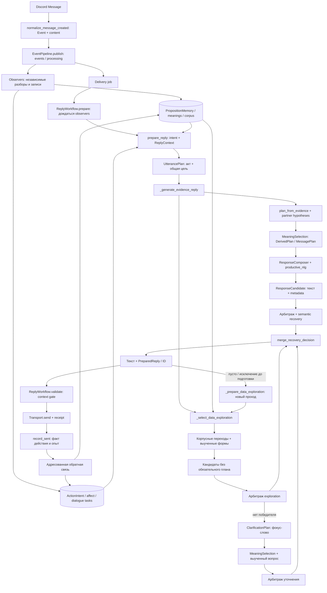

# DEBiLGI: сквозная смысловая нить — архитектурный анализ

Дата: 14.11.2026. Worktree: `/workspace/DEBiLGI-codex`, ветка `codex/seed-structure-learning`, HEAD `7d3967179f818f7d9af5ac665038cc3a5fa9f245` плюс незакоммиченные задачи 1–2. Номера строк относятся **к текущим файлам worktree**, а не к HEAD. Пути ниже относительны корню worktree.

Исходники, тесты, миграции, конфиг и `SEED_STRUCTURE_LEARNING_REPORT.md` не изменялись. Запущены только автономные пробы; новая рабочая БД — `.codex_work/task3_probe.sqlite3`. Исходные БД открывались через SQLite `mode=ro` и копировались `backup`. Discord не подключался, отправок и реальных наград в пробе нет. `/workspace/DEBiLGI` не использовался; commit/push не выполнялись.

## 1. Вывод

Гипотеза подтверждается с существенным уточнением: **в проекте уже есть рабочий фрагмент «что сказать → как выразить», но он не является обязательным контрактом всего ответа**. `DerivedPlan → MessagePlan → ClauseThought → ResponseComposer` сохраняет посылки и роли. Его обходят корпусная генерация, отдельная генерация социальных форм и восстановление через уточнение. Объединение происходит поздно, через текст кандидата, metadata и баллы.

Три наблюдаемых режима — последствия одного недостатка контракта:

1. Корпусные переходы самостоятельно выбирают слова и тем самым содержание; смысл проверяется постфактум → бессмыслица среди кандидатов.
2. Защиты задач 1–2 отклоняют неподтверждённое содержание → пустой пул допустимых ответов.
3. Нехватка собственного факта трактуется как неясность намерения пользователя → выученное «В смысле “X”?». В текущей пробе это 10/12.

Нужна не замена всех модулей, а обязательная граница: **операция над памятью выбирает проверяемое содержание; реализация меняет только выражение; арбитраж сравнивает выражения одного допустимого плана**. Численная уверенность не заменяет источник факта. Отсутствие факта, неоднозначность разбора и ошибка реализации — разные состояния, которым сейчас часто достаётся один recovery.

## 2. Текущий поток: от Discord до подтверждённой отправки

### 2.1. Карта вызовов и объектов

| Переход | Место | Что реально передаётся |
|---|---|---|
| Вход Discord → нормализация | `src/debilgi/discord/events.py:34`, `:53`; `src/debilgi/events/normalizer.py:14` (`normalize_message_created`) | Discord Message → `Event`: ID автора/канала, время, payload с **content:str**, reply-связью, признаками бота и обращения. Смыслового объекта пока нет. |
| Запись → observers | `src/debilgi/events/pipeline.py:86` (`publish`), `:119` (`_worker`); регистрация — `src/debilgi/discord/bot.py:406` | Один `Event` последовательно передаётся обработчикам; каждый сам разбирает текст и пишет свою память. Возвращаемый общий семантический результат между observers не передаётся. |
| Обучение/память входа | `src/debilgi/discord/bot.py:413`, `:417`, `:418`, `:420`, `:430` | `meaning_intents.observe`; discourse; `dialogue_learning.observe`; `proposition_memory.observe`; cognitive core. Это несколько представлений одного события, связанных в основном ID. |
| Выбор намерения действия | `src/debilgi/cognition/core.py:90`, `:143`; `src/debilgi/discord/replies.py:929` | `ActionIntent`: тип действия, цель-гипотеза, evidence IDs, confidence, внутренние численные признаки. Это ещё не содержание реплики. При отсутствии intent в meaning-first создаётся `_direct_reply_intent`, `replies.py:1667`, с `respond_to_observed_message`. |
| Задание доставки → подготовка | `migrations/046_reply_delivery.sql:18`; `src/debilgi/discord/delivery_repository.py:50`; `src/debilgi/discord/delivery.py:131`; `src/debilgi/discord/reply_workflow.py:24` | SQL-триггер после вставки подходящего Event создаёт delivery job; worker выбирает его и загружает исходный `Event`; ожидание обработки до 5 секунд; выбор bound/direct/initiative. В meaning-first bound-обходы выключены проверками `replies.py:1172`, `:1193`. |
| Намерение → общий план акта | `src/debilgi/discord/replies.py:955`, `:974`; `src/debilgi/language/planning.py:100`, `:115` | `StructuredThought(action_type, objective:str, confidence, evidence)` + `ReplyContext` → `UtterancePlan(speech_act, max_tokens, thought, context)`. Конкретной пропозиции в `StructuredThought` нет. |
| Сбор контекста | `src/debilgi/discord/replies.py:1364`, `:1400`, `:1560` | Память/знания/реакции/личность → `ReplyContext`. Большинство фактов — строки; есть также assertion memory, dialogue state, dependency patterns, affect features и dialogue situation. |
| Meaning-first dispatch | `src/debilgi/discord/replies.py:1618`, `:2232` | `Event + UtterancePlan` → `_generate_evidence_reply`. Старый `_generate_arbitrated` тоже немедленно уходит сюда при meaning-first (`:2897`). |
| Дополнение контекста | `src/debilgi/discord/replies.py:2242`, `:2278` | Из БД: `MeaningRecord`, `BoundDialogueReport`, но также `(event_id, text)`, n-граммы, word relations, строки `user:/agent:`. Всё складывается в общий `ReplyContext`. |
| Получение смысловых вариантов | `src/debilgi/discord/replies.py:2299`, `:2307`; `src/debilgi/language/generative_planner.py:604` | `PlanningResult(objective, proposals, evidence, unresolved)`; proposal = `DerivedPlan(MessagePlan, operation, SemanticEvidence[])`. Отдельно — `InterlocutorHypothesis[]` и узкие `grounded_agent_plans`. |
| Выбор смыслового намерения | `src/debilgi/discord/replies.py:2354`, `:2366`; `src/debilgi/experience/meaning_intents.py:78` | Планы → `MeaningSelection`; выбранный план сохраняется в `language_meaning_intentions.plan_json` **до реализации**. Это правильная граница для дальнейшей перестройки. |
| План → поверхность | `src/debilgi/discord/replies.py:2439`; `src/debilgi/language/communication.py:348`, `:369`; `src/debilgi/language/productive_nlg.py:435` | `MessagePlan + DependencyPattern[]` → `ProductiveSurface[]`. Морфология реализует роли и согласование; composer частично проверяет сохранность смысла. |
| Поверхность → кандидат | `src/debilgi/discord/replies.py:2453`; `src/debilgi/language/arbitration.py:96` | `ResponseCandidate` (алиас `SurfaceCandidate`): **text**, source, confidence, metadata с plan/key/premises. В вызове нет обязательного типизированного `MessagePlan`. |
| Первый арбитраж + recovery | `src/debilgi/discord/replies.py:2574`, `:2584` | Кандидаты → `ArbitrationDecision`; при отсутствии победителя — `_semantic_recovery_candidates`, `:2138`. |
| Параллельный по смыслу корпусный путь | `src/debilgi/discord/replies.py:2634`, `:1841`, `:1887` | `UtterancePlan` → `MemoryPhraseGenerator.generate_explorations` → тексты из переходов/отношений; плюс `forms_for → realize_observed_form` (`:2008`). Смысловой план для этих текстов заранее не выбран. |
| Уточнение после отказа | `src/debilgi/discord/replies.py:2044`, `:2063` | Если exploration не дал победителя, выбирается `ClarificationPlan` с упоминанием слова текущего ввода; создаётся отдельное meaning intention; затем текст и арбитраж. |
| Слияние решений | `src/debilgi/discord/replies.py:2640`; `src/debilgi/language/arbitration.py:349` | `ArbitrationDecision + recovery/exploration decision` → победитель. Exploration может заменить semantic recovery; хороший основной semantic answer сохраняется. |
| Возврат результата | `src/debilgi/discord/replies.py:2684`, `:1036` | Наружу генератор возвращает **str**; решение переносится боковым словарём `_arbitration_decisions`. `PreparedReply` хранит текст и ID, но не обязательный план/доказательство (`src/debilgi/experience/models.py:14`). |
| Внешний recovery | `src/debilgi/discord/replies.py:822`, `:894`, `:1685` | Пустой результат/исключение → новый облегчённый `ReplyContext`, повторный поиск semantic/exploration. Это ограниченные повторные проходы, но не переформулирование сохранённого плана. |
| Последняя проверка → отправка | `src/debilgi/discord/reply_workflow.py:129`; `src/debilgi/discord/delivery.py:169`, `:178` | `PreparedReply.text` → context gate → транспорт. Для `arbitrated:*` gate сразу доверяет арбитражу (`src/debilgi/language/context_gate.py:231`). Семантического round-trip на этой границе нет. |
| Подтверждение → опыт | `src/debilgi/discord/reply_workflow.py:182`, `:204`; `src/debilgi/discord/replies.py:1262` | После receipt: record task attempt, meaning intention sent, arbitration sent, outgoing context, experience/self dataset. Только последующая адресованная реакция может дать meaning reward. |

### 2.2. Mermaid: фактический meaning-first путь



Это диаграмма ветвей, а не обещание параллельного выполнения: exploration вызывается последовательно даже при уже существующем semantic winner.

## 3. Что есть для каждого из шести целевых шагов

### Шаг 1. Сообщение → смысловая структура: полезное ядро, неполное покрытие

Уже есть:

- `src/debilgi/language/morphology.py:245`, `:349`, `:651`: pymorphy3, альтернативы разборов, контекстное ранжирование, инфлексия; `:711`, `:745` — управление и согласование.
- `src/debilgi/language/structured_utterance.py:158`, `:182`, `:193`: `ClauseFrame`, `StructuredUtterance`, роли, отрицание, modal lemmas, вопрос/команда, неявный субъект, связи клауз и неоднозначности. `valency.py` добавляет ограничения аргументов.
- `src/debilgi/language/semantic_graph.py:127`: `parse_proposition`; `generative_planner.py:196`: другой консервативный `statement_thought`. `sentence_understanding.py:119` — ещё один слой понимания и отношений.
- `entities.py`, `dialogue_state.py`, `dialogue_obligations.py` — участники, ссылки, эллиптические ответы; есть точечные успешные тесты переноса и связывания.

Используется активно, но **единый результат не переносится сквозь pipeline**: одни и те же строки повторно разбираются в observers, planner, composer, scorer. Разбор proposition — производная проекция с потерями. `parse_proposition` принимает простую одиночную клаузу; отбрасывает цитирование, несколько финитных глаголов и неподдержанную вложенную область отрицания (`semantic_graph.py:135`, `:146`, `:148`, `:205`). Это разумная консервативность, но не универсальный русский синтаксис.

Проба парсера:

| Ввод | Полученный результат | Последствие |
|---|---|---|
| `как дела` | question, `elliptical=True`, confidence ≈0.26; predicate=None; objective slot/how, topic=`дело` | Нет нормализованного социального запроса о состоянии агента. |
| `привет, расскажи о себе` | Предлог `о` и complement topic есть в frame, но objective topics=`привет` | На стыке frame → цель рефлексивный адресат теряется, приветствие становится предметом рассказа. |
| `объясни, почему небо голубое` | Первая клауза — command `объяснить`; вторая — fragment без предиката; objective question_word=None | Теряется вложенная причинная задача; recovery уточняет глагол команды. |
| `я сегодня работал весь день` | `день` становится direct_object | Длительность представлена как пациенс; дальнейшее «сохранение роли» уже охраняет ошибку разбора. |
| `мне нравится рисовать` | Есть indirect_object и action_complement, нет subject | Консервативный proposition-конвертер не всегда может превратить это в сохраняемый факт о предпочтении человека. |

Морфологическое время глагола есть, но календарного интервала события, привязанного к времени сообщения, в общем IR нет. `ConceptLexeme` хранит `entity_kind`, но **не entity_id** (`productive_nlg.py:61`); простая замена `я↔ты` — не стабильная идентичность участника. В `TokenInterpretation` entity_id уже есть: его нужно сохранять при проекциях.

Отдельное ограничение цели «без нейросетей»: `src/debilgi/language/syntax_backend.py:23` содержит необязательный **нейросетевой Slovnet/Navec**. Он выключен по умолчанию (`config.py:65`). Целевая архитектура и приведённые автономные разборы на него не опираются; включать его как способ исправить этот этап нельзя при заданном ограничении.

### Шаг 2. Структура → граф фактов: память есть, общего графа с временной истинностью нет

`PropositionMemory.observe` (`src/debilgi/language/proposition_memory.py:45`) пишет три разных вида материала:

1. Язык: n-граммы и словесные отношения (`:59`, `:60`, `:358`, `:399`). Это доказательства употребления, не истинности содержания.
2. Reports: `language_proposition_reports` + terms, **текст** с автором/событием/временем (`:69`, `:100`). Изолированные относительные даты и третьи лица пропускаются (`:78`). `relevant_reports` возвращает `(source_event_id, text)` (`:178`).
3. `language_meaning_records`: JSON `MeaningRecord(premises, conclusions)` с `ClauseThought` (`:119`; схема `migrations/054_semantic_meaning_graph.sql`). Это уже символическая память с происхождением, не просто bag of words.

`semantic_graph.py:543` действительно делает ограниченный вывод по фактам/условиям/определениям с proof provenance и обработкой противоречий. Ограничения — до пяти раундов, 256 правил, 64 промежуточных подстановок и 128 proofs (`:561`, `:569`, `:580`, `:604`). Здесь нет бесконечной логической рекурсии.

Работоспособность подтверждается существующими тестами сохранения после restart/redaction и замены полярности (`tests/integration/test_proposition_memory.py:28`, `:65`). Но это не общий граф мира и собственного опыта:

- Выборка `learned_meanings` ограничена текущими guild/channel/**speaker**, 256 записями; факты старше часа исключаются, contextual propositions фильтруются (`proposition_memory.py:141`). Исторические текстовые reports при этом живут отдельным путём. Одна временная модель для всех фактов отсутствует.
- Наблюдатель пропускает bot-authored события (`:48`): полезная защита от самообучения, но отдельного канала доверенных операционных фактов агента почти нет.
- `MeaningRecord` не имеет отдельного epistemic status и valid-time (`semantic_graph.py:61`). Уверенность находится внутри thoughts; «человек утверждает P» и «P проверено» не разделены универсальным типом.
- Pronoun perspective зашита в лексемы (`semantic_graph.py:92`), а автор существует снаружи JSON, в SQL scope. Это мешает безопасным запросам сразу о нескольких людях.

Переиспользовать хранение событий, извлечение простых пропозиций, proofs и миграции памяти. Нормализовать адресацию сущностей, источники, статус знания и valid-time; не объявлять n-граммы графом фактов.

### Шаг 3. Намерение → операция над графом: частично реализовано

Есть три разных «намерения», которые важно не смешивать:

- `ActionIntent` cognitive core — выбрать действие/адресата на основании состояния и ожиданий.
- `InterlocutorHypothesis` — описательная гипотеза, какого изменения разговора ждёт человек; обучается по наблюдаемым парам и продолжениям (`interlocutor_intent.py:204`, `:230`, `:285`). Это статистический вывод из response signatures, не готовая операция запроса к фактам.
- `MeaningSelection` — выбрать собственный `DerivedPlan` по атрибутированным последствиям своих действий (`experience/meaning_intents.py:78`). Это ценностная политика над уже предложенными смыслами.

`plan_from_evidence` уже содержит операции retrieve, integrate user answer, продолжение, запрос недостающего отношения, capability/relation/task resolution и вывод из meaning graph (`generative_planner.py:604`, `:705`, `:783`, `:945`, `:971`). Это следует развивать, а не заменять таблицей «на вопрос X ответить Y».

Но `DialogueObjective` и `reader_goal` сжаты до kind/predicate/question_word/topics/known_roles (`generative_planner.py:102`; `communication.py:56`). Типизированного `Query(subject=agent_id, relation=activity, time=now)` нет. Самосообщение добывается только узким `grounded_agent_plans` (`interlocutor_intent.py:364`): последнее подтверждённое action за минуту в той же паре user/channel либо learned goal, плюс сходная корпусная сигнатура. Ни библиотеку прочитанного, ни предметное предпочтение этот мост не запрашивает.

`MeaningIntentRepository` правильно отделяет подготовку от отправки и информацию от награды. Но на холодном опыте выбор между допустимыми proposals идёт по детерминированному hash tie (`meaning_intents.py:179`). Нет первичного приоритета «выполнить понятный запрос фактом, затем оценить полезность опыта». В пробе на дождь выбирается исследовательский вопрос; это осмысленный план вопроса, но не содержательное объяснение.

### Шаг 4. Конкретные факты + роль ответа: лучший готовый фундамент

`ClauseThought` (`productive_nlg.py:85`), `MessagePlan` (`communication.py:112`), `SemanticEvidence` и `DerivedPlan` (`generative_planner.py:110`, `:118`) дают нужную основу: claim, reason, condition, follow-up, additional claims, operation, premises, evidence, answer shape. `MessagePlan.key` позволяет связать план, реализацию и последствия.

Есть ещё несколько конкурирующих типов:

- `ResponseMeaningPlan` (`meaning_plan.py:107`) с propositions, discourse links, response moves. Он строится **из строк exact_answer/required_facts с повторным разбором** (`:129`, `:137`, `:149`). Его основной вызов в старом большом `_generate_arbitrated`; текущий meaning-first проходит ранний return `replies.py:2897` и этим планом не пользуется.
- `ResponseContentPlan`/`ContentProposal` отделяют содержание от поверхности номинально, но `SurfaceCandidate.create` по умолчанию создаёт content plan с `clauses=()` (`arbitration.py:137`).
- `SemanticReplyPlan` (`semantic_reply_plan.py:76`) обслуживает специальное семантическое уточнение; его validator проверяет элементы уточнения, а не произвольный граф ответа (`:338`).
- `StructuredThought` в `UtterancePlan` — только общая цель действия. Название «meaning-level utterance plan» в трассе ещё не означает, что выбран факт.

Следует сделать **один** канонический ответный план на основе `MessagePlan`, а остальные типы временно подключить адаптерами. Не добавлять пятый конкурирующий план с теми же полями.

### Шаг 5. План → текст: продуктивная морфология уже работает

`productive_nlg.realize_thought` (`:435`) проверяет valency, выбирает разрешённый порядок ролей, согласует глагол с субъектом (`:711`) и реализует падежи. `ResponseComposer.realize` (`communication.py:369`) выражает claim/reason/condition, сохраняет запись исходного плана и результаты проверок.

`DialogueStructureLearning` (`dialogue_learning.py:115`) теперь подключён после discourse observer, обучает роли и грамматику из человеческих событий до генерации ответа (`:151`, `:167`). `SemanticAssimilation.observe_local_structure` (`semantic_assimilation.py:346`) сохраняет продуктивные конструкции. `realize_observed_form` не заполняет открытые содержательные слоты биографией корпуса (`dialogue_learning.py:274`). Это полезные механизмы обучения форме.

Нарушение архитектуры — `MemoryPhraseGenerator.generate_explorations` (`memory_based.py:117`): он получает общий контекст и выбирает последовательность **содержательных слов**, а не порядок уже выбранных аргументов. Варианты ответов могут ранжироваться частотами (`:159`); обычные предложения растут из n-грамм и relations (`:193`, `:327`). Отсутствие ручной реплики не делает этот путь meaning-first.

Корпусную модель надо понизить до стилистического ранжирования готовых, проверенных выражений плана. Она может выбирать порядок, регистр, засвидетельствованную форму приветствия, но не новый объект/предикат/оценку/истину ответа. Лексическую замену разрешать только при доказанной эквивалентности смысла.

### Шаг 6. Повторный разбор → сверка с планом: есть частичная проверка, общего обязательства нет

Нельзя утверждать, что обратной проверки совсем нет:

- `communication.surface_issues` (`:220`) повторно разбирает текст, проверяет наличие голов, пропажу предиката, отрицание, явную перестановку агенса/объекта. Composer вызывает его для компонентов (`:445`).
- `facts.covers_structured_fact` (`facts.py:68`) проверяет роли/полярность required facts, но допускает текстовое включение (`:73`) и лексический fallback (`:105`).
- `surface_coherence.evaluate_surface` (`:44`) и `_morphological_issues` (`:309`) проверяют грамматику; после задач 1–2 важны лицо/число/род, управление, условное «бы».

Однако `surface_issues` — проверка части противопоказаний, а не эквивалентности графов. Подробная проба ниже. Нет обязательного отказа за дополнительные неподтверждённые утверждения, смену времени/модальности/речевого акта; нет общего переноса проверки на последний отправляемый текст. Уточнение из `realize_clarification` проверяется surface coherence (`interlocutor_intent.py:597`), не эквивалентностью его `MessagePlan`.

Если composer не выразил мысль, он возвращает `()`/пропускает вариант (`communication.py:379`, `:429`, `:451`); `replies.py:2584` и `:2634` переключаются на другие источники. Это замена содержания после неудачи выражения, а не обязательная переформулировка исходного смысла.

## 4. Точные разрывы смысловой нити

| № | Где | Что теряется/подменяется | Наблюдение или проверяемый эффект |
|---|---|---|---|
| R1 | `planning.py:100`, `:115`; `replies.py:974` | Смысл ответа подменяется типом действия и строкой objective | `respond_to_observed_message` ещё не содержит ни факта, ни адресованного вопросного слота. Содержательная генерация начинается позже. |
| R2 | `proposition_memory.py:178`, `:315`; `replies.py:1574`, `:2290`; `generative_planner.py:738` | Структура/источник превращаются в текст и повторно разбираются; raw corpus со `speaker_only=True` добавляется в `proposition_reports` | Метка `(event_id,text)` не сообщает, что это факт, вопрос, цитата или языковой пример. Консервативный reparsing частично защищает, но не восстанавливает потерянный epistemic status. |
| R3 | `communication.py:56`, `:82`; `generative_planner.py:139` | Полный frame с вложенными/рефлексивными связями сжимается до цели и тем | «Расскажи о себе» получает тему `привет`; причинный вопрос про небо получает predicate=`объяснить`, question_word=None. |
| R4 | `interlocutor_intent.py:329`; `replies.py:2082` | Статистическая уверенность гипотезы превращается в диагноз непонимания | **Для observed-only confidence ≤0.64, а порог «неясно» — 0.65.** Даже идеальное сходство корпусного опыта не преодолевает этот порог. Это не доказывает, что пользователь выразился неясно. |
| R5 | `replies.py:1861`, `:1865` | Любая достаточно похожая self-directed гипотеза становится общим запретом корпусных реплик | На «как дела» лучший кластер self_directed=false, confidence≈0.615, similarity=1; другая гипотеза self_directed=true с confidence≈0.492, similarity=1 отсекает все 9 корпусных кандидатов. Запрет чужого самосообщения нужен, но факт о собственном состоянии вместо него не запрашивается. |
| R6 | `replies.py:1887`, `:1907`; `memory_based.py:327` | Нет плана → содержание выбирается статистикой | В трассе запроса о голубом небе есть кандидат «Объясни, а ты в бассейн который под открытым небом на небоскребе.» Он правильно отклонён как `ungrounded_corpus_topic`/`dialogue_task_not_advanced`, но был создан без исходного факта. |
| R7 | `replies.py:2044`, `:2082`; `interlocutor_intent.py:505`, `:521`, `:545` | «Не могу обосновать ответ» заменяется «не понял слово пользователя» | Фокус берётся по приоритету синтаксической роли и позиции, а не по конкурирующим значениям или missing slot. «Как дела» → `дела`; «объясни…» → `объясни`. `reason` попадает в план-обёртку, но не определяет полезный уточняемый аргумент. |
| R8 | `dialogue_tasks.py:509`; `arbitration.py:894`, `:908`, `:916` | Полезность/заземление подменяются metadata, пересечением слов и числом | Repair с corpus evidence и фокусом получает progress=0.62. Любое reasoning evidence + locally composed + topical bound может дать статус `grounded_answer`. В probe так помечены все десять «В смысле…?». Источник формы подтверждает форму, но не недостаток понимания. |
| R9 | `replies.py:2453`; `arbitration.py:137`, `:475`, `:503` | Типизированный MessagePlan превращается в необязательные metadata и пустой content plan | Content scores вычисляются, но победитель выбирается из scored surfaces; `selected_proposal_ids` не ограничивает этот пул. Metadata с правильным планом есть у части producers, но это не обязательство типов. |
| R10 | `communication.py:220`, `:283`, `:289`; `replies.py:2684`, `:1036` | Частичная проверка становится предположением полной сохранности; дальше передаётся str | Смена времени, модальности и добавленное место проходят probe без issues. `PreparedReply` не требует inverse-validation receipt. |
| R11 | `context_gate.py:231`; `reply_workflow.py:172` | Последний gate доверяет source label; на других путях способен заменить текст без нового смыслового плана | Для текущих arbitrated-ответов replacement не является причиной проблемы — они проходят как pre-scored. Но граница отправки всё равно не доказывает совпадение с планом. |
| R12 | `meaning_intents.py:241`, `:379`; `interlocutor_intent.py:375` | Разнообразие собственной деятельности сужено до одного action `отвечать`, одной минуты и текущей пары | Память поиска, чтения, обучения и тем не входит в self query. Приветствие без meaning_intention_id тоже не попадает в этот мост (`replies.py:1279`). |

### 4.1. Воспроизведённая проба

Запущен существующий runner задачи 2 на **новой backup-копии** чистого сидинга 300 диалогов:

```bash
PYTHONDONTWRITEBYTECODE=1 PYTHONPATH=.codex_work/asyncio_poll:src \
  DEBILGI_MEANING_FIRST_REPLIES=true DEBILGI_TEST_REPLIES=true \
  DEBILGI_SEMANTIC_CONSULTANT_ENABLED=false \
  .venv/bin/python -u .codex_work/task2_probe.py \
  .codex_work/task2_seed_300.sqlite3 .codex_work/task3_probe.sqlite3 \
  .codex_work/task3_probe.json > .codex_work/task3_probe.log 2>&1

PYTHONDONTWRITEBYTECODE=1 PYTHONPATH=src \
  .venv/bin/python .codex_work/task3_audit.py
```

`asyncio_poll` — уже существующая локальная поддержка проб из задачи 1; приложение и зависимости в этом анализе не патчились. Seed harness запускает pipeline, но не Discord delivery и не фоновые runtime workers. Данные этого эксперимента не доказывают работу/остановку production background loop.

| Вход | Подготовленный ответ | Происхождение |
|---|---|---|
| ку бро | Привет. | learned_dialogue_structure |
| о чем думаешь | В смысле «думаешь»? | interlocutor_clarification |
| как дела | В смысле «дела»? | interlocutor_clarification |
| чем занимаешься? | В смысле «занимаешься»? | interlocutor_clarification |
| ты любишь собак? | В смысле «собак»? | interlocutor_clarification |
| я сегодня работал весь день | В смысле «работал»? | interlocutor_clarification |
| привет, расскажи о себе | В смысле «расскажи»? | interlocutor_clarification |
| что ты сейчас делаешь? | В смысле «делаешь»? | interlocutor_clarification |
| мне нравится рисовать | В смысле «рисовать»? | interlocutor_clarification |
| какие книги ты читаешь? | В смысле «книги»? | interlocutor_clarification |
| сегодня идёт дождь | Почему дождь идёт сегодня? | semantic_reasoning |
| объясни, почему небо голубое | В смысле «объясни»? | interlocutor_clarification |

Все 12 текстов совпали с `.codex_work/task2_final_probe.json`. Исключения=0, удержания=0, уточнения=83.3%; median подготовки=3.359 с, max=4.421 с. Это локальная скорость данного runner, не сетевой SLA. По ручной классификации: один успешный социальный акт, один исследовательский вопрос, **ни одного прямого информативного ответа на содержательный запрос**. Нулевое удержание само по себе не является метрикой решения задачи.

Трасса `discord:message:1999000000000000002` («как дела»):

1. Objective=`slot`, predicate=None, question_word=`как`, topics=[`дело`].
2. Основных proposals=0; grounded_agent_plans=0; learned_goals=[].
3. Девять corpus candidates отвергнуты с `interlocutor_requests_ungrounded_agent_state`.
4. Recovery reason=`interlocutor_intent_uncertain`; выбран mention-конструктор.
5. «В смысле “дела”?»: total≈0.656, answer_status=`grounded_answer`, rejection_reasons=[]. Это механическая допустимость кандидата, не ответ о состоянии.

Для `discord:message:1999000000000000011` («объясни…») гипотез нет, proposals нет; отклонены корпусные склейки; выбран focus=`объясни`, total≈0.649. Для «дождь» основной planner имеет `continue_from_memory` и `query_unobserved_relation`; выбран второй, хотя это вопрос к собеседнику. Exploration всё равно выполняется и подготавливает ещё одно, невыбранное уточнение.

В итоговой копии: 12 traces со статусом `started`, 13 intentions со статусом `prepared`, 0 sent intentions. Именно этого и следует ожидать: runner вызывает `prepare`, но не `validate`/`record_sent`. Поэтому он **не расходует бюджет уточнений по отправкам** и не проверяет end-to-end доставку. Нельзя записывать эти 10 повторений как 10 реальных последовательных уточнений одному пользователю или как награждённый опыт.

### 4.2. Проба обратной проверки

Взята пропозиция `parse_proposition('Я читал книгу.', perspective='agent')`; вызван существующий `communication.surface_issues` с изменёнными поверхностями. Код и полный разбор — `.codex_work/task3_audit.py`, результаты — `.codex_work/task3_audit.json`.

| Проверяемый текст | Изменение к плану | Результат surface_issues |
|---|---|---|
| Я читал книгу. | Нет | `()` |
| Я читаю книгу. | past → present | `()` — пропущено |
| Я читал книгу в Москве. | Новое неподтверждённое место | `()` — пропущено |
| Я читал книгу? | statement → question | `()` — пропущено |
| Я могу читать книгу. | Деятельность → способность | `()` — пропущено |
| Я не читал книгу. | Смена отрицания | `changed_negation` — обнаружено |
| Ты читал книгу. | Смена участника | `missing_subject` — обнаружено |

Это изолированная проверка **конкретного validator**, а не утверждение, что все такие фразы обязательно будут отправлены: поверх него действуют другие фильтры. Она доказывает, что текущий reader check недостаточен как сертификат смысловой эквивалентности.

## 5. Модель «я»: что отсутствует и что уже можно заземлить

### 5.1. Почему существующего «я» недостаточно

Фраза «модели я нет» буквально неверна. `cognition_self_models` и `SelfModel` есть (`migrations/007_autonomous_self_model.sql`; `src/debilgi/experience/models.py:62`; `experience/repository.py:175`, `:212`). Но модель хранит counts, average_reward, efficacy и успешность инициатив. Её читает autonomy policy (`autonomy/policy.py:54`), а не общий запрос фактов о деятельности. Это статистика поведения, не автобиографическая память.

Есть и `self_state_reasoning`, `runtime_state_reasoning`, `personal_action_reasoning`, `preference_reasoning`, personality perspective. Их большой набор вызовов находится за старой ветвью `_generate_arbitrated` (`replies.py:3606`, `:3616`, `:3633`), которую meaning-first обходит ранним return (`:2897`). Они не полностью мёртвые для проекта, но не образуют self memory текущего пути. Некоторые ответы о внутреннем состоянии строятся из предпосылок вроде `active_conversation`/`engagement_state`, а не из измеренной истории (`self_state_reasoning.py:214`). Переносить эти ветки целиком в meaning-first нельзя.

Исключения, уже действующие в meaning-first: `_semantic_recovery_candidates` получает `identity_thought` из gateway identity (`replies.py:2157`) и `affective_stances` из текущих ролей, affect/personality (`:2191`). Поэтому имя/роль агента и отдельная реактивная позиция иногда могут быть выражены без общего графа «я». Это локальные поставщики содержания; их тоже следует перевести в общие claims/plans, а не терять при удалении recovery.

Текущий живой мост `MeaningIntentRepository.record_sent` создаёт реальный операционный факт `я → отвечать → тебе` после receipt (`meaning_intents.py:239`). Это правильное заземление, но:

- Один предикат для всех смысловых действий; нет темы, объекта чтения, факта обучения или результата поиска.
- Регистрируется лишь при наличии `meaning_intention_id` (`replies.py:1279`), а у приветствия/распределительного пути его нет.
- `grounded_agent_plans` запрашивает только эту пару user/channel и последнюю минуту. Он также принимает learned goals и принудительно ставит present (`interlocutor_intent.py:384`, `:408`): **цель сама по себе не подтверждает текущее выполнение**. В текущей пустой по опыту пробе это не проявилось, но в перестройке нужно разделить desired/planned/active/completed.
- `learned_goals` усредняет ненулевые награды действий и возвращает последнее action как один положительно оценённый goal (`meaning_intents.py:379`, `:397`). Это не предметное предпочтение к собаке, книге или рисованию.

### 5.2. Фактическое наполнение seed-БД

Read-only снимок `.codex_work/task2_seed_300.sqlite3` перед probe:

| Данные | Число | Что это доказывает |
|---|---:|---|
| events | 5938 | Только человеческий seed: 2325 MESSAGE_CREATED + 3613 MESSAGE_REPLIED. |
| language_meaning_records / proposition_reports / dialogue_reports | 844 / 596 / 0 | Извлечение фактов работает выборочно; число реплик не равно числу пригодных фактов. |
| language_generation_ngrams / observed_exchanges | 56333 / 3566 | Формы и переходы выучены (счётчики также в отчёте задачи 2). |
| cognition_action_intents | 5938 | Shadow-намерения по входам, **не совершённые действия**. |
| cognition_internal_states / affect_observations / affect_moods | 600 / 5938 / 1 | Рассчитанные внутренние состояния; не автобиография и не доказательство любви/настроения человека. |
| continuous_cognition_work_items | 5938 | Работа поставлена в очередь; это не доказательство, что она выполнена. |
| cognition_self_models / language_utterance_experiences | 0 / 0 | Подтверждённых собственных обменов для этой модели нет. |
| language_meaning_intentions / meaning_consequences | 0 / 0 | Собственный ценностный опыт не создан корпусом — правильно. |
| knowledge_queries / knowledge_concepts / reference_lookups | 0 / 0 / 0 | В этой БД нельзя обосновать «я прочитал статью/книгу» данными поиска. |
| cognition_reflections / background_cycle_runs / reply_delivery_jobs | 0 / 0 / 0 | Эти источники в конкретном offline seed ещё ничего не дают. |

После 12 входов новой пробы meaning_records=846, proposition_reports=596, self_models=0. Наличие 600 внутренних состояний не компенсирует отсутствие собственных фактов, пригодных для ответов.

### 5.3. Источники реальной деятельности и допустимая семантика

| Существующий источник и место записи | Во что можно преобразовать | Что выводить нельзя |
|---|---|---|
| `events`, discourse turns; `discord/events.py:53`, `language/dialogue_learning.py:124` | «наблюдал/обработал сообщение о T»; live/seed/import обязательно разделять по source; собеседник и время — ID | Корпусный персонаж «я» не становится агентом; импорт не означает живой разговор с автором. |
| Delivery receipt + `language_meaning_intentions`, `reply_delivery_jobs`, traces; `discord/delivery.py:182`, `reply_workflow.py:182` | Отправил ответ пользователю U о T, спросил аргумент, подтвердил получение; дата, plan ID, ответный message ID | Prepared/retry/sending/uncertain не означают подтверждённую отправку. |
| `language_meaning_consequences`, arbitration/assertion feedback; `meaning_intents.py:274`, `:334` | Пользователь отверг/подтвердил конкретный ответ; получена требуемая информация | Ответ на вопрос — не награда за вопрос; молчание — не dislike; реакция на стиль не доказывает истинность утверждения. |
| `knowledge_queries`, `knowledge_concepts`, `language_reference_lookups`; `knowledge/service.py:144`, `:370`, `:543` | Запросил/получил источник, извлёк конкретные сведения о T; URL/query/completed_at | Pending — не чтение. Получение extract — не прочтение целой книги. `internalize_consulted_fact` может иметь внешнее происхождение; в режиме без нейросетей такие источники нельзя незаметно использовать как разрешённые. |
| `language_productive_constructions`, lesson evidence; `semantic_assimilation.py:346` | По событию E выучил/обновил конструкцию C; обучение форме с provenance | Из грамматического урока нельзя вывести убеждение агента или предметную симпатию. |
| `continuous_cognition_work_items/pulses/runtime`; `cognition/continuous.py:120`, `:158` | Задача queued/processing/completed, heartbeat и текущая обработка темы | Очередь в seed harness — не активная мысль. Факт «обдумываю T» требует статуса выполнения и свежести. |
| `affect_*`, `social_reactions`; `cognition/affect.py:89`; `replies.py:1367` | Измеренный внутренний аффективный отклик, scope и число наблюдений; возможный источник собственного ограниченного самоописания | Одно число или label — не наблюдение физической усталости, человеческих чувств или любви к теме. Сейчас affect в основном влияет на стиль/политику через features. |
| `language_utterance_experiences`, reflections, self_models; `experience/consolidation.py:34`, `:134`; `reflection/engine.py:42` | История результата своих действий и калибровки прогнозов | В старом experience-пути есть nearest-pending attribution (`consolidation.py:81`) и ignored_reward=-0.18 (`:18`, `:123`). Такие оценки нельзя автоматически переносить в строгие предпочтения нового meaning-пути. |
| `cognition_expectations/difference_vectors`, internal states; `cognition/core.py:90` | Ожидал исход O, получил O′, разность d; изменил уверенность | Surprise/efficacy не равны истинности мирового факта или оценке предмета пользователем. |

Содержательное «я» должно быть проекцией этих источников с действительным субъектом **agent_id**, а не списком зашитых биографических утверждений. Для стартового наполнения достаточно реальных обработанных событий, завершённых операций и receipt. Но рост телеметрии сам по себе не даёт права говорить на пустом языковом опыте: нужен отдельный gate компетенции реализации.

## 6. Целевой контракт и минимальная перестройка

### 6.1. Один носитель смысла

«Один и тот же объект» следует понимать как один типизированный контекст с неизменными ID и доказательными переходами, а не как повтор входной пропозиции в ответе. Вход «я работал» и ответ о реакции/вопросе имеют разные пропозиции; связь должна быть явной.

Предлагаемый контракт (названия рабочие):

```text
MeaningTurn
  turn_id, parser_version, graph_snapshot_at, participants{speaker, addressee, agent}
  input: ParsedMeaning[] + alternatives + unresolved_slots
  updates: GraphDelta[claim IDs / attribution / valid-time / evidence IDs]
  request: IntentQuery(operation, target entity, requested relation/slot, constraints)
  result: Known(claim IDs, proof) | Unknown(query receipt) | Ambiguous(alternatives)
  reply: MessagePlan(act, claims, reason, missing-slot question, provenance)
  surfaces: [text, same plan_id, inverse_parse, validation receipt]
  delivery: prepared / sent receipt / failed / uncertain
```

Это оболочка над существующими `StructuredUtterance`, `DerivedPlan`, `MessagePlan`, а не альтернативный парсер или ещё один независимый reply planner. Инварианты:

- `EntityRef(id)` отделён от формы «я/ты/он»; perspective меняется только в realization.
- Смысловое время/интервал, отрицание, модальность и её scope, речевой акт и источник — обязательные поля, а не необязательная metadata.
- `Known` требует proof с допустимыми источниками; `Unknown` содержит выполненный запрос, его scope и момент снимка. Нет факта ≠ факт отрицания.
- Социальный акт вроде приветствия — допустимое содержание плана без утверждения о мире, но с основанием во входном акте и выученной возможностью реализации.
- Clarify разрешён только при нескольких конкурирующих интерпретациях/неразрешённом обязательном аргументе; вопрос указывает, какое различие устранит. `Unknown` о собственной биографии → epistemic ответ из результата запроса, а не просьба объяснить понятное слово.
- Любая поверхность обязана иметь plan_id и успешно проверенный смысл. Ранжирование формы не может добавить новый claim.

### 6.2. Хранение: что добавить и что оставить

Не переписывать event store и все 59 миграций. Новые таблицы вводить добавочными миграциями после текущего максимального номера; номера заранее не резервировать.

| Таблица/изменение | Минимальные поля и назначение |
|---|---|
| `meaning_entities` | entity_id, kind, external namespace/id, aliases; уникальность для agent/user/channel/source. Сущности не идентифицировать только леммой. |
| `meaning_claims` | claim_id, predicate/concept ID, clause act, polarity, modality + scope, valid_from/to, observed_at, epistemic_status, confidence, scope, supersedes/retracted_at, parser/schema version. Реляционное ядро + JSON для сложных рамок на переходный период. |
| `meaning_arguments` | claim_id, role, entity/concept/literal ref, modifiers/quantifier, preposition, position, embedded_claim_id при вложении. Падеж выражения не использовать как единственную смысловую роль. |
| `meaning_evidence` | claim_id, source_kind, source_event/table/key, derivation/rule ID, parent claim IDs, confidence; уникальность происхождения для replay. Сырые reports остаются evidence, а не отдельной истиной. |
| `agent_activities` | activity_id, agent_id, operation, topic/object refs, interlocutor, queued/active/completed/failed, started/completed_at, delivery receipt/source ID. Проектор создаёт из них claims; это журнал операций, не ещё одна конкурирующая семантическая память. |
| `agent_preferences` | agent_id + activity/topic + relationship scope, estimates, support/uncertainty, updated_at; **производная** проекция атрибутированных последствий с доступными source IDs, не вручную заданная любовь/неприязнь. Можно сначала реализовать как view над consequences. |
| Дополнение `language_meaning_intentions` | canonical plan/meaning IDs, query result receipt, selected/superseded marker, schema version. Существующие status/feedback сохранять; не смешивать receipt доставки с reward. |
| Дополнение traces/delivery serialization | plan_id, graph snapshot, parse/realization attempt IDs, explicit outcome category, validation result/hash финального текста; подготовленные невыбранные планы помечать, а не считать совершёнными. |
| `meaning_projection_cursors` | projection/version, последний source ID/монотонный sequence; нужен для ограниченного идемпотентного backfill/сна. |

`language_meaning_records` оставить входом совместимости: адаптер выдаёт canonical claims с внешним speaker_id и источником human_report. Reports, raw events и knowledge records сохранять как свидетельства. `generation_*`, grammar patterns, observed exchanges, clarification constructions — только языковой слой. Старые self_models оставить для автономии; они не заменяют claims/activities.

При backfill **нельзя** склеить все исторические `ты` в agent: адресат человеческого seed-диалога определяется исходной reply-связью. Если его не восстановить — сохранить unresolved participant и исключить из фактических ответов. Аналогично `сегодня` требует timestamp исходного сообщения, а не даты backfill.

### 6.3. Этапы, зависимости и критерии готовности

**Этап 0. Зафиксировать контракт и базовую диагностику.**

Переиспользовать response traces и существующие probe; добавить plan/meaning IDs и независимые категории `social / informative / epistemic / clarification / withheld / error`. Отдельно записывать parse failure, missing fact, ambiguity, realization mismatch, delivery failure. Сохранять метрики old/new на одном seed и нескольких независимых контекстах. Без изменения поведения.

Готовность: каждый кандидат объясняет происхождение содержания и путь выбора; `grounded_answer` не используется как единственная метрика пользы; подготовка, gate, подтверждение и feedback считаются отдельно. Базовые 12 текстов воспроизводятся; добавляется многоходовый offline transport с receipt, без подключения к Discord.

**Этап 1. Общее IR и адаптеры разбора.**

Переиспользовать morphology, ClauseFrame, entities, valency, dialogue-state и ClauseThought. Передавать результат разбора/его версию по pipeline вместо повторного разбора каждой проекции. Добавить стабильные participant refs, semantic time, modality/scope и неопределённые слоты. Отдельно исправить разбор длительности, дативного experiencer, nominal state/social inquiry, вложенной команды с причинным вопросом. Правила задают классы конструкций и управление, а не ответы на контрольные строки.

Готовность: размеченный набор простых и сложных рамок; метрики ролей/времени/полярности отдельно от coverage. На поддержанном подмножестве обязательные роли ≥95%, polarity/participant/time invariants=100% в контрастных проверках. Неподдержанное не упрощается до другого смысла. Набор включает новые слова и порядок слов, а не только 12 старых prompts.

**Этап 2. Канонический граф и структурный retrieval.**

Переиспользовать PropositionMemory и meaning proofs. Ввести claims/arguments/evidence, тип источника, temporal scopes, сохранение конфликтующих атрибуций. Перенести retrieval с «совпали леммы в text» на запрос роли/сущности/предиката/интервала. Не выкидывать текстовые источники; текст используется как evidence и для диагностики.

Готовность: restart, raw redaction, replay и backfill дают те же claim IDs/числа; нет утечки между людьми/каналами; относительные даты интерпретируются от source time; свежая поправка не стирает историческое состояние; отсутствие ответа возвращает `Unknown`, а не отрицательный факт. Сохранить существующие проверки proposition memory и добавить противоречия с разными авторами/временем.

**Этап 3. Проектор реального «я».**

Переиспользовать receipt, knowledge-query completion, learning evidence, runtime work status и строгие meaning consequences. Ввести activities и их claims; вначале объяснимые факты обработки/отправки/поиска/обучения. Не расширять `self_state_reasoning` догадками про настроение. Preferences сначала только над конкретными деятельностями/темами с повторным собственным опытом и правильной атрибуцией.

Готовность: при заданных 20 операциях все доступные self facts выводятся из реальных receipt/source IDs; prepared/sending/goal/queued не становятся completed/active. Повтор/restart не удваивает биографию. Приветствия и другие отправки учитываются в activity независимо от наличия старого meaning intention. Корпус сам по себе создаёт 0 agent biography/preferences. На «какие книги…» ответ о книгах появляется лишь при соответствующих реальных источниках; отсутствие чтения не заменяется случайным названием.

**Этап 4. Намерение как запрос и смысловая политика.**

Переиспользовать interlocutor learning как поставщик ограниченных гипотез, а generative planner — как операции. Перенести grounded_agent_plans на графовый запрос; заменить неструктурные `unresolved_slot` на конкретную причину. Разделить уверенность разбора, намерения, факта и выразимости. `MeaningIntentRepository.choose` выбирает только допустимые и релевантные планы; фактическое выполнение понятного запроса имеет приоритет перед свободным исследовательским вопросом. Reward ранжирует полезные действия, но не создаёт фактов.

Уточнение должно иметь `ambiguous_slot + alternatives + expected_information_gain`, а не просто focus token и `genuine_clarification=True`. Не лечить ловушку 0.64/0.65 одним снижением порога: проблема ещё и в отсутствии нужного различения причин. Для `Unknown` сформировать смысл ограничения знания/опыта из результата запроса, с предметным фокусом. Без готового текста; реализация обычной грамматикой.

При этом `communication.plan_issues` уже запрещает превращать технические evidence вроде `target_absent_from_local_knowledge` в содержание (`communication.py:175`). Новый epistemic результат должен быть типизированным утверждением об ограничении знания **конкретного предмета запроса**, а не обходом этой защиты или озвучиванием внутреннего сбоя.

Готовность: на ясных вопросах без факта — 0 лексических уточнений; при настоящей неоднозначности ≥90% уточнений указывают нужный слот по ручной разметке. При доступном факте informative answer ≥90% в поддержанном домене. В многоходовой пробе максимум одно последовательное уточнение на relationship/episode; его receipt и конкретный исход учитываются. Social greeting тоже проходит выбор смыслового акта и получает plan ID.

**Этап 5. Обязательная реализация и обратная проверка.**

Переиспользовать ResponseComposer/productive_nlg/pymorphy3 и усвоенные DependencyPattern. Сделать `SurfaceCandidate` ссылкой на обязательный canonical plan. Арбитраж оценивает уже валидированные выражения; scores не разрешают фактическое расхождение. Проверять полный финальный текст: participant refs, предикаты и аргументы, дополнительные утверждения, временные интервалы/аспект в поддержанном классе, polarity, modality/scope, statement/question и межклаузные связи.

Inverse parser возвращает `equivalent / contradicted / insufficient_parse`; отсутствие разбора — не доказательство совпадения. Использовать альтернативы морфологии, чтобы не принимать одну случайную омонимию за нарушение. Переформулировать **тот же plan_id** ограниченным набором грамматических вариантов, например до трёх; сохранять причину отказа. Сначала менять порядок/развёрнутость, потом разрешённую лексическую форму. Повторный запуск corpus exploration не является переформулированием плана.

Готовность: все нарушения из §4.2 обнаруживаются; на поддержанном наборе corruptions=0 принятых; ≥95% валидных планов выражаются хотя бы одним проверенным вариантом. Последний gate принимает `plan + surface + validation receipt`, любое изменение текста требует новой проверки. `PreparedReply`/delivery serialization сохраняют plan ID; `record_sent` проверяет соответствие receipt именно выбранному тексту и плану.

Абсолютное «всегда выдать текст» несовместимо с пустым языковым опытом и отсутствием выразимой конструкции. Вне поддержанного подъязыка после конечного перебора нельзя честно гарантировать ни эквивалентную переформулировку, ни содержательный ответ. Тогда сохраняется причина `unrealizable_plan` и контроль abstention; при наличии выражаемого epistemic плана можно ответить им как **явно новым** допустимым планом. Нельзя скрывать эту границу заглушкой или бесконечной рекурсией.

**Этап 6. Убрать обходы и закрепить остановку обучения.**

После этапов 1–5 понизить MemoryPhraseGenerator до стилиста: вход — уже фиксированный план и допустимые поверхности. Запретить content-word sampling для фактических ответов. Social/clarification forms реализуют выбранный акт, не создают его постфактум. Удалять недостижимые старые reply-ветви по покрытию, постепенно сокращая `replies.py`; legacy API временно держать через адаптеры.

Сон/backfill подключать после стабильного графа: монотонный курсор **сырых** допустимых источников, ограниченная пачка/CPU, один проход за tick, yield в event loop, идемпотентность. Собственные generated тексты не являются новыми языковыми demonstrations. Доверенные receipt/activities могут создавать операционные факты «я», но не обучать грамматику на собственной поверхности. Разрешённые логические выводы сохраняют proof и не запускают новый бесконечный цикл raw learning.

Готовность: 100% отправляемых реплик имеют план/проверку; корпус влияет на форму, а не содержание; 100 idle ticks без новых source IDs не растят graph/lessons/classes и не крутят CPU. Restart/replay не повторяет отправку/награду. Полный регрессионный набор проходит; лишь затем удаляются временные adapters/старые producer branches.

Зависимости: `0 → 1 → 2 → 3 → 4 → 5 → 6`. Реализацию inverse checker можно разрабатывать после IR параллельно с проектором, но включать обязательный gate стоит после измерения coverage, иначе получится ещё один скачок удержаний.

### 6.4. Судьба существующих механизмов

| Механизм | Решение при завершении перехода |
|---|---|
| `proposition_memory.py`, `semantic_graph.py` | Сохранить извлечение/ограниченный вывод/provenance, заменить текстовые retrieval-контракты canonical claims; не удваивать факт в независимых хранилищах истины. |
| `meaning_intents.py`, `interlocutor_intent.py` | Сохранить раздельные описательные гипотезы и ценности собственных действий; исправить причинность уточнения, scope деятельности и цели/действия. |
| `dialogue_learning.py`, `semantic_assimilation.py` | Сохранить обучение форме на человеческих источниках и наблюдение актов; вызывать реализацию только с выбранным смысловым актом/слотами. |
| `communication.py`, `productive_nlg.py`, morphology/valency | Основной путь реализации; усилить общий контракт, временные/модальные роли и inverse check. |
| `meaning_plan.py`, `construction_nlg.ResponseContentPlan`, `semantic_reply_plan.py` | Свести через адаптеры к MessagePlan/общему IR; после переноса нужных возможностей убрать дублирующие модели/специальные validators. Не удалять логику discourse/clarification раньше переноса. |
| `memory_based.py`, статистика n-грамм/relations | Стиль и ранжирование эквивалентных поверхностей; удалить из factual path свободный выбор содержательных слов/ответа частотами. |
| `arbitration.py` | Сохранить журнал, ранжирование, историю реакций и версионирование; заменить metadata-допуск на типизированные доказательства. Content selection до realization, surface selection после inverse check. |
| `surface_coherence.py` | Сохранить как грамматическую защиту. Он не заменяет ни fact grounding, ни semantic equivalence. |
| `_prepare_data_exploration`, `_select_interlocutor_repair`, старые fallback/recovery в `replies.py` | Перенести полезные операции в planner; удалить повторные обходы «не выразилось → сгенерируй другое содержание». Протокол bounded repair оставить явным, без self-recursion. |
| self/runtime/personal action reasoners, identity, affective stance | Разобрать на подтверждаемые fact providers/операции. Удалить неоснованные самоописания; не возвращать старые готовые оценки через включение legacy-ветви. |
| `cognition_self_models`, autonomy, d-контур | Оставить профиль успешности/теневые ожидания по назначению; добавить структурные проекции, не превращать efficacy/surprise в биографию или мировые факты. |

## 7. Как сохранить ограничения и тесты

### 7.1. Неизменяемые свойства

- **d≠0:** сохранить исходный shadow-контур ожиданий и их разности: `d = 1 − P(actual outcome)` (`README.md:501`; `cognition/difference.py:41`; `cognition/core.py:95`). Это не команда принудительно делать любую разность ненулевой и не основание выдумывать reward. Добавление semantic expectations должно учитывать actual observed outcome, с собственным provenance и без двойного обучения.
- **Meaning-first:** ни topicality, ни source_confidence, ни corpus evidence не дают права добавить факт. Выбор содержания завершается до реализации.
- **Пустая БД:** существующие `test_empty_evidence_mode_does_not_emit_a_canned_recovery` (`tests/unit/test_safe_replies.py:413`) и `test_direct_reply_without_intent_or_language_data_does_not_invent_a_script` (`:784`) сохраняют `prepared is None`. Номера 244/615 из постановки относятся к прежней версии файла. Автоматическая телеметрия не должна открыть обход через «я сейчас отвечаю» при отсутствии выученной способности выразить ответ. Языковой gate проверяется отдельно от наличия текущего входного события.
- **Не выдумывать противоположное желание:** отсутствие/отрицательная реакция на ответ не означает «не люблю собак». Реакции принадлежат операции/ответу и контексту.
- **Защиты задачи 2:** bot guard; ограничение raw input/2048 examples/32 neighbours/depth=1; точная отрицательная lexical exception раньше класса; новые классы не обучаются на прежних классах; один последовательный repair по подтверждённым отправкам; prepared не тратит бюджет и не получает reward.

### 7.2. Существующие проверки, которые нужно переносить через адаптеры

| Набор | Сохраняемое поведение |
|---|---|
| `tests/integration/test_proposition_memory.py:28`, `:65`, `:91`, `:126`, `:168`, `:213` | Restart/redaction, scope, polarity/time updates, идемпотентность языковых доказательств, два источника диалогового факта. |
| `tests/integration/test_meaning_intents.py:86`, `:156`, `:176`, `:190`, `:215` | Prepared ≠ действие/желание; неатрибутированное внимание/молчание не награждает; вопрос меняет знание, но не approval; отрицание не создаёт противоположную цель. |
| `tests/integration/test_interlocutor_intents.py:132`, `:166`, `:202`, `:236`, `:262`, `:278` | Лимит repair после receipt, live correction, действительное действие вместо корпусной биографии, исключение перед классом, отсутствие рекурсивного вывода намерения о намерении. |
| `tests/integration/test_observed_dialogue_structure.py:54`, `:84`, `:102`, `:128` | Обучение формы без отправок; границы пар/каналов; перенос новых слов; cold start без surface. |
| `tests/unit/test_safe_replies.py:81`; integration delivery/response traces; unit morphology/surface coherence | Доставка уточнения только один раз, запрет bot reply loops, сохранение конкретной причины отказа, лицо/число/падеж/«бы». |

Есть **реальное противоречие некоторых старых ожиданий с новой целью**, его нельзя скрыть: `test_database_language_graph_answers_unparsed_messages` (`test_safe_replies.py:580`, assertions `:635`) требует непустой ответ для «зюзюбрик», «Почему робот скучает?» и других входов при наличии небольшой языковой выборки, допускает `learned_distribution`, запрещает копию исходной реплики. Эти проверки фиксируют прежнюю стратегию свободной генерации, а не наличие подтверждённого смысла.

На переходных этапах их можно сохранить в явно legacy-режиме, а для нового контракта использовать fixture с доступным фактом/истинной неоднозначностью и проверять смысл. При окончательном удалении legacy нельзя обещать неизменность всех таких assertions: потребуется явно пересмотреть контракт конкретного теста. Запрещено добавлять фиктивный факт, снижать фильтр или сохранять скрытый corpus-обход ради зелёного результата. Проверки пустой БД и смысловых инвариантов менять по смыслу не требуется.

Полный pytest в этом заходе не запускался: правок поведения нет. Существующий лог задачи 2 `.codex_work/task2_pytest_full.log` содержит **1557 passed, 2 skipped**, это результат предыдущего захода, а не новая верификация. Новая верификация здесь — воспроизведение probe и отдельные read-only проверки парсера/validator/SQL.

## 8. Метрики следующей пробы

Сравнивать одинаковые данные, часы событий, seed, настройки и ID; независимые prompts не выдавать за multi-turn. Отдельные наборы:

1. Пустая БД; язык без собственных действий; язык + реальные действия; язык + действия + адресованный feedback.
2. Понятные вопросы с доступным фактом; понятные без факта; действительно неоднозначные; сообщения о пользователе; социальные акты.
3. Перефразы/новые слова; другие авторы/каналы; прошлое/настоящее; отрицание/модальность; исправления; restart/redaction/replay.
4. Многоходовые обмены с offline transport и receipt, включая ответ на уточнение, отказ, коррекцию и отсутствие реакции; отдельно `uncertain delivery`.

| Метрика | Сейчас / базис | Критерий после перестройки |
|---|---|---|
| Clarification rate на исходных 12 | 10/12 | Отдельная ручная оценка необходимости; на ясных self/state prompts лексических уточнений=0. Низкая доля уточнений сама по себе не цель. |
| Прямой informative answer при известном ответе | Исходная проба не имеет достаточного собственного опыта | ≥90% в размеченном поддержанном домене; denominator только answerable prompts. |
| Честный epistemic answer при неизвестном факте | Вместо него часто mention repair | ≥90% при наличии выученного языка; каждый содержит query receipt и предмет ответа, без ложного отрицания. |
| Неподтверждённые claims / чужая биография как «я» | Кандидаты есть, часть отсекается | 0 отправленных; долю отклонённых corpus claims тоже считать, чтобы видеть лишнюю работу. |
| Plan → final text preservation | Validator пропускает 4 вида изменений из §4.2 | 0 принятых семантических corruptions; separately valid-plan realization coverage ≥95%. |
| Grounding coverage | Метка grounded_answer допускает repair | 100% фактических отправленных claims имеют source/proof; social/question отдельно, без искусственного factual denominator. |
| Ошибочное/избыточное уточнение | «В смысле дела/объясни» | Precision нужного missing slot ≥90%; последовательный repair budget соблюдается в 100% цепочек. |
| Память/участник/время | Текст и scope разнесены | 0 утечек участника, future evidence и stale current facts в контрастном наборе. |
| Отправка/ценность | Offline probe только prepare | 0 наград/биографии completed для prepared/uncertain; 0 reward из чужих пар; совпадение receipt с final plan/text. |
| Производительность | median 3.359 с, max 4.421 с на локальных 12 | Измерять p50/p95/SQL count и число reparses на ≥100 prompts; начальная цель — не хуже базы на том же железе. Нельзя выдавать max из 12 за p95 production. |
| Остановка | Ранее отдельно проверены локальные лимиты | При отсутствии новых raw sources 0 новых обучающих записей; bounded CPU/pulse и фиксированный максимум realization attempts. |

Начальный расширенный набор: порядка 100–200 размеченных входов + 20–30 цепочек, с отдельным новым словарём и отложенными перефразами. Это разумный регрессионный объём для ручной семантической оценки, не доказательство понимания открытого языка. Цифры готовности выше — предлагаемые acceptance targets, не уже достигнутые результаты.

## 9. Оценка объёма

Оценка для поддержанного русского подъязыка, а не полного понимания разговорного русского. Строки — приблизительный суммарный добавленный/существенно изменённый Python+SQL+проверки; диапазоны не означают чистый прирост. Файлы этапов пересекаются, поэтому их нельзя суммировать как число уникальных файлов.

| Этап | Основные области | Файлы | Строки | Сложность и главный риск |
|---|---|---:|---:|---|
| 0. Контракт диагностики и probe | traces, probe, delivery diagnostics | 3–5 | 250–500 | Низкая/средняя; ложная метрика «есть текст=успех». |
| 1. IR, identity/time/modality, parser adapters | structured_utterance, morphology, entities, semantic_graph, communication/planning | 6–10 | 1000–1800 | Высокая; омонимия, вложенные конструкции, потери в adapters. |
| 2. Claims/evidence graph и retrieval | 1–2 миграции, proposition_memory, graph/repository/projector, tests | 5–8 | 1000–1700 | Высокая; backfill, временные противоречия, утечки авторства. |
| 3. Реальная деятельность «я» | activity projector, delivery, knowledge/learning/runtime adapters, preferences | 6–10 | 800–1400 | Средняя/высокая; смешение queued/planned/sent/completed и неверная атрибуция оценки. |
| 4. IntentQuery и операции | generative_planner, interlocutor_intent, meaning_intents, dialogue tasks, replies | 6–9 | 1000–1700 | Высокая; различение неизвестности и неоднозначности, полезность выбора. |
| 5. Realization + inverse check | productive_nlg, composer, new equivalence checker, arbitration, PreparedReply/delivery | 7–11 | 1200–2000 | Очень высокая; зависимость generator/checker от общего ошибочного парсера, false rejection. |
| 6. Удаление обходов, стилист, bounded sleep | replies, memory_based, assimilation, background, tests | 5–9 | 600–1100 плюс удаление старых ветвей | Средняя/высокая; скрытые legacy-контракты, двойное обучение/отправка. |

Итого ориентир: **5850–10200 строк затронутой логики и проверок**, примерно 20–35 уникальных файлов, 2–4 добавочные миграции в зависимости от объединения схем. Позднее возможен заметный чистый минус строк за счёт `replies.py` (сейчас 7933 строки) и дублирующих plan/recovery ветвей. Это оценка порядка величины с неопределённостью около ×1.5; календарный срок без данных о команде и требуемом покрытии языка из неё не следует.

Первый полезный вертикальный результат — этапы 0–4 с существующим realizer: агент способен ответить о подтверждённой деятельности и предметно обозначить отсутствие опыта. Ориентир 4050–7100 затронутых строк; он ещё не закрывает общий inverse check и не разрешает возвращать корпусную генерацию содержания. Самая дорогая часть — не таблицы SQLite, а согласование одной семантики между парсером, retrieval и проверкой выражения.

## 10. Реалистичная граница без нейросети

Реально получить: устойчивые простые пропозиции; запросы о людях и собственных операциях; ограниченные условные выводы; сохранение источника/времени/отрицания; предметное «не знаю» из query result; опытные предпочтения к деятельностям; короткие грамматически согласованные ответы из фактов; полезное уточнение конкретного аргумента. Для этого не нужны готовые реплики: нужны символические операции, словарь понятий, правила морфологии и выученные конструкции.

Не следует ожидать автоматически: человеческую беседу на любую тему, понимание иронии/намёков/сложного эллипсиса, надёжное разрешение всех омонимов и местоимений, широкое здравомыслие из n-грамм, богатое объяснение неизвестных физических причин, человеческую биографию или предпочтение ко всему. pymorphy3 определяет возможные формы слов; он не сообщает, почему небо голубое. Такое объяснение требует внешнего/введённого знания, которое стало проверяемой причинной структурой.

Чем шире открытый русский язык, тем больше правил, размеченных примеров, семантического словаря и неоднозначностей. Нельзя просто повышать confidence вслед за количеством корпуса. Round-trip тем же парсером проверяет внутреннюю согласованность и может повторить его ошибку; поэтому нужны независимые контрастные и ручные проверки, особенно агенса/пациенса, времени и модальности.

Пустая БД остаётся молчаливой. После обучения форме и накопления реальных операций бот может говорить о том, что действительно сделал/узнал, и об ограничениях своего знания. Привычное «как дела» тогда допускает осмысленный социальный акт или ограниченное самоописание из текущего состояния; это не обязывает утверждать «отлично». Для вопросов о любви к собакам отсутствие предметного опыта должно оставаться отсутствием опыта. Содержательность появится из связанного собственного опыта и знаний, а не из более удачной склейки слов.

## Артефакты анализа

- `SEED_STRUCTURE_LEARNING_REPORT.md` — исходный отчёт задач 1–2, прочитан без изменений.
- `.codex_work/task3_probe.sqlite3`, `task3_probe.json`, `task3_probe.log` — новая копия и воспроизведённые 12 подготовок.
- `.codex_work/task3_audit.py`, `task3_audit.json` — read-only SQL-срез, структурные разборы, контрпримеры обратной проверки, компактные trace summaries.
- `.codex_work/task3_initial_hashes.json` — контроль содержимого tracked/untracked проектных файлов для проверки отсутствия изменений этого захода; `.codex_work` исключён gitignore.


## Этап 0 — контракт происхождения и диагностика без изменения поведения

14.11.2026. Этот раздел описывает новую реализацию после исходного анализа выше. База, результаты и незакоммиченные правки задач 1–2 сохранены. `/workspace/DEBiLGI` и его БД не использовались; Discord не подключался; commit/push нет.

### Что добавлено

Только диагностика в существующих metadata/response traces; новых таблиц, миграций, типов планировщика и правил выбора ответа нет. Относительно снимка **перед этапом 0**, а не HEAD:

| Место | Добавлено строк | Назначение |
|---|---:|---|
| `src/debilgi/language/response_trace.py:24`, `:88`, `:273`, `:371` | 203 | Происхождение содержания, стабильные диагностические ID, классификация причин, read-only сводка этапов; сводка также записывается в terminal step. |
| `src/debilgi/language/arbitration.py:96` | 10 | Каждый SurfaceCandidate, включая direct construction/replace, получает `metadata.diagnostic`. Исходные candidate/proposal IDs и входы scoring сохраняются. |
| `src/debilgi/discord/replies.py:630`, `:1811`, `:2421` | 13 | ID/источник победителя и каждого scored-кандидата в traces; ранее не отражённый финальный выбор outer recovery; снимок существующего разбора. |
| `src/debilgi/discord/delivery.py:130`, `:137`, `:169`, `:180`, `:198` | 18 | Ошибка подготовки, ошибка транспорта/неопределённый receipt и ошибка bookkeeping записываются на разных стадиях; retry/delivery policy прежняя. |
| `src/debilgi/experience/meaning_intents.py:348` | 10 | Уже вычисленное атрибутированное последствие записывается в исходную trace отдельно от receipt; reward не пересчитывается. |
| `scripts/probe_response_contract.py:48`, `:63`, `:144`, `:153` | 205 | Копии SQLite через read-only backup, существующий `seed_harness.build`, 12 прежних входов, три отдельных многоходовых контекста, локальный transport/receipt, JSON, assertions контракта и old/new. |
| `tests/integration/test_response_traces.py:145`, `tests/unit/test_response_arbitration.py:62` | 80 + 44 | Раздельные причины, состояния подготовки/gate/receipt/feedback, ID разных реализаций одного плана, происхождение всех типов кандидатов и неизменность arbitration при удалении diagnostic metadata. |

Итого **254 строки runtime + 205 строк probe + 124 строки тестов = 583 добавленные строки**, удалённых строк нет. Единственный новый исполняемый файл — probe; остальные изменения встроены в прежние точки. Новый раздел отчёта посчитан отдельно ниже.

Контракт `metadata.diagnostic`: `content_source`, исходный `origin`, producer/renderer/speech_act, независимая category, `plan_id`, `meaning_id`, `plan_basis`, прежние plan_key/intention_id, operation, evidence IDs/kinds и ссылки посылок. Семантический ID выводится из уже существующего ключа MessagePlan, сохраняется между вариантами поверхности и отдельными intentions; это диагностический namespace, а не новый canonical graph.

**Не выдумывать отсутствующий план:** `surface-only:*` / `observed-content:*` обозначают содержание, уже возникшее в поверхности; `plan_basis=surface_only`. Удержание без выбранного содержания имеет `no-content:<event_id>` / `meaning-turn:<event_id>` и `content_source=none`. Это ссылки на решение по ходу, а не фиктивная пропозиция. Финальная read-only сводка связывает выбранное содержание с decision_id и путём traces; при подтверждении отправки она попадает в completed.details.diagnostic. Исторический корневой status и существующие quality callbacks не переопределены. Поздний feedback виден в свежей сводке, сохраняя снимок terminal step на момент receipt.

`reasons` хранит отдельно `parse_failure`, `missing_fact`, `ambiguity`, `realization_mismatch`, `delivery_failure`, исходные code/stage. Есть также `policy`, `upstream_failure`, `selection_failure`: исчерпанный бюджет нельзя выдавать за ошибку парсера, а отсутствие допустимого кандидата — за доказанное отсутствие факта. `withhold_reason` выделяет конечную причину; причины отвергнутых кандидатов сохраняются даже при отправленном ответе. `preparation`, `gate`, `receipt`, `feedback` независимы. `grounded_answer`, исходные баллы и rejection reasons остаются в score traces, но не определяют category.

Категории описывают **тип акта, а не истинность или полезность**. `informative` у корпусного утверждения не означает подтверждённый факт. `epistemic` здесь включает операцию запроса неизвестного отношения, а не только выражение ограничения знания. Существующий `interlocutor_intent_uncertain` сохраняется в ambiguity как legacy-диагноз; `input_parse` отдельно показывает альтернативы парсера. Ни один из этих признаков не удостоверяет, что намерение человека действительно неясно. Полноценный Unknown/query receipt и доказательство истинной неоднозначности относятся к следующим этапам.

### Проба: одинаковые данные и часы, разные копии

Исходник `.codex_work/task2_seed_300.sqlite3` создан задачей 2 через `.codex_work/seed_harness.py` из `.codex_work/toloka_seed.jsonl`. Read-only проверка сверила **все event_id/content первых 300 диалогов: 5938/5938 совпали**. Повторного обучения другого seed не было: old/new получают backup одного снимка. SHA-256 БД: `5493fb7007b6837879455d89527fc79b0b0adc7bbd4dd8d68966988bbe41a760`; JSONL: `354f8ee174eb2859171997902aaf4e5228d7be743ea75abcdc9213f9faa1c19e`.

Old — полный снимок текущего пакета **с задачами 1–2**, сохранённый до первой правки в `.codex_work/stage0_before/debilgi`; не HEAD до этих задач. Один runner запускается с этим пакетом и с `src`. Для перенесённого пакета только корень конфигурации runner указывает на тот же worktree, чтобы обе стороны читали одинаковые настройки/миграции/instruction. Время первого события `2026-11-14T14:00:00Z`, шаг 40 секунд, ID одинаковы. Случайные decision IDs и latency не сравниваются.

Базовая последовательность 12 входов намеренно остаётся **prepare-only**, как в задаче 2. Каждый многоходовый сценарий начинает отдельную копию того же seed, выполняет prepare→validate→локальный send→record_sent; следующая реплика адресуется последнему receipt. Бот не получает выдуманного gateway-профиля; «ты кто?» в этом офлайн-контексте может удерживаться. Локальный receipt подтверждает только имитацию доставки.

¹ Источники: **S**=`social_form` (выученные слоты диалоговой формы); **C**=`clarification_recovery` (ClarificationPlan); **M**=`semantic_plan` (DerivedPlan/MessagePlan с посылками); **G**=`corpus_generation` (словесные переходы). В таблице первые 8 знаков ID, полные plan/meaning/intention IDs и ссылки — в JSON.

² Путь: **E**=evidence planner + semantic recovery, **G**=корпус/выученные формы, **C**=clarification recovery, **A**=финальный arbitration/merge, **W**=outer recovery завершился удержанием. У M exploration также проверяется, но не заменяет победителя; таблица сокращает путь выбранного содержания, все попытки и отказы остаются в `selection_path`/steps.

| Ввод | Результат | Категория | Источник / план¹ | Путь² / удержание |
|---|---|---|---|---|
| ку бро | Привет. | social | S / `surface-only:08316986` | E→G→A |
| о чем думаешь | В смысле «думаешь»? | clarification | C / `plan:7df7990d` | E→G→C→A |
| как дела | В смысле «дела»? | clarification | C / `plan:9dd9467a` | E→G→C→A |
| чем занимаешься? | В смысле «занимаешься»? | clarification | C / `plan:806b4e1a` | E→G→C→A |
| ты любишь собак? | В смысле «собак»? | clarification | C / `plan:0b1f3ffc` | E→G→C→A |
| я сегодня работал весь день | В смысле «работал»? | clarification | C / `plan:030d18c0` | E→G→C→A |
| привет, расскажи о себе | В смысле «расскажи»? | clarification | C / `plan:6fea750e` | E→G→C→A |
| что ты сейчас делаешь? | В смысле «делаешь»? | clarification | C / `plan:6c5fa2de` | E→G→C→A |
| мне нравится рисовать | В смысле «рисовать»? | clarification | C / `plan:417abd87` | E→G→C→A |
| какие книги ты читаешь? | В смысле «книги»? | clarification | C / `plan:7e07041f` | E→G→C→A |
| сегодня идёт дождь | Почему дождь идёт сегодня? | epistemic | M / `plan:f747ed2b` | E→A |
| объясни, почему небо голубое | В смысле «объясни»? | clarification | C / `plan:c4e5c781` | E→G→C→A |

Многоходовые сценарии (каждый со своей копией БД; тексты с receipt, кроме трёх удержаний):

| Сценарий/ход | Ввод | Результат | Категория | Источник / план¹ | Путь² / удержание |
|---|---|---|---|---|---|
| clarification/1 | ты любишь собак? | А какие собаки? | clarification | C / `plan:fdbd82d8` | E→G→C→A |
| clarification/2 | я спрашиваю, любишь ли ты собак? | Это очень сильно любит. | informative | G / `surface-only:8cc27ff9` | E→G→A |
| clarification/3 | так да или нет? | удержан | withheld | — / нет плана | E→G→C→W / `clarification_chain_budget_exhausted` |
| clarification/4 | что ты сейчас делаешь? | удержан | withheld | — / нет плана | E→G→C→W / `clarification_chain_budget_exhausted` |
| memory/1 | я читаю книгу. | Почему ты читаешь книгу? | epistemic | M / `plan:2fc41737` | E→A |
| memory/2 | что я читаю? | Ты читаешь книгу. | informative | M / `plan:18d11bae` | E→A |
| memory/3 | нет, я читаю журнал. | Читать, а у меня как? | informative | G / `surface-only:cf3442f1` | E→G→A |
| memory/4 | что я читаю? | Написал ты «нет, я читаю журнал.». | informative | M / `plan:af612688` | E→A |
| social/1 | ку бро | Привет. | social | S / `surface-only:08316986` | E→G→A |
| social/2 | спасибо | И тебе спасибо. | social | S / `surface-only:3879d962` | E→G→A |
| social/3 | ты кто? | удержан | withheld | — / нет плана | E→G→C→W / `no_learned_question_for_current_focus` |
| social/4 | как дела | Что за дело? | clarification | C / `plan:72c70125` | E→G→C→A |

### Что стало видно о происхождении содержания

- **«Привет.» и «И тебе спасибо.»** рождаются в `realize_observed_form` (`src/debilgi/language/dialogue_learning.py:243`) из выученных морфологических слотов и evidence человеческих обменов. Предварительного MessagePlan и meaning intention у них нет; ID честно остаётся surface-only.
- **Все 12 уточнений** (10 в базовой пробе, 2 в многоходовых) происходят из `clarification_plans` (`src/debilgi/language/interlocutor_intent.py:494`), выбранной смысловой mention-операции, затем `realize_clarification` (`:563`). Корпус подтверждает оператор вопроса, текущий ввод поставляет focus. Это отдельный план recovery, а не реализация исходного запроса о собственной деятельности/собаках/небе.
- **Вопросы о дожде и чтении** рождаются как `query_unobserved_relation` в evidence planner из `current_user_report`. Это epistemic запрос отношения, не прямой информативный ответ и не лексическое уточнение непонятого слова.
- **«Ты читаешь книгу.»** — `retrieve_proposition` (`src/debilgi/language/generative_planner.py:801`): посылка `dialogue_report`, reference=`discord:message:1999000000000000000`, то есть собственная предыдущая реплика собеседника в этом сценарии. Пропозиционное содержание уже выбрано до реализации.
- **«Написал ты «нет, я читаю журнал.».»** — `attribute_dialogue_turn` (`src/debilgi/language/generative_planner.py:836`), посылка `quoted_user_turn`. Агент цитирует реальный ход; это не пересмотренный ответ «ты читаешь журнал». Роли/задача исправления остаются проблемой следующих этапов.
- **«Это очень сильно любит.» и «Читать, а у меня как?»** рождаются прямо в `MemoryPhraseGenerator.generate_explorations` (`src/debilgi/language/memory_based.py:117`); заранее выбранного семантического плана нет. Evidence IDs подтверждают языковые источники переходов, а не истинность содержания. Обе поверхности уже проходили в old. Лимит уточнений блокирует новые вопросы, но допускает корпусное утверждение; этап 0 этот обход не исправляет.

Три удержания имеют прежние точные причины: два `clarification_chain_budget_exhausted` (policy), одно `no_learned_question_for_current_focus` (selection_failure). Не было исключений, parse failure или delivery failure в этих сценариях. При этом отклонённые кандидаты дают missing_fact в 14 ходах и realization_mismatch в 12. Ambiguity отмечена в 23 ходах по legacy-коду и/или альтернативам парсера — **это не 23 доказанных неясных намерения**. Так проявляется разница между диагностикой кандидатов и причиной конечного удержания.

Всего: **social=3, informative=4, epistemic=2, clarification=12, withheld=3, error=0**. Источники: S=3, C=12, M=4, G=2, none=3. **21 preparation**, из них 12 оставлены подготовленными для исторического сравнения; **9 gate allowed, 9 simulated receipt**, 0 gate withheld. Проверены **436 наблюдений кандидатов** (с повторениями на разных стадиях); у всех есть источник, ID и producer/renderer, баллы/eligibility/rejections объясняют выбор.

Feedback: **3 последствия**, отдельно от 9 receipt: два `follow_up_question` с external_value=null и один прежний `refusal` с -0.65 после «нет, я читаю журнал». Число записей в свежих diagnostic.feedback совпало с `language_meaning_consequences`; продолжение разговора не превращено в одобрение. У социальных форм и двух корпусных отправок по-прежнему нет meaning intention: trace видит receipt, но не изобретает смысловую награду/биографию.

### Неизменность поведения, проверки и готовность

`--compare` проверил **24/24** совпадения old/new по prepared_text/source, gate_text, sent_text, receipt ID, статусу, failure_stage/reason и последствиям feedback. Базовые **12/12** текстов дополнительно совпали с `task2_final_probe.json`. Assertion проверки контракта прошла для всех кандидатов и удержаний. Это доказательство на зафиксированном эталоне; качество этих же текстов не объявлено исправленным.

Полный pytest в `.venv` worktree: **1574 passed, 2 skipped**, 52.80 с; пропуски — только необязательная локальная RuWordNet. Добавлено 17 случаев тестирования; проверки пустой БД, d≠0/meaning-first и защиты от циклов остались зелёными. Ruff **по всему `src scripts tests`** и `git diff --check` прошли. Локальный `asyncio_poll/sitecustomize.py` использован только runner-ом, как в задачах 1–2; приложение и зависимости им не патчились.

Воспроизведение (новый work-dir, не существующая probe-БД):

```bash
PYTHONPATH=.codex_work/asyncio_poll:src DEBILGI_MEANING_FIRST_REPLIES=true \
  DEBILGI_TEST_REPLIES=true DEBILGI_SEMANTIC_CONSULTANT_ENABLED=false \
  .venv/bin/python -u scripts/probe_response_contract.py \
  --seed-db .codex_work/task2_seed_300.sqlite3 \
  --work-dir .codex_work/stage0_reproduce --output .codex_work/stage0_reproduce.json \
  --compare .codex_work/stage0_old.json
PYTHONPATH=.codex_work/asyncio_poll:src .venv/bin/python -m pytest -q
.venv/bin/ruff check src scripts tests
git diff --check
```

Для old тот же runner с `PYTHONPATH=.codex_work/asyncio_poll:.codex_work/stage0_before` и `--baseline`, отдельными work-dir/output. Артефакты: `.codex_work/stage0_old.json`, `stage0_old.log`, `stage0_release.json`, `stage0_release.log`, `stage0_metrics.json`, `stage0_pytest.log`; четыре probe-БД каждой стороны лежат в соответствующих work-dir. Метрики содержат SHA-256 seed и результаты assertions.

**Этап 0 готов; можно переходить к этапу 1.** Общий IR, parser/participants/time, canonical claims, новое epistemic поведение и исправление corpus bypass не реализовывались. Диагностика теперь позволяет их менять с различимыми причинами и сверкой прежнего поведения, не принимая рост grounded_answer/числа отправок за рост содержательности.

Объём этого нового раздела отчёта: **114 строк**; в 583 строки кода/probe/тестов не включён.


## Этап 1 — общий IR сообщения и адаптеры разбора

14.11.2026. Реализация поверх сохранённых незакоммиченных задач 1–4. Базис — снимок `src/debilgi` перед первой правкой этого этапа (`.codex_work/stage1_before/debilgi`), **не HEAD**. Исходная проба `stage1_old.json` отдельно сверена с `stage0_release.json`: **24/24 совпадения поведения**, включая feedback. `/workspace/DEBiLGI` и его БД не использовались; внешних отправок, commit/push нет.

### Проводка и контракт

Общий объект — расширенный **существующий `StructuredUtterance`**, версия `meaning-ir/1`; второго парсера, reply planner или хранилища фактов не добавлено. `ClauseFrame`, morphology, entities, valency, dialogue-state и `ClauseThought` остаются рабочими типами.

| Место (file:line) | Изменение |
|---|---|
| `src/debilgi/events/models.py:58` | Ленивый `Event.meaning`: один неизменяемый IR исходного события, очистка адреса прежними addressing/entities; источник, время и участники привязываются до проекций. |
| `src/debilgi/language/structured_utterance.py:89`, `:209`, `:240`, `:260`, `:1899` | Версия, поля рамок, ограниченный общий синтаксический cache (2048), привязка к событию (512). Повторная загрузка того же неизменённого события возвращает тот же объект; разные авторы/время/адресаты имеют разные привязки. Очередь и durable event store не менялись. |
| `src/debilgi/language/planning.py:86`, `src/debilgi/discord/replies.py:1381`, `:1566`, `:1722`, `:2425` | IR передаётся через `ReplyContext.input_meaning`; planner, composer, recovery и trace читают `context.structure`. Смена фокусируемого текста проверяет соответствие IR тексту и использует разбор другого запроса, сохраняя исходный IR события. |
| `src/debilgi/language/proposition_memory.py:71`, `:122`, `:406`; `src/debilgi/language/dialogue_learning.py:148` | Наблюдение структуры, простые reports/meanings и языковые зависимости используют исходный IR. Сырые тексты evidence сохраняются. |
| `src/debilgi/language/word_relations.py:48`, `:116` | Перспектива проецируется на существующие arcs/лексемы; удалён повторный разбор уже преобразованной строки из `grammatical_tokens`. Области цитирования, команды и косвенной речи сохранены. |
| `src/debilgi/language/semantic_graph.py:136`, `:396`; `src/debilgi/language/generative_planner.py:201`; `src/debilgi/language/dialogue_state.py:118` | Прежние API принимают готовую структуру; строковые вызовы совместимы и используют общий синтаксический результат. Консервативные ограничения проекций в плоский `ClauseThought` сохранены. |
| `src/debilgi/language/productive_nlg.py:66`, `:91`; `src/debilgi/language/dialogue_obligations.py:54`; `src/debilgi/language/communication.py:143` | В `ClauseThought` проходят participant refs, semantic time/scopes, parser/source version; JSON round-trip и чтение старых JSON. Старый policy key плана сохраняет прежний namespace: новые поля IR не меняют hash-разрешение ничьих. Канонические ключи участников/времени — задача этапа 2. |

`ParticipantRef` (`structured_utterance.py:95`) отделяет стабильный `discord:user:<id>` от формы «я/ты». В человеческом seed адресат берётся из reply-связи; само наличие bot ID не превращает каждое «ты» в агента. Явные упоминания третьих лиц используют ID из entities. Неидентифицированное «она», неизвестный адресат, имя без ID и состав группы «мы/вы» остаются локальными unresolved refs; группа не склеивается с одним человеком. Рефлексив связывается с субъектом/адресатом команды; координация переносит подтверждённый субъект родительской клаузы.

`SemanticTime` (`:103`) хранит tense, source anchor, deictic, интервал и единицу/количество длительности. ISO-8601 сохраняет timezone исходного события; дни — полуоткрытые интервалы от source date, «сейчас» — точка source timestamp. Дата backfill не участвует. `SemanticScope` (`:115`) отличает отрицание модального предиката от отрицания инфинитива. `UnresolvedSlot` (`:122`, `:503`) различает запрошенный аргумент, недостающий аргумент, неподдержанную конструкцию, нерешённого участника и конфликт временных указателей. Версия и эти признаки видны в `input_parse` traces.

### Исправленные классы конструкций

- **Длительность** (`structured_utterance.py:617`): quantified/whole temporal accusative и bare duration при нетранзитивном предикате с отдельным субъектом. «Работал весь день», «два часа гуляю», «неделю я гулял» дают duration, не direct_object; перестановка слов не меняет роли.
- **Дативный experiencer** (`:905`, `valency.py:126`): управление задаёт профиль предиката, а не контрольная строка. «Мне нравится лепить», «театр нравится Андрею», «рисовать нравится мне» сохраняют experiencer и отдельную тему/действие. Experiencer не подставляется как номинативный агенс.
- **Номинативное состояние/социальный запрос** (`structured_utterance.py:877`): zero-copula, syncretic case, `state_inquiry`/`nominal_inquiry`; «как здоровье», «ты кто», «кто ты». Вопрос сохраняет слот и адресата; текст ответа не задаётся.
- **Вложенный причинный/косвенный вопрос** (`:1540`, `:1617`, `:1736`): command → `ccomp:interrogative`, номинальная предикация дочерней рамки; verb + «ли» получает собственную вопросную область. «Я знаю, где она появится» остаётся сообщением о знании, а не внешним вопросом. `reader_goal` сохраняет явную тему, включая рефлексив «о себе», вместо существительного приветствия (`communication.py:56`).
- **Поправка** (`structured_utterance.py:129`, `:491`): «нет, я читаю журнал» — correction над `previous_fact`, при наличии reply ID сохраняется ссылка. «Нет» не превращает исправленное утверждение в отрицательное. Legacy adapters не записывают его как обычную независимую замену факта. История/конфликт/supersedes и разрешение отсутствующего target — этап 2.

Неподдержанные scopes/цитирование/несвязанные предикаты/фрагменты получают явные причины; плоские adapters возвращают `None`, а сложный IR не превращается в утверждение только о первой клаузе. Поддержка IR не обещает, что вся сложная рамка уже реализуема старым плоским `ClauseThought`: длительность, experiencer с инфинитивной темой и вложенные области остаются в исходном IR для этапа 2. Политика ответа, три режима, reward и лимиты задачи 2 не менялись.

### Размеченный набор и метрики

Независимые ожидаемые роли/время/полярность/акт: `tests/fixtures/meaning_ir.json:1`; проверки — `tests/unit/test_meaning_ir.py:60`. **69 входов**, новые предметы/имена и обратный порядок слов; 64 поддержанных, 5 явных unsupported. Среди них нет требования «ответить заготовкой». Полные IR и счётчики: `.codex_work/stage1_parses.json`, `stage1_parse_metrics.json`; воспроизводимый расчёт — `stage1_metrics.py`.

| Метрика | Результат | Знаменатель |
|---|---:|---|
| Coverage конструкций | **64/69 = 92.75%** | Все размеченные входы, включая unsupported |
| Правильная метка supported/unsupported | **69/69 = 100%** | Все входы |
| Обязательные роли | **122/122 = 100%** | Размеченные роли в поддержанных рамках; порог ≥95% выполнен |
| Tense / polarity / clause act | **70/70 = 100% каждый** | Все поддержанные клаузы, отдельно от coverage |
| Source time + participant invariants | **10/10 = 100%** | 5 относительных дат × 2 автора, включая round-trip в ClauseThought |
| Speaker/addressee/agent invariants | **4/4 = 100%** | Обратное направление, другой человек, неизвестный адресат |
| Polarity/modality scope invariants | **4/4 = 100%** | «не хочу / хочу не», «не можешь / можешь не» |
| Граница суток и timezone | **1/1 = 100%** | Source day отличается от UTC day |

Дополнительно проверены группы, третьи лица, reflexive, координация, correction reply edge, конфликт deictics и инвалидирование фокусируемого текста (`test_meaning_ir.py:143`, `:153`, `:159`, `:192`, `:203`, `:212`, `:221`, `:237`, `:244`). Интеграционный тест `tests/integration/test_meaning_ir_pipeline.py:16` проходит durable reload → два observers → PropositionMemory (язык, relations, meanings/reports) → ReplyContext: **одно фактическое построение синтаксической структуры**, один shared bound IR. Это проверка повторного разбора, а не лишь cache-hit morphology. Открытый русский язык этим набором не сертифицирован.

### Проба этапа 0: до / после

Тот же `scripts/probe_response_contract.py`, seed SHA-256 `5493fb7007b6837879455d89527fc79b0b0adc7bbd4dd8d68966988bbe41a760`, одинаковые часы/ID/настройки. Только новые SQLite backup-копии. Базовые 12 остаются prepare-only; три многоходовых сценария имеют независимые копии и локальные receipt. Сверка всех наблюдаемых полей — `.codex_work/stage1_comparison.json`, `stage1_compare.py`; разрешены ровно два перечисленных изменения выбора, неожиданных изменений нет.

| Ход | Ввод | До | После | Причина |
|---|---|---|---|---|
| base/1 | ку бро | Привет. | Привет. | = |
| base/2 | о чем думаешь | В смысле «думаешь»? | В смысле «думаешь»? | = |
| base/3 | как дела | В смысле «дела»? | В смысле «дела»? | = |
| base/4 | чем занимаешься? | В смысле «занимаешься»? | В смысле «занимаешься»? | = |
| base/5 | ты любишь собак? | В смысле «собак»? | В смысле «собак»? | = |
| base/6 | я сегодня работал весь день | В смысле «работал»? | В смысле «работал»? | = |
| base/7 | привет, расскажи о себе | В смысле «расскажи»? | В смысле «расскажи»? | = |
| base/8 | что ты сейчас делаешь? | В смысле «делаешь»? | В смысле «делаешь»? | = |
| base/9 | мне нравится рисовать | В смысле «рисовать»? | В смысле «рисовать»? | = |
| base/10 | какие книги ты читаешь? | В смысле «книги»? | В смысле «книги»? | = |
| base/11 | сегодня идёт дождь | Почему дождь идёт сегодня? | Почему дождь идёт сегодня? | = |
| base/12 | объясни, почему небо голубое | В смысле «объясни»? | молчание | ① |
| clarification/1 | ты любишь собак? | А какие собаки? | А какие собаки? | = |
| clarification/2 | я спрашиваю, любишь ли ты собак? | Это очень сильно любит. | молчание | ② |
| clarification/3 | так да или нет? | молчание | молчание | = |
| clarification/4 | что ты сейчас делаешь? | молчание | молчание | = |
| memory/1 | я читаю книгу. | Почему ты читаешь книгу? | Почему ты читаешь книгу? | = |
| memory/2 | что я читаю? | Ты читаешь книгу. | Ты читаешь книгу. | = |
| memory/3 | нет, я читаю журнал. | Читать, а у меня как? | Читать, а у меня как? | = |
| memory/4 | что я читаю? | Написал ты «нет, я читаю журнал.». | Написал ты «нет, я читаю журнал.». | = |
| social/1 | ку бро | Привет. | Привет. | = |
| social/2 | спасибо | И тебе спасибо. | И тебе спасибо. | = |
| social/3 | ты кто? | молчание | молчание | = |
| social/4 | как дела | Что за дело? | Что за дело? | = |

① В дочерней рамке теперь есть **почему + небо + голубое**, вопросный scope и нулевая связка. Прежний recovery выбирал слово внешней команды. Теперь существующая проверка причинного запроса отклоняет «А что за небо?» с `reason_required_not_polarity_or_word_meaning`; факта причины в seed нет. Нет prepared/source, статус `started→withheld`, failure stage=`recovery`, legacy reason=`interlocutor_intent_uncertain`. Последний код всё ещё не доказывает неоднозначность разбора: IR supported=true; исправление эпистемической политики относится к этапу 4.

② Ранее два финитных предиката были одной рамкой с `спрашивать`; теперь вторая рамка — **любить + субъект ты + объект собаки**, полярный косвенный вопрос. Прежние corpus checks получают настоящий предикат и роли: «Это очень сильно любит.» отклоняется как `corpus_unjustified_predicate_transition`, другие склейки — `corpus_answer_actor_unbound/mismatch` или отсутствие источника самоотчёта. Повторное уточнение запрещает прежний `clarification_chain_budget_exhausted`. Prepared/gate/sent/source/receipt становятся null, `sent→withheld`; новой логики выбора нет.

Все остальные prepared/source, gate/sent/receipt, status/failure совпали **22/24**; базовые тексты **11/12**. Feedback изменился отдельно: clarification-сценарий **1→3 `follow_up_question`, все external_value=null**. После удержанного второго хода `previous receipt` остаётся первым уточнением; следующие вопросы адресуются ему и атрибутируются прежним observer. Memory-сценарий сохраняет follow_up_question и refusal=-0.65, social/base feedback неизменны. Следствие доставки не выдано за новую награду.

Категории до→после: social **3→3**, informative **4→3**, epistemic **2→2**, clarification **12→11**, withheld **3→5**, error **0→0**. Preparation **21→19**, gate allowed и simulated receipt **9→8**; новые ошибки доставки отсутствуют. Контракт происхождения проверен на **419** наблюдениях кандидатов после правок (до 436). Сохранение плохого corpus-ответа в memory/3 и цитаты в memory/4 показано явно: маркировка correction ещё не выполняет структурный пересмотр памяти.

### Строки, проверки, готовность к этапу 2

Подсчёт относительно снимка начала этапа: `.codex_work/stage1_lines.json`, `stage1_line_counts.py`; прежние правки задач 1–4 исключены.

| Область | Добавлено | Удалено | Чистое изменение |
|---|---:|---:|---:|
| Runtime, 14 существующих файлов | 769 | 103 | **+666** |
| Python тесты | 307 | 3 | **+304** |
| Размеченная JSON-фикстура | 1286 | 0 | **+1286** |
| Эталонный probe | 0 | 0 | 0 |

Рост runtime заметный и **не является сокращением кода**: основная часть — 493 добавленные строки существующего `structured_utterance.py` (типы/источник/связывание участников и времени, классы конструкций). Вместо новых слоёв заменены независимые вызовы разбора в observer/planner/composer и цикл «преобразовать перспективу в строку → разобрать её снова» в языковой проекции. Новых runtime-файлов, таблиц, генераторов и ветвей выбора нет. Строковые API оставлены как адаптеры совместимости; удаление старых ветвей и сведение canonical key/retrieval — следующие этапы, не фиктивное уменьшение diff сейчас.

Полный `.venv` pytest: **1674 passed, 2 skipped**, **48.42 с** (`stage1_pytest_complete.log`); оба skip — необязательная локальная RuWordNet. Добавлено **100** случаев тестирования; одно старое ожидание изменено (`tests/unit/test_safe_replies.py:5240`, `:5272`): при понятом state inquiry, отсутствии факта/языковых данных и недоступном teacher теперь требуется молчание, а не непустой fallback. Проверки пустой БД, meaning-first, d≠0, prepared≠sent/reward и защиты от циклов зелёные. Ruff по `src scripts tests` и `git diff --check` прошли. Runner workaround `asyncio_poll` остался только в PYTHONPATH, приложение/зависимости им не менялись.

Воспроизведение (для probe выбрать **новые** work-dir/output):

```bash
PYTHONPATH=.codex_work/asyncio_poll:src DEBILGI_MEANING_FIRST_REPLIES=true \
  DEBILGI_TEST_REPLIES=true DEBILGI_SEMANTIC_CONSULTANT_ENABLED=false \
  .venv/bin/python -u scripts/probe_response_contract.py \
  --seed-db .codex_work/task2_seed_300.sqlite3 \
  --work-dir .codex_work/stage1_reproduce --output .codex_work/stage1_reproduce.json
PYTHONPATH=src .venv/bin/python .codex_work/stage1_metrics.py
PYTHONPATH=.codex_work/asyncio_poll:src .venv/bin/python -m pytest -q
.venv/bin/ruff check src scripts tests
git diff --check
```

Артефакты окончательной пробы: `.codex_work/stage1_old.json`, `stage1_old.log`, `stage1_verified.json`, `stage1_verified.log`, `stage1_comparison.json`; SQLite — в `stage1_old/` и `stage1_verified/`. `--compare` исходного runner ожидает полную неизменность, поэтому для этапа 1 используется отдельная сверка с assertions двух допустимых отличий; семантика самого эталонного runner сохранена.

**Этап 1 готов для измеренного подъязыка; можно переходить к этапу 2.** Вход уже несёт refs/time/scope/correction и версию. Этапу 2 предстоит канонический граф с ID/valid-time, разрешение correction target и история конфликтов, структурный retrieval и безопасный backfill от source timestamp. Старая память/ключи ещё не используют все новые поля как критерии истины. Три режима ответа сохранены; самостоятельный выбор режима до генерации, устранение lexical clarification при Unknown и corpus bypass здесь не реализовывались.


## Этап 2 — канонический граф фактов и структурный retrieval

14.11.2026. Изменения относительно полного снимка начала задачи 6: `.codex_work/stage2_before/` (включает незакоммиченные задачи 1–5). Это новая проводка существующей `PropositionMemory`, а не второй сервис памяти. Работа выполнена только в `/workspace/DEBiLGI-codex`; production worktree `/workspace/DEBiLGI` и его БД не использовались, Discord не подключался, commit/push нет.

### Канонический контракт и замена старых путей

- `src/debilgi/language/canonical_claims.py:85`, `:104`, `:122`, `:129`: `ClaimQuery`, `CanonicalClaim`, `Known | Unknown`. Claim содержит субъект, предикат, полярность, автора, тип источника, event ID, source time, valid-time, confidence, прежний `ClauseThought` с аргументами/модальностью и `MeaningProof` с claim/event IDs. `Known` означает наличие атрибутированного свидетельства в разрешённой области, а не внешнюю проверку истинности чужих слов. `Unknown` содержит выполненный запрос и момент снимка; отрицательная пропозиция из отсутствия строки не создаётся.
- `src/debilgi/language/proposition_memory.py:203`: запись проецирует **IR этапа 1**, переиспользуя `statement_thought`/`parse_proposition`. Сохраняются participant refs, модальные операторы с областью действия, отрицание, версия парсера и уверенность. Поправка потребляет только отмеченный IR начальный оператор «нет,»; внутреннее «не» остаётся отрицанием claim. Неподдержанное не превращается в упрощённый факт.
- `src/debilgi/language/proposition_memory.py:445`: SQL-поиск использует scope, предикат, роли/ref аргументов, запрошенную роль, время наблюдения и пересечение интервалов; порядок лемм в тексте не служит критерием факта. Есть отдельный исторический запрос. Непривязанный прошлый факт не доказывает факт за конкретную дату; будущий valid-time не становится текущей деятельностью.
- `src/debilgi/language/proposition_memory.py:550`, `:602`, `:682`: `learned_meanings` получает факты из claims; старые meaning records поставляют определения/условия/причинные связи. Reports и dialogue reports остались источниками и адаптерами. Исторический `relevant_reports` возвращает исходное свидетельство для совместимости; production вызывает `current_only=True` и получает поверхности активных claims для прежнего surface gate. Его выход не разбирается обратно как независимая истина.
- `src/debilgi/discord/replies.py:1764`, `:2303`, `src/debilgi/language/planning.py:57`, `src/debilgi/language/generative_planner.py:744`: `ReplyContext` передаёт результат графового запроса. Убрано присоединение `speaker_only` сырого корпуса к factual reports. При подключённом графе прямые факты берутся из canonical result, а не из старого пула assertion/raw reports; цитирование прочитанной реплики не заменяет запрос чтения. Имеющийся движок правил продолжает работать, с проверкой участника/интервала результата.
- `src/debilgi/language/semantic_graph.py:65`, `:76`, `:592`, `:643`: прежние `MeaningRecord`/`MeaningProof` несут canonical claim IDs через вывод. В `generative_planner.py:1321` исправлен стык причинного proof: прямой сохранённый эффект раньше занимал ключ до причинной деривации. Причина теперь требует подтверждённой посылки; answer slot причинного ответа передаётся как «почему», а не polarity. Нового движка вывода нет, прежние ограничения раундов/размеров сохранены.

`canonical_claims.py` — типы и адаптеры, без отдельного хранилища/генератора. N-граммы, отношения слов и raw utterances продолжают учить форму. Три режима ответа и их арбитраж, пороги, repair budget, d≠0, prepared/sent/reward не перенастраивались. Плохой свободный ответ на саму поправку в пробе остаётся видимым ниже; его исправление не маскируется специальной заготовкой.

### Поправки, время и изоляция

`proposition_memory.py:387`: `supersedes` связывает версии одного автора, guild/channel, субъекта и предиката с совместимой модальностью/временем. IR reply target выбирает конкретный старый факт; reply к ответу бота допускает поиск последнего факта того же автора/темы. Reply к существующему чужому human event не заменяет произвольный собственный факт. Разные авторы не сливаются. Прежнее обновление полярности одного атома сохранено через те же связи.

Claims и их source/valid-time не стираются и не перезаписываются при поправке. В текущем снимке старую версию исключает связь `supersedes`; запрос до времени поправки ещё видит книгу, исторический запрос видит книгу и журнал. Связи пересчитываются в порядке source time/event ID, поэтому обратный replay даёт тот же граф. Рёбра всегда идут к предшествующему событию, self-edge запрещён схемой; новая рекурсия не введена.

`canonical_claims.py:29`, `:202`: относительные дни привязаны к **source timestamp в часовом поясе сервера**, затем сохраняются как UTC-интервалы `[from, to)`. По умолчанию используется локальный пояс ОС, для проверок он явно задаётся `ZoneInfo`; ни дата backfill, ни timezone браузера не подменяют source day. Проверены Asia/Almaty с переходом через UTC-полночь и America/New_York на смене DST. Дейктическое слово ответа меняется относительно дня вопроса, включая общий вопрос без указанной даты; дальняя дата представляется календарным числом. Для настоящего без явной даты сохранён прежний час актуальности состояния; прошлое без календарной привязки имеет неизвестный интервал, а не выдуманную дату.

Граница чтения остаётся **guild + channel + автор**, как в прежней privacy policy. Два человека в одной пробе спрашивают собственные факты. Дополнительная проверка хранит противоположные высказывания двух авторов об одном `discord:user:99` независимо. Неразрешённые местоимения не служат фактическим основанием; именованное упоминание остаётся локальной ссылкой источника и не отождествляется с Discord-пользователем.

`canonical_claims.py:18`: импорт `seed_corpus_*` получает `corpus_form`, а его participant refs — namespace `corpus:<source_event_id>:…`. Такие записи исключены из factual query и learned rules/facts. Даже совпадение внешнего ID с живым человеком/ботом не переносит корпусную биографию. Тип `agent_observed` предусмотрен схемой; доверенный проектор реальных операций появится на этапе 3. Сырой bot-authored текст по-прежнему не обучает память фактов/языка.

### Миграция и backfill

`migrations/060_canonical_claims.sql:1`: добавочная миграция **59 → 60**. Таблицы `meaning_claims`, `meaning_arguments`, `meaning_evidence`, `meaning_supersedes`, `meaning_claim_projections`; индексы scope/predicate и role/ref, внешние ключи источников и ограничение полярности/типов источника. Удалён только заменённый **леммный индекс** `language_proposition_terms`; исходные reports, meaning records, dialogue reports и events сохранены как свидетельства. Миграция выполняется существующим транзакционным/checksum-механизмом.

`proposition_memory.py:53`, `:158`, существующий вызов `discord/bot.py:458`: startup сначала полностью опустошает очередь ещё не спроецированных допустимых источников страницами по 256, затем выполняет прежний ограниченный языковой replay. Per-event receipt с версией схемы записывается атомарно с claims/arguments/evidence/связями; неподдержанный источник также получает receipt с нулём claims. Поэтому рестарт не гоняет его бесконечно, а прерванный backfill продолжает с необработанных событий. Live-цепочки вопрос/ответ восстанавливают прежний bound dialogue report **до** canonical projection.

ID — SHA-256 от версии канонической проекции, исходного event ID и нормализованной структуры/времени; дата запуска и последовательность replay в ID не входят. При удалённом content backfill использует все сохранённые proposition/meaning источники события и retained dialogue thought. Если ни структуры, ни исходного свидетельства нет, факт не выдумывается. Обычный `restore_from_events(limit=2000)` больше не ограничивает миграцию последними 2000 фактами.

На отдельной read-only backup-копии seed (`stage2_backfill.sqlite3`) обработаны **5938 событий**, получены **1191 corpus_form**, **2791 arguments**, **1191 evidence**, **0 supersedes**; реальных personal/agent facts из корпуса — **0**. Первый backfill занял **20.72 с** в локальной среде. Повтор, закрытие/открытие БД и удаление сырого content дали те же числа, claim IDs и SHA-256 **всех пяти** таблиц: `.codex_work/stage2_backfill_audit.json`. Это скорость разового backfill, не latency ответа. Новый тест также перестраивает граф из redacted многофразовых evidence после удаления самих проекций и получает идентичный снимок.

### Проба до / после

Один исходный seed `.codex_work/task2_seed_300.sqlite3`, SHA-256 `5493fb7007b6837879455d89527fc79b0b0adc7bbd4dd8d68966988bbe41a760`; разные новые SQLite backup для каждого сценария/варианта. Старый пакет и его миграции — из `stage2_before`, новый — `src`/текущие миграции. Исторические первые **24/24** выбора baseline совпали с `.codex_work/stage1_verified.json`, включая feedback. Новые 12 ходов выполнены тем же runner на обеих версиях.

`people`: person 0 сообщает книгу, person 1 — журнал, затем каждый спрашивает о себе. `dates`: книга сообщена в D0 как «сегодня», журнал — в D1 как «сегодня»; вопросы идут за D0 из D1, за D1 из D1, за D1 из D2. `unknown`: после чтения спрашивают о не сообщённых покупках. Время первого хода `2026-11-14T14:00:00Z`, шаг 40 секунд с явными сдвигами дней; ID, настройки и язык одинаковы. Базовые 12 остаются prepare-only; остальные проходят gate → локальный receipt, без Discord.

| Сценарий/ход | Ввод | Этап 1 | Этап 2 |
|---|---|---|---|
| base/1 | ку бро | Привет. | Привет. |
| base/2 | о чем думаешь | В смысле «думаешь»? | В смысле «думаешь»? |
| base/3 | как дела | В смысле «дела»? | В смысле «дела»? |
| base/4 | чем занимаешься? | В смысле «занимаешься»? | В смысле «занимаешься»? |
| base/5 | ты любишь собак? | В смысле «собак»? | В смысле «собак»? |
| base/6 | я сегодня работал весь день | В смысле «работал»? | В смысле «работал»? |
| base/7 | привет, расскажи о себе | В смысле «расскажи»? | В смысле «расскажи»? |
| base/8 | что ты сейчас делаешь? | В смысле «делаешь»? | В смысле «делаешь»? |
| base/9 | мне нравится рисовать | В смысле «рисовать»? | В смысле «рисовать»? |
| base/10 | какие книги ты читаешь? | В смысле «книги»? | В смысле «книги»? |
| base/11 | сегодня идёт дождь | Почему дождь идёт сегодня? | Почему дождь идёт сегодня? |
| base/12 | объясни, почему небо голубое | молчание | молчание |
| clarification/1 | ты любишь собак? | А какие собаки? | А какие собаки? |
| clarification/2 | я спрашиваю, любишь ли ты собак? | молчание | молчание |
| clarification/3 | так да или нет? | молчание | молчание |
| clarification/4 | что ты сейчас делаешь? | молчание | молчание |
| memory/1 | я читаю книгу. | Почему ты читаешь книгу? | Почему ты читаешь книгу? |
| memory/2 | что я читаю? | Ты читаешь книгу. | Ты читаешь книгу. |
| memory/3 | нет, я читаю журнал. | Читать, а у меня как? | Читать, а у меня как? |
| memory/4 | что я читаю? | Написал ты «нет, я читаю журнал.». | Читаешь ты журнал. |
| social/1 | ку бро | Привет. | Привет. |
| social/2 | спасибо | И тебе спасибо. | И тебе спасибо. |
| social/3 | ты кто? | молчание | молчание |
| social/4 | как дела | Что за дело? | Что за дело? |
| people/1 | я читаю книгу. | Почему ты читаешь книгу? | Почему ты читаешь книгу? |
| people/2 | я читаю журнал. | Почему ты читаешь журнал? | Почему ты читаешь журнал? |
| people/3 | что я читаю? | Читаешь ты книгу. | Читаешь ты книгу. |
| people/4 | что я читаю? | Ты написал «я читаю журнал.». | Ты читаешь журнал. |
| dates/1 | я сегодня читал книгу. | Почему ты читал книгу сегодня? | Почему ты читал книгу сегодня? |
| dates/2 | я сегодня читал журнал. | молчание | молчание |
| dates/3 | что я вчера читал? | Ты читал журнал сегодня. | Читал ты книгу вчера. |
| dates/4 | что я сегодня читал? | Читал ты журнал сегодня. | Читал ты журнал сегодня. |
| dates/5 | что я вчера читал? | Ты читал книгу сегодня. | Читал журнал ты вчера. |
| unknown/1 | я читаю книгу. | Почему ты читаешь книгу? | Почему ты читаешь книгу? |
| unknown/2 | что я покупаю? | молчание | молчание |
| unknown/3 | я покупаю журнал? | молчание | молчание |

Все **4 изменения из 36** объясняются новой проводкой факта: memory/4 — correction разрешён, активен журнал, книга в истории; people/4 — возвращён claim второго автора вместо цитаты; dates/3 и dates/5 — фильтр source-bound интервала и правильная временная перспектива вместо случайного выбора прежнего текста. Остальные **32/36** выборов совпали, в первоначальных 24 — **23/24**. На memory/2 сохранено точное «Ты читаешь книгу.», memory/4 — без цитаты сырого текста.

Категории old/new одинаковы: **social=3, informative=8, epistemic=6, clarification=11, withheld=8, error=0**. Preparation **28→28**, gate и simulated receipts **17→17**. Feedback всех сценариев идентичен (8 последствий: 7 follow_up_question с null и прежний refusal=-0.65 в memory); receipt не стал новой наградой. Проверены **551** наблюдение кандидатов и отдельные assertions claims/истории/участников/дат/Unknown (`scripts/probe_response_contract.py:201`).

В unknown/2–3 результат графа — **Unknown**, claims пусты, выдуманного отрицания покупок нет. Поверхностное молчание и прежняя причина `clarification_chain_budget_exhausted` сохранены: эпистемическая формулировка Unknown и самостоятельный выбор режима относятся к этапу 4. Категории сами по себе не показывают улучшения retrieval, поэтому приведены конкретные факты и тексты.

Артефакты: `.codex_work/stage2_baseline.json/.log`, `stage2_verified.json/.log`, `stage2_comparison.json/.log`, `stage2_metrics.py`; БД в `stage2_baseline/` и `stage2_verified/`. В `claim_result` runner сохраняет сериализуемый query receipt, claims, supersedes и proof; финальные БД содержат обе версии чтения.

### Строки, проверки и готовность к этапу 3

Подсчёт относительно начала **этого** этапа, а не HEAD: `.codex_work/stage2_lines.json`, расчёт в `stage2_metrics.py`. Предыдущие задачи исключены.

| Область | Добавлено | Удалено | Чистое изменение |
|---|---:|---:|---:|
| Runtime, 6 файлов | 800 | 124 | **+676** |
| Python тесты, 3 файла | 464 | 8 | **+456** |
| Probe | 60 | 4 | **+56** |
| Миграция SQL | 52 | 0 | **+52** |

Runtime вырос: `canonical_claims.py` **234/0**, `proposition_memory.py` **492/107**, planner **53/6**, replies **12/10**, planning **2/0**, meaning proofs **7/1**. Рост оплачивает явные ID/источники/интервалы, структурный запрос, транзакционную историю и безопасную миграцию. Заменены оба леммных factual retrieval, отдельное чтение facts из старых meaning records, сырой factual bypass и индекс terms; не добавлен параллельный reply planner или память. Legacy text API остаются адаптерами источников, а не вторым арбитром истины.

Новые **26** случаев в `tests/integration/test_canonical_claims.py`: correction/as-of/history, отрицательная поправка, модальность, role reversal, чужие авторы/каналы/guild, будущее source/valid-time, два source day/таймзоны/DST, относительная дата общего вопроса, открытый мир, reverse replay, claim IDs через старые proofs, corpus/bot guard, legacy upgrade/redaction, многофразовый и двухисточниковый backfill. `tests/integration/test_proposition_memory.py` **не изменён**, все его проверки сохранены.

Старые ожидания изменены явно: 6 проверок schema version теперь требуют 60 (`test_event_repository.py`). В `test_safe_replies.py:636` вопрос «Почему робот скучает?» с одними обстоятельственными «без…» теперь требует удержания: прежняя corpus-склейка переносила «без дела» с человека на робота, а causal claim отсутствовал. В fixture трёх repair-проверок (`:679`) дана настоящая причинная связь «Робот скучает, потому что человек молчит», сохранены проверки возврата к исходному запросу/запрет meta-script, учтена запятая в токенах. Это перенос теста на доказуемое содержание, а не ослабление factual gate; противоречие такого legacy ожидания уже отмечено в §7.2 анализа.

Полный финальный `.venv` pytest: **1700 passed, 2 skipped**, **52.43 с** (`.codex_work/stage2_pytest_final.log`); оба skip — необязательная локальная RuWordNet. Ruff по `src scripts tests` и `git diff --check` прошли. Сохранены проверки пустой БД/молчания, meaning-first, d≠0, prepared ≠ sent/reward и защиты от циклов. Runner workaround `asyncio_poll` используется только через PYTHONPATH, код приложения и зависимости им не изменялись.

Воспроизведение (work-dir/output должны быть новыми):

```bash
PYTHONPATH=.codex_work/asyncio_poll:src DEBILGI_MEANING_FIRST_REPLIES=true \
  DEBILGI_TEST_REPLIES=true DEBILGI_SEMANTIC_CONSULTANT_ENABLED=false \
  .venv/bin/python -u scripts/probe_response_contract.py \
  --seed-db .codex_work/task2_seed_300.sqlite3 \
  --work-dir .codex_work/stage2_reproduce --output .codex_work/stage2_reproduce.json
# Для старого пакета: PYTHONPATH=.codex_work/asyncio_poll:.codex_work/stage2_before/src
# и DEBILGI_MIGRATIONS_PATH=.codex_work/stage2_before/migrations.
PYTHONPATH=.codex_work/asyncio_poll:src .venv/bin/python -m pytest -q
.venv/bin/ruff check src scripts tests
git diff --check
```

**Этап 2 готов для измеренного подъязыка; можно переходить к этапу 3.** Канонический reader не повышает corpus до биографии, поддерживает историю/атрибуции/время и возвращает Unknown. Следующий проектор должен подавать в эту же память доверенные операционные источники/receipt с типом `agent_observed`, различая queued/prepared/active/completed. Полная открытая русская семантика, разрешение произвольных анафор, политика выбора трёх режимов, устранение всех corpus-обходов и обязательный inverse validation остаются соответствующим следующим этапам; здесь их готовность не заявляется.


## Этап 3 — проектор реального «я» и нейтральное предобучение формы

Этап выполнен в `/workspace/DEBiLGI-codex`, поверх незакоммиченных задач 1–6. Исходники до этого этапа сохранены в `.codex_work/stage3_before`, исходный diff — `stage3_initial.diff`. Данные `/workspace/DEBiLGI` и `/workspace/DEBiLGI-stage2` не использовались; commit/push не выполнялись.

### Одна память содержания вместо нескольких поставщиков биографии

Операционная проекция встроена в существующий `PropositionMemory`, без отдельной self-memory или второго генератора (`src/debilgi/language/proposition_memory.py:445`). Факт об агенте — обычный `meaning_claims` с `subject_ref=discord:agent:<bot_user_id>` и `source_kind=agent_observed`; его аргументы и evidence читаются тем же каноническим reader этапа 2. `agent_activities` хранит связь операции с этим claim, исходным событием, source key и receipt, а не вторую версию содержания.

- `SafeMentionReplyService.record_sent` регистрирует activity **до** ветки `meaning_intention_id` (`src/debilgi/discord/replies.py:1272`). Приветствия, уточнения, инициативы и прочие отправки учитываются одинаково, после receipt. Повторный receipt имеет тот же activity/claim ID.
- Проектор читает реальные статусы `event_processing`, `reply_delivery_jobs`/meaning intentions, `knowledge_queries` с completion, локальное lesson evidence и `continuous_cognition_work_items` (`src/debilgi/language/proposition_memory.py:550`). Сканирование идёт конечными keyset-пачками по 512 исходных событий в guild/channel; старые источники за первой пачкой не теряются (`:533`). Производные claims не становятся входом проектора: нет обобщения собственных обобщений и намерений намерений.
- `processed + completed_at` даёт «обработал сообщение»; `sent/completed + response_message_id + sent_at` — «отправил сообщение». Prepared/sending/uncertain этого не доказывают. `resolved/cached/no_result + completed_at` подтверждает поиск, а успешное получение concept — получение источника. Получение extract книги **не** становится чтением целой книги.
- Только `processing` подтверждает текущую работу; heartbeat ограничивает её действительность минутой. Completed создаёт прошедшее действие и закрывает активный интервал. Retry→queued/failed закрывает прежний active claim; одна очередь и одна ошибка не создают успешной деятельности. Возобновление использует тот же activity ID.
- Локальное обучение сохраняет исходный event ID рядом с существующим lesson evidence (`src/debilgi/language/semantic_assimilation.py:393`). Claim об обучении возникает при наличии active lesson и конкретного evidence, не из пересказа lesson. Корпус может активировать форму; это не автобиография агента.
- Gateway identity также проецируется в граф. Имя с другим gateway ID не принимается; смена имени закрывает прежний valid-time, replay не создаёт ещё одну биографическую запись. Повторное имя после переименования — новый реальный интервал, а не вечный старый факт.

Старый `SelfModel` сохранён для autonomy со всеми прежними статистиками; `claim_ids` теперь ссылаются на ту же проекцию (`src/debilgi/experience/models.py:62`, `src/debilgi/experience/repository.py:212`). Efficacy не превращается в характер или симпатию. Personality/genome/perspective/PersonalOpinion остаются средствами позиции и формы через существующий ReplyContext; их численные установки не объявляются прожитыми событиями. `self_state_reasoning` не расширялся предположениями о настроении; meaning-first больше не получает отдельные self-утверждения через recovery в обход графа.

### Приоритет self claims и строгие preferences

Адресованные агенту вопросы получают self query с сохранением predicate/role/time; неопределённый agent ID даёт Unknown (`src/debilgi/language/canonical_claims.py:185`). Второе лицо в объекте «что **я тебе** отправил?» не меняет субъекта на агента. Условное «что будет, если…» остаётся условным рассуждением, а не запросом состоявшейся биографии.

`plan_from_evidence` сначала строит ответ из результата такого запроса (`src/debilgi/language/generative_planner.py:637`). Корпус не заполняет недостающий self slot; corpus distribution/observed exchanges отвергаются как источник содержания для self query (`src/debilgi/discord/replies.py:1883`). Морфология и выученные dependency patterns продолжают реализовывать выбранный claim. Добавлен профиль управления `называться` для продуктивного выражения имени (`src/debilgi/language/valency.py:123`). Ни одной готовой строки ответа о себе не добавлено: «сообщение», «конструкция» и глаголы операций — значения смысловых узлов.

Прежний `grounded_agent_plans` оставлен адаптером, возвращающим пустой набор (`src/debilgi/language/interlocutor_intent.py:364`): цели и недавние завершённые ответы больше не переименовываются в present. Его специальная проверка в task progress заменена проверкой canonical premise с agent subject и ID текущего query (`src/debilgi/cognition/dialogue_tasks.py:655`; передача ID — `src/debilgi/discord/replies.py:2516`). Это перенос доказательства выполнения вопроса через общий граф, а не новый выбор режима ответа.

`agent_preferences` — SQL view над существующими intentions/consequences и подтверждёнными activities (`migrations/061_agent_activities.sql:19`). Поддержка требует минимум двух **разных собственных отправок с одинаковым смысловым behavior_key**, того же guild/channel/user и явно адресованного ненулевого feedback. Key сохраняет конкретные предикат и аргументы плана; разные темы и собеседники не усредняются. Feedback из корпуса исключён; reply на уточнение без reward не становится симпатией. View сохраняет evidence IDs и величину оценки. Это оценка повторной деятельности в отношениях, не «любовь к собакам» по одному лайку. `learned_goals` теперь читает эту проекцию вместо среднего всех вознаграждённых действий (`src/debilgi/experience/meaning_intents.py:389`). Старый единичный положительный reward продолжает обучать выбор действия, но не создаёт preference/desire.

### Миграция и нейтральный seed

Добавочная миграция **061** создаёт `agent_activities`, view `agent_preferences` и nullable `source_event_id` у существующего `language_semantic_lesson_evidence`. Миграции 001–060 не изменялись. Проекция транзакционна; стабильный ID выводится из agent/source key, source status разделяет active/completed claims. Старые meaning intentions и delivery jobs служат совместимыми источниками receipts, а не отдельными self facts. Backfill не требует старого meaning intention и не переносит prepared text в биографию.

Seed-путь сохраняет обучение морфологии, конструкциям и диалоговым актам. Личные реплики корпуса остаются `corpus_form` со scoped corpus participants в графе этапа 2, исключаются из реальных фактов reader и из всех adapters операционного «я». Ни corpus `я`, ни чужое `ты`, ни корпусный queued work не становятся агентом или реальным собеседником. Деструктивной чистки языковых форм не было.

Проверены read-only исходная `.codex_work/task2_seed_300.sqlite3`, её отдельная upgrade-копия `.codex_work/stage3_seed_upgrade.sqlite3` и новый прогон 300 Toloka-диалогов `.codex_work/stage3_seed_final.sqlite3`. Цифры и проверка отсутствия регрессии форм — `.codex_work/stage3_seed_audit.json`; воспроизводящий audit — `stage3_seed_audit.py`.

| Метрика | Исходный task2 seed | Его upgrade-копия | Новый seed до этапа 3 | Новый seed после этапа 3 |
|---|---:|---:|---:|---:|
| Реплики/events | 5938 | 5938 | 5938 | 5938 |
| Self biography / agent activities | 0 / 0 | 0 / 0 | 0 / 0 | **0 / 0** |
| Preferences | 0 | 0 | 0 | **0** |
| Productive constructions | 204 | 204 | 233 | **233** |
| Сумма observation_count конструкций | 2448 | 2448 | 2439 | **2439** |
| Dialogue act patterns | 49 | 49 | 49 | **49** |
| Сумма evidence_count диалоговых актов | 3566 | 3566 | 3566 | **3566** |

Для контроля причины также полностью засеян снимок начала этапа 3 (`.codex_work/stage3_seed_before.sqlite3`): те же 300 диалогов, часы, настройки и parser assets. Между новым seed **до/после этого этапа** совпадают число конструкций, их support, диалоговые паттерны и observed exchanges. Разница 2448→2439 относительно более старой task2-БД уже есть на снимке **до** этапа 3 и не приписывается нейтрализации корпуса здесь; upgrade существующей БД сохраняет все 2448 наблюдений. Оба новых seed-прогона завершили 5938 реплик с **0 failed events** (`stage3_seed_before.log`, `stage3_seed_final.log`).

### Проверка 20 операций и происхождения

`tests/integration/test_agent_projection.py:44` задаёт двадцать исходных операций: 5 состояний доставки, 4 состояния фоновой работы, 4 состояния поиска, 2 состояния обработки, 2 корпусных события, 2 независимых receipt без intention и одно извлечённое утверждение. Получаются **9 activities: 8 completed и 1 active**, с ожидаемыми source IDs ровно для операций **4, 5, 7, 8, 11, 12, 14, 18, 19**. Запрос прошедшей деятельности получает 8 claims, текущей — один свежий claim. У каждого проверены agent subject, `agent_observed`, claim ID, исходное событие, source key и proof. Replay/restart сохраняют ID и количество; истёкший heartbeat возвращает Unknown.

Дополнительные проверки в этом же файле: настоящее локальное learning evidence; получение отрывка книги без факта её чтения; Unknown местоположения против corpus «я на море»; receipt приветствия через настоящий service API; две одинаковые положительно оценённые отправки против чужой темы/пользователя/unsent/corpus feedback; processing→queued/failed→processing; переименования с as-of/replay; правильный субъект «я тебе»; receipt за пределами первой пачки 512 событий. Проверки старого поведения пересмотрены явно: единичная оценка больше не означает желание и receipt больше не означает «отвечаю сейчас». Изменены шесть ожиданий schema version на 61; проверки attribution, silence, d≠0, meaning-first и запрета bot↔bot сохранены.

### Проба до / после

Исходный эталон `.codex_work/stage2_verified.json` воспроизведён на снимке начала этапа: все **36 прежних ходов** совпали по текстам, источникам, gate, receipt, причинам и feedback. Расширенная проба этапа 2 — `stage3_baseline.json`; после этапа 3 — `stage3_acceptance.json` (также `stage3_release.json` / `stage3_final.json`). Независимые сценарии используют отдельные SQLite backup и те же часы. Проба содержит **42 хода**, transport остаётся offline: receipt доказывает симулированную отправку, не контакт с Discord.

| Self-сценарий | До | После | Результат графа / причина |
|---|---|---|---|
| 1. «ку бро» | «Привет.» | «Привет.» | Receipt приветствия теперь даёт activity без intention. |
| 2. «что ты делаешь?» | «В смысле «делаешь»?» | то же | Unknown: предыдущая отправка завершена, фоновой processing нет. |
| 3. «что ты сегодня делал?» | молчание | «Изучил конструкцию я.» | Known: конкретное локальное lesson evidence; действует обычная морфология. |
| 4. «какие книги ты читал?» | молчание | «Что за книги?» | **Unknown**, факта чтения и названия книги нет. После содержательного хода 3 прежний бюджет уточнения снова допускает один вопрос. |
| 5. «ты где?» | молчание | молчание | **Unknown**, corpus «на море» не используется. |
| 6. «как тебя зовут?» с gateway identity | молчание | «Называюсь я Дебильги.» | Known: gateway identity → canonical claim → productive NLG. |

**Все остальные 36 ходов не изменились.** Полные поля сравнения — `.codex_work/stage3_comparison.json`. Категории 42 ходов: social **4→4**, informative **8→10**, epistemic **6→6**, clarification **12→13**, withheld **12→9**. Prepared **30→33**, подтверждённых offline receipt **19→22**. Дополнительный clarification не считается ростом знания или полезности. `verify_self_contract` отдельно проверяет Known/Unknown и provenance, не приравнивая Unknown к новому режиму ответа (`scripts/probe_response_contract.py:241`).

Лексические уточнения «В смысле…», «Что за книги?» сохранены. Три режима, их пороги и бюджет не перенастраивались; самостоятельный выбор ясного Unknown вместо такого уточнения остаётся этапу 4. Здесь исправлены источник self-содержания и допуск реально найденного claim через существующий gate, а не эта политика.

### Строки, проверки и готовность к этапу 4

Подсчёт сделан относительно `.codex_work/stage3_before`, а не HEAD: предыдущие незакоммиченные задачи исключены. Расчёт — `.codex_work/stage3_metrics.py`, подробности по файлам — `stage3_lines.json`.

| Область | Добавлено | Удалено | Чистое изменение |
|---|---:|---:|---:|
| Runtime, 11 файлов | 402 | 107 | **+295** |
| Python тесты, 5 файлов | 388 | 26 | **+362** |
| Probe, 1 файл | 28 | 0 | **+28** |
| SQL миграция, 1 файл | 42 | 0 | **+42** |

Рост runtime оплачен заменой: **55** строк старого `grounded_agent_plans` заменены адаптером, **27** строк старого накопительного `learned_goals` — чтением строгого view; отдельные self recovery/corpus-поставщики содержания отключены для self query. Добавлены provenance, operational reconciliation, valid-time переходы и адаптер SelfModel к общему графу. Новая параллельная личность, генератор биографии и таблица ручных вкусов не появились.

Финальный полный pytest в `.venv`: **1711 passed, 2 skipped**, **52.51 с** (`.codex_work/stage3_pytest_acceptance.log`). Skip — прежняя необязательная локальная RuWordNet. Ruff по `src scripts tests` и `git diff --check` прошли (`stage3_ruff.log`). Повтор пробы на финальном runtime подтвердил **behavior identical: 42 turns**, canonical и self contracts (`stage3_acceptance.log`). Runner workaround `asyncio_poll` применяется только через PYTHONPATH, приложение и зависимости не патчились.

Воспроизведение (probe work-dir должен быть новым):

```bash
PYTHONPATH=.codex_work/asyncio_poll:src DEBILGI_MEANING_FIRST_REPLIES=true \
  DEBILGI_TEST_REPLIES=true DEBILGI_SEMANTIC_CONSULTANT_ENABLED=false \
  .venv/bin/python -u scripts/probe_response_contract.py \
  --seed-db .codex_work/task2_seed_300.sqlite3 \
  --work-dir .codex_work/stage3_reproduce --output .codex_work/stage3_reproduce.json \
  --compare .codex_work/stage3_acceptance.json
PYTHONPATH=.codex_work/asyncio_poll:src .venv/bin/python -m pytest -q
.venv/bin/ruff check src scripts tests
git diff --check
```

**Этап 3 готов для проверенного домена; можно переходить к этапу 4.** Реальные source IDs и receipts питают единое «я», повтор не удваивает биографию, seed остаётся обучением форме. Не заявляется понимание произвольных книжных/тематических запросов: unsupported реализация может быть удержана, загрузка extract не доказывает чтение целого произведения. Выбор epistemic ответа при Unknown, ясного уточнения при настоящей неоднозначности и свободной формы остаётся следующему этапу; необходимость полного inverse validation — соответствующим последующим этапам.


## Этап 4 — намерение как графовый запрос и решение о режиме до генерации

14.11.2026. Снимок начала этого этапа — `.codex_work/stage4_before`: это **конец этапа 3**, включая незакоммиченные задачи 1–7. Эталон `.codex_work/stage3_acceptance.json` сохранён. Старый runtime на расширенной пробе (`stage4_complete_baseline.json`) воспроизвёл **все исходные 42 хода без различий** по prepared/source, gate, sent, receipt, status, failure и feedback. Новые сценарии добавлены до изменения runtime; их старое поведение также измерено, а не реконструировано по памяти.

Работа выполнена только в `/workspace/DEBiLGI-codex`. Исходный seed открывался SQLite `mode=ro` и копировался через backup; каждый сценарий имеет свою БД в `.codex_work`. Соседние worktree и их БД не изменялись, Discord не подключался, commit/push не выполнялись. Все receipt ниже — offline transport.

### Проводка: существующий planner вместо позднего слияния

| Место (file:line) | Что теперь происходит |
|---|---|
| `src/debilgi/language/canonical_claims.py:85`, `:137` | `ClaimQuery` сохраняет субъект, предикат, запрошенную роль, интервал, снимок и одношаговый `predicate_parent`. Ограниченные interlocutor hypotheses дают provenance намерения и могут заполнить отсутствующий грамматический слот лишь при совпадении предиката и вопросительного слова; их response predicates не становятся фактами. |
| `src/debilgi/discord/replies.py:2111`, `:2168` | Interlocutor inference выполняется **перед** запросом. В factual retrieval передаётся текущий структурный вопрос, без добавленных лемм `dialogue_state.retrieval_query`; расширенная строка остаётся языковому поиску. Контекст ссылок собирается из реальных хронологических реплик этого собеседника. |
| `src/debilgi/language/generative_planner.py:155`, `:798`; `src/debilgi/language/interlocutor_intent.py:368` | `plans_for_claim_result` — общая операция canonical retrieval. Старый пустой `grounded_agent_plans` теперь адаптер того же запроса и той же операции. В runtime нет второго поставщика self facts; прямые факты, self claims и существующий вывод по правилам остаются разными доказуемыми операциями одного planner. |
| `src/debilgi/language/generative_planner.py:142`, `:226`; `src/debilgi/discord/replies.py:2205`, `:2219` | Неизменяемый `ResponseDecision` фиксирует `mode`, `act`, конкретную причину, parse/intent/fact confidence **до wording**. `expression_confidence=None` в этот момент честно означает «ещё не измерено»; отдельный результат выражения появляется в `confidence_dimensions` после composer (`replies.py:2461`). Отсутствие факта не приравнивается к неуверенному намерению. |
| `src/debilgi/experience/meaning_intents.py:89` | `choose` сначала отбрасывает `plan_issues`, нерелевантные и недоказанные планы. Canonical premise должна принадлежать результату текущего запроса и сохранять его thought; условный и причинный вывод проверяются своим соответствием запросу. Если есть допустимый ответ на понятный вопрос, исследовательские вопросы исключаются **до reward/exploration**. Reward ранжирует оставшиеся действия, не добавляя фактов. |
| `src/debilgi/discord/replies.py:1699`, `:1786`, `:2495` | Поздние evidence → semantic recovery → corpus → lexical repair → merge заменены dispatch уже выбранного режима. Corpus вызывается только для выбранного `free_form`; неудачная реализация фактического/epistemic плана не открывает ему доступ. Внешний recovery входит в ту же политику один раз; наличие решения предотвращает повторный выбор смысла. |

Три требуемых режима сохранены: `clarification`, `free_form`, `silence_or_unknown`; обычное выполнение найденного факта имеет отдельный `answer`. Состояния `query_has_no_supported_fact`, `unsupported_query_construction`, `query_not_executed`, `query_execution_failed`, `no_observed_social_form` и `clarification_chain_budget_exhausted` больше не спрятаны за `unresolved_slot`/«неясным намерением». Ошибка выполнения запроса **не** превращается в Unknown. `response_trace.py:92`, `:441` различает эти причины и читает решение режима независимо от surface scores.

Ловушка 0.64/0.65 устранена разделением причин: потолок уверенности observed-only interlocutor **0.64 сохранён**, пороги арбитража не снижались. Ясный синтаксический запрос исполняется и при таком статистическом confidence; проверки включают ровно 0.64 (`tests/integration/test_response_policy.py:134`).

### Предметный Unknown, уточнение и новый эпизод

`KnowledgeLimit` (`src/debilgi/language/communication.py:119`) содержит **типизированный запрос и его вопросительную пропозицию** под отрицанием «знать». Это не отрицание самой пропозиции и не технический outcome. `knowledge_limit_plan` (`generative_planner.py:171`) переиспользует прежний epistemic predicate, заменяя его общий «ответ на вопрос» конкретным interrogative complement. Composer (`communication.py:439`) выражает обе части обычной морфологией; для полярного complement грамматика вводит `ли`. Так получены «Я не знаю, где я», «Я не знаю, какие книги я читал», «Я не знаю, что ты покупаешь». Готовых строк этих ответов в runtime нет.

`communication.plan_issues` (`:208`) продолжает отвергать `target_absent_from_local_knowledge`, `answer_not_derived` и другие технические evidence, в том числе во вложенном вопросе. Предмет Unknown хранится в самом плане; неполученный query result и неподдержанная проекция удерживаются со своей причиной. При отсутствии языкового опыта epistemic реализация также удерживается; прежние проверки пустой БД, d≠0 и bot↔bot проходят.

Настоящее уточнение имеет `ClarificationNeed(ambiguous_slot, alternatives, expected_information_gain)` (`communication.py:128`). Источник альтернатив — существующий reference resolver, а не случайное слово запроса. Для поддержанной одиночной клаузы planner спрашивает о референте; он не повторяет «X ушёл или Y ушёл?» с недоказанной предпосылкой события. EIG — `log2(N)` бит для различения ограниченного набора из двух/трёх равноправных кандидатов, а не выученная оценка награды. Это объяснимая модель, не заявление об эмпирически откалиброванной вероятности.

Бюджет прежнего `InterlocutorIntentRepository.clarification_allowed` расходуется только подтверждённой отправкой. Повтор текущего вопроса не уточняет уточнение. `MeaningIntentRepository.observe` (`:335`) сохраняет ответ «Дракон»/«Оля» как `reference_binding` нужного слота с source ID и `requested_information_received`; `external_value=null`. Это не факт «дракон ушёл» и не одобрение вопроса (`tests/integration/test_response_policy.py:203`). Собственные generated surfaces не обучают новые гиперонимы; ни intentions намерений, ни рекурсивных generalizations не появилось.

Захват старым вопросом исправлен в `resolve_evidence_context` (`generative_planner.py:672`, `:738`): приветствие/зов и самостоятельный новый вопрос сохраняют текущий фокус. Старое обращение рассматривается только при реальном продолжении: response control, неполный modal или содержательный эллипсис; «так что?» продолжает работать. «че»/«чё» имеют грамматическое чтение «что» с сохранением поверхности (`morphology.py:263`). Contact call использует уже выученные социальные формы (`dialogue_learning.py:37`); `contact_response_binding` допускает само приветствие, но не приветствие с произвольным добавленным factual claim (`cognition/dialogue_tasks.py:110`).

При проверке раннего допуска найден ещё один обход self projection: статическое «мне нравится дождь» проходило старую защиту, проверявшую только **subject** «я». Теперь проверяются участники во всех аргументах и модификаторах статических knowledge (`generative_planner.py:943`). Дативный experiencer не превращает corpus preference в собственный опыт; соответствующий новый тест сохранён. Это объясняет удержание ответа на сообщение о дожде в таблице ниже.

### Одно действие вверх, исключения и происхождение

`query_from_event` превращает «что/чем + делать/заниматься» в запрос действий **этого субъекта за этот интервал**, сохраняя исходный общий предикат как `predicate_parent`. `PropositionMemory.query_claims` (`proposition_memory.py:697`) ищет подходящие canonical claims, а не строки с тем же глаголом.

У такого перехода есть два языковых основания: прямая человеческая пара вопрос–ответ из interlocutor learning (`interlocutor_intent.py:384`) или консервативная морфологическая конструкция переходного глагола с пациенсом. Непереходный «гулял» допускается после прямой демонстрации; «болел» и «спал» без такого основания не становятся ответами на «что делал». Отрицание, модальность/scopes, будущее и отвергнутое конкретное ребро имеют приоритет над положительным обобщением. Операционное self activity опирается на реальную `agent_activities.operation`; identity исключена из действий. RuWordNet не требуется и не устанавливался: достаточно уже доступных словарей/морфологии и опыта диалогов.

Переход выполняется **один раз при запросе**; generalized claims не материализуются. Proof сохраняет исходный claim ID/source event, `predicate_parent:<child>:<parent>:depth=1` и основание — raw example, morphology либо operation. Отвергнутый exact edge проверяется раньше морфологического default. Читаются только ограниченные raw observed examples (2048); цепочка из собственных выводов или live generated примеров не строится. Старые signatures без нового `response_asserted` читаются через сохранённую raw пару; корпусная пара доказывает языковую связь, но не факт о живом участнике.

В пробе «я вчера брил ноги» сохраняет исходный valid-time, «что я делал вчера?» получает этот claim и его доказательство; «нет, я брил руки» supersedes прежний claim, «что я брил?» отвечает руками. В тестах дополнительно проверены мытьё окна, покраска стены, чтение книги, ремонт велосипеда, отрицание, желание/модальность, будущее, сон/болезнь и отсутствие транзитивного замыкания (`tests/integration/test_response_policy.py:66`, `:92`, `:100`, `:113`).

### Миграции и совместимость

**SQL-миграций нет; версия БД остаётся 61.** Таблицы canonical claims, interlocutor examples, intentions/consequences и activities переиспользованы. Существующие миграции 001–061, seed и его claims не переписывались; новый backfill не нужен. Дополнительные поля плана сохраняются прежним `plan_json`; старые JSON читаются без них. У обычного плана отсутствующие optional act/limit/clarification поля исключены из ключа: точное совпадение с ключом этапа 3 проверено отдельным тестом (`test_response_policy.py:241`). Behavior identity новых Unknown включает предмет запроса; разные незнания не усредняются в одну «не знаю»-деятельность. Источники и snapshot ID не меняют семантическую идентичность одного такого плана.

### Проба до / после и все остальные изменения

Расширение `scripts/probe_response_contract.py:30`, проверки `:268`: **65 ходов**, включая 23 новых хода относительно этапа 3. Из них 21 имеет измеренный before на старом runtime; два завершающих ответа на настоящее уточнение добавлены для проверки конкретного исхода. Финальные результаты — `.codex_work/stage4_final.json`, полный diff всех наблюдаемых полей — `stage4_comparison.json`. До финального воспроизведения сохранён release-прогон `stage4_release.json`.

В таблице перечислены все изменения prepared-текста/источника и новые ходы. «—» означает удержание; в base-сценарии тексты только подготавливаются, без отправки. Примеры ниже — **фактически измеренные поверхности**, не шаблоны реализации.

| Сценарий:ход / ввод | Этап 3 | Этап 4 | Причина |
|---|---|---|---|
| base:2 «о чем думаешь» | В смысле «думаешь»? | Я не знаю, о чём я думаю. | Предметный Unknown вместо lexical repair / молчания. |
| base:3 «как дела» | В смысле «дела»? | — | Неподдержанная проекция не превращается в вопрос о слове. |
| base:4 «чем занимаешься?» | В смысле «занимаешься»? | Я не знаю, чем я занимаюсь. | Предметный Unknown вместо lexical repair / молчания. |
| base:5 «ты любишь собак?» | В смысле «собак»? | Я не знаю, люблю ли я собак. | Предметный Unknown вместо lexical repair / молчания. |
| base:6 «я сегодня работал весь день» | В смысле «работал»? | — | Нет доказанного нового содержания и допустимой социальной формы; наружный исследовательский вопрос убран. |
| base:7 «привет, расскажи о себе» | В смысле «расскажи»? | — | Неподдержанная проекция не превращается в вопрос о слове. |
| base:8 «что ты сейчас делаешь?» | В смысле «делаешь»? | Я не знаю, что я делаю сейчас. | Предметный Unknown вместо lexical repair / молчания. |
| base:9 «мне нравится рисовать» | В смысле «рисовать»? | — | Нет доказанного нового содержания и допустимой социальной формы; наружный исследовательский вопрос убран. |
| base:10 «какие книги ты читаешь?» | В смысле «книги»? | Я не знаю, какие книги я читаю. | Предметный Unknown вместо lexical repair / молчания. |
| base:11 «сегодня идёт дождь» | Почему дождь идёт сегодня? | — | Убрана ложная собственная preference из корпусного дативного knowledge. |
| clarification:1 «ты любишь собак?» | А какие собаки? | Я не знаю, люблю ли я собак. | Предметный Unknown вместо lexical repair / молчания. |
| clarification:4 «что ты сейчас делаешь?» | — | Я не знаю, что я делаю сейчас. | Предметный Unknown вместо lexical repair / молчания. |
| memory:1 «я читаю книгу.» | Почему ты читаешь книгу? | — | Нет доказанного нового содержания и допустимой социальной формы; наружный исследовательский вопрос убран. |
| memory:3 «нет, я читаю журнал.» | Читать, а у меня как? | — | Нет доказанного нового содержания и допустимой социальной формы; наружный исследовательский вопрос убран. |
| social:3 «ты кто?» | — | Я не знаю, кто я. | Предметный Unknown вместо lexical repair / молчания. |
| social:4 «как дела» | Что за дело? | — | Неподдержанная проекция не превращается в вопрос о слове. |
| people:1 «я читаю книгу.» | Почему ты читаешь книгу? | — | Нет доказанного нового содержания и допустимой социальной формы; наружный исследовательский вопрос убран. |
| people:2 «я читаю журнал.» | Почему ты читаешь журнал? | — | Нет доказанного нового содержания и допустимой социальной формы; наружный исследовательский вопрос убран. |
| dates:1 «я сегодня читал книгу.» | Почему ты читал книгу сегодня? | — | Нет доказанного нового содержания и допустимой социальной формы; наружный исследовательский вопрос убран. |
| unknown:1 «я читаю книгу.» | Почему ты читаешь книгу? | — | Нет доказанного нового содержания и допустимой социальной формы; наружный исследовательский вопрос убран. |
| unknown:2 «что я покупаю?» | — | Я не знаю, что ты покупаешь. | Предметный Unknown вместо lexical repair / молчания. |
| unknown:3 «я покупаю журнал?» | — | Я не знаю, покупаешь ли ты журнал. | Предметный Unknown вместо lexical repair / молчания. |
| ambiguity:1 «Дракон встретил рыцаря.» | Почему дракон встретил рыцаря? | — | Нет доказанного нового содержания и допустимой социальной формы; наружный исследовательский вопрос убран. |
| ambiguity:2 «Он ушёл?» | — | Спрашиваешь ты о драконе или ты спрашиваешь о рыцаре? | Настоящая неоднозначность subject; вопрос о референте, без утверждения события. |
| ambiguity:4 «Дракон» | новый ход | — | Нет доказанного нового содержания и допустимой социальной формы; наружный исследовательский вопрос убран. |
| ambiguity_female:1 «Маша встретила Олю.» | Почему маша встретила олю? | — | Нет доказанного нового содержания и допустимой социальной формы; наружный исследовательский вопрос убран. |
| ambiguity_female:2 «Она читала?» | — | Ты спрашиваешь о маше или ты спрашиваешь о оле? | Настоящая неоднозначность subject; вопрос о референте, без утверждения события. |
| ambiguity_female:4 «Оля» | новый ход | — | Нет доказанного нового содержания и допустимой социальной формы; наружный исследовательский вопрос убран. |
| shaving:1 «я вчера брил ноги» | Почему ты брил ноги вчера? | — | Нет доказанного нового содержания и допустимой социальной формы; наружный исследовательский вопрос убран. |
| shaving:2 «что я делал вчера?» | Вчера вышла замуж. | Брил ноги ты вчера. | Canonical claim выбран до формы; тот же факт, обычная морфология. |
| shaving:4 «что я брил?» | Ты брил руки. | Брил ты руки. | Canonical claim выбран до формы; тот же факт, обычная морфология. |
| state_exception:1 «я вчера болел» | Почему ты болел вчера? | — | Нет доказанного нового содержания и допустимой социальной формы; наружный исследовательский вопрос убран. |
| state_exception:2 «что я делал вчера?» | Делал вчера болел. | Я не знаю, что ты делал вчера. | Предметный Unknown вместо lexical repair / молчания. |
| stale_greeting:2 «ку бро» | — | Здорово. | Текущий социальный ход открывает эпизод; выученная форма. |
| stale_greeting:3 «че делаешь» | А что за че? | Я не знаю, что я делаю. | Предметный Unknown вместо lexical repair / молчания. |
| stale_call:2 «але» | — | Здорово. | Текущий социальный ход открывает эпизод; выученная форма. |
| stale_call:3 «ауу» | Я говорю. | Привет. | Текущий социальный ход открывает эпизод; выученная форма. |
| stale_call:4 «ты где?» | — | Я не знаю, где я. | Предметный Unknown вместо lexical repair / молчания. |
| stranger:1 «что Петя делал вчера?» | А какой петя? | Я не знаю, что петя делал вчера. | Предметный Unknown вместо lexical repair / молчания. |
| stranger:2 «какие книги Петя читал?» | — | Я не знаю, какие книги петя читал. | Предметный Unknown вместо lexical repair / молчания. |
| self:2 «что ты делаешь?» | В смысле «делаешь»? | Я не знаю, что я делаю. | Предметный Unknown вместо lexical repair / молчания. |
| self:4 «какие книги ты читал?» | Что за книги? | Я не знаю, какие книги я читал. | Предметный Unknown вместо lexical repair / молчания. |
| self:5 «ты где?» | — | Я не знаю, где я. | Предметный Unknown вместо lexical repair / молчания. |

Неизменившиеся фактические ответы по памяти/двум участникам/датам и два Known self ответа сохраняют те же claims и источники. Порядок слов «Ты брил руки» → «Брил ты руки» — выбор поверхности одного claim при новом порядке допуска; смысл и supersedes не меняются. Само сообщение-поправка сохраняется в графе, даже если отвечать на него нечем.

Изменения без изменения текста также перечислены: `base:12`, `clarification:2–3`, `stale_greeting:1`, `stale_call:1` теперь имеют `unsupported_query_construction` вместо uncertain/lexical-repair/budget причин; `dates:2` и `shaving:3` — `no_observed_social_form` вместо clarification budget. Повтор настоящего уточнения удерживается именно как `clarification_chain_budget_exhausted`. Старый намеренный принцип не заменён выдачей любой строки: неподдержанные «как дела», сложный «расскажи о себе» и некоторые вложенные вопросы остаются без выразимого содержательного плана.

Для прежних 42 ходов изменились prepared/source **25/42**, sent/gate **15/42**, status/failure stage **17/42**, failure reason **21/42**. Отличаются 20 receipt IDs: их последовательная offline нумерация сдвигается после добавленной/убранной отправки. Это не новый вид receipt и не доказательство роста полезности. Feedback изменился отдельно: memory потеряла один follow-up после убранного исследовательского вопроса, сохранив прежний refusal=-0.65; unknown имеет один вместо двух follow-up; social теперь имеет два `conversation_continued` и один `follow_up_question` с null, потому что социальный акт тоже получает intention; self — пять вместо четырёх follow-up. Новые реальные уточнения дали по одному follow-up и одному `requested_information_received`, все без reward. Новая поправка shaving даёт ещё один прежнего типа refusal=-0.65; болезнь, молчание и факт отправки не награждаются.

| Набор | Prepared | Gate / sent / receipt | social | informative | epistemic | clarification | withheld / error |
|---|---:|---:|---:|---:|---:|---:|---:|
| Этап 3, исходные 42 | 33 | 22 | 4 | 10 | 6 | 13 | 9 / 0 |
| Этап 4, те же 42 | 26 | 20 | 3 | 10 | 13 | **0** | 16 / 0 |
| Этап 4, все 65 | 38 | 32 | 6 | 12 | 18 | **2** | 27 / 0 |

Диагностическая `informative` сама по себе не считается полезным factual answer: например, неизменное «И тебе спасибо» старый classifier теперь относит к informative из-за нового общего act `continue`; смысловой режим остаётся `free_form`. Поэтому готовность измерена по query/result и выбранному режиму отдельно, а не по этой широкой категории.

### Готовность, строки и воспроизведение

| Критерий §6.3 | Измерение |
|---|---|
| 0 лексических уточнений на ясных вопросах без факта | **0**. На исходных 42 вообще не осталось lexical repair. Во всех 65 — 28 решений `silence_or_unknown`: 18 предметных Unknown выражены грамматикой, 8 неподдержанных конструкций и 2 исчерпанных clarification budget удержаны с конкретной причиной. |
| ≥90% уточнений указывают нужный слот при настоящей неоднозначности | **100%: 8/8 размеченных контрастов reference resolver плюс 2/2 сквозных эпизода**, нужный слот subject и реальные альтернативы. Неподдержанная вложенная ссылка не уточняется по случайным старым существительным. Это проверенный домен, не универсальная оценка русского языка. |
| informative ≥90% при доступном факте | **11/11 = 100%** поддержанных query с Known → `answer`, реализованы и прошли delivery gate. Дополнительно 5/5 новых широких action queries в интеграционных проверках сохраняют исходный предикат/пациенс/время/proof. |
| Максимум одно последовательное уточнение | **1**, повтор в обоих эпизодах удержан; есть receipt и typed slot outcome, без создания события/награды. |
| Ясный выбор режимов на живых последовательностях | Старый полярный вопрос → «ку бро»/«але»/«ауу»: `free_form` и выученная социальная отправка; «че делаешь», self books/location и чужой человек без фактов: предметный `silence_or_unknown`. |
| Защита пустой БД, d≠0, канонических источников и циклов | Полный регрессионный набор, прежние source/valid-time/restart/correction/self tests, новые запреты на generalization closure и identity-as-action проходят. |

Подсчёт относительно `.codex_work/stage4_before`, **не HEAD**; предыдущие незакоммиченные задачи исключены. Расчёт — `stage4_metrics.py`, пофайловые данные — `stage4_lines.json`.

| Область | Добавлено | Удалено | Чистое изменение |
|---|---:|---:|---:|
| Runtime, 14 прежних файлов | 638 | 339 | **+299** |
| Тесты, 4 файла | 304 | 67 | **+237** |
| Probe, 1 файл | 71 | 2 | **+69** |
| SQL | 0 | 0 | **0** |

Отдельно отчёт: +156 строк, удалённых нет; в runtime он не включён.

Рост runtime — результат замены проводки: `replies.py` **+123/-309 = -186** строк; убраны поздний lexical-repair selector, повторные сборки/retrieval внешнего recovery, spawn исследовательского подзадания для ясного отсутствующего факта и слияние независимых ответов. Вместо них добавлены типизированные query/decision/limit/ambiguity, одношаговый retrieval с proof и допуск в существующем meaning policy. Новый runtime-файл, параллельный арбитр, отдельная self memory и таблица ответов не появились. Ранжирование surface существующим арбитражем сохранено внутри выбранного смысла/режима.

Полный pytest в `.venv`: **1749 passed, 2 skipped, 57.32 с** (`.codex_work/stage4_pytest_acceptance_final.log`). Skip — прежняя необязательная локальная RuWordNet. Ruff `src scripts tests` проходит (`stage4_ruff.log`), `git diff --check` проходит. Финальное воспроизведение (`.codex_work/stage4_final.log`) подтвердило **behavior identical: 65 turns**, **372** наблюдения кандидатов и canonical/self/mode contracts. Сериализованные candidate diagnostics также проверены. Workaround `asyncio_poll` используется только через PYTHONPATH, приложение и зависимости не патчились.

```bash
PYTHONPATH=.codex_work/asyncio_poll:src DEBILGI_MEANING_FIRST_REPLIES=true \
  DEBILGI_TEST_REPLIES=true DEBILGI_SEMANTIC_CONSULTANT_ENABLED=false \
  .venv/bin/python -u scripts/probe_response_contract.py \
  --seed-db .codex_work/task2_seed_300.sqlite3 \
  --work-dir .codex_work/stage4_reproduce --output .codex_work/stage4_reproduce.json \
  --compare .codex_work/stage4_final.json
PYTHONPATH=.codex_work/asyncio_poll:src .venv/bin/python -m pytest -q
.venv/bin/ruff check src scripts tests
git diff --check
```

**Этап 4 готов к этапу 5 в проверенном домене.** Следующий этап должен сделать обязательными canonical plan на surface/delivery, полную inverse validation и ограниченное переформулирование того же плана. Не заявляется решение произвольных вложенных запросов, восстановление всех референций/эллипсисов или безупречная орфография имён/предлогов во всех уточнениях. Удержание неподдержанного смысла остаётся явным решением; факт найденного знания не заменяется корпусной болтовнёй.

## Этап 4.5 — реактивность

14.11.2026. Базис этого этапа — `.codex_work/stage45_before/`, снятый **до первой правки задачи 9**, со всеми незакоммиченными задачами 1–8; сравнение с HEAD здесь неприменимо. Ветка сохранена. Чужие worktree и их БД не открывались; разрешённые `/workspace/DEBiLGI-stage4/data/*.log` только прочитаны. В этих логах нет пригодных диалоговых пар. Исходный seed открывался SQLite `mode=ro`; каждый сценарий выполнялся на новой локальной backup-копии. Discord, commit и push не использовались.

**Проводка реализована, но полная поведенческая готовность задачи 9 не достигнута:** доступный seed не содержит ответных подколов и достаточных ответов на скуку/смех. Подменять этот пробел строками из задания или тестовыми демонстрациями в рабочем seed нельзя. Источники и фактическое покрытие показаны ниже; зелёный pytest сам по себе не означает полного покрытия корпуса.

### Решение и форма

| Место (file:line) | Изменение |
|---|---|
| `src/debilgi/language/generative_planner.py:142`, `:227` | `ResponseDecision` до wording получает причины `reactive_greeting`, `reactive_smalltalk`, `reactive_self_report`, `reactive_positive_evaluation`, `reactive_negative_evaluation`, `reactive_evaluation`, `reactive_emotion`, `reactive_amusement` или подтверждённый парой `reactive_fragment`; отдельно фиксируется разрешение одного вопроса-крючка. Поддержанный фактический ответ проверяется раньше реакции; остальные прямые вопросы по-прежнему идут в предметный Unknown. |
| `src/debilgi/discord/replies.py:1945`, `:1784`, `:2245` | До выбора режима читаются человеческие exchanges и история подтверждённых отправок. Выбранный акт сохраняется через прежний `response_act_plan`/meaning intention; после этого существующий selector реализует только observed forms. Убраны независимая генерация содержимого из переходов слов и неиспользуемый semantic recovery с самопроизвольной affective stance. Пустой пул не запускает новый режим или новый смысл. |
| `src/debilgi/language/dialogue_learning.py:76`, `:130`, `:214`, `:392` | Тип акта следует из IR, прежних социальных признаков и морфологии; новые словари оскорблений/комплиментов и готовых ответов не добавлены. Краткая непредметная реакция получает speech-act slots, закрытые слова — grammar slots, предмет вопроса — prompt slot. Читается и безопасный **начальный** акт многосоставного ответа, до чужой биографической клаузы. Конечные произвольные фрагменты чужой истории не извлекаются. |
| `src/debilgi/language/dialogue_learning.py:499` | Реализация сохраняет наблюдаемую пунктуацию, включая `))`, и подставляет только текущий предмет с морфологией. Вопросительное прилагательное согласуется с текущим предметом: в тесте книга→журнал меняет «какую»→«какой». Произвольные открытые роли, первое лицо демонстратора, владение, местоположение, новая профессия и неизвестные действия не заполняются корпусом. |
| `src/debilgi/language/dialogue_learning.py:370`, `src/debilgi/discord/replies.py:1791` | Анти-повтор читает последние шесть receipt-backed ответов за десять минут этого guild/channel/user, включая ID выученной формы. Повтор формы и тех же слов с другой пунктуацией удерживается; можно выбрать другую наблюдённую форму. Prepared ничего не расходует; другой собеседник/канал и истёкший эпизод изолированы. После вопроса запрещён следующий вопрос, в том числе без знака `?`. |
| `src/debilgi/language/dialogue_learning.py:484`; `src/debilgi/language/arbitration.py:699`, `:952`; `src/debilgi/cognition/dialogue_tasks.py:490` | Существующие scorer и task progress проверяют свидетельство: выбранный реактивный акт, человеческие evidence IDs, текущий slot binding и воспроизводимую поверхность. Это отдельная допустимая социальная причина ответа, а не высокий confidence якобы найденного факта. Минимальный score арбитра и observed-only потолок intent 0.64 сохранены. |
| `src/debilgi/experience/meaning_intents.py:140` | Ритуальный state inquiry допускает **план** smalltalk; это не общий пропуск корпуса через factual query. Наличие факта сохраняет приоритет, self/claims retrieval не ослаблен, биография из корпуса не проецируется в «я». |
| `src/debilgi/language/surface_coherence.py:44`, `:306`; `src/debilgi/language/response_trace.py:59`, `:77` | Проверка различает доказанный социальный фрагмент и незаконченное factual предложение; закрывающая чатовая скобка не считается ошибкой скобочной структуры. Открытая настоящая скобка всё ещё проверяется. Диагностика помечает реакцию `social`, сохраняет semantic plan, source event IDs, `exchange_pattern_id` и вид клаузы. |

Неадресованные сообщения и авторы-боты отсекаются прежней addressing/loop guard до генерации. Нераспознанный ввод без подходящего опыта даёт `no_reactive_evidence`; законный реактивный акт без допустимой поверхности — `no_observed_social_form`. Это не «неясный вопрос» и не запрос значения слова. Обычные реальные неоднозначности сохраняют один вопрос с альтернативами и прежний budget.

Регистровое и тематическое соответствие измеряется отдельно от фактической истинности: совпадение социального акта не требует общего предметного существительного, как у приветствия. Но неизвестный фрагмент и эмоциональное слово требуют лексического свидетельства; оценка рассказа требует общего действия/темы, кроме чистых междометий. Отрицание нельзя переносить в положительную реплику; обращение на «вы» не переносится из формы в разговор на «ты». Так не допускается, например, перенос `прикольно → да да)` на `скучно`. Это ограничения привязки смысла, не фильтр грубости. Мат и жаргон в наблюдённом ответном акте разрешены.

### Аудит обучения и недостающие данные

`.codex_work/stage45_seed_audit.py` / `stage45_seed_audit.json`: исходные **5938 events, 3566 adjacent human pairs, 49 dialogue act patterns, 204 productive constructions** сохранены. В старых сериализованных exchanges было 0 форм с новой разметкой reactive act; повторное извлечение из **тех же исходных событий** даёт **262** допустимых форм, включая безопасные начальные акты. Это число форм, а не 262 разных фраз или успешных ответов.

| Тип | Извлечено форм |
|---|---:|
| greeting | 108 |
| self_report | 90 |
| fragment с лексической привязкой | 38 |
| smalltalk | 21 |
| positive_evaluation | 4 |
| emotion | 1 |
| negative_evaluation / evaluation / amusement | 0 |

Старый seed обслуживается повторным извлечением по source IDs при чтении, без SQL-миграции и разрушения старых языковых проекций. Новое наблюдение сразу сохраняет расширенные slots, тип входного акта и регистр в существующих exchanges/act patterns; productive syntax учится прежним observer.

Отдельный **настоящий replay 13 Toloka-пар** через `EventRepository → DiscourseMemory → DialogueStructureLearning.observe` в новой `.codex_work/stage45_observer.sqlite3` сохранил все 13 exchanges с реактивными формами и десять pattern-строк. Повтор answer events не увеличивает support. Источники, counts и результат replay — `stage45_observer_audit.json`; среди них `seed:toloka:94:12`, `:221:16`, `:233:24`, `:294:10`. Например, `seed:toloka:94:11` содержит «Ты молодец!», а ответ `:94:12` начинается «Ничего себе!» и затем переключается на профессию/накопления. Переносится только начальный акт; остальная биография не является разрешённой формой.

Проверены также все доступные **600 raw Toloka-диалогов**. В них нет пары требуемого типа «грубый подкол → ответный подкол»; единственное вхождение «ты дурак» находится внутри несвязного длинного сообщения, после которого продолжает тот же speaker. Наличие отдельно слова «тупой» в самоописании не создаёт такой пары. Логи живого stage4 не содержат примеров таких обменов. Поэтому недостающий групповой регистр нельзя извлечь исправлением слотов. Нужен реальный источник чатов; его путь запрошен, нового источника в сессии не поступило. Строки задания не добавлялись в seed или runtime.

### Проба до / после с происхождением

Общий seed и часы сохранены. До: `.codex_work/stage45_baseline.json` (77 ходов, включая добавленные сценарии, код начала этапа). После: `.codex_work/stage45_release.json`. Исторические 65 ходов сверяются отдельно с результатом этапа 4; новые 12 ходов — десять одиночных входов и два одинаковых подкола в одном эпизоде. В таблице silence обозначает явный withheld, а не потерянную доставку.

| Сценарий / ввод | До | После | Форма / причина |
|---|---|---|---|
| reactive_0/1: лошара | `Я не знаю.` | `silence` | `no_reactive_evidence` |
| reactive_1/1: ты тупой | `Я не знаю.` | `silence` | `no_observed_social_form` |
| reactive_2/1: ну ты бля крутой | `Привет крутой.` | `ничего себе!` | F5 |
| reactive_3/1: красавчик | `Я не знаю.` | `да да)` | F6 |
| reactive_4/1: я читаю книгу | `silence` | `здорово!` | F7 |
| reactive_5/1: мне нравится рисовать | `silence` | `ух ты!!!` | F4 |
| reactive_6/1: я сегодня работал весь день | `silence` | `ого круто!` | F8 |
| reactive_7/1: как дела | `silence` | `привет. дела отлично. у тебя как?` | F2 |
| reactive_8/1: скучно | `Я не знаю.` | `silence` | `no_observed_social_form` |
| reactive_9/1: ахахах | `Я не знаю.` | `silence` | `no_observed_social_form` |
| reactive_repeat/1: лошара | `Я не знаю.` | `silence` | `no_reactive_evidence` |
| reactive_repeat/2: лошара | `silence` | `silence` | `no_reactive_evidence` |

Результат: **6/10 отдельных входов; 6/12 ходов с двумя повторами**. Для `лошара`, `ты тупой`, `скучно`, `ахахах` подходящей поверхности нет. Corpus anti-repeat на подколе не считается проверенным двумя удержаниями; его реальное срабатывание с двумя выученными формами проверено отдельно на изолированных обучающих данных теста.

| Форма | Наблюдаемая реализация | Pattern ID | Source answer event IDs |
|---|---|---|---|
| F1 | `привет!` | `exchange-form:2da291e7df56f95855126077` | `seed:toloka:12:1`, `seed:toloka:276:1` |
| F2 | `привет. дела отлично. у тебя как?` | `exchange-form:1dd6ce5705fe0eb8efb3ecd5` | `seed:toloka:200:2` |
| F3 | `это классно!` | `exchange-form:96a6581f5b4f3b8d38e44c7e` | `seed:toloka:57:7` |
| F4 | `ух ты!!!` | `exchange-form:f8a9dc7541def0caac330e03` | `seed:toloka:50:12` |
| F5 | `ничего себе!` | `exchange-form:5378439ce793bf7e66ffd73b` | `seed:toloka:94:12` |
| F6 | `да да)` | `exchange-form:704ef136492e4d6a23930f09` | `seed:toloka:233:24` |
| F7 | `здорово!` | `exchange-form:742702b73dd6687bfa2db7d4` | `seed:toloka:209:4` |
| F8 | `ого круто!` | `exchange-form:80ddfae0ff5bf1c4e2f97acd` | `seed:toloka:252:9` |
| F9 | `и тебе спасибо!` | `exchange-form:720fdcd3f309ac1482aece4b` | `seed:toloka:90:17` |
| F10 | `вау!` | `exchange-form:595f8ba27034e8ba39ff69db` | `seed:toloka:289:13` |
| F11 | `здравствуйте` | `exchange-form:03d27348dda7eb41195e71f9` | `seed:toloka:21:1`, `seed:toloka:236:1`, `seed:toloka:260:1` |

`exchange-form:*` — детерминированный hash структуры slots/формы из данных, а не ID заготовки в коде. Полные supporting event IDs есть в JSON; если речь о начальном акте, source event содержит также последующие чужие фразы, которые в ответ не переносились.

Все остальные изменения исходных 65 ходов (те же данные и часы):

| Ход / ввод | До → после | Причина / источник |
|---|---|---|
| base/1: ку бро | `Привет.` → `привет!` | Наблюдённая пунктуация/другая доступная форма; F1. |
| base/3: как дела | `silence` → `привет. дела отлично. у тебя как?` | Законный реактивный акт; F2. |
| base/6: я сегодня работал весь день | `silence` → `это классно!` | Законный реактивный акт; F3. |
| base/9: мне нравится рисовать | `silence` → `ух ты!!!` | Законный реактивный акт; F4. |
| base/11: сегодня идёт дождь | `silence` → `silence` | Удержание осталось; уточнена причина `no_reactive_evidence`. |
| memory/1: я читаю книгу. | `silence` → `здорово!` | Законный реактивный акт; F7. |
| social/1: ку бро | `Привет.` → `привет!` | Наблюдённая пунктуация/другая доступная форма; F1. |
| social/2: спасибо | `И тебе спасибо.` → `и тебе спасибо!` | Выученная социальная форма F9; category informative→social. |
| social/4: как дела | `silence` → `привет. дела отлично. у тебя как?` | Законный реактивный акт; F2. |
| people/1: я читаю книгу. | `silence` → `здорово!` | Законный реактивный акт; F7. |
| people/2: я читаю журнал. | `silence` → `здорово!` | Законный реактивный акт; F7. |
| dates/1: я сегодня читал книгу. | `silence` → `здорово!` | Законный реактивный акт; F7. |
| unknown/1: я читаю книгу. | `silence` → `здорово!` | Законный реактивный акт; F7. |
| ambiguity/1: Дракон встретил рыцаря. | `silence` → `silence` | Удержание осталось; уточнена причина `no_reactive_evidence`. |
| ambiguity/4: Дракон | `silence` → `silence` | Удержание осталось; уточнена причина `no_reactive_evidence`. |
| ambiguity_female/1: Маша встретила Олю. | `silence` → `silence` | Удержание осталось; уточнена причина `no_reactive_evidence`. |
| ambiguity_female/4: Оля | `silence` → `silence` | Удержание осталось; уточнена причина `no_reactive_evidence`. |
| shaving/1: я вчера брил ноги | `silence` → `вау!` | Законный реактивный акт; F10. |
| state_exception/1: я вчера болел | `silence` → `ух ты!!!` | Законный реактивный акт; F4. |
| stale_greeting/2: ку бро | `Здорово.` → `привет!` | Наблюдённая пунктуация/другая доступная форма; F1. |
| stale_call/2: але | `Здорово.` → `привет!` | Наблюдённая пунктуация/другая доступная форма; F1. |
| stale_call/3: ауу | `Привет.` → `здравствуйте` | Наблюдённая пунктуация/другая доступная форма; F11. |
| self/1: ку бро | `Привет.` → `привет!` | Наблюдённая пунктуация/другая доступная форма; F1. |

**Все 11 factual answer сохраняют прежний текст, source и Known/proof.** Прямой Unknown сохраняет предметную область и текст; два реальных reference clarification и повторный запрет сохранены. **Лексических уточнений ясных вопросов: 0.** У correction-реплик без поверхности отказ остаётся отказом: не было замены фактического ответа реакцией.

Дополнительные confirmed offline sends сдвигают последующие искусственные receipt IDs; это изменение количества отправок, не подтверждение Discord и не изменение фактов. Сценарии `memory`, `unknown`, `shaving`, `state_exception` получают по одному дополнительному `follow_up_question` с `external_value=null`: теперь последующий вопрос адресован действительно отправленной реакции. Прежние refusal=-0.65 сохраняются; отправка сама по себе не стала reward. `stage45_comparison.json` содержит полный diff полей, категорий, feedback и receipt IDs.

| Набор | Prepared | Gate / sent | social | informative | epistemic | clarification | withheld / error |
|---|---:|---:|---:|---:|---:|---:|---:|
| До, 65 исторических | 38 | 32 | 6 | 12 | 18 | 2 | 27 / 0 |
| После, 65 исторических | 49 | 40 | 18 | 11 | 18 | 2 | 16 / 0 |
| До, все 77 | 45 | 39 | 6 | 19 | 18 | 2 | 32 / 0 |
| После, все 77 | 55 | 46 | 24 | 11 | 18 | 2 | 22 / 0 |

Падение `informative` в расширенном наборе 19→11 не означает потерю знания: убраны шесть корпусных «Я не знаю.» на нефактических входах, «Привет крутой.» и исправлена категория формы благодарности. Фактический знаменатель независимо остаётся 11/11. На `я вчера болел` доступен лишь общий удивлённый акт `ух ты!!!`, а не сочувственное понимание болезни: это остаётся ограничением качества корпуса/семантики. На повторный attention call выбирается другое наблюдённое приветствие; переключение в «здравствуйте» показывает, что распознавание тонкого регистра пока неполно. Это не заявляется идеальным человеческим smalltalk.

### Проверки, строки и готовность к этапу 5

Полный pytest в `.venv`: **1776 passed, 2 skipped, 59.90 с** (`.codex_work/stage45_pytest_verified.log`). Прежние skips — необязательная локальная RuWordNet. Ruff `src scripts tests` проходит (`stage45_ruff_final.log`); `git diff --check` проходит. Финальная проба проверила **77 ходов и 420 наблюдений кандидатов**, mode, canonical/self/source/correction/time/generalization contracts (`stage45_release.log`). Начальный historical baseline точно совпал с результатом этапа 4 на 65 ходах; два финальных прогона совпали по поведению на 77 ходах.

Полное покрытие проверяется отдельно: `verify_reactive_contract(..., require_coverage=True)` завершает проверку **FAILED** на отсутствующих формах (`stage45_coverage_gate.log`). Без флага проба проверяет безопасность и печатает пробелы, но не объявляет полную готовность.

```bash
PYTHONPATH=.codex_work/asyncio_poll:src DEBILGI_MEANING_FIRST_REPLIES=true \
  DEBILGI_TEST_REPLIES=true DEBILGI_SEMANTIC_CONSULTANT_ENABLED=false \
  .venv/bin/python -u scripts/probe_response_contract.py \
  --seed-db .codex_work/task2_seed_300.sqlite3 \
  --work-dir .codex_work/stage45_reproduce --output .codex_work/stage45_reproduce.json \
  --compare .codex_work/stage45_release.json
# Добавить --require-reactive-coverage, чтобы нехватка форм дала ненулевой exit code.
PYTHONPATH=.codex_work/asyncio_poll:src .venv/bin/python -m pytest -q
.venv/bin/ruff check src scripts tests
git diff --check
```

Workaround `asyncio_poll` передаётся только через PYTHONPATH; зависимости и приложение им не патчились.

Новые проверки `tests/unit/test_safe_replies.py:6495`, `:6550`, `:6570`, `:6607`, `:6614` запускают настоящий reply service на изолированной БД: до демонстрации молчание, после неё подкол с матом, самодовольное согласие, перенос вопросительного слота, `жиза`, эмоция и смех из **наблюдённой пары**. Проверены две разные формы подряд, отсутствие расхода budget на prepared, ограничение вопроса с `?` и без него, изоляция участников/эпизода, неадресованность, бессмыслица и запрет чужих биографий. Это **синтетические обучающие данные тестов**, они не участвуют в корпусной пробе и не заявляются её источниками. `tests/integration/test_observed_dialogue_structure.py:139` отдельно проверяет извлечение начального акта с пунктуацией и запрет извлечения поздней фразы из уже начавшейся биографии.

Прежние ожидания тестов изменены явно: приветствие сохраняет наблюдённые `!` и регистр написания; affective stance без наблюдённой социальной формы больше не разрешает ответ из пустого опыта. Семь прежних входов теста isolated language graph теперь проверяют удержание при отсутствии пар, включая бессмыслицу, attention call без формы и открытое «напиши что-нибудь странное». Набор отдельных предложений не доказывает подходящий ответный акт. Прежние два unsupported причинных/условных случая в этом тесте продолжают удерживаться. Фактические, correction, time, self, focus и generalization tests сохранены.

Подсчёт относительно начала этапа, **не HEAD** (`stage45_metrics.py`, `stage45_lines.json`):

| Область | Добавлено | Удалено | Чистое изменение |
|---|---:|---:|---:|
| Runtime, 8 файлов | 441 | 350 | **+91** |
| Тесты, 2 файла | 147 | 27 | **+120** |
| Probe, 1 файл | 41 | 0 | **+41** |
| SQL | 0 | 0 | **+0** |

`replies.py`: **+67/-317 = -250 строк**; вместо второго источника свободного содержимого осталась реализация уже выбранного акта из exchanges. Runtime в целом **+91 строка**: основная прибавка — извлечение и морфологическая привязка уже наблюдённых форм в существующем learner. Новых runtime-файлов, SQL-таблиц, движка ответов или банка реплик нет. Аудитные скрипты/БД/логи в `.codex_work` — временные артефакты, в подсчёт runtime не включены.

Отчёт: 161 добавленных строк, удалённых нет; отдельно от runtime.

**К этапу 5: механизмы можно переносить, но выдавать полную готовность поведения этапа 4.5 нельзя.** Фактический контракт сохранён и проводка реакций не содержит банка ответов; критерий полного реактивного покрытия намеренно остаётся красным до появления реальных пар подколов и подходящих эмоциональных продолжений. Следующий архитектурный этап должен переносить social act witness и source IDs через общий canonical plan/surface/delivery contract вместе с factual proof, сохраняя эту границу между языковой формой и чужой биографией.

## Этап 4.6 — композиционная реакция

15.11.2026. Базис — сохранённое начало задачи 10 (`.codex_work/stage46_before`), со всеми незакоммиченными задачами 1–9; сравнение с HEAD здесь неприменимо. Работа продолжена в том же дереве и ветке. Соседние worktree, папки снимков и живой бот не изменялись. Исходный seed открывался read-only, рабочие прогоны выполнялись на новых SQLite backup в `.codex_work`. Discord, commit и push не использовались.

### Проверка старых механизмов и окончательная проводка

| Механизм / file:line | Что установлено и что используется |
|---|---|
| `src/debilgi/language/memory_based.py:117`, `:764`, `:1039` | `MemoryPhraseGenerator` уже умеет variable-order n-gram walks, грамматическое взвешивание и детерминированные варианты. Его `generate_exchange_parts` использует прежние `_build_model`, `_exploration_candidate`, `_weighted_pick`: собирается наблюдённая грамматика частей и выбирается их лексическое наполнение. Самостоятельная свободная генерация фактического содержания не включалась. |
| `src/debilgi/language/dialogue_move_planner.py:385`; `src/debilgi/language/generative_planner.py:280` | Смысл реакции выбирает существующий `_fragment_moves` через `plan_dialogue_moves`. В этой ветви доступны только подтверждённые обменами акты. Сформированный `ClauseThought` передаётся в обычный `MessagePlan` и meaning intention до реализации. Старые вопросы-заготовки `_fragment_moves` при таком вызове не используются. |
| `src/debilgi/language/grounded_generator.py:29` | Проверка показала: этот класс выдаёт целые локальные подтверждённые факты и прямо исключает склейку фрагментов. Он не является подходящим сборщиком реакций. Его фактический контракт сохранён. |
| `src/debilgi/language/recovery.py:85` | `compose_dialogue_reply` возвращает готовые служебные строки, включая утверждение о местонахождении агента. Возвращать его в meaning-путь означало бы нарушить empty-DB и self-claims guard. Реакции через него не проходят. |
| `src/debilgi/language/communication.py:609`, `:674`; `src/debilgi/language/productive_nlg.py:456` | `ResponseComposer` получает выбранный смысл, запрашивает варианты у прежнего n-gram механизма, связывает слоты с текущим IR и вызывает `realize_thought` с выученными `DependencyPattern`. Отдельного генератора ответных фраз и декартова перебора текстовых заготовок нет. |
| `src/debilgi/discord/replies.py:1877`, `:2018`; `src/debilgi/language/response_trace.py:79` | Сохранены решение режима, factual priority и общий арбитраж. В trace записываются смысл, parts/construction/source IDs, `event_valence`, `condition_report`, `part_search=observed_ngram_walk`. |

`slot_question` означает встречный вопрос об аргументе сообщения; `appraise` — оценку услышанного; `empathize` — реакцию на неблагоприятное событие, включая вопрос о состоянии; `check_condition` — осторожный вопрос при неизвестной оценке состояния; `agree` — согласие с комплиментом; `retort` — ответный подкол. Названия операций не реализуются как русские слова ответа. Все слова и выразительные знаки берутся из человеческих наблюдений.

### Валентность, тон и анти-повтор

`src/debilgi/cognition/affect.py:66` оценивает **сообщённое событие**, переиспользуя существующие социальные признаки и координаты эмоций. Накопленное настроение бота не подменяет оценку события. Допускается один переход от сырой пары с короткой явной оценкой к тому же предикату нового сообщения; производные оценки не материализуются и не становятся обучающими примерами. Противоречивые признаки оставляют оценку неизвестной. Нового словаря названий болезней, событий или ответов нет.

`src/debilgi/language/dialogue_learning.py:611` связывает допустимые части с валентностью и темой. Положительная оценка не переносится на плохую новость. При неопределённом сообщении о состоянии используется выученный вопрос о состоянии. Например, для «болел» в этом seed нет надёжной отрицательной метки: система не приписывает себе понимание болезни, но выбирает спокойный `check_condition`, а не восторг. На синтетических отрицательных событиях отдельно проверены известный отрицательный знак и его перенос из сырого сочувственного ответа.

Начальный маркер не обязателен: n-gram backoff может начать с самого ядра. Повтор недавнего префикса уменьшает его вес; дополнительный префикс не получает преимущества в арбитраже. Междометия и выразительные окончания проверяются на соответствие событию. Грубость допустима по выученному групповому опыту; запрета мата или морализаторских ответов нет.

`src/debilgi/language/dialogue_learning.py:574`: вопросительный бюджет использует receipt-backed эпизод за 10 минут. Для вариативности поверхности читаются последние шесть отправок этому же человеку в том же канале за час; чужой пользователь и другой канал не расходуют этот запас. Prepared не считается отправкой. Сравнение нормализует регистр, ё/е и пунктуацию: новая скобка не делает повтор новым ответом. Дополнительно любой результат сверяется со всеми source answer events и всеми raw seed events. Пул ограничен 192 n-gram попытками, максимумом четырёх частей и семью словами. Самообучения на выданных репликах нет.

### Разложение exchange forms и guard утверждений

`src/debilgi/language/dialogue_learning.py:143`, `:323`: каждая клауза проверяется отдельно; exchange projection версии 5 хранит ядро, prefix/payload/suffix, морфологические слоты, акт и регистр. Существующие `language_productive_constructions` хранят абстрактный порядок морфологических слотов части, `language_dialogue_act_patterns` подтверждает наблюдённый переход. `semantic_assimilation.py:254` отделяет класс `dialogue_act` от обычных пропозиционных конструкций, чтобы новые короткие формы не вытесняли грамматику фактических ответов.

Приветствие выделяется и перед точкой, и перед запятой: «привет, всё хорошо» не разрешает перенос состояния. Отрицание нельзя вынести в произвольный тоновый префикс и получить «не да». Незаконченные грамматические хвосты и шумовые окончания не образуют ядро реакции. Встречное вопросительное прилагательное согласуется с реальным аргументом, включая множественное число; неподходящие признаки рода при plural снимаются обычной морфологией. Оценка рассказа не превращается в утверждение о личности рассказчика.

Новые seed/chat observations используют один learner. Старые exchanges обновляются в их прежней JSON-проекции, без увеличения support; replay и повторное чтение идемпотентны. Человеческая короткая форма, помеченная normalizer как `suppress_full_parse`, может обучать человеческий обмен; bot-authored turn и ответ на собственную реплику бота в такой опыт не попадают. Канонический factual reader и проектор «я» не расширялись корпусной биографией. SQL-миграций нет, версия БД — 61.


Аудит исходного seed: **5938 events, 3566 exchanges**, 452 извлечённых частей, 54 структур частей в прежней таблице productive constructions (204 старые конструкции сохранены, всего 258). Dialogue act evidence не увеличился при обновлении. Повторный проход дал идентичные IDs/counts; реальный replay 13 Toloka-пар (`stage46_observer_done.log`) отдельно сохранил 13 exchanges без повторного прироста support. Артефакты: `.codex_work/stage46_seed_audit.json`, `stage46_seed_done.log`; fresh seed — `stage46_seed_done.sqlite3`. Интеграционные тесты проверяют restart, старую проекцию, повтор наблюдения и исключение собственных ответов.

### Проба до / после с частями

До — `.codex_work/stage45_release.json` (77 ходов), дополнительные эпизоды измерены на прежнем коде в `stage46_extra_baseline.json`. После — `.codex_work/stage46_done.json`: **84 хода** на том же исходном seed и фиксированных часах `2026-11-14T14:00:00Z`, на независимых backup. Новый контраст `reactive_bad_news` не имеет измеренного before и так помечен. SHA-256 исходной БД остался `5493fb7007b6837879455d89527fc79b0b0adc7bbd4dd8d68966988bbe41a760`.

Ни один из **35 подготовленных социальных ответов** не совпал после нормализации ни с исходным ответом exchange, ни с одной из 5938 raw seed реплик. **Утверждений о боте без self claim — 0.** Социальный план содержит акт, а не выдуманную пропозицию о состоянии. `reaction_audit.selected_plan` фиксирует выбранный смысл до текста, `diagnostic.content` — фактически использованные части после реализации.

| Сценарий / ввод | Этап 4.5 | Этап 4.6 | Смысл / причина | Части |
|---|---|---|---|---|
| reactive_0/1: лошара | `silence` | `silence` | no_reactive_evidence | — |
| reactive_1/1: ты тупой | `silence` | `silence` | no_observed_social_form | — |
| reactive_2/1: ну ты бля крутой | `ничего себе!` | `а ух ты!!` | acknowledge | P15+P25+P18 |
| reactive_3/1: красавчик | `да да)` | `ну здорово)` | appraise | P9+P29+P1 |
| reactive_4/1: я читаю книгу | `здорово!` | `какую?` | slot_question | P30+P5 |
| reactive_5/1: мне нравится рисовать | `ух ты!!!` | `да это круто!!!` | appraise | P12+P8 |
| reactive_6/1: я сегодня работал весь день | `ого круто!` | `как у тебя?` | check_condition | P19+P16 |
| reactive_7/1: как дела | `привет. дела отлично. у тебя как?` | `как у тебя?` | reciprocal_question | P19+P28 |
| reactive_8/1: скучно | `silence` | `silence` | no_observed_social_form | — |
| reactive_9/1: ахахах | `silence` | `и да ничего!` | acknowledge | P10+P20+P2 |
| reactive_repeat/1: лошара | `silence` | `silence` | no_reactive_evidence | — |
| reactive_repeat/2: лошара | `silence` | `silence` | no_reactive_evidence | — |
| reactive_smalltalk_episodes/1: как дела | `привет. дела отлично. у тебя как?` | `как у тебя?` | reciprocal_question | P19+P28 |
| reactive_smalltalk_episodes/2: как дела | `привет. дела отлично. у тебя как?` | `ну как ты?` | reciprocal_question | P9+P7+P28 |
| reactive_smalltalk_episodes/3: как дела | `привет. дела отлично. у тебя как?` | `ну как у тебя?` | reciprocal_question | P9+P19+P28 |
| reactive_smalltalk_repeat/1: как дела | `привет. дела отлично. у тебя как?` | `как у тебя?` | reciprocal_question | P19+P28 |
| reactive_smalltalk_repeat/2: как дела | `привет. дела отлично.` | `ну здравствуй)` | return_greeting | P9+P17+P4 |
| reactive_shaving/1: я брил ноги | `silence` | `какие?` | slot_question | P30+P5 |
| reactive_bad_news/1: я провалил экзамен | `новый контраст (before не измерен)` | `как у тебя?` | empathize | P19+P5 |

Каждый P-ID ниже обозначает конкретную выученную часть; полные IDs и supporting events перечислены в следующей таблице. `silence` означает явное удержание. Покрытие реактивной части — **14/19**; отсутствующие случаи: `лошара`, `ты тупой`, `скучно`, `лошара`, `лошара`. Они не заполнялись строками из задания или синтетическим чатом.

Прочие изменения текста либо причины удержания относительно этапа 4.5 перечислены полностью:

| Ход / ввод | До | После | Смысл / причина | Части |
|---|---|---|---|---|
| base/1: ку бро | `привет!` | `и привет.` | return_greeting | P24+P26+P3 |
| base/3: как дела | `привет. дела отлично. у тебя как?` | `как у тебя?` | reciprocal_question | P19+P28 |
| base/6: я сегодня работал весь день | `это классно!` | `как у тебя?` | check_condition | P19+P16 |
| base/9: мне нравится рисовать | `ух ты!!!` | `ой, это круто!` | appraise | P14+P21 |
| memory/1: я читаю книгу. | `здорово!` | `какую?` | slot_question | P30+P5 |
| memory/3: нет, я читаю журнал. | `silence` | `какой?` | slot_question | P30+P5 |
| social/1: ку бро | `привет!` | `и привет.` | return_greeting | P24+P26+P3 |
| social/2: спасибо | `и тебе спасибо!` | `ну тебе спасибо)` | acknowledge | P9+P13+P22 |
| social/4: как дела | `привет. дела отлично. у тебя как?` | `как у тебя?` | reciprocal_question | P19+P28 |
| people/1: я читаю книгу. | `здорово!` | `какую?` | slot_question | P30+P5 |
| people/2: я читаю журнал. | `здорово!` | `какой?` | slot_question | P30+P5 |
| dates/1: я сегодня читал книгу. | `здорово!` | `какую?` | slot_question | P30+P5 |
| dates/2: я сегодня читал журнал. | `silence` | `какой?` | slot_question | P30+P5 |
| unknown/1: я читаю книгу. | `здорово!` | `какую?` | slot_question | P30+P5 |
| shaving/1: я вчера брил ноги | `вау!` | `какие?` | slot_question | P30+P5 |
| shaving/3: нет, я брил руки | `silence` | `а какие?` | slot_question | P15+P30+P5 |
| state_exception/1: я вчера болел | `ух ты!!!` | `как у тебя?` | check_condition | P19+P5 |
| stale_greeting/2: ку бро | `привет!` | `ну здравствуй!` | return_greeting | P6+P23+P11 |
| stale_call/2: але | `привет!` | `и привет..` | return_greeting | P24+P26+P27 |
| stale_call/3: ауу | `здравствуйте` | `и здравствуй!` | return_greeting | P24+P23+P11 |
| self/1: ку бро | `привет!` | `и привет.` | return_greeting | P24+P26+P3 |

**Все 11 фактических ответов сохранили текст, Known и canonical proof.** Лексических уточнений на ясных вопросах — **0**. Два реальных reference clarification, их subject slot и запрет последовательного повторения сохранены. Расширение грамматики реакции не переопределяет режим `answer` или предметный Unknown. Подробное сравнение полей всех ходов — `stage46_comparison.json`.

| Набор | Prepared | Sent / gate | social | informative | epistemic | clarification | withheld / error |
|---|---:|---:|---:|---:|---:|---:|---:|
| 4.5: 77 | 55 | 46 | 24 | 11 | 18 | 2 | 22 / 0 |
| 4.6: те же 77 | 59 | 50 | 28 | 11 | 18 | 2 | 18 / 0 |
| 4.6: все 84 | 66 | 57 | 35 | 11 | 18 | 2 | 18 / 0 |


Начальное «ну» встречается в **6/35** социальных поверхностей; оно не является обязательной приставкой. Три отдельных smalltalk-эпизода дали разные нормализованные реализации: `как у тебя?`, `ну как ты?`, `ну как у тебя?`. Повтор внутри эпизода после встречного вопроса реализуется без второго вопроса. Последовательность offline receipt IDs меняется вместе с количеством отправок, не с фактической истинностью. Изменившиеся feedback-сценарии: `dates`, `memory`, `shaving`; точные before/after — `stage46_feedback_comparison.json`. Receipt не объявляется наградой; существующие отрицательные оценки поправок сохраняются.

### Реестр частей выбранных ответов

Обозначение `<role>` — слово текущего сообщения, а не слово демонстратора. Вывод изменяемого слота выполняет морфология. В таблице показаны первые три supporting event IDs; полный набор доступен в JSON пробы и raw exchanges.

| Часть | Полный ID | Тип / наблюдаемая часть | Source answer IDs |
|---|---|---|---|
| P1 | `exchange-part:007d36dc8303fcae0e60f209` | suffix / `)` | `seed:toloka:233:24` |
| P2 | `exchange-part:01d6165434665f84a55b78f3` | suffix / `!` | `seed:toloka:104:14`, `seed:toloka:171:14`, `seed:toloka:17:20` … (4) |
| P3 | `exchange-part:0e68bd35e74fbcdaa5b35210` | suffix / `.` | `seed:toloka:129:1`, `seed:toloka:162:1`, `seed:toloka:232:1` … (5) |
| P4 | `exchange-part:10da368cdf7cdb8b4ac3bc12` | suffix / `)` | `seed:toloka:255:3` |
| P5 | `exchange-part:23545829bd78544b57fdc5e5` | suffix / `?` | `seed:toloka:291:10`, `seed:toloka:31:6` |
| P6 | `exchange-part:25097045fb5eb6d668cc71e6` | prefix / `ну` | `seed:toloka:98:1` |
| P7 | `exchange-part:435152834e35ae8a5005a3bb` | core / `как ты` | `seed:toloka:205:2` |
| P8 | `exchange-part:4b3e71bdb823494940799596` | suffix / `!!!` | `seed:toloka:134:14`, `seed:toloka:50:12` |
| P9 | `exchange-part:4ba69d287b3bdd4a862bd43a` | prefix / `ну` | `seed:toloka:0:12`, `seed:toloka:32:8` |
| P10 | `exchange-part:579f4154e87a6ab0f62d2132` | prefix / `и` | `seed:toloka:90:17` |
| P11 | `exchange-part:629468363da64523f210bbed` | suffix / `!` | `seed:toloka:113:1`, `seed:toloka:14:1`, `seed:toloka:175:1` … (17) |
| P12 | `exchange-part:6c21cb6855a218b0d6ac66b9` | core / `да это круто` | `seed:toloka:251:8` |
| P13 | `exchange-part:6c91249229307a18d805279b` | core / `тебе спасибо` | `seed:toloka:90:17` |
| P14 | `exchange-part:6f532bd74713658335960a43` | core / `ой, это круто` | `seed:toloka:101:7` |
| P15 | `exchange-part:7e093061669c7f4aa0843d6a` | prefix / `а` | `seed:toloka:38:13` |
| P16 | `exchange-part:853ace2308e42b778a1a7360` | suffix / `?` | `seed:toloka:22:17`, `seed:toloka:38:13`, `seed:toloka:62:4` |
| P17 | `exchange-part:8c86a6b40f305fb1b18d2150` | core / `здравствуй` | `seed:toloka:127:1` |
| P18 | `exchange-part:90af5b265b4f89beb056bf5e` | suffix / `!!` | `seed:toloka:39:19` |
| P19 | `exchange-part:96c968184319bf9ade0524bb` | core / `как у тебя` | `seed:toloka:34:3` |
| P20 | `exchange-part:a421953956a32297d14ae00d` | core / `да ничего` | `seed:toloka:62:15` |
| P21 | `exchange-part:b196305ae75aeab7c651356c` | suffix / `!` | `seed:toloka:189:16`, `seed:toloka:209:4`, `seed:toloka:221:20` … (11) |
| P22 | `exchange-part:ba96c8a0db3fd888860ee816` | suffix / `)` | `seed:toloka:103:1`, `seed:toloka:106:1`, `seed:toloka:155:1` … (10) |
| P23 | `exchange-part:be3fb18cf2b8d731833b9f9c` | core / `здравствуй` | `seed:toloka:75:1` |
| P24 | `exchange-part:c0426b2a930ae8bf1b768476` | prefix / `и` | `seed:toloka:133:1` |
| P25 | `exchange-part:c9bee04731ee875fe9eade94` | core / `ух ты` | `seed:toloka:50:12` |
| P26 | `exchange-part:cf07233aae393b5349d49434` | core / `привет` | `seed:toloka:103:1`, `seed:toloka:106:1`, `seed:toloka:110:1` … (81) |
| P27 | `exchange-part:d1bb7afbbd3b9c1c174d60ba` | suffix / `..` | `seed:toloka:142:10` |
| P28 | `exchange-part:ddb74f4182bc389df3b44fbf` | suffix / `?` | `seed:toloka:200:2`, `seed:toloka:205:2`, `seed:toloka:217:3` … (4) |
| P29 | `exchange-part:dfe1def0de2edcc170ec33ee` | core / `здорово` | `seed:toloka:80:5` |
| P30 | `exchange-part:ef5bfdb95db32817671e5b20` | core / `какая` | `seed:toloka:148:7` |

### Синтетический чат и контрасты валентности

Изолированные примеры тестов не добавлялись в корпусную пробу. Мини-чат обучает пары `ты тупой → сам такой долбоеб))`, `ты дурак → ну сам такой`, `красавчик → ну а то))`, `ты крутой → да да!!!`; новые сообщения проходят настоящий reply service и receipt history. Все результаты отличаются от всех исходных ответов этого мини-чата после нормализации; их отправка не создаёт новые human exchanges.

| Новый ввод | Реакция | Смысл | Части (IDs) |
|---|---|---|---|
| ты очень тупой | `ну сам такой долбоеб))` | retort | `exchange-part:3e18e9c6c361fdefde12f3e5`, `exchange-part:6a711aaad1b3df12507b315e`, `exchange-part:23d761f1253fd2511106b62c`, `exchange-part:4c3968e7c9920a892bcb0faa` |
| ну ты дурак | `сам такой!!!` | retort | `exchange-part:3d3495148ee0c71591e591ff`, `exchange-part:cb524e47d6db3b0b4a390949` |
| ну ты бля крутой | `да!!!` | agree | `exchange-part:3ff7ef39755455c6fd2fbc0a`, `exchange-part:cb524e47d6db3b0b4a390949` |
| ты молодец | `ну да!!!` | agree | `exchange-part:e45c623b6126914da067b443`, `exchange-part:3ff7ef39755455c6fd2fbc0a`, `exchange-part:cb524e47d6db3b0b4a390949` |

Отдельный мини-чат даёт отрицательный пример `я провалил экзамен → бля жесть!`, сырую сочувственную оценку `я потерял кошелёк → очень печально.`, вопрос `как дела → и как ты?` и положительный контраст. Для нового объекта и нового состояния получены:

| Новый ввод | Реакция | Смысл | Валентность | Части (полные IDs) |
|---|---|---|---|---|
| я вчера провалил экзамен | `жесть.` | empathize | -1.0 | `exchange-part:eb55f239b0e73fed130b6cb6`, `exchange-part:3baac1cb525f430fb16f09b4` |
| я потерял телефон | `и очень печально.` | empathize | -0.8 | `exchange-part:6ca18d05875e0980132ca4bf`, `exchange-part:a55d1139b0f4115486151167`, `exchange-part:3baac1cb525f430fb16f09b4` |
| я вчера болел | `как ты?` | check_condition | None | `exchange-part:435152834e35ae8a5005a3bb`, `exchange-part:ddb74f4182bc389df3b44fbf` |


`None` — неизвестная оценка, а не замаскированная положительная. Отрицательные новости не получают `ого`, `круто` или восторженные `!!`; выученная грубая форма допускается. Артефакты — `stage46_synthetic.json`, `stage46_valence.json`; проверки находятся в `tests/unit/test_safe_replies.py:6642`, `:6689`, `:6708` и `tests/integration/test_observed_dialogue_structure.py:155`, `:182`.

### Строки, проверки и готовность к этапу 5

Подсчёт относительно начала **всего этапа 4.6**, включая правки до продолжения сессии, а не HEAD или последнего прототипа: `.codex_work/stage46_lines.json`, расчёт `stage46_metrics.py`.

| Область | Добавлено | Удалено | Чистое изменение |
|---|---:|---:|---:|
| Runtime, 10 прежних файлов | 818 | 212 | **+606** |
| Тесты, 2 файла | 185 | 13 | **+172** |
| Probe | 47 | 3 | **+44** |
| SQL | 0 | 0 | **+0** |


Отдельно отчёт: 197 добавленных строк, удалённых нет. Runtime вырос: новые проверки и разложение в существующем learner заменяют прежнее воспроизведение полной exchange form; удалён отдельный selector социальных поверхностей (`replies.py` +21/−82). Выбор смысла подключён к прежнему `_fragment_moves`, перебор композиций — к существующему n-gram поиску, морфология — к `realize_thought`. Рост нельзя объявлять сокращением кода: это перенос guard/provenance/valence в обязательную композицию. **Новых runtime-модулей, SQL-таблиц и второго генератора нет.** Обязательные ограничения поиска и scope истории указаны выше.

Полный `.venv` pytest: **1782 passed, 2 skipped**, 62.63 с (`stage46_tests_verified.log`); skips — прежняя необязательная локальная RuWordNet. Ruff `src scripts tests` и `git diff --check` прошли. Проба проверяет mode, claims, исправления, даты, self/source и отсутствие копий. Отдельный строгий gate `--require-reactive-coverage` остаётся красным при отсутствии человеческих демонстраций; зелёный pytest не подменяет полноту покрытия.

**К этапу 5:** композиционный путь, приоритет фактов и проверенные guards готовы к переносу в обязательный plan/surface/delivery contract. Полную готовность открытого общения объявлять нельзя: в рабочем seed по-прежнему нет нужных ответных подколов и достаточно эмоциональных продолжений. Валентность неизвестного предиката не угадывается, а выбор уместного вопроса по предмету пока ограничен выученной конструкцией и морфологией. Этап 5 должен сохранить act witness, части, raw source IDs, Unknown и различие prepared/sent/reward при полной обратной проверке смысла.

Воспроизведение (имена output/work-dir должны быть новыми):

```bash
PYTHONPATH=.codex_work/asyncio_poll:src DEBILGI_MEANING_FIRST_REPLIES=true \
  DEBILGI_TEST_REPLIES=true DEBILGI_SEMANTIC_CONSULTANT_ENABLED=false \
  .venv/bin/python -u scripts/probe_response_contract.py \
  --seed-db .codex_work/task2_seed_300.sqlite3 \
  --work-dir .codex_work/stage46_reproduce --output .codex_work/stage46_reproduce.json
PYTHONPATH=.codex_work/asyncio_poll:src .venv/bin/python -m pytest -q
.venv/bin/ruff check src scripts tests
git diff --check
```

Workaround `asyncio_poll` используется только через PYTHONPATH. Commit/push не выполнялись.

## Этап 4.7 — понимание хода по форме

15.11.2026. Работа выполнена в том же незакоммиченном дереве `/workspace/DEBiLGI-codex`, ветка `codex/seed-structure-learning`. Исходное состояние этапов 1–4.6 сохранено. Discord и внешние модели не подключались; commit/push не выполнялись.

На полном сиде обязательная проба выросла с **8/18 до 18/18** доставленных offline ответов. **11/11 фактических ответов сохранили Known, сами claims и полные canonical proofs**. Текст сохранился у **11/11**. Это покрытие проверенных реплик, а не обещание полного понимания любого языка.

### Что перестроено

- `dialogue_acts.analyze_turn_form` читает адресованность, вопросительную форму, личные местоимения, поверхностные окончания просьбы, зов, эмоциональные сигналы, мат, капс и скобки до обращения к морфологии. `Event.turn_form` вычисляется перед `Event.meaning`; неизвестное слово не может запретить этот шаг. `ReplyContext` переносит тот же результат, а `turn_form_for` дополняет его предыдущим ходом бота и обычной манерой именно этого человека в этом канале. Чужая реплика бота не становится контекстом адресата.

- В существующем `dialogue_learning.forms_for` совпадение класса хода повышает релевантность независимо от общей лексемы. Нереферентные подтверждения, Unknown и встречные вопросы переносимы; фактические слоты по-прежнему требуют привязки к текущей реплике. Подкол на неразмеченный незнакомый фрагмент не переносится без оценочного или тонового свидетельства. Нового словаря оскорблений нет.

- `ResponseDecision` выбирает режим до поверхности. `response_act_plan` и прежний `dialogue_move_planner._fragment_moves` выбирают акт по доступным частям и тону; `affective_stance` использует прежнюю политику согласия/сопротивления и изменение обычной манеры. `MeaningIntentRepository.choose` принимает именно этот разрешённый социальный план и больше не отбрасывает его повторно из-за вопросительной формы входа. Награда сама по себе не делает такой план фактом.

Формат да/нет применяется к фактическому answer, а не заставляет свободный Unknown выдумывать бинарную полярность. Арбитраж требований причины признаёт форменный Unknown только после обратной реконструкции текста из плана и частей; один флаг `free_form` проверки не обходит. Внешний рассказ с несколькими участниками не притворяется однослотовым личным рассказом при переносе встречного вопроса.

- `MessagePlan → ResponseComposer → MemoryPhraseGenerator.generate_exchange_parts` остался единственным способом реализации форменной реакции. Это тот же ограниченный n-gram обход частей; отдельного банка ответов или нового fallback-генератора нет. Короткий Unknown извлекается из человеческих наблюдений; отрицание остаётся в ядре и не отделяется как произвольный тоновый префикс. Конечные утверждения, личная биография и предикативы вроде «тебе холодно»/«тебе нельзя» не лицензируются как свободные реакции.

- Известная морфология согласует слоты, включая вопросительные прилагательные. Предикатный вопрос не переносится через несовместимую переходность; вопрос о состоянии не подменяется вопросом о профессии или происхождении. Выученное междометие и незнакомый цитируемый крючок сохраняют исходное написание: guessed noun inflection не должна уничтожать смех. Начальная пунктуация и незавершённые союзы не становятся ядром.

- Factual priority сохранён для предметного запроса и поддержанного внешнего высказывания. Корпусная фраза с общим словом больше не вытесняет реакцию на личный рассказ: на полном сиде старый код отвечал на «я брил ноги» фразой «Скрепит снег под ногами.». Собственные факты идут только через canonical claims.

### Self-слот, валентность и новое слово

Один участник без предиката или предмета запроса больше не означает «вернуть все его факты». Явный родительский запрос «что делал» сохранён. Вопросительное прилагательное помечает недостающую характеристику аргумента: общее «конструкция» не заполняет «какую именно». Эллипсис разрешается максимум на один предыдущий реальный ход бота этому адресату; он не заменяется старым пользовательским вопросом. Отсутствующая характеристика даёт Unknown, а не повтор общего self-claim.

Отрицательная короткая оценка сырого события имеет право veto против численного большинства восторженных пар. Переносится оценка самого предиката или прямой короткой человеческой реакции, а не оценочное прилагательное к другому объекту. Для неизвестного непереходного состояния одних положительных ответов недостаточно для восторга. Тест отдельно проверяет 20 положительных пар против одной отрицательной. Новых названий отрицательных событий в коде нет.

Для «болел» этот seed всё ещё не даёт надёжной отрицательной метки. После перестройки `event_valence = null`, выбран `check_condition`: спокойный вопрос вместо старого «да весьма хорошо!». Это честный предел знания, а не доказанное понимание болезни. «Очень жаль» допускается как наблюдённый эмоциональный предикатив с усилителем; сочувственные формы и их источники проходят тот же learner. Смех имеет собственный переносимый смысл `mirror_amusement`.

Незнакомое слово получает raw наблюдение `word_reaction` в прежнем `language_observed_exchanges.topic_links_json`: написание/лемма, ход и тон человеческого ответа, `derivation_depth = 0`; оба event ID уже принадлежат exchange. Это не словарное определение и не факт об агенте. Самостоятельные ответы бота и производные оценки не становятся новыми человеческими демонстрациями; повтор наблюдения идемпотентен. Крючок может связать новое неизвестное написание с наблюдённой вопросительной конструкцией без знания его значения.

### Полный сид и протокол пробы

`.codex_work/seed_harness.py seed` обработал **600 диалогов / 11968 событий**, ошибок обработки — **0**. Затем существующий `/workspace/seedwork/replay_seed_exchanges.py` был прочитан и запущен без изменения через прежние `dialogue_learning.observe/forms_for` на изолированной БД. Получено **7384 exchanges / 955 частей** старой проекции. Указанные для живого бота 7387 exchanges здесь не подменялись: чистый replay JSONL дал 7384, происхождение дополнительных трёх живых обменов не проверялось.

До использован снимок исходников начала этапа 4.7, после — текущая реализация. Обе стороны используют один и тот же полный seed и часы `2026-11-14T14:00:00Z`. Каждый сценарий получает независимый backup; после него БД немедленно удаляется. За раз существовало не более трёх копий полного сида. Добавлен отдельный эпизод self-followup; суммарно сопоставлено 111 ходов. `base` намеренно остаётся prepare-only; его отсутствие receipt не считается молчанием. Остальные отправки — только local transport receipts. Истинная доставка и внешняя награда из них не выводятся.

SHA-256 исходной рабочей seed-БД: `99327c11128c8d1105c58921d73d89efdda3b1ede24be8df918205e1265bb880`. Проекция частей обновлена на месте до версии 6 без увеличения support и без новой SQL-миграции; схема БД остаётся 61. Ограниченный кэш разбора exchanges увеличен до 32768 записей для полного корпуса.

### Обязательные 18 реплик: ответ, режим, ход/тон и части

Все F-ID раскрыты ниже; полные source IDs и состояние до генерации находятся в JSON. Входы здесь адресованы боту. «Обычный» означает отсутствие дополнительных поверхностных тоновых маркеров. Разница `форма → акт` показывает допустимое уточнение после первичного форменного разбора.

| Ввод | До: режим / ответ или причина | После: режим / ответ | Форма → акт / тон | Части |
|---|---|---|---|---|
| `эй` | `free_form` / `ну хай..` | `free_form` / `вот хай!` | `call → greeting` / обычный | F1+F2+F3 |
| `алоу бро` | `silence_or_unknown` / молчание: `no_reactive_evidence` | `free_form` / `вот здравствуй!!` | `call → greeting` / обычный | F1+F4+F5 |
| `а ты попробуй дать наугад` | `silence_or_unknown` / молчание: `no_reactive_evidence` | `free_form` / `не знаю.` | `request` / обычный | F6+F7 |
| `аузын жап котакбас` | `silence_or_unknown` / молчание: `no_reactive_evidence` | `free_form` / `ааа нету!!!` | `fragment` / обычный | F8+F9+F10 |
| `дырка?` | `silence_or_unknown` / молчание: `unsupported_query_construction` | `free_form` / `ого не знаю!` | `question` / обычный | F11+F6+F3 |
| `а что есть у тебя?` | `silence_or_unknown` / молчание: `unsupported_query_construction` | `free_form` / `не знаю!)` | `question` / обычный | F6+F12 |
| `ответишь?` | `silence_or_unknown` / `Я не знаю, отвечу ли я.` | `free_form` / `даже, не знаю...` | `question` / обычный | F13+F14+F15 |
| `а че так?` | `silence_or_unknown` / молчание: `unsupported_query_construction` | `free_form` / `а не знаю..` | `question` / обычный | F16+F6+F17 |
| `потому что ты?` | `silence_or_unknown` / молчание: `unsupported_query_construction` | `free_form` / `не знаю...` | `question` / обычный | F6+F15 |
| `так какую?` | `silence_or_unknown` / молчание: `unsupported_query_construction` | `free_form` / `а не знаю..` | `question` / обычный | F16+F6+F17 |
| `я вчера болел` | `free_form` / `да весьма хорошо!` | `free_form` / `как у тебя?` | `self_report` / обычный | F18+F19 |
| `скучно` | `free_form` / молчание: `no_observed_social_form` | `free_form` / `да вроде тоже ничего!` | `fragment → emotion` / обычный | F20+F21 |
| `ахахах` | `free_form` / `и да ничего!!!` | `free_form` / `хаха...` | `amusement` / обычный | F22+F23 |
| `лошара` | `silence_or_unknown` / молчание: `no_reactive_evidence` | `free_form` / `какого?` | `fragment` / обычный | F24+F25 |
| `как дела` | `free_form` / `как у тебя?` | `free_form` / `как у тебя?` | `question → smalltalk` / обычный | F18+F26 |
| `я читаю книгу` | `free_form` / `какую книгу читаешь?` | `free_form` / `какую книгу читаешь?` | `self_report` / обычный | F27+F19 |
| `ну ты бля крутой` | `free_form` / `так тоже верно.` | `free_form` / `но тоже верно!` | `evaluation → positive_evaluation` / coarse | F28+F29+F30 |
| `красавчик` | `free_form` / `вот тоже верно!` | `free_form` / `вот тоже верно!` | `positive_evaluation` / обычный | F31+F29+F32 |

В изолированном baseline «эй» уже получал ответ: это отличие от указанной живой истории не скрыто. Исходная проба сохраняла 11/11 фактов, но провалила старый reactive-contract на корпусном factual diversion; JSON до сохранён несмотря на этот ожидаемый провал baseline.

### Уточнения собственного факта

| Эпизод / ход | Ввод | До | После | Query / части после |
|---|---|---|---|---|
| form_self_followup/1 | `что ты сегодня делал?` | `Я не знаю, что я делал сегодня.` | `Я не знаю, что я делал сегодня.` | `Unknown, role=None` / — |
| form_self_followup/2 | `так какую?` | `Отправил я сообщение.` | `не знаю!` | `Unknown, role=direct_object, attribute` / F6+F3 |
| form_self_followup/3 | `какую конструкцию ты изучил?` | `Изучил конструкцию я.` | `Я не знаю, какую конструкцию я изучил.` | `Unknown, role=direct_object, attribute` / — |
| form_self_followup/4 | `потому что ты?` | `Отправил сообщение я.` | `а не знаю..` | `Unknown, role=direct_object` / F16+F6+F17 |
| form_self_grounded/1 | `ку бро` | `ну хай..` | `вот здравствуй!!` | `Unknown, role=None` / F1+F4+F5 |
| form_self_grounded/2 | `что ты сегодня делал?` | `Отправил я сообщение.` | `Отправил я сообщение.` | `Known, role=None` / — |
| form_self_grounded/3 | `так какую?` | `Изучил конструкцию я.` | `не знаю.` | `Unknown, role=direct_object, attribute` / F6+F33 |
| form_self_grounded/4 | `какую конструкцию ты изучил?` | `Изучил конструкцию я.` | `Я не знаю, какую конструкцию я изучил.` | `Unknown, role=direct_object, attribute` / — |
| form_self_grounded/5 | `потому что ты?` | `Я отправил сообщение.` | `вот не знаю..` | `Unknown, role=direct_object` / F1+F6+F17 |

### Реестр выбранных частей

Это части сырых человеческих ответов, а не строки из кода. Указываются первые три source ID; весь список находится в `stage47_comparison.json` и `stage47_parts.json`. Переименование `reciprocal_question → check_condition/empathize` является выбором смысла для текущего события и не создаёт нового источника.

| F-ID | Полный part ID | Тип / наблюдённая форма | Source answer IDs |
|---|---|---|---|
| F1 | `exchange-part:6d88d7a83a7d21f48cfa7cc9` | prefix / `вот` | `seed:toloka:153:3` |
| F2 | `exchange-part:302a71d587c91755ba72d238` | core / `хай` | `seed:toloka:385:1`, `seed:toloka:489:1` |
| F3 | `exchange-part:2ae29a8c77d86aa144b3fe35` | suffix / `!` | `seed:toloka:113:1`, `seed:toloka:14:1`, `seed:toloka:175:1` … (34) |
| F4 | `exchange-part:8f674c216b620f294fcbcb7e` | core / `здравствуй` | `seed:toloka:253:1`, `seed:toloka:462:1` |
| F5 | `exchange-part:f3ee8d3a6266886906293650` | suffix / `! !` | `seed:toloka:450:1` |
| F6 | `exchange-part:2a202d8048cb6e8aa10f686c` | core / `не знаю` | `seed:toloka:16:13`, `seed:toloka:431:19`, `seed:toloka:494:12` … (4) |
| F7 | `exchange-part:074bd7c2ef67ecaa5ebb20b7` | suffix / `.` | `seed:toloka:366:14` |
| F8 | `exchange-part:f6055c1403ba1a39b72fd671` | prefix / `ааа` | `seed:toloka:151:15` |
| F9 | `exchange-part:96e6e0fc48603131a0094935` | core / `нету` | `seed:toloka:70:13` |
| F10 | `exchange-part:d995601eec9489e676ff2416` | suffix / `! ! !` | `seed:toloka:432:5` |
| F11 | `exchange-part:77c835f14e65046a4581fb0a` | prefix / `ого` | `seed:toloka:559:12` |
| F12 | `exchange-part:60ec74ae9d084d4f1620ae4b` | suffix / `! )` | `seed:toloka:575:14` |
| F13 | `exchange-part:2f3cb6c3bdb3e45d5ae506e1` | prefix / `даже` | `seed:toloka:494:12` |
| F14 | `exchange-part:8876ac96cb5d7093ada51688` | core / `, не знаю` | `seed:toloka:42:19` |
| F15 | `exchange-part:50077a21957b02ec690ffa08` | suffix / `. . .` | `seed:toloka:320:18`, `seed:toloka:320:8`, `seed:toloka:355:14` … (5) |
| F16 | `exchange-part:ae9c9c52f955e9f629474dca` | prefix / `а` | `seed:toloka:299:3` |
| F17 | `exchange-part:529a1e515eb5db7c1fcf7432` | suffix / `. .` | `seed:toloka:275:9` |
| F18 | `exchange-part:5c32b9324b798aa31ebef7d3` | core / `как у тебя` | `seed:toloka:34:3`, `seed:toloka:599:3` |
| F19 | `exchange-part:5bff43fe4f38c7d178451180` | suffix / `?` | `seed:toloka:404:11`, `seed:toloka:425:20`, `seed:toloka:559:5` |
| F20 | `exchange-part:9e4ee69cda43d29d4bc49e7e` | core / `да вроде тоже ничего` | `seed:toloka:370:4` |
| F21 | `exchange-part:54cc01f2e322cda0e143d65f` | suffix / `!` | `seed:toloka:104:14`, `seed:toloka:171:14`, `seed:toloka:17:20` … (11) |
| F22 | `exchange-part:1f69da375380801cbe0d59af` | core / `хаха` | `seed:toloka:41:11` |
| F23 | `exchange-part:78175ec9547f0209718aa917` | suffix / `. . .` | `seed:toloka:224:16`, `seed:toloka:548:11` |
| F24 | `exchange-part:7b41e44a43ab331829ce600b` | core / `какое` | `seed:toloka:298:6` |
| F25 | `exchange-part:a82a030623fe29ab537e4454` | suffix / `?` | `seed:toloka:298:6` |
| F26 | `exchange-part:d6fa30c38fa30366e7a95a56` | suffix / `?` | `seed:toloka:200:2`, `seed:toloka:205:2`, `seed:toloka:217:3` … (6) |
| F27 | `exchange-part:e07d8a9bb859a958a32cf9d0` | core / `какие <direct_object> <predicate>` | `seed:toloka:404:11` |
| F28 | `exchange-part:d8e3b68d220ff75472ec44e9` | prefix / `но` | `seed:toloka:488:8` |
| F29 | `exchange-part:8ca4626578f40c69585018e7` | core / `тоже верно` | `seed:toloka:482:8` |
| F30 | `exchange-part:b5346b967f3d705553c81b06` | suffix / `!` | `seed:toloka:108:7`, `seed:toloka:138:17`, `seed:toloka:143:14` … (28) |
| F31 | `exchange-part:8002f49fb2c92eba34243041` | prefix / `вот` | `seed:toloka:302:19` |
| F32 | `exchange-part:29e443ee4aa1a8c6e4139e81` | suffix / `!` | `seed:toloka:302:19` |
| F33 | `exchange-part:1b8e4899577b94a706c1ff9b` | suffix / `.` | `seed:toloka:120:19`, `seed:toloka:128:3`, `seed:toloka:151:3` … (28) |

### Оставшееся молчание и ограничения

| Эпизод / ход | Ввод | Выбранный режим | Причина |
|---|---|---|---|
| ambiguity/3 | `Он ушёл?` | `silence_or_unknown` | `clarification_chain_budget_exhausted` |
| ambiguity_female/3 | `Она читала?` | `silence_or_unknown` | `clarification_chain_budget_exhausted` |

Неадресованная реплика выбирает удержание до генерации; отдельно проверены неадресованность, отсутствие обученных частей и бюджет последовательного вопроса. Явный factual Unknown остаётся осмысленным ответом и не считается молчанием.

Качество поверхности ещё ограничено наблюдёнными частями. Например, реакция на «лошара» может быть слабым «какого?», а казахская реплика остаётся незнакомым фрагментом с форменным откликом: на этом материале не доказано, что бот знает значение оскорбления или классифицирует казахский наезд. Некоторые части и окончания звучат неловко или излишне выразительно. Они приведены в таблице без редактирования. Нового словаря отрицательных событий, атак или готовых ответов ради покрытия не добавлялось. Полный семантический round-trip всех прагматических оттенков короткой реакции остаётся задачей следующего этапа.

### Проверки и артефакты

- Полный `pytest`: **1812 passed, 2 skipped**. Оба пропуска — необязательная локальная установка опубликованной RuWordNet; форменная реакция её не требует. `ruff check src scripts tests` и `git diff --check` проходят.

- Проба после проходит полный response/mode/claim/self/reactive contract, включая 18/18 и 11/11; факты и proofs отдельно попарно сверены с полным baseline. Нет неподтверждённых личных пропозиций в выбранных форменных планах; каждый такой план имеет `predicate_class=dialogue_act`, пустые factual dependencies и части с source IDs. Проверены чужая биография, отрицание Unknown, несовместимая переходность, смех, новое слово/новый крючок, restart/idempotence и исключение собственных реплик.

- JSON: `.codex_work/stage47_before.json`, `stage47_before_extra.json`, `stage47_after.json`, **`stage47_comparison.json`**, `stage47_parts.json`, `stage47_seed_audit.json`. Логи: `stage47_seed.log`, `stage47_replay.log`, `stage47_after.log`, `stage47_pytest_done.log`, `stage47_ruff.log`, `stage47_cleanup.log`. Промежуточные seed/probe/test БД и временный снимок исходников после проверки удалены; оставлены отчёт, JSON и логи.

Повторение на новой рабочей БД через существующий harness:

```bash
PYTHONPATH=src DEBILGI_MEANING_FIRST_REPLIES=true DEBILGI_TEST_REPLIES=true \
  DEBILGI_SEMANTIC_CONSULTANT_ENABLED=false .venv/bin/python -u \
  .codex_work/seed_harness.py seed .codex_work/reproduce47.sqlite3 \
  .codex_work/toloka_seed.jsonl 600
PYTHONPATH=src .venv/bin/python -u /workspace/seedwork/replay_seed_exchanges.py \
  .codex_work/reproduce47.sqlite3
PYTHONPATH=src DEBILGI_MEANING_FIRST_REPLIES=true DEBILGI_TEST_REPLIES=true \
  DEBILGI_SEMANTIC_CONSULTANT_ENABLED=false .venv/bin/python -u \
  scripts/probe_response_contract.py --seed-db .codex_work/reproduce47.sqlite3 \
  --work-dir .codex_work/reproduce47_work --output .codex_work/reproduce47.json
PYTHONPATH=src .venv/bin/python -m pytest -q
.venv/bin/ruff check src scripts tests
git diff --check
```

В этой sandbox-сессии для aiosqlite использовался только временный `sitecustomize`: `selectors.DefaultSelector = selectors.SelectSelector`, а timeout его `select` ограничивался 10 микросекундами. Он одинаков для before/after, передавался через PYTHONPATH и не внесён в приложение или зависимости. Для старого baseline есть `--audit-only`; для отдельного эпизода — `--scenario-prefix`. После воспроизведения свою seed-БД также следует удалить.

## Этап 4.8 — вычисление ответа и гипотезы

15.11.2026. Работа продолжена в `/workspace/DEBiLGI-codex`, в прежней ветке `codex/seed-structure-learning`, поверх незакоммиченных этапов 1–4.7. Соседние деревья, их БД и живой бот не изменялись. Discord login/send, внешние модели, commit/push не использовались. Все доставки ниже — offline receipts.

### Перестройка существующего пути

`dialogue_learning.turn_features` использует прежние `analyze_turn_form`, структурный разбор, социальные признаки и морфологию. Получаются ход, тон, адресованность, лицо, время/относительный день, отрицание, валентность, предикат, тема и признаки именного слота: род, число, падеж, одушевлённость. Неизвестная валентность сохраняется неизвестной. Форменный разбор до словаря из 4.7 сохранён.

`response_forms → transformation_rule` записывает **разницу признаков**, а не ответную строку, в `topic_links_json` прежних `language_observed_exchanges`: `input`, `target`, `removed`, `added`, `rule_id`, вес, счётчик, исходные prompt/answer IDs, исключения и IDs реакций. Лексемы темы и глагола не входят в identity правила; глаголы исходной пары остаются необязательными якорями графа. Аргументы, которые ответ не переносит, не становятся обязательными условиями. Например, балкон из «люблю цветы, выращиваю на балконе» не должен запрещать применение «какие цветы?» к новому объекту. Самостоятельного хранилища ответов нет. Проекция exchanges — 7; SQL-миграций нет, схема остаётся 61. Чтение старой проекции обновляет JSON без повторного наблюдения человеческой пары.

Вместо прежнего Jaccard + минимальной релевантности 0.75 за форму и таблицы приоритетов в `_fragment_moves` используется вычисленная активация. `semantic_graph.spread_activation` синхронно проводит ток по взвешенным связям, суммирует входящие токи, применяет затухание **0.78 на каждом шаге**, порог **0.025** и не посещает узел повторно. Путь памяти ограничен тремя переходами; путь «признаки → правило → целевой акт» — двумя. Общий предел — пять переходов, без рекурсивного создания правил или claims. `memory_activation` читает прежние `meaning_claims/meaning_arguments` (до 64 связей) и выученные `predicate_parent` через `InterlocutorIntentRepository.predicate_children` (до 2048 исходных примеров). Это языковое соседство, а не перенос чужой биографии на человека или бота.

Правило имеет конъюнктивный вход: несовместимое лицо, отрицание, известная валентность или отсутствующий переносимый аргумент блокируют его. Совпадение местоимения, «какой» либо общего «быть» не доказывает общего содержания. Смех после одного вопроса не переносится на любой вопрос; вопрос о происхождении не становится реакцией на незнакомый фрагмент. Для неизвестного состояния разрешён слабый переход к уже наблюдавшемуся вопросу о состоянии (коэффициент 0.45). Валентность события не выводится из одного совпадения глагола «быть». Частая общая оценка с ненадёжной валентностью ограничена по активации и не вытесняет правило с привязанным предметным слотом.

Начальный вес исходной связи — 0.8. Эффективный вес правила учитывает поддержку: `0.5 + 0.4*n/(n+2) + mean(w)-0.8`, с верхней границей 1; `n` — сумма счётчиков его исходных связей. Активация также учитывает долю совпавших признаков и ограниченную поддержку предикатных якорей. Численные коэффициенты — параметры этой реализации, не биологическая модель и не обещание точной семантики любого текста.

`ResponseDecision` выбирает уровень **до поверхности**: активация ≥ 0.40 — `answer`; слабая ненулевая — `hypothesis`; отсутствие применимого правила/адресованности или исчерпанный бюджет — `silence`. Фактический `Known`, явный запрос и неоднозначность референции сохраняют свои прежние ветви. У гипотезы нет права вводить неизвестную личную пропозицию: разрешены вопросы и нефактические реакции, а не неподтверждённая биография. Тест отдельно проверяет гипотезу-реакцию без вопросительного знака.

`response_act_plan → MessagePlan → ResponseComposer → MemoryPhraseGenerator` сохранён. Генератор получает уже вычисленный смысл; допускаются другие правила того же смысла и того же уровня уверенности, если первая лексическая реализация не проходит проверку. В trace сохраняются отдельно сильнейший плановый rule и фактически реализованный `reaction_rule`; обратная связь обновляет именно последний. Грамматические пути n-gram обхода считаются по типам: сотни однословных приветствий не должны скрывать все наблюдавшиеся пути с частицами в ограниченных 192 попытках. Слова, частицы, знаки и конструкции имеют человеческие source IDs; новых готовых строк ответов в runtime нет.

Морфология привязанного существительного получает род и число **текущего** слова; старое женское/множественное согласование не переносится на «журнал». Конструкция с experiencer проверяется перед переносом предиката, поэтому «мне нравится» не становится «ты нравишься». У словарных имён восстанавливается заглавная и склонение; перед Олей реализуется «об Оле». Предсказанные морфологией незнакомые имена не заставляют писать «Зюзюбрик» с заглавной и не снимают кавычки с упоминания слова.

`reverse_reaction_check` разбирает **полученный текст**, извлекает акт заново и сверяет вопросительность, перенос содержательных лексем, лицо/время глагола и согласование вопросительного прилагательного. Используются все допустимые морфологические чтения, чтобы омонимия nom/acc не отвергала правильный вариант. Несовпавшая поверхность отбрасывается; поиск ограничен прежним бюджетом, невозможность реализации заканчивается молчанием. Уточнения и фактические планы дополнительно проходят прежний `surface_issues`/канонический reader. Это обратная проверка указанных признаков, **не полный прагматический анализ** произвольной реплики.

### Обучение и границы

`observe_hypothesis_feedback` требует реального receipt и явного reply-target, того же человека/канала и окна 10 минут. Подтверждение усиливает связи, отказ/непонимание ослабляет и сохраняет исключение для признаков этого входа. Тематическое продолжение — более слабый сигнал. Повторное событие и следующие реплики к уже оценённой гипотезе повторно не обучают её: один доставленный ответ принимает одну реакцию. Ответ бота не становится человеческой демонстрацией. Бюджет новой гипотезы читается по последнему доставленному ответу этому адресату в канале; подготовленный текст его не расходует.

Короткое корпусное «не знаю» исключено из свободных реакций. Незнание факта выражается только через прежний `knowledge_limit_plan`, привязанный к конкретному выполненному запросу с результатом Unknown. Поэтому падение числа доставленных ответов относительно 18/18 в 4.7 не скрывается: заполнение пустоты неподходящим актом больше не считается успехом.

### Проба на полном сиде

Свежая БД построена тем же `.codex_work/seed_harness.py seed ... toloka_seed.jsonl 600`, затем выполнен прежний `/workspace/seedwork/replay_seed_exchanges.py` без изменения этого файла. **600 диалогов, 11968 событий, 7384 exchanges; ошибок seed/replay — 0.** Код начала 4.8 сохранён только для baseline. Повторный baseline воспроизвёл все 18 поверхностей из `stage47_after.json`. До измерено 123 хода; итоговый контракт 4.8 содержит 53 хода: обязательные фразы с контекстом, все 11 фактов и два трёхходовых эпизода обучения. Затронутые последними исправлениями эпизоды повторены целиком на новых backup, а не подправлены вручную в результатах. Один и тот же seed открывался пробами read-only; его SHA и результаты сравнения сохранены в JSON.

Всего в обязательной таблице доставлено **14/24** ходов (включая уточнение), среди исходных 18 — **9/18**. Таблица сохраняет реальные поверхности без редакторского исправления. «План: гипотеза» при молчании означает ненулевую активацию до реализации и отсутствие прошедшей все ограничения поверхности. R-ID ссылается на реестр ниже; полные источники правил и лексических частей находятся в JSON.

| Ввод | До (4.7) | После | Уровень до генерации / результат | Правило; вес; активация | Обратная проверка |
|---|---|---|---|---|---|
| `эй` | `вот хай!` | `даже здравствуй!!` | ответ | R1; 0.8966; 0.5455 | pass |
| `алоу бро` | `вот здравствуй!!` | `ну хай..` | ответ | R1; 0.8966; 0.5455 | pass |
| `а ты попробуй дать наугад` | `не знаю.` | — | молчание | —; 0 | нет поверхности |
| `аузын жап котакбас` | `ааа нету!!!` | — | молчание | —; 0 | нет поверхности |
| `дырка?` | `ого не знаю!` | — | гипотеза → молчание | R2; 0.6333; 0.2569 | нет поверхности |
| `а что есть у тебя?` | `не знаю!)` | — | гипотеза → молчание | R3; 0.6333; 0.3853 | нет поверхности |
| `ответишь?` | `даже, не знаю...` | — | гипотеза → молчание | R3; 0.6333; 0.3083 | нет поверхности |
| `а че так?` | `а не знаю..` | — | молчание | —; 0 | нет поверхности |
| `потому что ты?` | `не знаю...` | — | молчание | —; 0 | нет поверхности |
| `так какую?` | `а не знаю..` | — | молчание | —; 0 | нет поверхности |
| `я вчера болел` | `как у тебя?` | `как у тебя?` | гипотеза | R4; 0.7857; 0.2151 | pass |
| `скучно` | `да вроде тоже ничего!` | `как у тебя?` | гипотеза | R4; 0.7857; 0.2151 | pass |
| `ахахах` | `хаха...` | `и хаха!!` | ответ | R5; 0.7000; 0.4259 | pass |
| `лошара` | `какого?` | — | молчание | —; 0 | нет поверхности |
| `как дела` | `как у тебя?` | `вот у тебя как?!` | ответ | R4; 0.7857; 0.4780 | pass |
| `я читаю книгу` | `какую книгу читаешь?` | `ну какую книгу читаешь?` | гипотеза | R6; 0.6333; 0.3853 | pass |
| `ну ты бля крутой` | `но тоже верно!` | `ой, это круто!!!` | ответ | R7; 0.8864; 0.5393 | pass |
| `красавчик` | `вот тоже верно!` | `ну ого.` | ответ | R8; 0.8429; 0.5128 | pass |
| `я читаю журнал` | `какой журнал?` | `ну какой журнал читаешь?` | гипотеза | R6; 0.6333; 0.3853 | pass |
| `мне нравится рисовать` | `ну что рисуешь?` | `ого тоже норм!` | ответ | R7; 0.8864; 0.5393 | pass |
| `я вчера на шашлыках был` | `как у тебя?` | `как у тебя?` | гипотеза | R4; 0.7857; 0.2151 | pass |
| `Дракон` | `но что, дракон?!` | `ну что, дракон?!` | гипотеза | R9; 0.6333; 0.3083 | pass |
| `Маша встретила Олю.` | `каждому своё))` | — | молчание | —; 0 | нет поверхности |
| `Она читала?` | `Ты спрашиваешь о маше или ты спрашиваешь о оле?` | `Ты спрашиваешь о Маше или ты спрашиваешь об Оле?` | ответ | clarify_reference; не вес exchange | pass |

| R-ID | Полный rule ID | Примеры source IDs (полный список в JSON) |
|---|---|---|
| R1 | `exchange-rule:53d24b73e551d533cbdc8a21` | `seed:toloka:101:0`, `seed:toloka:101:1` |
| R2 | `exchange-rule:1c8612bca2176c7e3a958cd0` | `seed:toloka:93:13`, `seed:toloka:93:14` |
| R3 | `exchange-rule:0fcc3ae0cca7ab0e10fb1dcd` | `seed:toloka:203:3`, `seed:toloka:203:4` |
| R4 | `exchange-rule:0e58ceff2dd2d5d89aae38ca` | `seed:toloka:13:2`, `seed:toloka:13:3` |
| R5 | `exchange-rule:d62e4e3695ed5a579b57e0df` | `seed:toloka:384:15`, `seed:toloka:384:16` |
| R6 | `exchange-rule:6904b4fbb14f96da41f65004` | `seed:toloka:404:10`, `seed:toloka:404:11` |
| R7 | `exchange-rule:56744bcdc1d53722892f7d7a` | `seed:toloka:101:6`, `seed:toloka:101:7` |
| R8 | `exchange-rule:27410c2a7f52eee5a1421c70` | `seed:toloka:124:23`, `seed:toloka:124:24` |
| R9 | `exchange-rule:d0652e922c93cd1e58110fd3` | `seed:toloka:204:7`, `seed:toloka:204:8` |

Для `clarify_reference` используется прежняя грамматическая операция уточнения двух референтов с ожидаемым выигрышем 1 бит, а не выдуманный вес человеческого exchange. Её источник — предшествующий человеческий ход `discord:message:1999000000000000000` в отдельном эпизоде; обратная проверка — существующий `surface_issues` для обеих альтернатив.

### Реакция на гипотезу

В обоих независимых эпизодах первый ход «я вчера болел» получил `как у тебя?`, уровень `hypothesis`, реализованное правило `exchange-rule:0e58ceff2dd2d5d89aae38ca`, эффективный вес 0.785714 и активацию 0.215113. Пять исходных связей этого правила имеют raw-вес 0.8. Источники включают пары `seed:toloka:34:2 → seed:toloka:34:3` и `seed:toloka:599:2 → seed:toloka:599:3`.

| Реакция к доставленному ответу | Raw-вес исходных связей | Исключение | Повтор рассказа третьим ходом |
|---|---|---|---|
| `да` | 0.8 → **0.95** | нет | молчание; вес остаётся 0.95 |
| `не, ты чё` | 0.8 → **0.7025** | сохраняется сигнатура входа с `predicate:болеть`, past и time:-1 | молчание; вес остаётся 0.7025 |

Положительная реакция увеличивает счётчик каждой исходной связи; это не пять независимых подтверждений человека. По ID реакции и ID оценённой гипотезы исключается повторное обучение. Синтетические тесты отдельно проверяют restart, чужого человека/канал, повтор event ID, повтор рассказа после оценки и более слабое усиление при подхвате именной темы (`концерт отличный`). Это тестовые демонстрации; они не добавлялись в полный сид и не подменяют его покрытие.

### Что пока не понято

Нулевая применимость остаётся у просьбы дать ответ наугад без предметного слота, казахского фрагмента без выученного значения, эллиптических «а че так?», «потому что ты?», «так какую?» без опоры и «лошара», которое морфология читает как форму «лошак». Неподдержанный наезд не притворяется распознанным казахским оскорблением. Обученный подкол переносится в тестах с настоящей человеческой демонстрацией; это не доказательство наличия такого регистра в данном сиде.

У «дырка?», «а что есть у тебя?» и «ответишь?» получился слабый целевой вопрос, но не подходящая лексическая реализация. Проба закончилась молчанием. Обход запрета на копию целой корпусной фразы, повтор или семантическую проверку ради 18/18 не добавлялся. Эти три неудачи реализации отличаются в JSON от нулевой активации.

«Болел», «скучно» и событие на шашлыках пока дают **общий вопрос о состоянии**, а не полноценное сочувствие или понимание приятного события. В этом пути не выучено достаточно надёжной оценки этих событий; уровень поэтому — гипотеза. Неподходящие «Очень жаль» из рассказа о разводе и «Грубовато» из шутки о поедании животных больше не переносятся через общий «я был» или одно слово «шашлык». Фразы «даже здравствуй», «ого тоже норм» и выразительные частицы всё ещё неловки. Обратная проверка coarse-акта этого не исправляет: она не является полным читателем прагматики. Алгоритм вычисления и контроля гипотез реализован, полное понимание языка этим этапом не достигнуто.

В итоговых 53 ходах «не знаю» сохранилось только в предметных Unknown: `self/2` — «Я не знаю, что я делаю.»; `self/4` — «Я не знаю, какие книги я читал.»; `self/5` — «Я не знаю, где я.». У бота нет подтверждённого текущего занятия, прочитанных книг или положения в пространстве. Это не реакция по умолчанию на неизвестное слово.

### Проверки, воспроизведение и диск

**11/11 фактов сохранили текст, весь claim result и canonical proofs** при попарном сравнении с повторным baseline 4.7. Строгий контракт 4.8 проверил 53 хода, грамматику журнала и имён, отсутствие фактических зависимостей у социальных актов, обратную проверку всех доставленных реакций и изменение весов в обоих эпизодах. Последний полный pytest: **1820 passed, 2 skipped**; оба skip — прежняя необязательная локальная RuWordNet. Ruff `src scripts tests` и `git diff --check` зелёные.

Артефакты: **`.codex_work/stage48_comparison.json`**, `stage48_before.json`, `stage48_before_extra.json`, `stage48_after.json`, `stage48_rechecked.json`, `stage48_bbq_final.json`, `stage48_seed_audit.json`, `stage48_changes.json`; итоговые логи `stage48_rechecked.log`, `stage48_comparison.log`, `stage48_pytest_done_final.log`, `stage48_ruff.log`, `stage48_diff_check.log`, `stage48_cleanup.log`. Ранние диагностические логи сохранены как история выявленных ошибок, не как итоговая оценка.

Полных seed-копий одновременно было не больше трёх. После проверки удалены seed, все рабочие backup/WAL/SHM, временный снимок исходников и тестовые work-dir этапа; оставлены отчёт, JSON и логи. SHA исходного seed до/после проб совпал: `8b2fb2a5110cf4f478b30f1a04dff0cc384ff467eb5d0e2f0b32905efc47970e`.

Повторение: выполнить прежние команды seed/replay из раздела 4.7 на новой локальной БД, затем:

```bash
PYTHONPATH=src DEBILGI_MEANING_FIRST_REPLIES=true DEBILGI_TEST_REPLIES=true \
  DEBILGI_SEMANTIC_CONSULTANT_ENABLED=false .venv/bin/python -u \
  scripts/probe_response_contract.py --seed-db .codex_work/reproduce48.sqlite3 \
  --work-dir .codex_work/reproduce48_work --output .codex_work/reproduce48.json --stage48
PYTHONPATH=src .venv/bin/python -m pytest -q
.venv/bin/ruff check src scripts tests
git diff --check
```

Для этой sandbox-сессии сохранён прежний временный selector workaround из 4.7 через PYTHONPATH; в приложение и зависимости он не внесён. После воспроизведения свою БД следует удалить.

## Этап 4.8b — доли, гипотезы и переспрос своего хода

15.11.2026. Продолжено то же незакоммиченное дерево `codex/seed-structure-learning`. Рабочие БД — только в `.codex_work`; соседние деревья, их БД и живой бот не затрагивались. Discord, интернет, нейросети, commit/push не использовались. Новых SQL-миграций нет.

### Изменение существующего пути

`turn_form/analyze_turn_form` получает ограниченный класс repair по переспросу и receipt реально отправленного хода тому же человеку в том же канале за последние 10 минут. Подготовленный текст, другой адресат/канал и будущий ход таким основанием не служат. Полноценный вопрос с собственным предикатом, например «что я сегодня читал?», остаётся фактическим запросом. `ResponseDecision` выбирает repair до генерации. `MessagePlan/ResponseComposer` переиспользует scoped Unknown прошлого вопроса или строит описание отправленного речевого действия. Для приветствия лексема «приветствовать» взята из человеческого наблюдения; для эпистемического ограничения — наблюдённое «помнить». Это пояснение хода, без придуманной причины или биографии. Повторное пояснение сохраняет исходную цитату и не наращивает вложенные «я сказал».

В `dialogue_learning` человеческие вопросительные клаузы проецируются в типизированные переменные; целая строка ответа не переносится. Проекции и их счётчики/исключения хранятся на прежних exchange-рёбрах в `topic_links_json`. Известный предикат переносится по ограниченному семейству приставочных глаголов; сосед неизвестной темы требует наблюдённой связи в одной клаузе и выученной вопросительной грамматики. Это кандидат гипотезы, не тождество предикатов и не факт. Правило проходит прежний `spread_activation`: затухание 0.78, порог 0.025, ограниченная глубина. Активация дополнительно ограничена силой типизированного соответствия; вес/feedback не обходят граф. Применимость проверяет ход, валентность, отрицание/лицо для обычных правил и содержательный тон; caps, скобки и восклицания не становятся обязательными условиями смысла. Неудачная обратная проверка по-прежнему запрещает отправку.

Прежние части и source IDs, `MemoryPhraseGenerator`, морфология и productive NLG остаются единственной реализацией. Время конечного глагола берётся из текущей реплики, а не из донора; прошлое согласуется по роду/числу без фиктивного второго лица. Положение временного слова лицензирует человеческий вопрос с временем. Исправлена реализация вопросительного подлежащего при existential-порядке: «что у меня есть». Для внимания запрещено двусмысленное приветственное «здорово». Атомарное приветствие, смех, междометие и грамматический эллипсис могут совпасть с наблюдённой лексемой; запрет копирования содержательных чужих реплик сохранён.

### Доли и граница факта

При полном Known прежний factual path получает `known=1` и не подмешивает реакцию или гипотезу. При неполном смысле `MessagePlan` сохраняет нормированные силы `known/hypothesis/reaction`: подтверждённые слоты входа с event IDs, активацию гипотезы и валентность/тон. Это силы опор, а не буквальная доля слов. Ограничение относится к утверждениям: гипотетических декларативных утверждений не больше половины. В данной версии гипотетический событийный предикат реализуется вопросом (ноль гипотетических декларативных утверждений); слабые междометные реакции также допустимы. Например, BBQ связывается с отдыхом по человеческому графу, «вчера» — из текущего сообщения; это не утверждение, что человек отдыхал.

Доставленная содержательная гипотеза записывается отдельно в существующие `continuous_cognition_hypotheses/evidence`, namespace `response:`, с `epistemic_status=hypothesis` и **нулём подтверждений**. Её вес, receipt и собственные повторы бота не создают Known. Старый строковый recall исключает этот namespace. Запись canonical claim разрешена только после явного человеческого подтверждения полярной гипотезы либо минимум трёх подтверждающих canonical наблюдений из разных событий минимум двух людей, с тем же участником, предикатом и временем события. Доказательства — реальные человеческие event IDs. «Да» после вопроса о степени тяжести не подтверждает автоматически весь событийный предикат. Отказ снижает вес и сохраняет исключение, отвергает гипотезу; ранее повышенный claim теряет resolved. Подготовка не расходует бюджет, отправленная гипотеза блокирует следующую гипотезу тому же человеку в эпизоде. Порог активации сам по себе не повышает гипотезу до факта.

### Полный сид и результат

Тот же путь seed_harness → replay_seed_exchanges: **600 диалогов, 11968 событий, 7384 exchanges, ошибок 0**. Baseline — снимок принятого 4.8, обе стороны измерены на одном сиде. SHA256 `8a7dbc53ae067dd13910d65a99f8263483672b928314733cf783012d3972c678` до/после совпал. Сценарии изолированы последовательными SQLite backup; одновременно не больше трёх полных БД. Всего **74 хода**: 24 обязательных строки с контекстом имён, 11 фактов внутри контрольных диалогов, живые цепочки, прошедшее время и четыре эпизода feedback. Исторические «вот здравствуй.»/«даже здорово..» — явно отмеченные фикстуры старой отправки, не новые обучающие пары и не результаты новой генерации.

Среди исходных 18 доставлено **12/18** вместо 9/18; молчаний **6 вместо 9**. На 24 обязательных строках — 17/24 вместо 14/24. Живые цепочки: **14/14** доставлено. Это проверка локального пути с симулированными receipt, не отправка в Discord.

| Ввод | 4.8 | 4.8b | Уровень / фактический результат | Вес; активация; правило | Обратная проверка |
|---|---|---|---|---|---|
| эй | даже здравствуй!! | хай!!! | ответ | 0.8966; 0.5455; `exchange-rule:53d24b73e551d533cbdc8a21` | pass |
| алоу бро | ну хай.. | хай!!! | ответ | 0.8966; 0.5455; `exchange-rule:53d24b73e551d533cbdc8a21` | pass |
| а ты попробуй дать наугад | — | а что дать? | гипотеза | 0.7000; 0.3300; `exchange-rule:6687475046d751d3dc754e51` | pass |
| аузын жап котакбас | — | — | молчание | 0.0000; 0.0000; `—` | нет поверхности |
| дырка? | — | ну какая дырка?! | гипотеза | 0.7000; 0.3200; `exchange-rule:0ab6558d78df559c7c849817` | pass |
| а что есть у тебя? | — | Я не знаю, что у меня есть. | ответ | 0.0000; 0.0000; `—` | reader |
| ответишь? | — | вот отвечаю!! | ответ | 0.8000; 0.4867; `exchange-rule:ddf7543844f3836122744ab8` | pass |
| а че так? | — | — | молчание | 0.0000; 0.0000; `—` | нет поверхности |
| потому что ты? | — | — | молчание | 0.0000; 0.0000; `—` | нет поверхности |
| так какую? | — | — | молчание | 0.0000; 0.0000; `—` | нет поверхности |
| я вчера болел | как у тебя? | не серьезно болел вчера? | гипотеза | 0.7000; 0.3550; `exchange-rule:9b4585bc9c9c8b97d606169a` | pass |
| скучно | как у тебя? | почему скучно? | гипотеза | 0.7000; 0.3800; `exchange-rule:681e7ce375a5b889971f999a` | pass |
| ахахах | и хаха!! | ну ахаххахахахаха!! | ответ | 0.8000; 0.4867; `exchange-rule:6ba181619b15ff8b8f24a975` | pass |
| лошара | — | — | молчание | 0.0000; 0.0000; `—` | нет поверхности |
| как дела | вот у тебя как?! | как у тебя? | ответ | 0.7857; 0.4780; `exchange-rule:0e58ceff2dd2d5d89aae38ca` | pass |
| я читаю книгу | ну какую книгу читаешь? | какую книгу читаешь? | гипотеза | 0.6333; 0.3853; `exchange-rule:6904b4fbb14f96da41f65004` | pass |
| ну ты бля крутой | ой, это круто!!! | — | гипотеза → молчание | 0.6333; 0.3853; `exchange-rule:ec9bd9cfb58dfb142de9f558` | нет поверхности |
| красавчик | ну ого. | вот тоже верно))) | гипотеза | 0.6333; 0.3853; `exchange-rule:ec9bd9cfb58dfb142de9f558` | pass |
| я читаю журнал | ну какой журнал читаешь? | какой журнал читаешь? | гипотеза | 0.6333; 0.3853; `exchange-rule:6904b4fbb14f96da41f65004` | pass |
| мне нравится рисовать | ого тоже норм! | ого ой, это круто! | ответ | 0.8862; 0.5392; `exchange-rule:56744bcdc1d53722892f7d7a` | pass |
| я вчера на шашлыках был | как у тебя? | ты отдыхал вчера? | гипотеза | 0.7000; 0.3200; `exchange-rule:b66b4c841e4ee4cc77ea7363` | pass |
| Дракон | ну что, дракон?! | какой дракон? | гипотеза | 0.7000; 0.3200; `exchange-rule:0e9be90845a4f7c4f2bb403e` | pass |
| Маша встретила Олю. | — | — | молчание | 0.0000; 0.0000; `—` | нет поверхности |
| Она читала? | Ты спрашиваешь о Маше или ты спрашиваешь об Оле? | Ты спрашиваешь о Маше или ты спрашиваешь об Оле? | ответ | 0.0000; 0.0000; `—` | reader |

Полные source IDs, признаки правил, выбранная и реализованная активация, доли, состояния гипотез и результаты проверки каждого хода сохранены в [stage48b_comparison.json](.codex_work/stage48b_comparison.json); полные traces — в `stage48b_verified.json`.

### Живые цепочки

| Сценарий | Ход пользователя | Отправленный ответ 4.8b |
|---|---|---|
| live_unknown_why / 1 | че делаешь? | Я не знаю, что я делаю. |
| live_unknown_why / 2 | почему? | Я не помню, что я делаю. |
| live_unknown_why / 3 | ну так почему? | Я не помню, что я делаю. |
| live_greeting_why / 1 | але | хай!!! |
| live_greeting_why / 2 | и к чему это? | Я приветствовал тебя. |
| live_greeting_misunderstood / 1 | але | хай!!! |
| live_greeting_misunderstood / 2 | что здорово? я не понял тебя | Я приветствовал тебя. |
| live_greeting_misunderstood / 3 | я не понял тебя | Приветствовал я тебя. |
| live_historical_greeting / 1 | але | вот здравствуй. |
| live_historical_greeting / 2 | и к чему это? | Я приветствовал тебя. |
| live_historical_ambiguous / 1 | але | даже здорово.. |
| live_historical_ambiguous / 2 | что здорово? я не понял тебя | Я приветствовал тебя. |
| live_historical_ambiguous / 3 | я не понял тебя | Приветствовал я тебя. |
| live_self_polar / 1 | ты крутой математик? | Я не знаю, я ли крутой математик. |

«я сегодня читал книгу» → **какую книгу читал сегодня?**. «читаешь» из baseline не переносится в прошедшее.

### Реакция и проверки

- `hypothesis_accept`: вес [0.7] → [0.85]; feedback IDs ['discord:message:1999000000000000001']; исключений 0. Третий ход не выпускает следующую гипотезу.
- `hypothesis_reject`: вес [0.7] → [0.6025]; feedback IDs ['discord:message:1999000000000000001']; исключений 1. Третий ход не выпускает следующую гипотезу.

Для BBQ до реакции: working, positive=0, Known отсутствует. После «да»: positive=1, retained, canonical proof с ID человеческого подтверждения; следующий запрос об отдыхе — Known. После «не, ты чё»: negative=1, rejected, canonical claim не создаётся; следующий запрос — Unknown. Набор тестов отдельно проверяет повторы бота, отсутствие факта при высоком весе, повтор одного человека, независимость людей/событий, несовпадающее время, идемпотентность evidence и отзыв ранее подтверждённого claim.

**11/11 фактов:** текст ответа и полный `claim_result` (claims, proofs, query) полностью совпали с JSON-значениями baseline. Проверены все тесты: **1838 passed, 2 skipped** (необязательная локальная RuWordNet); **ruff src/scripts/tests — green**, `git diff --check` — green. Логи: `stage48b_last_tests.log`, `stage48b_last_ruff.log`, `stage48b_verified_probe.log`.

### Что осталось

Без контекста молчат «а че так?», «потому что ты?», «так какую?» — нет доставленного прошлого хода/аргумента, который можно честно пояснить. «аузын жап котакбас» не имеет достаточного локального смыслового/тонового подтверждения. «лошара» больше не вызывает вопрос о происхождении: оценочный фрагмент распознан, но подходящий перенос ответного наезда не лицензирован этим сидом. «ну ты бля крутой» тоже осталось молчанием: кандидат agree не проходит обратную проверку смысла; прежнее appraisal не переносится через несовпавшие условия хода. Это потеря одного ответа относительно принятого 4.8, явно включённая в счётчик, а не успех.

«Не знаю» осталось только в ответах на отсутствующие факты, в частности о собственной деятельности/свойстве/наличии. Пояснение прошлого хода не доказывает причину события. Обратный разбор по-прежнему проверяет ограниченный набор признаков, а не произвольную прагматику.

После проверки удалены seed, все промежуточные SQLite-копии и временные work/test/runner-каталоги. Сохранены код, отчёт, JSON и логи.

## Этап 4.9 — ограниченное раздумье, эллипсис и видимая подготовка

15.11.2026. Продолжено исходное незакоммиченное дерево `codex/seed-structure-learning`. Интернет, нейросети, Discord, живой бот и соседние деревья не использовались; commit/push не выполнялись. Все рабочие БД находились только в `.codex_work`. Штатно использовалось не больше трёх полных копий; при одном перезапуске кратковременно было четыре из-за оставшейся копии остановленного процесса. Это нарушение заданного лимита; лишняя копия сразу удалена, событие записано в JSON.

### Что изменено

- `generative_planner.ResponseDecision` сохраняет несколько совместимых активированных опор. `compatible_response_decisions` выдаёт исходный план первым и до трёх независимых альтернатив. `response_self_questions` проверяет адресата, знак, время и переменную эллипсиса по текущему графу, dialogue_state и receipt прошлого хода. Неотвеченные вопросы остаются в trace; они не создают фактов и не выпускаются вместо ответа.

- `replies._generate_evidence_reply` перед выбором meaning intention проводит кандидаты через прежний `MessagePlan → ResponseComposer` и обратную проверку. Не прошедший план не уничтожает остальные. Политика выбирает среди реализуемых планов по опыту и силе активации; первичный путь сохраняется. Бюджет: максимум четыре смысла, одна секунда дополнительного поиска между ограниченными обходами частей; первичный обход в этот дополнительный бюджет не входит. При единственной опоре кандидат один: новые смыслы для заполнения квоты не придумываются. Доли known/hypothesis/reaction нормируются из активированных опор; ограничение гипотетических утверждений ≤1/2 сохранено.

- `dialogue_learning._reaction_form/_reaction_parts` одинаково выделяют согласие при обучении и обратном чтении поверхностей с междометиями/частицами. Само междометие остаётся acknowledgment. Версия прежней проекции поднята до 9, обратная проверка и запрет копирования содержательных человеческих ответов сохранены. Указательное «это» больше не считается направленным retort.

- `ellipsis_variable/variable_plan` различают атрибут с родом/числом/падежом, причину и недостающий причинный предикат. Атрибут связывается с совместимым аргументом реально отправленного содержания; вопросы можно перечитать только как переменные. Без основания используется наблюдённый человеческий глагол вопроса и обычный NLG-запрос недостающей темы. Причина внешнего события не выводится из факта отправки сообщения.

- `learned_evaluation` удерживает исходное написание и требует явной человеческой оценки слова: минимум три разных события двух людей, без противоречащего знака. Частота, одно окончание и эмоциональность соседнего ответа этого не заменяют. Сырые наблюдения оценки хранятся на прежних exchange-рёбрах как working. Для «лошара» на этом сиде таких данных нет; молчание здесь сохранено честно.

- `tokenizer.elongation_variants` передаёт оба сокращения в прежнее контекстное ранжирование морфологии. «Неее.» → частица `не`; «у неё» и «у неее» → местоимение `она`. Двойные согласные и исходная выразительность сохранены.

- В `discord/delivery` typing-контекст охватывает подготовку, валидацию и отправку и закрывается при отказе/ошибке/отмене. Длительность рассчитывается из длины ответа и числа шагов: ориентир 32 символа/с плюс 0.08 с за шаг, общая цель 0.4–6 с; уже потраченное вычислением время вычитается. Если подготовка заняла больше цели, дополнительной задержки нет. Холодный разбор и обновление человеческих проекций уступают цикл событий каждые 128 обменов, без добавления паузы. Reconciliation и bookkeeping не запускают typing. Никакой реальный Discord для теста не использовался.

### Проба и регрессии

Выполнен тот же `seed_harness → replay_seed_exchanges`: **600 диалогов, 11968 событий, 7384 exchanges, 0 ошибок**. Baseline — снимок исходников 4.8b начала этого этапа. Одна и та же seed-БД, фиксированные часы, независимые последовательные backup сценариев. Добавлены четыре контекстные цепочки: вопросы проверяются и отдельно, и после реально подготовленного/валидированного/доставленного offline ответа.

На исходных строках, исключая казахскую фразу: **12/17 → 16/17**; молчаний **5 → 1**. На всей исправленной пробе: 70/82 → 75/82. «аузын жап котакбас» вынесена отдельно: отсутствуют языковые данные, это не механическое молчание.

**11/11 фактов:** тексты, claims, queries и полные proofs совпали с 4.8b. **Живые цепочки: 14/14**. Абляция на тех же сценариях с `DEBILGI_RESPONSE_DELIBERATION_ENABLED=false`: 75/82; с раздумьем 75/82. Регрессионный gate запрещает снижение числа доставленных ответов; отдельный тест проверяет, что gate отвергает потерю доставки.

### Ввод, планы и обратная проверка

Число кандидатов — независимые планы, число отказов — поверхности, отклонённые обратным разбором. Задержка: фактическая подготовка / оставшаяся расчётная пауза доставки, секунды. `?` означает неизвестную переменную, а не факт. Полные признаки, источники и планы — в JSON.

| Ввод / контекст | 4.8b | 4.9 | Уровень | Планы / отвергнутые планы / поверхности | Самовопросы → ответы | Задержка, с |
|---|---|---|---|---|---|---|
| эй | хай!!! (ответ) | хай... | ответ | 4 / 1 / 0 | адресат=обращение; знак=?; время=? | 44.048 / 0.000 |
| алоу бро | хай!!! (ответ) | хай... | ответ | 3 / 0 / 0 | адресат=обращение; знак=?; время=? | 4.835 / 0.000 |
| а ты попробуй дать наугад | а что дать? (гипотеза) | а что дать? | гипотеза | 1 / 0 / 0 | адресат=обращение; знак=?; время=? | 4.567 / 0.000 |
| аузын жап котакбас | — (молчание) | — | молчание | 0 / 0 / 0 | адресат=обращение; знак=?; время=? | 4.598 / 0.000 |
| дырка? | ну какая дырка?! (гипотеза) | даже какая дырка?! | гипотеза | 4 / 0 / 0 | адресат=обращение; знак=?; время=? | 4.719 / 0.000 |
| а что есть у тебя? | Я не знаю, что у меня есть. (ответ) | Я не знаю, что у меня есть. | ответ | 1 / 0 / 0 | адресат=обращение; знак=?; время=present | 5.710 / 0.000 |
| ответишь? | вот отвечаю!! (ответ) | ну отвечаю... | ответ | 2 / 0 / 0 | адресат=обращение; знак=?; время=future | 4.604 / 0.000 |
| а че так? | — (молчание) | О чём ты спрашиваешь? | ответ | 1 / 0 / 0 | адресат=обращение; знак=?; время=?; причина/основание=? | 5.713 / 0.000 |
| потому что ты? | — (молчание) | О чём ты спрашиваешь? | ответ | 1 / 0 / 0 | адресат=обращение; знак=?; время=?; предикат причины=? | 6.334 / 0.000 |
| так какую? | — (молчание) | О чём ты спрашиваешь? | ответ | 1 / 0 / 0 | адресат=обращение; знак=?; время=?; атрибут=? | 5.505 / 0.000 |
| я вчера болел | не серьезно болел вчера? (гипотеза) | не серьезно болел вчера? | гипотеза | 1 / 0 / 0 | адресат=обращение; знак=?; время=past | 4.510 / 0.000 |
| скучно | почему скучно? (гипотеза) | почему скучно? | гипотеза | 1 / 0 / 0 | адресат=обращение; знак=-0.35; время=? | 4.715 / 0.000 |
| ахахах | ну ахаххахахахаха!! (ответ) | хааххахаах.. | ответ | 1 / 0 / 0 | адресат=обращение; знак=?; время=? | 5.955 / 0.000 |
| лошара | — (молчание) | — | молчание | 0 / 0 / 0 | адресат=обращение; знак=?; время=? | 5.063 / 0.000 |
| как дела | как у тебя? (ответ) | как у тебя?! | ответ | 2 / 0 / 0 | адресат=обращение; знак=?; время=? | 4.537 / 0.000 |
| я читаю книгу | какую книгу читаешь? (гипотеза) | какую книгу читаешь? | гипотеза | 3 / 0 / 0 | адресат=обращение; знак=0.48; время=present | 4.911 / 0.000 |
| ну ты бля крутой | — (молчание) | ого тоже верно. | гипотеза | 1 / 0 / 0 | адресат=обращение; знак=1.0; время=? | 4.827 / 0.000 |
| красавчик | вот тоже верно))) (гипотеза) | вот тоже верно!) | гипотеза | 1 / 0 / 0 | адресат=обращение; знак=1.0; время=? | 5.348 / 0.000 |
| я читаю журнал | какой журнал читаешь? (гипотеза) | какой журнал читаешь? | гипотеза | 3 / 0 / 0 | адресат=обращение; знак=0.48; время=present | 4.611 / 0.000 |
| мне нравится рисовать | ого ой, это круто! (ответ) | ну это же круто! | ответ | 3 / 0 / 0 | адресат=обращение; знак=1.0; время=present | 4.585 / 0.000 |
| я вчера на шашлыках был | ты отдыхал вчера? (гипотеза) | ты отдыхал вчера? | гипотеза | 3 / 0 / 0 | адресат=обращение; знак=?; время=past | 4.479 / 0.000 |
| Дракон | какой дракон? (гипотеза) | какой дракон? | гипотеза | 4 / 0 / 0 | адресат=обращение; знак=?; время=? | 4.527 / 0.000 |
| Маша встретила Олю. | — (молчание) | — | молчание | 0 / 0 / 0 | адресат=обращение; знак=?; время=past | 4.311 / 0.000 |
| Она читала? | Ты спрашиваешь о Маше или ты спрашиваешь об Оле? (ответ) | Ты спрашиваешь о Маше или ты спрашиваешь об Оле? | ответ | 1 / 0 / 0 | адресат=обращение; знак=?; время=past | 3.682 / 0.000 |
| че делаешь? [live_unknown_why/1] | Я не знаю, что я делаю. (ответ) | Я не знаю, что я делаю. | ответ | 1 / 0 / 0 | адресат=обращение; знак=?; время=present | 4.170 / 0.000 |
| почему? [live_unknown_why/2] | Я не помню, что я делаю. (ответ) | Я не помню, что я делаю. | ответ | 1 / 0 / 0 | адресат=обращение; знак=?; время=?; причина/основание=Я не знаю, что я делаю. | 3.635 / 0.000 |
| ну так почему? [live_unknown_why/3] | Я не помню, что я делаю. (ответ) | Я не помню, что я делаю. | ответ | 1 / 0 / 0 | адресат=обращение; знак=?; время=?; причина/основание=Я не помню, что я делаю. | 3.736 / 0.000 |
| але [live_greeting_why/1] | хай!!! (ответ) | хай... | ответ | 3 / 0 / 0 | адресат=обращение; знак=?; время=? | 4.206 / 0.000 |
| и к чему это? [live_greeting_why/2] | Я приветствовал тебя. (ответ) | Приветствовал тебя я. | ответ | 1 / 0 / 0 | адресат=обращение; знак=?; время=? | 3.720 / 0.000 |
| але [live_greeting_misunderstood/1] | хай!!! (ответ) | хай... | ответ | 3 / 0 / 0 | адресат=обращение; знак=?; время=? | 4.360 / 0.000 |
| что здорово? я не понял тебя [live_greeting_misunderstood/2] | Я приветствовал тебя. (ответ) | Приветствовал тебя я. | ответ | 1 / 0 / 0 | адресат=обращение; знак=?; время=past | 4.680 / 0.000 |
| я не понял тебя [live_greeting_misunderstood/3] | Приветствовал я тебя. (ответ) | Я приветствовал тебя. | ответ | 1 / 0 / 0 | адресат=обращение; знак=?; время=past | 3.808 / 0.000 |
| але [live_historical_greeting/1] | вот здравствуй. (ответ) | вот здравствуй. | ответ | 3 / 0 / 0 | адресат=обращение; знак=?; время=? | 4.802 / 0.000 |
| и к чему это? [live_historical_greeting/2] | Я приветствовал тебя. (ответ) | Приветствовал тебя я. | ответ | 1 / 0 / 0 | адресат=обращение; знак=?; время=? | 3.925 / 0.000 |
| але [live_historical_ambiguous/1] | даже здорово.. (ответ) | даже здорово.. | ответ | 3 / 0 / 0 | адресат=обращение; знак=?; время=? | 4.405 / 0.000 |
| что здорово? я не понял тебя [live_historical_ambiguous/2] | Я приветствовал тебя. (ответ) | Приветствовал тебя я. | ответ | 1 / 0 / 0 | адресат=обращение; знак=?; время=past | 3.941 / 0.000 |
| я не понял тебя [live_historical_ambiguous/3] | Приветствовал я тебя. (ответ) | Я приветствовал тебя. | ответ | 1 / 0 / 0 | адресат=обращение; знак=?; время=past | 4.062 / 0.000 |
| ты крутой математик? [live_self_polar/1] | Я не знаю, я ли крутой математик. (ответ) | Я не знаю, я ли крутой математик. | ответ | 1 / 0 / 0 | адресат=обращение; знак=1.0; время=? | 4.406 / 0.000 |
| ку бро [stage49_attribute_after_action/1] | хай!!! (ответ) | хай... | ответ | 4 / 1 / 0 | адресат=обращение; знак=?; время=? | 4.481 / 0.000 |
| что ты сегодня делал? [stage49_attribute_after_action/2] | Отправил я сообщение. (ответ) | Отправил я сообщение. | ответ | 1 / 0 / 0 | адресат=обращение; знак=?; время=past | 4.655 / 0.000 |
| так какую? [stage49_attribute_after_action/3] | Сказал я «Отправил я сообщение.». (ответ) | О чём ты спрашиваешь? | ответ | 1 / 0 / 0 | адресат=обращение; знак=?; время=?; атрибут=? | 3.671 / 0.000 |
| я читаю книгу [stage49_attribute_after_question/1] | какую книгу читаешь? (гипотеза) | какую книгу читаешь? | гипотеза | 3 / 0 / 0 | адресат=обращение; знак=0.48; время=present | 4.299 / 0.000 |
| так какую? [stage49_attribute_after_question/2] | Я сказал «какую книгу читаешь?». (ответ) | Я не знаю, какую книгу ты читаешь. | ответ | 1 / 0 / 0 | адресат=обращение; знак=?; время=?; атрибут=какую книгу читаешь? | 3.752 / 0.000 |
| че делаешь? [stage49_reason_after_unknown/1] | Я не знаю, что я делаю. (ответ) | Я не знаю, что я делаю. | ответ | 1 / 0 / 0 | адресат=обращение; знак=?; время=present | 4.168 / 0.000 |
| а че так? [stage49_reason_after_unknown/2] | Я не помню, что я делаю. (ответ) | Я не помню, что я делаю. | ответ | 1 / 0 / 0 | адресат=обращение; знак=?; время=?; причина/основание=Я не знаю, что я делаю. | 3.968 / 0.000 |
| але [stage49_causal_after_greeting/1] | хай!!! (ответ) | хай... | ответ | 3 / 0 / 0 | адресат=обращение; знак=?; время=? | 4.565 / 0.000 |
| потому что ты? [stage49_causal_after_greeting/2] | — (молчание) | О чём ты спрашиваешь? | ответ | 1 / 0 / 0 | адресат=обращение; знак=?; время=?; предикат причины=? | 3.801 / 0.000 |

### Судьба repair и ограничения

Отдельная приоритетная ветка `repair_own_turn` в ResponseDecision удалена. Форменный признак `repair` сохранён как указатель на связь с доставленным событием; отдельного режима ответа для него нет. Событие отправки имеет Known-опору `receipt:channel:message`, участников, время и цитируемый план; оно активируется прежним spread_activation. Обычный план `retrieve_delivered_act` сохраняет scoped Unknown либо поясняет отправленный акт. Общая оценка выполнения задачи читает `sent_turn`, а не специальный ярлык. Повторное пояснение сохраняет первичную цитату; receipt не доказывает истинность цитируемой гипотезы. Гарантии адресата/канала/≤10 минут/реальной отправки и запрет самообучения проверены. Все 14 прежних живых ходов сохранены после снятия приоритета.

Обратная проверка остаётся ограниченным локальным разбором ролей, морфологии и речевого действия. Полное понимание произвольного русского не заявляется. Для направленного оскорбления этому сиду не хватает человеческих смысловых свидетельств; казахская лексика также отсутствует. Неотвеченные самовопросы не получают отдельной долговременной памяти: они записаны в trace как незаполненные рабочие переменные. Настоящие сроки Discord и субъективная естественность пауз здесь не измерены. Новых runtime-модулей, SQL-таблиц, банков реплик и нейросетей нет.

Проверки: **1867 passed, 2 skipped in 68.64s (0:01:08)**, **ruff — green**, `git diff --check` — green. Отчёт: [stage49_comparison.json](.codex_work/stage49_comparison.json); полные пробы: `stage49_before.json`, `stage49_after.json`, `stage49_without.json`. После проверки все рабочие SQLite/WAL/SHM этапа и временный снимок исходников удалены.

## Этап 4.9a — оценка адресата без выдуманного знака

15.11.2026. Узкая правка в `dialogue_learning.py`: исходная поверхность сохраняет expressive-семейство при морфологическом «лошак». Знак и адресат собираются раздельно по возвратам человеческой оценки: минимум три независимых обмена двух авторов; противоречащий знак остаётся неизвестным. Суффикс, частота слова и смех сами по себе знак не задают. Явное «ты» связывает адресата грамматически; адресация сообщения сама по себе не делает любую оценку оценкой бота.

На этом сиде отрицательный знак «лошара» по-прежнему не доказан. Вместо молчания доступна наблюдённая неутверждающая реакция: минимум три человеческих примера двух авторов в разных типах ходов. Лексика, части и пунктуация берутся из человеческих данных; прежние feedback-веса, exceptions и обратная проверка сохранены. Перенос ответного наезда на другое содержание требует отрицательного знака и адресата; прямо наблюдённые реакции на то же содержание сохранены без превращения их в факт об оскорблении.

| Фраза | Доставленный offline ответ |
|---|---|
| лошара | ооо! |
| ты дурак | ооо! |
| ну ты и тупой | ооо! |
| ну ты бля крутой | ааа тоже верно... |

Для первых трёх строк знак неизвестен, `reaction=1`, гипотетических утверждений **0**; у похвалы знак положительный, смысл `agree`. Все четыре поверхности прошли обратную проверку.

Полная проба повторена: **76/82 вместо 75/82**, прежних доставок не потеряно; **14/14 живых цепочек**. **11/11 фактов**, включая queries, claims и полные proofs, полностью совпали на одной seed-БД с кодом 4.9. Модуль baseline восстановлен и проверен по прежнему SHA256. Первое сравнение с историческим JSON остановилось только на случайном UUID заново созданного seed-урока и производном activity ID; этот отказ сохранён, затем фактические сценарии повторены старым кодом на той же БД без нормализации proofs. Сид: 600 диалогов, 11968 событий, 7384 обмена, ошибок нет.

Проверки: **1872 passed, 2 skipped**, ruff и `git diff --check` зелёные. Runtime изменён в одном модуле; Discord и соседние деревья не менялись, commit/push нет. Одновременно не больше двух полных рабочих БД в `.codex_work`; seed повторно использован для 4.10, затем все рабочие SQLite/WAL/SHM удалены. Артефакты: [stage49a_comparison.json](.codex_work/stage49a_comparison.json), полная проба `stage49a_after.json`, соседние фразы `stage49a_near.json`, точные baseline proofs `stage49a_baseline_facts.json`.

## Этап 4.10 — собственный выбор, коалиции и возврат отказа в раздумье

15–16.11.2026. Продолжено незакоммиченное дерево после 4.9a. Изменены семь существующих runtime-модулей; новых слоёв, модулей runtime и миграций нет. Discord-код и соседние деревья не менялись; внешних отправок, commit/push нет.

`MeaningIntentRepository.choose` применяет собственные предпочтения после проверки допустимости смыслов. Это последовательный отсев по атрибутированному опыту, памяти собственных отправок, знакомой теме и привязкам, затем по активным склонностям генома/настроения. В состоянии без различающих оснований сохраняется семантический порядок, а не жребий по event ID. Предпочтения действуют и между доказанными фактическими альтернативами. Опыт конкретного собеседника имеет приоритет; при его отсутствии используется подтверждённый опыт той же операции с другими людьми того же guild. Ни предпочтение, ни опыт не предоставляют отсутствующий proof.

Память использует досье человеческих discourse-turns и реальные отправки с ограничениями guild/channel/user и времени; подготовленный текст памятью отправки не считается. Геном, настроение и модель отношений реально изменяют выбор. Surface arbitration сохраняет допуск качества и выбирает среди допущенных социальных форм по повторяемости, сохранённым привязкам, конкретности и характеру; недавние реплики канала служат дополнительным штрафом повтору. Причины, значения признаков и source IDs сохраняются в `selection_json`, `personal_choice` и `surface_choice`.

Силы независимых опор одного смысла объединяются с исключением повторных source IDs. Человеческие префиксы/окончания можно присоединять из совместимых опор; состав и происхождение записаны, обратная проверка обязательна. Отказ реализации создаёт самовопрос и новую активацию в прежнем бюджете: проверка доказанного содержания вопросом вместо невыразимого утверждения, затем поддержанная реакция на тон и уточнение услышанного слова. Для последнего переносится наблюдённая человеческая грамматика noun-echo, а исходная поверхность сохраняется буквально: «лошара», не «лошак». Вопрос не утверждает ни знак оценки, ни свойство адресата. Переходы не создают новых мировых фактов и не пополняют человеческий сид ботом.

Проверка собственного прошлого хода учитывает выбранный смысл и реальный receipt. После встречного вопроса бот описывает/цитирует этот вопрос; он больше не называет его приветствием из-за исходного класса входа.

Полные пробы с раздумьями и без выполнены на одной seed-БД: **76/82 и 76/82**, baseline 4.9a — **76/82**. **11/11 фактов** (тексты, queries, claims и полные proofs), **14/14 живых цепочек**, потерянных доставок нет. Различается **21** поверхность между режимами; абляция отличается от 4.9a в **1** поверхности («мне нравится рисовать»: «это правильно!!!» → «вау!!!»); доставка и фактические гарантии сохранены. После полных прогонов повторены все сценарии собственного речевого отчёта, затем фактический блок и прочие затронутые сценарии обоих режимов; точный протокол и финальные SHA256 сохранены в JSON.

| Метрика, доля доставленных ходов | С раздумьями | Без |
|---|---|---|
| Не прежний первый (баллы и tie-break) | 24/76 (31.6%) | 0/76 (0.0%) |
| Строго ниже максимума surface-баллов | 7/76 (9.2%) | 0/76 (0.0%) |
| Решено памятью | 2/76 (2.6%) | 0/76 (0.0%) |
| Решено опытом | 0/76 (0.0%) | 0/76 (0.0%) |
| Решено вкусом | 28/76 (36.8%) | 0/76 (0.0%) |
| Коалиция ≥2 независимых опор | 25/76 (32.9%) | 0/76 (0.0%) |
| Новая активация после отказов, естественная проба | 0/76 (0.0%) | 0/76 (0.0%) |

Точные повторы внутри цепочек: **1/34 (2.9%)** против **1/34 (2.9%)**. Уникальных поверхностей после удаления регистра/пунктуации: **53** против **49**. В 31/35 социальных ходов конкурируют ≥2 реализуемых варианта. В остальных 4 рассмотрен подтверждённый резерв и отдельно записан его ранний отсев; это не выдаётся за вторую прошедшую поверхность. Всего ≥2 варианта (включая явный семантический отсев резервов) рассмотрены в 59/76 (77.6%) ходов; для остальных сохранён единственный доказанный путь без выдумывания второго смысла. Фактический выбор и поверхностные источники посчитаны отдельно в JSON.

На холодном сиде естественный показатель опыта может оставаться нулевым: Toloka не содержит предыдущих отправок этого бота, оценённых этим собеседником. В отдельных проверках подтверждённый опыт перевешивает противоположный текущий вкус, переносится как предпочтение операции другим людям и не использует будущую обратную связь. Контролируемые отказы не примешаны к естественной частоте переосмыслений.

| Проверка | Реальное изменение ответа |
|---|---|
| Один вход «эй», mood=0 / mood=+1, тот же человеческий сид | ну ты кто?! → привет!) |
| «эй» после собственной отправки | привет!) → как у тебя?) (память + любопытство) |
| «эй» после явного человеческого отказа | привет!) → ну как ты?) (опыт + вкус; память отправки уже вне 10 минут) |
| Контролируемые независимые опоры согласия 0.35 + 0.35 против acknowledgment 0.52 | ого) → ну да) (сила 0.5775; дубликат не усиливает) |
| Контролируемый отказ, вход «эй» | ого! (acknowledge, reverse check passed, утверждений-гипотез 0) |
| Контролируемый отказ, вход «лошара» | лошара? (slot_question, reverse check passed, утверждений-гипотез 0) |
| Контролируемая невыразимость факта, «что я читаю?» | Ты читаешь книгу? (тот же proof, prepare + validate passed; «да» затем не обучает похвале) |

В фактическом «что ты сегодня делал?» выбрано «Изучил конструкцию я.» из нескольких доказанных действий; причина в трассе — `taste`, а не хэш. Сам факт и его proof совпали с 4.9a.

Проверки: **1880 passed, 2 skipped in 69.70s (0:01:09)**, **All checks passed!**, `git diff --check` зелёный. Одновременно не больше двух полных рабочих БД в `.codex_work`; после всех сравнений они удалены. Отчёт: [stage410_comparison.json](.codex_work/stage410_comparison.json); полные трассы: `stage410_after.json`, `stage410_without.json`; самостоятельные пробы состояния: `stage410_seed_examples.json`; контролируемые коалиции и отказы: `stage410_controlled_examples.json`, `stage410_recovery_examples.json`.

## Этап 4.11 — архитектурная проводка и живые случаи 4.10

16.11.2026. Продолжено исходное незакоммиченное дерево `codex/seed-structure-learning`. Работал только в этом дереве; Discord не запускался, соседние деревья и их БД не использовались, commit/push нет. Это перепроводка существующих механизмов, без нового журнала, поля активации или механизма сравнений.

### Архитектура

- Допустимые планы сохраняются с активацией и опытом до арбитра. Финализируется фактически выбранный план, его proof и намерение; одинаковый текст больше не перетирает метаданные другого плана. Разные гипотезы формируются раздельно.
- Лексикографическое исключение заменено суммой вкладов состояния, генома, памяти, активации и опыта. Признаки включены в существующие обучаемые профили арбитра. Ничьи используют целевую длину из состояния и порядок активации; алфавит и бросок монеты не используются. Это работает и для `semantic_reasoning`.
- Постоянные `obligation_fit`/`semantic_frame_fit` заменены оценкой продвижения задачи, обратной проверкой, покрытием ролей и уверенностью выражения. `measure_candidates` поступает в действующий арбитр.
- 30 наблюдателей разделены: 17 до готового ответа, 12 после подготовки, character_markov.observe исключён. Две ограниченные очереди внутри прежнего EventPipeline: обучение предыдущего сообщения не задерживает обязательную обработку следующего. Готовность передаётся asyncio.Event; опрос БД каждые 10 мс убран. Повторы, ошибки, отмена и восстановление проверены.
- Отдельное read-only соединение не берёт write-lock. Его курсоры сериализуются отдельным read-lock: перекрывающиеся SELECT не удерживают старый snapshot после commit. Владелец транзакции читает свои записи через writer.
- forms_for ограничен 8192 обменами, source_answers — 16384 строками; добавлены ограниченные кэши с инвалидированием при наблюдении/обратной связи. Выбор лексем прошлого речевого действия ограничен 512 подходящими строками. Поведение отправленного хода хранится в прежнем selection_json намерения; чтение trace с LIMIT 1 оставлено для старых записей. Индексы миграции 062 ускоряют временные выборки и исключают повторный json_extract авторства при чтении источников.
- Живой _reply_context собирается один раз из нужных источников, личность выражается один раз. Повторная сборка диалога и повторная полная генерация при отказе определения убраны.
- Обнаружение точного повтора вынесено в общий расчёт с давностью receipt; повтор слова внутри фразы — другой признак. Контролы, эллипсис и заполнение уточнения проходят через focus_request и существующие dialogue tasks.
- Совместимый старый генератор не удалён: при meaning_first_replies=False он используется тестами и остаётся достижимым. В действующем meaning-first пути исключение проверено отдельным тестом. Это незавершённая часть чистки legacy.

### Проверки и замеры

Повторён прежний seed_harness → replay_seed_exchanges: 600 диалогов, 11968 событий, 7384 exchanges, ошибок 0. Один и тот же сид, последовательные независимые сценарии, максимум две полные копии. Сид после проб не изменён. Полные JSON до/после и абляция сохранены в .codex_work.

Доставка: **76/82 → 79/82**, без раздумья **77/82**; различаются **20** ответов. Всего 83 строки, одна казахская реплика исключена из знаменателя 82. Потерянных прежних доставок: 0. В абляции без раздумья потерян один прежний ход — stage49_attribute_after_action/3; общий результат абляции 77/82. Старые живые цепочки: **14/14**. Новая цепочка: **9/20 → 20/20**; непосредственно в историческом диалоге было 11 доставок.

**Факты 11/11**: queries, claims и полные proofs совпадают с 4.10. Выбранный план проверяется по предикату, ролям, времени, scopes и evidence на принадлежность этому же доказанному набору; затем проверяется текст. Точный текст совпал в 3/11 случаях: порядок стал нейтральным, а на «что ты сегодня делал?» выбран другой подтверждённый ответ — «Я отправил сообщение.» вместо «Изучил конструкцию я.». Три отрицательных контроля отвергают чужого участника, выдуманный предикат и изменённый знак.

В эпизоде про шашлыки раздумье может выбрать wh-вопрос («где отдыхал?»), а не полярную проверку. Последующее «да» в этом случае не повышает гипотезу до факта. Проверка 4.11 учитывает действительную форму вопроса; прежние проверки полярного подтверждения человеком сохранены. Это не заменяется принудительным выбором вопроса ради старого текстового ожидания.

| Метрика | 4.10 | 4.11 |
|---|---:|---:|
| Подготовка ответа, медиана / p95, мс | 4 389.8 / 5 699.5 | 1 688.9 / 3 357.2 |
| SQL-чтения на ход, медиана | 178.0 | 150.0 |
| Полученные строки на ход, медиана | 31 691.0 | 22 729.0 |
| Все SQL-операторы на ход, медиана (парная проба 9 ходов) | 625.0 | 523.0 |
| Строки Python в src | 79514 | 79969 |
| Наблюдатели до / после подготовки | 30 / 0 | 17 / 12 |

Время — до подготовленного ответа, без расчётной typing-паузы; доставка offline подтверждена синтетическими receipts. SQL-чтения — вызовы fetchone/fetchall, строки — полученные результаты, не посещения строк внутри SQLite VM. Общее число SQL дополнительно измерено trace-callback обоих соединений на одной и той же парной выборке. Время реальной сети Discord не измерялось.

≥2 поверхности рассмотрены в 57/83 ходах; ≥2 допустимы в 57; ≥2 разных ключа плана — в 29. Изменённых блоков: +760/−305 строк; мёртвого legacy-генератора удалено 0. Повторы собственных последних шести реплик за десять минут и отдельные непосредственные повторы перечислены в JSON.

Тесты: **1900 passed, 2 skipped**, ruff зелёный. Сценарий зависания stage410_examples воспроизведён исправленной копией: корректное завершение. Причина — async-фикстура с yield без finally; теперь закрываются оба SQLite-соединения, потоки и цикл событий. Backup-соединения закрываются явно. Все вспомогательные запуски ограничены timeout.

### Живой диалог 16.11: до и после

Исторические ответы взяты из LIVE410_DIAGNOSIS; соседний столбец — воспроизведение 4.10 на том же сиде, что 4.11. Реплики идут одной контекстной цепочкой с фактическими offline receipts. Сравнительный ответ не придумывается: существующий разбор не умеет доказывать, кто быстрее.

| Ввод | Исторический 4.10 | Повтор 4.10 | 4.11 |
|---|---|---|---|
| ну ку бро | ну ты кто?) | ну ты кто?! | ну ты кто?! |
| я ферзевина | ммм) | вау! | угу! |
| а ты кто? | Я не знаю, кто я. | Я не знаю, кто я. | Я не знаю, кто я. |
| а если прикинуть кто ты | Я не знаю, кто я. | Я не знаю, кто я. | Я не знаю ответа на этот вопрос. |
| ну ок | — | — | ооо.. |
| а что ты делаешь? | Я не знаю, что я делаю. | Я не знаю, что я делаю. | Я не знаю, что я делаю. |
| кто бегает быстрее муравей или медведь? | вот чем думаешь?) | — | Я не знаю ответа на этот вопрос. |
| а ты ответь на вопрос | — | — | Я не знаю ответа. |
| ответишь? | даже отвечаю! | вот чем ответишь?) | Я не знаю ответа на этот вопрос. |
| и какой ответ на мой вопрос? | О чём ты спрашиваешь? | О чём ты спрашиваешь? | Я не знаю ответа на этот вопрос. |
| кто быстрее муравей или медведь? | — | — | Я не знаю ответа. |
| кто быстрее? | — | — | Я не знаю ответа на этот вопрос. |
| быстрее из них медведь | — | — | ммм!)) |
| понял? | Ты не понял меня. | — | Я не знаю ответа на этот вопрос. |
| и почему же я не понял тебя? | Сказал «Ты не понял меня.» я. | Сказал «О чём ты спрашиваешь?» я. | Я не помню ответа на этот вопрос. |
| я это понял | Спрашиваешь ты о медведе или о муравье? | угу!) | что ты понял?) |
| о обоих | — | — | Я не знаю ответа. |
| кто быстрее? медведь или муравей? | — | — | Я не знаю ответа на этот вопрос. |
| преположи | — | — | Я не знаю ответа. |
| медведь или муравей? | — | — | Я не знаю ответа на этот вопрос. |

«Быстрее из них медведь» сохраняется как приписанный человеку working-ответ на открытую задачу в dialogue_task_events и получает существующий acknowledge. В каноническую связь скорости он не превращается: полноценный разбор сравнений и безглагольных конструкций остаётся будущему этапу.

Не сделано: удаление совместимого legacy-пути и его локальных проверок; строгий перенос обучения за сетевое подтверждение Discord (сейчас оно после подготовки); полноценное сравнение. Единый журнал обратной связи и единое поле активации не вводились. Для них подготовлены согласованные plan-key, выбранное намерение, активация кандидатов и приписанная обратная связь в существующих записях.

После парного SQL-замера рабочая seed-БД, WAL/SHM и содержимое stage411_probe_work удалены; временные каталоги SQL-пробы также очищены. Максимум — две полные копии БД. Отдельные неудачные измерения (холодный timeout 120 с и неверный порядок полей промежуточного индекса) в финальные цифры не включены.


## Этап 4.12 — удаление legacy-генерации (аудит до изменений)

Аудит выполнен по рабочему состоянию 4.11, а не по HEAD: в checkout уже находились изменения предыдущих этапов. Снимок исходников до удаления и исходные построчные метрики сохранены под `.codex_work/stage412_before_source` и `stage412_lines_before.json`; БД в снимок не входят. Discord не запускается.

| Место до очистки | Класс | Решение |
|---|---|---|
| `config.py:75,252`, `bot.py:399`, `replies.py` — `meaning_first_replies` | а | Удалить флаг и env, сделать прежнее значение True безусловным. Все True-тесты живого поведения сохранить с новой сигнатурой. |
| `replies.py:1678–1726,2441–6157` — `_generate_checked` legacy-ветвь, `_generate_legacy_checked`, `_generate_arbitrated` | а | Удалить старый выбор генераторов, ремонт текста, scripted/legacy fallbacks и недостижимые вспомогательные функции; оставить `_generate_evidence_reply`. |
| `character_markov.py` — Config/Model/Repository, генерация, таблица `language_character_transitions`; config/env и bot/archive wiring | а | Наблюдатель уже исключён в 4.11; создание NeologismService не имеет вызывающего propose-пути. Удалить генератор, обучение переходам и wiring. |
| `character_markov.py` — normalize_word/is_word_form/words_from_text, импорты из background, entities, lexical_matching, morphology, preference_reasoning, structured_utterance, russian_reference, usage_learning, sentence_understanding, lexicon | в | Это нормализация/распознавание, а не цепь. Перенести без изменения в существующий tokenizer, сохранить анализ словоформ, словарь и распознавание неологизмов. |
| `lexicon.NeologismService.propose` | а | Не вызывается ботом; единственная роль — предложение слова через character Markov. Удалить сервис, сохранить NeologismRepository и словарный анализ. |
| `memory_based.py` — generate/generate_candidates/generate_explorations, модели слов и backoff, соответствующие тесты | а | Живой evidence-путь их не вызывает; удалить весь генератор слов и его тесты. |
| `communication._realize_reaction → MemoryPhraseGenerator.generate_exchange_parts` | б/в | Реальная зависимость 4.11: выбирает целые подтверждённые core/prefix/payload/suffix после выбора смысла, но использует общий n-gram walk. Удалить общий генератор, сохранить существующую грамматику частей внутри communication; проверить тождественность выбора и всех ответов. Нельзя просто удалить эту зависимость: пропадут живые социальные ответы. |
| `grounded_generator.py` | в | Маркова нет: возвращает только полные локально обоснованные факты, без следующего токена. После удаления legacy проверить оставшиеся вызовы и удалить только при полной недостижимости. |
| `ArchiveRepository` / `language_ngram_counts` | в | Агрегаты биграмм/триграмм используются статистикой импорта; это не обязательно генерация. Сохранить статистику, удалить подключение в старый reply context, если больше не нужно. |
| `PropositionMemory._observe_language` / `language_generation_ngrams`, observations | а | Переходы сырых слов нужны удаляемому генератору; удалить запись. |
| `learned_ngrams`, `_observe_relations` / `language_generation_reader_ngrams` | в | В evidence-пути reader grams не генерируют слова: лишь признак наличия обученного языка для knowledge_limit. Удалить n-gram чтение/запись, заменить признак существующими dependency patterns/corpus/word relations, сверить пробу. Сами word relations и их журнал оставить. |
| `language_layer_curriculum` — character_markov_role | а | Учебная сцена описывает удалённую возможность; удалить сцену и её ожидаемую метку. |
| `word_relations` docstring, surface_coherence тесты logged_markov_splices | в | Это описание запрета склеек и защита качества поверхности, не генерация. Сохранить. |

Старые миграции и таблицы не удалять: действующие БД сохраняют данные, новые миграции для удаления не нужны. Прекратить обращения к генераторным таблицам из runtime. Финальная классификация оставшихся упоминаний и проверки будут дописаны после очистки.

Наблюдение 16.11 13:31–13:35 добавляется отдельной цепочкой, без настройки ответов. Нельзя приписывать историческую фразу «кто их не хочет?)» конкретному кандидату без исторического trace: в 4.11 общий словесный Markov и character Markov отключены; выбор выученных частей реакции при этом активен. Его вклад проверяется по offline trace новой цепочки и описывается отдельно от исторического свидетельства.

Дополнение аудита перед дальнейшей очисткой: `ExperienceRepository.resolve/_transitions/transition_adjustments` и `ExperienceConsolidator.transition_adjustments` обучают веса n-грамм `language_experience_transitions` исключительно для удаляемого MemoryPhraseGenerator (класс а). Удалить эти веса/чтение/поле административной статистики, сохранить разрешение опыта, награды, self_model и reflection. Три интеграционных теста переделать на проверку именно этих живых последствий и отсутствия обучения переходов. `scripts/train_foundation.py`, `train_language_layer.py`, `train_grammar_semantics.py` также содержат старый wiring: отключить character-модель и использовать уже существующий GroundedConstructionGenerator для диагностических фактов вместо удаляемого генератора.

Во время полного pytest обнаружена существующая гонка в `test_other_task_cannot_read_uncommitted_changes`: тест ожидал снимок после commit, хотя WAL-reader законно запускался до него. Runtime БД не менялся. Тест теперь явно завершает чтение при удерживаемой транзакции (обязан увидеть 1), затем проверяет свежий снимок после commit/rollback (2/1). Это устраняет зависимость результата от порядка потоков, сохраняя строгую проверку изоляции.

### Итог очистки и проверка идентичности

Удалены оба генератора поверхности (`character_markov.py`, `memory_based.py`), NeologismService, legacy-ветка ответа, связанные настройки/env и неиспользуемые параметры инъекции. Смысловой путь стал единственным. Нормализация слов перенесена без изменения в tokenizer; распознавание словоформ/неологизмов, словарь, награды опыта, self-model и reflection сохранены.

В существующем communication сохранена грамматика целых выученных частей: prefix/core/payload/suffix. Общий генератор слов больше не импортируется; грамматика принимает только четыре структурные роли. Она сохраняет прежние границы, веса и выбор, а существующий ResponseComposer реализует и проверяет смысл. 8160 сравнений структурного выбора совпали. Техническая метка part_search стала observed_part_grammar. SoftGrammar оставлена как статистика/оценка грамматических ролей, archive ngrams — как статистика импорта.

Таблицы и исторические миграции сохранены; новой миграции нет. Runtime перестал читать/записывать `language_character_transitions`, `language_generation_ngrams`, `language_generation_reader_ngrams`, `language_generation_observations`, `language_experience_transitions`. `language_generation_word_relations` и её журнал остаются живыми. Признак наличия языка у knowledge_limit теперь опирается на существующие word_relations / dependency_patterns / corpus_utterances вместо n-грамм; в парной пробе потерь нет.

Снимок до очистки совпал со всеми 257 замороженными файлами 4.11. Сид восстановлен через те же 600 диалогов и ту же проекцию обменов: 11968 событий, 7384 обмена, 0 ошибок, integrity_check=ok. SHA256 исходного JSONL: 354f8ee174eb2859171997902aaf4e5228d7be743ea75abcdc9213f9faa1c19e. Измерения последовательные, часы 2026-11-14T14:00Z, семантический консультант отключён, deliberation включён. Транспорт offline с синтетическими receipts. При восстановлении сид строился замороженным 4.11; исходный сид этапа 4.11 строился baseline-кодом 4.10. Поэтому извлечённых частей 1472 вместо 1467. Все 83 ответа повторного baseline при этом совпали с опубликованным stage411_after.json; обе версии очистки используют один и тот же неизменённый новый сид.

**117/117 парных ходов совпали:** подготовленный текст, отправленный текст (включая молчание) и источник. Расхождений до/после нет. Факты **11/11** (query, claims, proofs, выбранный смысл и текст), прежние живые цепочки **14/14**, кейс 16.11 из 4.11 **20/20**, доставка **79/83** (**79/82** по старому счёту), **no_lost_deliveries=true**.

| Метрика | Парный 4.11 до удаления | 4.12 | Опубликованный 4.11 |
|---|---:|---:|---:|
| median, мс | 1590.6 | 1422.189 | 1688.936 |
| p95, мс | 3005.113 | 3003.245 | 3357.177 |

Латентность — от workflow.prepare до подготовленного ответа, с обязательными наблюдателями, без typing-паузы и сетевой доставки. Обе границы не хуже парного и опубликованного 4.11.

### Объём изменений

Python src: **79969 → 72562**; тесты: **33333 → 27022**; scripts: **3392 → 3363**; вместе: **116694 → 102947** строк. Это физические строки рабочего состояния до/после, не diff с HEAD.

| Файл | До | После | Δ |
|---|---:|---:|---:|
| `scripts/train_foundation.py` | 276 | 274 | -2 |
| `scripts/train_grammar_semantics.py` | 272 | 265 | -7 |
| `scripts/train_language_layer.py` | 434 | 414 | -20 |
| `src/debilgi/background.py` | 1147 | 1147 | +0 |
| `src/debilgi/config.py` | 474 | 431 | -43 |
| `src/debilgi/discord/bot.py` | 614 | 576 | -38 |
| `src/debilgi/discord/commands.py` | 1070 | 1069 | -1 |
| `src/debilgi/discord/replies.py` | 7688 | 1991 | -5697 |
| `src/debilgi/discord/reply_workflow.py` | 229 | 215 | -14 |
| `src/debilgi/experience/consolidation.py` | 156 | 152 | -4 |
| `src/debilgi/experience/repository.py` | 335 | 272 | -63 |
| `src/debilgi/language/archive_repository.py` | 613 | 590 | -23 |
| `src/debilgi/language/character_markov.py` | 243 | 0 | -243 |
| `src/debilgi/language/communication.py` | 912 | 1222 | +310 |
| `src/debilgi/language/entities.py` | 325 | 324 | -1 |
| `src/debilgi/language/language_layer_curriculum.py` | 412 | 391 | -21 |
| `src/debilgi/language/lexical_matching.py` | 98 | 98 | +0 |
| `src/debilgi/language/lexicon.py` | 1953 | 1878 | -75 |
| `src/debilgi/language/memory_based.py` | 1433 | 0 | -1433 |
| `src/debilgi/language/morphology.py` | 1254 | 1259 | +5 |
| `src/debilgi/language/planning.py` | 169 | 161 | -8 |
| `src/debilgi/language/preference_reasoning.py` | 346 | 346 | +0 |
| `src/debilgi/language/proposition_memory.py` | 1267 | 1200 | -67 |
| `src/debilgi/language/russian_reference.py` | 744 | 744 | +0 |
| `src/debilgi/language/sentence_understanding.py` | 433 | 433 | +0 |
| `src/debilgi/language/structured_utterance.py` | 2037 | 2036 | -1 |
| `src/debilgi/language/tokenizer.py` | 132 | 143 | +11 |
| `src/debilgi/language/usage_learning.py` | 291 | 290 | -1 |
| `tests/integration/test_archive_importer.py` | 282 | 282 | +0 |
| `tests/integration/test_bot_composition.py` | 98 | 95 | -3 |
| `tests/integration/test_database_isolation.py` | 134 | 137 | +3 |
| `tests/integration/test_deliberation_pipeline.py` | 183 | 183 | +0 |
| `tests/integration/test_experience_consolidation.py` | 155 | 154 | -1 |
| `tests/integration/test_proposition_memory.py` | 305 | 289 | -16 |
| `tests/unit/test_character_markov.py` | 51 | 0 | -51 |
| `tests/unit/test_config.py` | 303 | 276 | -27 |
| `tests/unit/test_grammar.py` | 63 | 20 | -43 |
| `tests/unit/test_grounded_generator.py` | 60 | 59 | -1 |
| `tests/unit/test_grounded_repair.py` | 107 | 98 | -9 |
| `tests/unit/test_language.py` | 193 | 75 | -118 |
| `tests/unit/test_language_layer_curriculum.py` | 33 | 32 | -1 |
| `tests/unit/test_learned_generation.py` | 422 | 0 | -422 |
| `tests/unit/test_literacy.py` | 84 | 70 | -14 |
| `tests/unit/test_question_reasoning.py` | 134 | 130 | -4 |
| `tests/unit/test_response_requirements.py` | 76 | 68 | -8 |
| `tests/unit/test_safe_replies.py` | 6871 | 1275 | -5596 |

Удалённые файлы: `src/debilgi/language/memory_based.py`, `src/debilgi/language/character_markov.py`, `tests/unit/test_learned_generation.py`, `tests/unit/test_character_markov.py`.

Удалённые Settings: `arbitration_max_total_candidates`, `arbitration_mode`, `character_markov_generation_attempts`, `character_markov_max_order`, `character_markov_max_word_length`, `character_markov_min_order`, `meaning_first_replies`, `response_confidence_threshold`, `response_plan_retry_limit`. Полные списки удалённых функций/классов, тестов, параметров и env — в stage412_comparison.json.

Собиралось 1902 тестовых случая; осталось **1652**, все прошли; удалены 250 случаев legacy/генераторов. Все проверки с прежним meaning_first_replies=True сохранены и вызывают единственный путь без флага. Части интеграционных проверок импорта/опыта/морфологии сохранены с проверкой живого поведения. Ruff и git diff --check зелёные. Для asyncio/SQLite использован тот же локальный selector runner, что в 4.11; первый запуск без него завис и ограничен timeout. Неудачные промежуточные прогоны сохранены в логах.

### Наблюдение 16.11 13:31–13:35

| № | Ввод | Исторический ответ пользователя | Парный replay до = после | Источник |
|---|---|---|---|---|
| 1 | ку бро | как у тебя?! | ну ты кто?! | arbitrated:learned_dialogue_structure |
| 2 | нормально | все хорошо, взаимно... | ооо дадно!!! | arbitrated:learned_dialogue_structure |
| 3 | а че ты делаешь? | Я не знаю, что я делаю. | Я не знаю, что я делаю. | arbitrated:semantic_reasoning |
| 4 | ты какаешь? | Я не знаю, какаю ли я. | Я не знаю, какаю ли я. | arbitrated:semantic_reasoning |
| 5 | а ты предположи | Я не знаю, какаю ли я. | Я не знаю, какаю ли я. | arbitrated:semantic_reasoning |
| 6 | понял | — | — | no_observed_social_form |
| 7 | а я что делаю? | Я не знаю, что ты делаешь. | Я не знаю, что ты делаешь. | arbitrated:semantic_reasoning |
| 8 | логично | вот да))) | вот тоже верно!)) | arbitrated:learned_dialogue_structure |
| 9 | а ты бегаешь по утрам? | Я не знаю, бегаю ли я по утрам. | Я не знаю, бегаю ли я по утрам. | arbitrated:semantic_reasoning |
| 10 | а ты хочешь бегать? | Я не знаю, хочу ли я бегать. | Я не знаю, хочу ли я бегать. | arbitrated:semantic_reasoning |
| 11 | значит хочешь лежать? | Я не знаю, хочу ли я лежать. | Я не знаю, хочу ли я лежать. | arbitrated:semantic_reasoning |
| 12 | а что ты хочешь? | кто их не хочет?) | ну кто их не хочет?! | arbitrated:learned_dialogue_structure |
| 13 | что не хочет? | — | — | no_observed_social_form |
| 14 | ну так что не хочет? | — | Я сказал «ну кто их не хочет?!». | arbitrated:semantic_reasoning |

Вся новая цепочка дана только как наблюдение; под неё ничего не обучалось и не настраивалось. Исторические ответы с живой БД не воспроизводятся побуквенно обязательно: другой контекст и выбор варианта, фиксированные часы общего стенда. Требование идентичности проверено между версиями на одной БД.

В replay ход 12 воспроизвёл «ну кто их не хочет?!». Трасса: learned_dialogue_structure → ResponseComposer → compose_reaction:slot_question, core exchange-part:b843f6aa33aae9ab74ce414e, rule exchange-rule:480b578f11a67598a1da5593. Источник ядра найден в сохранённых демонстрациях: seed:toloka:297:7 → seed:toloka:297:8, «С яблоками и сливами!!! Любишь пироги??» → «А кто их не любит. …». Глагол люблю/любить заменяется предикатом вопроса хотеть, а «их» помечено binding=grammar и переносится без референта. Это ошибка существующей смысловой реакции, не результат словесной/буквенной цепи. Полная форма и привязка к источнику сохранены в stage412_observation_attribution.json и JSON сравнения. Ничего не исправлялось.

Счётчики замороженного 4.11: `SafeMentionReplyService._generate_legacy_checked`=0, `SafeMentionReplyService._generate_arbitrated`=0, `MemoryPhraseGenerator.generate`=0, `MemoryPhraseGenerator.generate_candidates`=0, `MemoryPhraseGenerator.generate_explorations`=0, `MemoryPhraseGenerator.generate_exchange_parts`=98, `CharacterMarkovModel.generate`=0. Таким образом, удалённые буквенный и словесный генераторы не участвовали ни в одном из 117 replay-ходов. В историческом 4.11 True-маршрут также исключает эти генераторы. Реально живёт выбор выученных частей реакции (он сохранён через существующий смысловой composer). Историческое «кто их не хочет?)» могло пройти именно через целую выученную реакцию, но без её исторического trace нельзя доказать конкретного донора/деривацию. Живая БД ради этого не открывалась. Непривязанное «их», гипотеза после неизвестного, бесглагольные фразы, ответы о себе и переспрос собственной реплики записаны как задачи следующих этапов.

Рабочие stage412_seed.sqlite3/WAL/SHM удалены после всех проверок; stage412_probe_work пуст. Максимум — две полные БД (сид + текущая цепочка); снимок исходников БД не содержит. Discord не подключался, каталоги живого бота не использовались; commit/push нет.

## Этап 4.13 — обобщение смысла и независимые свидетельства

Основа изменений — `.codex_work/GENERALIZATION_AUDIT.md`, с решениями Коды из PROMPT19: удалить действительно мёртвые таблицы, оставить пустой набор врождённых правил, разделить личное и общее знание. Переподключены существующие память утверждений, словарь и гипотезы; новых таблиц нет. Функциональные проверки пройдены; исходный порог задержки **не выполнен**. Полные результаты — `.codex_work/stage413_comparison.json`.

### Один ключ и канон синонимов

Единый ключ утверждения — `semantic_graph.proposition_key`. Канонизация лемм берётся из подтверждённых `language_synonym_links` с однозначным `sense_id`, в контексте сервера. Пустой канон сохраняет прежнее представление ключа. К нему сведены подписи памяти утверждений, выводов continuous, каузальных пропозиций, generative_planner и адаптера MeaningProposition в meaning_plan. Уже использовавшие его behavior_key и смысловой вывод продолжают использовать ту же функцию. Мёртвый `semantic_repeat.py` и его тест удалены. Привязанные участники, время и область утверждения проверяются дополнительно: одинаковые слова о разных людях не становятся общим фактом.

`assertion_experience.learning_key` остаётся ключом опыта выбора действия, а признаки `interlocutor_intent` — признаками намерения; они не доказывают истинность утверждения. Счётчики синтаксических уроков, диалоговых актов, конструкций и выбора поверхности сохранены: согласно аудиту это грамматика и частота наблюдений, а не независимые подтверждения знания о мире.

Явные объяснения «X это Y» / «X то же что Y» и общие связи управления слов предлагают гипотезы в существующих `continuous_cognition_hypotheses/evidence`. Дистрибутивный кандидат сам не даёт подтверждающего голоса. Продвижение: не менее двух людей и трёх событий без опровержений, либо явное «да» человека в ответ на соответствующую реплику. Отрицание отзывает гипотезу. Вето: `FALSE_FRIEND_GROUPS`, `predicate_family`, несовместимые или неоднозначные `sense_id`; RuWordNet не требуется. При изменении канона затронутые общие утверждения перепроецируются из сохранённых источников, включая случай удаления сырого текста. Отзыв синонима разделяет голоса обратно; личные утверждения не добавляют голосов общему знанию.

### Один подсчёт, область знания и спор

`count_meaning_evidence` в `proposition_memory.py` считает независимых людей, дни, поддержку и опровержения. В `meaning_evidence` добавлены `meaning_key`, `guild_id`, `actor_id`, `observed_at`, `polarity`; происхождение события сохраняется. Индекс `meaning_evidence_support` начинается с `(guild_id, meaning_key)`, отдельный индекс обслуживает историю источника. Корпус, боты и собственные операционные квитанции не голосуют. Один человек имеет один текущий голос независимо от числа перефразов; события отдельно нужны только для порога гипотезы. Повторы одной мысли сливаются в утверждение с несколькими источниками, а не создают N независимых фактов.

На эту функцию переведены память утверждений, проверка гипотез ответа, выводы continuous и подтверждение каузальных связей. Каузальный писатель сохраняет источники; его отдельный infer не подключался в ответ ради этого этапа. Рабочий вывод continuous сам по себе не становится Known.

Личное с `discord:user:*`, участниками или личной принадлежностью доступно только владельцу; перенос к другому человеку закрыт. Общее утверждение о `concept:*` читается в пределах одного сервера, в том числе между его каналами. Для другого человека Known требует не менее двух независимых авторов и отсутствия действующих опровержений. Неподтверждённые и спорные сообщения сохраняются как `Unknown.reports` / `epistemic_status`, исключаются из посылок фактического вывода и используют существующее выражение неизвестного. Новые речевые шаблоны не вводились. Межсерверного обмена нет.

«Спорное» каждый раз вычисляется из сохранённой истории положительных и отрицательных голосов. Текущая позиция автора обновляется по времени, но исторический независимый кворум сохраняется при расчёте преобладающей стороны. Один оппонент не переворачивает устоявшееся: требуется больший независимый перевес. Наличие двух действующих сторон сохраняет disputed даже при преобладающей стороне.

Надёжность источника вычисляется отдельно от `social_relation_states.trust`: по его прошлым общим утверждениям, разрешённым другими людьми. Текущий смысл, личные записи, корпус и агент исключены. Множитель ограничен `[0.25, 1.0]`, влияет на уверенность и не увеличивает число людей. В genome добавлена неизменяемая точка `SemanticProtection` по смысловым признакам; набор по умолчанию пуст, конкретных правил и примеров категорий нет. Опыт не изменяет её вес; точка проверки подключена к чтению знания.

### Миграция 063 и удаление мёртвых данных

После проверки отсутствия runtime-чтений и записей миграция `063_meaning_evidence.sql` удаляет пять таблиц:

- `language_generation_ngrams`;
- `language_generation_reader_ngrams`;
- `language_generation_observations`;
- `language_character_transitions`;
- `language_experience_transitions`.

Исторические миграции не переписывались. `language_ngram_counts` оставлена как статистика импорта; живые `language_generation_word_relations` и журнал `language_generation_relation_observations` оставлены для грамматики и идемпотентности. Помимо индексов свидетельств добавлены индексы общего чтения claims и поиска пар управления. Автоматического VACUUM нет: удалённые страницы остаются в freelist.

На рабочем сиде переход 62→63 занял 435.473 мс, восстановление смысловых метаданных — 825.467 мс. Отдельная рабочая БД размером **537 214 976 байт** была получена дополнением сида тестовыми данными до ~0.5 ГБ: миграция 276.552 мс, повторное открытие 5.995 мс, integrity_check=ok, freelist=6852 страниц. Это проверка миграции на таком размере файла, а не замер на производственной БД с иной структурой данных. Тестовая БД удалена; файлы живого бота и снимков stage4* не открывались и не изменялись.

### Парные и синтетические пробы

Новый `stage413_seed.sqlite3` построен из того же JSONL, SHA-256 `354f8ee174eb2859171997902aaf4e5228d7be743ea75abcdc9213f9faa1c19e`: 11 968 событий, 7 384 обмена, ошибок 0. До обновления его физический SHA-256 — `2f6581b7f344f80cb874822f270ba5d0eb8d2eb9e13655c966ec843cc4400488`, после миграции и восстановления метаданных — `a37446baf1c79262030ead3af0e2ead2b180edf8aa7487b541979c4da1d0a1a9`. Это один логический сид: проверены все прежние колонки 142 сохранённых таблиц, дайджест строк до/после одинаков (`d6c3553e685051fcdb05cf2cab2df13a888f00bf771294cd7ef566327f2089bd`). Обновление сделано до измерения запросов тем же механизмом восстановления, который используется при старте. Парные пробы последовательные, часы фиксированы; исходники финального прогона заморожены и проверены хэшами.

**117/117** подготовленных и отправленных ответов и их источников совпали с 4.12; расхождений нет. Факты **11/11** сохранили смысл, запрос, источники доказательства и выбранный план; у девяти проверок изменился непрозрачный claim_id из-за единого ключа — соответствия перечислены в JSON. Прежние живые цепочки **14/14**, кейс 16.11 **20/20**, доставка **79/83**, `no_lost_deliveries=true`. На 2 248 мыслях проверены обе полярностные формы: **4 496/4 496 ключей побитово равны прежним** при пустом каноне.

Все **15** синтетических проверок `test_generalization.py` прошли. Они покрывают десять перефразов одного тролля как один голос; общий факт от трёх людей; спор без переворота одним человеком; приватность; изоляцию серверов; подтверждённое двумя людьми слияние «мишка/медведь» и вето ложных слияний. Дополнительно проверены явное подтверждение/отказ, отсутствие голосов у дистрибутивного кандидата, отзыв синонима после удаления сырого текста, отсутствие личных голосов в общем утверждении, ограничение надёжности, неизменяемость genome, индексы, удалённые таблицы и изоляция контекста канона.

| Задержка подготовки, мс | Парный 4.12 | Финальный 4.13 | Опубликованный 4.12 |
|---|---:|---:|---:|
| median | 1406.523 | 1761.873 | 1422.189 |
| p95 | 3101.527 | 3594.306 | 3003.245 |

Время включает обязательных наблюдателей workflow.prepare, без typing и сети. Финальный рост относительно парного 4.12 — **355.350 / 492.779 мс**; исходный критерий «не хуже 4.12» не выполнен. Кода допустила рост примерно 80 мс и отдельно запретила оптимизацию задержки при продолжении сеанса; измеренный рост превышает это послабление. Поэтому статус JSON — `functional_verified_latency_target_missed`, а не полная приёмка по всем порогам. Причина роста этим сравнением не установлена; отдельная оптимизация не выполнялась.

Полный pytest — **1666 passed** за 91.71 с; финальные синтетические проверки — **15 passed**; `ruff check src tests scripts` и git diff --check зелёные. Дополнительный `ruff format --check` всего репозитория обнаружил 177 файлов, требующих форматирования; массовая правка не применялась, это отдельный результат от успешного lint. Тесты использовали тот же локальный selector runner, что предыдущие этапы. После проверок удалены seed/WAL/SHM, БД сценариев и тестовые каталоги этапа; очистка и максимум две полные копии одновременно зафиксированы в JSON. Все вспомогательные запуски ограничены timeout. Discord не запускался, commit/push нет. Сон, сравнения, безглагольные фразы и межсерверное знание не реализовывались.

## Этап 4.13b — производительность и доводка обобщения

Полностью прочитан `.codex_work/LATENCY_AUDIT_413.md`. Прежние +355/+493 мс не использовались как доказательство регрессии: аудит воспроизвёл артефакт замера. Работа направлена на повторный разбор корпуса, проходы по обменам и готовые свидетельства. Код живого бота, Discord и БД снимков не запускались; изменения сделаны в рабочем дереве без commit/push.

Разбор обменов сохраняется в `language_exchange_analysis`: SHA-256 текста, версия и тип проекции, типизированный JSON. Версия включает исходники зависимостей парсера, версии морфологических пакетов и хеши файлов активного синтаксического backend. В момент наблюдения сохраняются `exchange_analysis`, формы ответа и чистые вспомогательные признаки. `DialogueStructureLearning.warm_analysis_cache()` отдельно прогревает старые обмены; startup запускает её задачей без ожидания завершения. Эту же функцию сможет вызывать сон. Закрытие БД отменяет фоновые задачи. На сиде — 43731 записей, 99.36 МБ JSON; первичное заполнение заняло 47.46 с вне замера ответов. Перезапуск использует уже сохранённый кэш.

Существующая проекция обменов поддерживает обратимые вклады по ревизии и ограниченному окну 8192 обмена: правила, конструкции, тоновые формы, определения, взаимные оценки, вопросительные единицы и временные свидетели. Изменившиеся/выпавшие обмены заменяют только свои вклады. Порядок источников и пороги **3 разных ответа / 2 человека / 2 типа хода** сохранены. При выборе перебираются обмены с формами и засвидетельствованной парой актов; общие счётчики не собираются заново на каждом ответе. Полностью совпавшие обновления проекции не записываются повторно.

Добавлены ограниченные кэши `normalize_chat_token`, `analyze_pragmatics`, исправления орфографии, извлечения содержательных слов и подготовленных обменов. Вариант нормализации с пользовательским callback не кэшируется: словарь callback может меняться. Прекомпилированы повторявшиеся регулярные выражения. Кэши хранят результаты чистого разбора, не ответы и не новые факты.

Миграция **064** добавляет scope и время в колонки claims/evidence, признак голосующего, индексы, последние позиции людей и готовые счётчики поддержки. Они обновляются при записи, переиндексации и отзыве подтверждения. Обычный `support()` читает готовую поддержку одним индексированным SQL; исторический срез или исключённое событие используют индексированные свидетельства без разбора thought JSON. Холодная ревизия надёжности дополнительно загружается одним запросом по серверу; затем используются кэш и вклады ключей с вычитанием текущего ключа. Корпус и боты отсеиваются в SQL. `count_meaning_evidence` обновляет Counter вместо повторного подсчёта всех людей на каждой строке. Сохранены один автор = один голос, личное/общее знание, исторический кворум, спорный статус и диапазон надёжности [0.25, 1.0].

Исправлены пять групп багов. Импорт смысла сравнивает канон до/после, перепроецирует затронутые общие утверждения и пересчитывает ключи; глобальный словарь не создаёт серверный канон без местного подтверждения. Общие управляющие слова дают кандидатов в отложенном `discover_synonym_candidates()`: порядок — число разных общих управляющих слов по убыванию, затем лексикографическая пара; дистрибутивное сходство не даёт голосов. Причинный наблюдатель не добавляет входное событие и обновляет счётчики через последнюю позицию человека, включая повтор и поздний приход события. Прежний счётчик событий ответа сохраняется в `legacy_positive_events`, а `positive_evidence` мигрирует в число людей. Для `corpus_form` поиск кандидатов пропускается.

Для сида повторён путь 4.13: 600 диалогов, **11 968 событий / 7 384 обмена**, тот же SHA-256 JSONL. Дайджест событий, обменов и дискурса до/после подготовки совпал. Финальные исходники зафиксированы хешами. Полный pytest — **1679 passed**; `ruff check src tests scripts` зелёный. Новый файл `test_performance_generalization.py` содержит **13** проверок, включая каждый баг, перезапуск кэша, инвалидацию backend, отмену прогрева и чтение готовой поддержки. Массовый ruff format не применялся.

Функциональная проба: **117/117** ответов совпали в проверенных before/after, включая подготовленный текст, отправленный текст и источник. Факты **11/11** сохранили смысл, запрос и доказательство; выбранные планы проверены читателем и surface-проверкой. Цепочки **14/14**, кейс 16.11 **20/20**, доставка **79/83**, потерь нет. Before также воспроизвёл опубликованную пробу 4.13.

Для тёплой производительности выполнен полный предварительный проход 117 ходов в каждом из двух процессов. Каждый сценарий и в прогреве, и в замере получал отдельную свежую копию сида; обученные состояния между сценариями не переносились. Измеряемые проходы чередовались before → after, минимум две пары. Любой ход >3× пары браковал попытку; всего попыток **5**, забраковано **5**, принято **0**. В JSON сохранены все повторы и CPU/wall каждого хода. Чистых пар по строгому фильтру недостаточно. Числа ниже — наблюдения последних повторов; они не объявляются принятым результатом производительности. Все забракованные попытки сохранены в JSON.

| Пара | median, мс | p95, мс | сумма 117 ходов, с | медиана парной дельты, мс | Приёмка |
|---|---:|---:|---:|---:|---|
| paired_b1_3 → paired_a1_3 | 1311.8 → 681.4 | 2689.1 → 1108.0 | 188.81 → 89.13 | -632.5 | брак по 3× |
| paired_b2_2 → paired_a2_2 | 1354.4 → 706.8 | 2581.6 → 1208.3 | 186.75 → 95.41 | -591.5 | брак по 3× |

Объединённые наблюдения: median **1335.8 → 702.1 мс** (-47.4%), p95 **2636.3 → 1129.1 мс**, медиана парной дельты **-609.1 мс**. Отдельно 83 основных хода: median **1501.4 → 776.8 мс**, p95 **2639.9 → 1231.3 мс**. Холодный первый `workflow.prepare` свежего процесса, до прогрева: **39.11 → 6.62 с**. Инициализация БД учитывалась отдельно, как в 4.13; Discord setup/login в офлайн-пробу не входит.

Шестая попытка исключена как неполная: измерительный before-процесс завершился без traceback; причина не установлена. Контроллер остановил оба измерительных процесса.

**Не выполнены: холодный ответ <5 с, две принятые чередующиеся пары.** Статус JSON: `functional_verified_speed_target_or_protocol_missed`. Диагностические b1/a1 и прерванный b2/a2 исключены из финальной приёмки; первый b1 содержал ход 121.6 с против 2.3 с пары. Их данные не подменяют финальные замеры.

Артефакты: `.codex_work/stage413b_comparison.json`, `stage413b_protocol.json`, исходные JSON прогонов, `stage413b_seed_stats.json`, хеши исходников и `stage413b_patch.diff`; краткий итог — `.codex_work/LAST_MESSAGE20.md`. Рабочий каталог `/tmp/debilgi-413b` и дополнительные тестовые БД этапа удалены после остановки измерительных процессов. Остальные рабочие изменения сохранены.


## Этап 4.14 — сон

Реализация поверх незакоммиченного состояния 4.13b, без commit/push, сети консультанта и подключения к Discord. Сравнение выполнено с копией исходников **начала этого этапа**, а не с HEAD. Временные источники и БД — только `/tmp/debilgi-sleep414`; `/workspace/DEBiLGI`, каталоги stage4* и их БД не использовались.

Сон встроен в существующий `ContinuousCognitionService`, очередь `continuous_cognition_gaps`, хранилище гипотез и текущий смысловой арбитр. Новых сервисных слоёв, таблиц знаний и шаблонов ответа нет. Миграция **065** расширяет существующие таблицы и индексирует версии чистого кэша разбора.

Ритм использует инъецируемые часы: **30 минут** без подходящей человеческой активности → сон; цикл **90 минут**. Активность — обращения на доступных боту серверах и сообщения в каналах с его доставленными ответами. Сохраняются последнее время активности, начало и конец цикла, состояние сна, новые сообщения и запрос пробуждения. Канал узнаётся и по существующей истории доставленных намерений после вытеснения из короткого контекста и рестарта. На границе цикла новые сообщения будят бота, тишина начинает следующий цикл. Статус — `idle` во сне, `online` при пробуждении; переподключение синхронизирует сохранённый статус.

Входящие сообщения продолжают проходить event pipeline. Тег сохраняется вместе с заданием доставки, текущая единица сна завершается и сохраняется, затем снимается барьер подготовки/отправки. Максимальный бюджет единицы — **120 секунд**; весь цикл не удерживает ответ. Барьер проверяется также для уже подготовленного задания после рестарта. Ночные инициативы не отправляются; существующий фоновый сетевой scheduler во сне не начинает новый цикл.

Дневные провалы выделяются из завершённых traces, формы хода, атрибуции feedback и разбора ссылок: withhold/ошибка, явный Unknown, повтор своего отправленного текста, отказ человека, переспрос и непривязанный слот. Сигнатура учитывает сервер, канал, человека и очищенный запрос; одна обработка события не увеличивает очередь повторно. Приоритет — частота, затем свежесть. Неразобранные смысловые gaps прежнего актора сохраняются.

Единица сна перечитывает эпизод и скрещивает существующие scoped plans, память доставленного хода, соседние вопросительные формы и текущие слоты через тот же `ResponseComposer`. Поверхность проверяется существующими читателями; непривязанные явные местоимения и утвердительная вставка в вопросительном ходе отсеиваются. Цитата собственного отправленного сообщения требует receipt. При дневном чтении ссылки проверяются заново, а контекстный gate проверяет конкурента до арбитража. Надёжный Known сохраняет первенство; старые кандидаты остаются в пуле.

Новый вариант хранится только как **гипотеза**, с нулевыми человеческими свидетельствами. Собственные повторы и ночь не подтверждают факт. Дневной feedback привязывается к настоящему receipt, тому же человеку и каналу; `count_meaning_evidence` сохраняет один голос автора. Отказ снижает вес и исключает гипотезу; повтор сна/запроса не создаёт её заново с новым положительным весом. Настройка врождённых правил не меняется. Семантические свидетельства и личные сведения между людьми/серверами не переносятся.

После приоритетных дыр слабые ответы получают меньший бюджет — до **двух экспериментальных единиц** за цикл; новая дыра обгоняет эксперименты. Тот же локальный перебор ищет вопросительные ходы из существующих частей. Отложенный `discover_synonym_candidates()` восстанавливает исходные человеческие события после рестарта и предлагает смысловые склейки только в прежнем хранилище гипотез. Вето FALSE_FRIEND_GROUPS, predicate_family и разных sense_id и дневной порог подтверждения сохранены.

Обслуживание вызывает `warm_analysis_cache` порциями по **8 обменов**. Стартовый прогрев и первый живой читатель делят задачу загрузки и первичной сборки проекции; тяжёлая сборка и ночной composer работают в worker thread. Готовый live-кэш не заменяется запоздавшей прогретой копией. Индекс версии не даёт читать старые JSON-проекции; устаревшие чистые записи удаляются по 256 за шаг, без удаления источников. Для scoped self Unknown не загружается весь корпус реакций, поскольку существующее решение `express_limit` его не использует.

Проверки: **1692 passed**, `ruff check src tests scripts` зелёный; массовый ruff format не применялся. В `test_sleep.py` — **13** случаев: фальшивые часы, циклы, фильтр активности, idle/online, очередь и приоритеты, тег посреди единицы с реальной очередью доставки, рестарт сохранённого сна и prepared-задания, конкуренция, отказ, один голос автора, синонимы без голосов, ссылки/утвердительные вставки, конкурентный прогрев и ограниченное удаление только старого кэша.

При бодрствовании две пары по **117/117** ответов идентичны исходному 4.13b: подготовленный/отправленный текст и источник, доставка и причины отказов. Факты — **11/11**, с прежними запросами, claims и proof; выбранные мысли проверены через reader и surface-проверку. Цепочки — **14/14**, кейс 16.11 — **20/20**, доставка — **79/83**, потерь нет. Сид: **11 968 событий / 7 384 обмена** из тех же 600 диалогов; SHA-256 JSONL совпадает с 4.13b, дайджесты исходных events/exchanges/discourse до/после равны.

Сценарий «день → сон → день»: найдено **11** дыр, создано **12** гипотез, конкуренты дошли до **8** повторных запросов. Все заданные живые типы дыр присутствуют. Значения всей таблицы `meaning_claims` непосредственно до и после сна побитово равны по дайджесту. Изменений отправленного текста относительно контрольного второго дня без работы сна — **0**. В частности, «предположи» всё ещё может получить старый Unknown: наличие нового конкурента не объявляется исправлением качества. Непривязанный «их» не размножается ночным скрещиванием. Полные кандидаты и отклонения сохранены в JSON.

Скорость: полный нетаймируемый прогрев 117 ходов в каждом процессе, затем **before → after → before → after**. Каждый сценарий получает новую копию сида. Бракуется только ход `after > 3× before`, повторившийся на той же паре запроса при повторном прогоне; ускорения не бракуются. Все исходные измерения и повторы сохранены. Главная величина — медиана парной дельты.

| Подготовка, мс | Before 4.13b | After 4.14 |
|---|---:|---:|
| median | 669.9 | 634.6 |
| p95 | 1548.0 | 1079.6 |

Медиана парной дельты: **-20.0 мс**. Холодный первый self-запрос при уже запущенной асинхронной startup-задаче: **4.28 с**; после её завершения — **1.65 с**. Холодный социальный ход «эй» с startup-задачей — **5.81 с**. Первые вызовы старого harness без startup-задачи записаны отдельно в `untimed_server_first`; эти условия не смешиваются.

Статус: **functional_verified_remaining_gates**. Не выполненные gates: холодный социальный ответ <5 с. Цель <5 с относится к холодному запуску; она не объявляется универсально выполненной, если социальная проба превышает порог. Контроль Discord выполнен на offline transport/fake presence; живых сетевых проверок не было.

Артефакты: `.codex_work/stage414_comparison.json`, `sleep414_protocol.json`, JSON прогонов, `sleep414_day.json` и контроль, хеши исходников, `sleep414_patch.diff`, `.codex_work/LAST_MESSAGE21.md`. Рабочие БД удалены после завершения измерительных процессов; посторонние worktree и БД не изменялись.

## Этап 4.14b — качество гипотез сна

Работа поверх незакоммиченного 4.14. Before — копия **всех исходников начала этого этапа** в `/tmp/debilgi-414b/before`, не HEAD; хеши и diff сохранены. `/workspace/DEBiLGI`, чужие каталоги stage4*, их БД, живой бот и Discord не затронуты. Сети, commit/push нет. Новых таблиц, сервисных слоёв и готовых фраз ответа нет; схема остаётся **065**.

`replay_sleep_episode` теперь начинает с человеческих обменов того же сервера и предшествующих эпизоду. Читаются границы отдельных вопросительных/ответных клауз, адресат, предикат, запрошенный слот, время и роли. Точное совпадение единого `meaning_key` 4.13 предпочтительнее аналогии слотов; затем учитывается количество **разных авторов** через `count_meaning_evidence`. Повторы одного автора не добавляют голосов. Для одинаковой поддержки сохраняются текущие слоты и предпочтительны варианты без новых личных подробностей донора. Корпусный голос здесь лицензирует языковую операцию, а не факт о боте.

Подтверждённый смысловой канон сохранён. Рабочие синонимы читаются только для ночной аналогии, с прежними вето FALSE_FRIEND_GROUPS, predicate_family, неоднозначных и разных sense_id; в подтверждённый канон они не публикуются. Человеческий ответ скрещивается с **текущими** слотами через существующие `MessagePlan` и `ResponseComposer`. Утверждение из чужого личного опыта выводится только под выученным оператором предположения, с реальным источником оператора; без него composer его не допускает. «Предположи» наследует вопрос предыдущего receipt, а при дневном чтении наследуемый ключ проверяется заново: смена темы не может вызвать старое предположение.

Поверхностный gate заменён проверкой нужного читательского обновления: тот же запрос/предикат/тема, направление участника, тип хода и привязки. Проверяются и опущенные субъекты по форме глагола. Отсекаются эхо предиката с вопросительным словом, Unknown вместо Unknown, повтор того же провала, посторонний встречный вопрос, непривязанные ссылки и цитата вместо пояснения. Уверенность в личной истинности и смысловое соответствие вопросу учитываются раздельно.

Переспрос на свою реплику читает сам отправленный текст и его ссылки, затем ищет привязку в реальном эпизоде того же человека. Если она есть — поясняет её; если нет — `KnowledgeLimit` относится к тому, что бот хотел сказать, а не к желанию лежать. В проверенном эпизоде «их» не имеет привязки: получается честное пояснение потери смысла своей реплики, без повторной цитаты.

В арбитре проверенный конкурент на исходную дыру получает реальную конкуренцию с Unknown/молчанием. Его статус — `hypothesis_answer`, не Known; начальный дневной вес не выше **0,5**. Надёжный Known по-прежнему закрывает вход ночному конкуренту. Дневной feedback через receipt меняет прежний вес и по отказу исключает гипотезу. Идентичность гипотезы теперь определяется смысловым планом: отклонённая мысль не возвращается с новым положительным весом через другую перестановку слов. Голоса авторов корпуса не становятся дневными подтверждениями.

Дополнительный тест с настоящим replay обнаружил побочный путь записи: обычное чтение self-запроса лениво достраивало проекцию реальных действий бота. Во сне чтение вызывается с `reconcile=False`, без достройки operational claims и переиндексации. Это не меняет дневной путь. Полное содержимое `meaning_claims` до/после сна совпадает по дайджесту; новые гипотезы не записываются в факты.

Сценарий «день → сон → день» и отдельный контроль без работы сна: **11 дыр → 7 смысловых гипотез**. Проверено **64 поверхностей**, прошло **11**, отсеяно **53**. Это число поверхностей до объединения вариантов одного плана, а не число независимых гипотез. Причины: `quote_instead_of_explanation` — 2; `asserted_question_preface` — 4; `unbound_reference` — 22; `unknown_instead_of_unknown` — 13; `predicate_echo_question` — 4; `unrelated_counterquestion` — 8. Первый день совпадает с контролем.

Изменилось **5** ответов второго дня относительно контроля; **5** дают осмысленное обновление исходного запроса:

| Вопрос | Контроль без сна | После сна |
|---|---|---|
| а че ты делаешь? | Я не знаю, что я делаю. | Наверное, я не делаю ничего. |
| а ты хочешь бегать? | Я не знаю, хочу ли я бегать. | Наверное, я хочу бегать. |
| значит хочешь лежать? | Я не знаю, хочу ли я лежать. | Наверное, я хочу лежать. |
| что не хочет? | молчание | Я не знаю, что я хотел сказать. |
| ну так что не хочет? | Я не помню, хочу ли я лежать. | Я не знаю, что я хотел сказать. |

Оставшиеся дыры не объявляются починенными. Для «ты какаешь?» и «бегаешь по утрам?» в этом сиде нет человеческих ответов с подходящим смысловым ключом. «Предположи» после первого запроса наследует ту же дыру, но не придумывает её полярность без донора. Вместо прежних эхо-вопросов и другого Unknown на них не сохраняются фиктивные починки. Два варианта про букет/сериал проходят как маркированные мнения по открытому слоту действия, но не проходят порог дневного арбитра; побеждает вариант с текущим предикатом без чужих личных подробностей. Это ограничение корпуса явно сохранено в сравнении.

Скорость и обслуживание:

- Холодный социальный ход со стартовавшей startup-задачей: **4.67 с**, повтор — **4.48 с**, исходный 4.14 — **5.78 с**. Цель <5 с выполнена на обоих прогонах. Причина лишней работы — `_restore_context` разбирал 30 длинных сводок внутри транзакции даже при пустом наборе тем. Ранний выход при пустой теме даёт тот же результат без этих разборов; конкретная социальная фраза не хардкодится.
- Холодный self-запрос со startup — **3.90 с**; после завершённого startup — **1.46 с**. Эти cold-замеры, как в 4.14, относятся к уже согласованной версии дискового кэша. Порог <5 с после инвалидизации всего парсера не заявляется; дорогая первая пересборка учитывается отдельно.
- Первый прогрев после изменения `ANALYSIS_VERSION` — **47.61 с**; повторный процесс без смены версии — **2.32 с**. До изменения — **2.63 с**. Причина 47 с в 4.14 — разовая инвалидизация чистого кэша, а не миграция 065 или повторяющаяся индексация. Проверены версии и количество всех **43 731** записей; инициализация с миграциями занимает около 7 мс. Чистый разбор/сериализация при пересборке вынесены в worker thread; записи остаются короткими.
- Старый выброс **39 024,98 мс** имел **39 007,81 мс CPU**, интервал trace 38,671 с между `input/turn_form` и `intent/interlocutor_model`. Старый harness запускал `pipeline.start`, без `bot.setup_hook`, актора сна и startup-прогрева. Конкуренция с ними не объясняет этот ход, а CPU почти равен wall time: длительное ожидание лока не подтверждается. Исходная trace не позволяет назвать конкретную CPU-функцию, это не объявляется установленным. В новых прогонах сохраняются CPU/wall, паузы GC и traceback watchdog после 5 с; исходный выброс не удалён из старого отчёта.

После прерывания агента сохранённые замеры проверили по хешам и досняли недостающую пару. Этот первый полный набор дал медиану парной дельты **+23,5 мс** и не был объявлен успешным. Затем в существующей `_ExchangeRows` устранён сброс графа вопросов и агрегатов при повторном чтении тех же исходных значений в том же порядке. Изменения данных и порядка продолжают инвалидировать проекцию. Диагностический замер на 7 384 обменах: повторное обновление с агрегатами **39,5 → 6,8 мс**; эти числа не смешиваются с задержками ответов. После этой правки снят новый полный протокол. Исходные неблагоприятные замеры сохранены в `sleep414b_preopt_*` и не подмешиваются к измерениям другой версии after.

Полный нетаймируемый прогрев **117 ходов** в каждом процессе, затем **before → after → before → after**; каждый сценарий получает новую копию сида. Отбраковка только `after > 3× before`, повторившегося на том же запросе в повторе той же пары; ускорения не бракуются. Все исходные измерения, повторы и решения об отбраковке сохранены. Основная величина — медиана парной дельты.

| Подготовка, мс | Before 4.14 | After 4.14b |
|---|---:|---:|
| median | 586.0 | 577.9 |
| p95 | 1340.9 | 1525.3 |

Медиана парной дельты: **-6.4 мс**. Проба при бодрствовании: **117/117** одинаковых ответов в обеих парах (подготовленный/отправленный текст, источник, доставка и причины отказов); before также совпадает с опубликованным 4.14 и, через его проверку, с 4.13b. Факты — **11/11**, с проверкой query/claims/proof и reader выбранной мысли; цепочки — **14/14**, кейс 16.11 — **20/20**, доставка — **79/83**, потерь нет. Сид прежний: **11 968 событий / 7 384 обмена**, те же 600 диалогов и SHA-256 JSONL; дайджесты исходных events/exchanges/discourse before/after равны.

Проверки: **1705 passed**, `ruff check src tests scripts` зелёный. Исходные **13 тестов сна** сохранены и проходят; всего в `test_sleep.py` — **16**, ещё **10** в `test_sleep_quality.py`: смысловые отказы, неявный адресат, один автор — один голос, скрещивание с текущими слотами, обязательный оператор предположения, пояснение ссылки, осторожная победа без повышения до факта, синонимы с вето, реальный replay без записи фактов и запрет возврата отклонённой мысли с другой поверхностью. Массовый ruff format не применялся. Офлайн harness использует тот же ограниченный `SelectSelector`, что и 4.14; он нужен из-за отсутствующего в этой среде пробуждения селектора из worker thread и одинаков для before/after.

**Доводка без Codex.** В 08:20 (Алматы) 17.11 Codex CLI упёрся в недельный лимит GPT, когда только начал финальный протокол после правки `_ExchangeRows`. Этап завершён без Codex: исходники в `src/`, `tests/`, `migrations/` финишером **не менялись**; их хеши совпадают с манифестом `sleep414b_frozen_sources.json`, снятым Codex. Повторно прогнаны pytest (**1705 passed**) и ruff (зелёный), затем существующий `sleep414b_measure.py` целиком (08:32–08:48) и `sleep414b_report.py`. День/контроль, cold-пробы, прогревы сида и микрозамер проекции сняты Codex уже после правки и переиспользованы. Оборванный прогон сохранён как `sleep414b_codexkilled_*.log`, черновой отчёт — `sleep414b_codexdraft_comparison.json`.

Gate `warm_p95_not_worse` **не выполнен**: p95 after 1525,3 против 1340,9 мс. Хвост задают первые ходы сценариев (новая копия сида) по 1,6–2,0 с, которые случайно попадают на любую сторону: b2/a2 — 934/1585 мс, но повтор той же пары b2_repeat/a2_repeat — 1773/942 мс; до правки p95 был 1476→1474. Вероятнее всего это шум, но по протоколу gate остаётся проваленным и не переопределяется. Единственный ход >3× (a2, observation_1331, ход 4: 1406 против 366 мс) на повторе не воспроизвёлся (387/363) и не бракуется. Выброс 39 с **не повторился**: observation_1331 ход 9 — 411–481 мс во всех шести прогонах, максимум любого таймируемого хода — 1,99 с. Во время нетаймируемого прогрева часы бокса прыгнули примерно на 4 минуты (вероятно, сон бокса); таймируемые пары шли при активном боксе.

Статус: **functional_verified_remaining_gates**; не выполнен только gate p95 (см. выше). Артефакты: `.codex_work/stage414b_comparison.json`, `sleep414b_protocol.json`, JSON всех прогонов, день и контроль, cold-пробы, статистика версий кэша, хеши исходников и `sleep414b_patch.diff`; краткий итог — `.codex_work/LAST_MESSAGE22.md`. Рабочие БД удалены после завершения измерительных процессов; чужие БД не изменялись.


## Этап 4.15 — механика сна по живому тесту

Работа поверх незакоммиченного 4.14b. База сравнения — снимок исходников начала этапа `/tmp/debilgi-415/before` (src + migrations до 065), а не HEAD. Живая БД 4.14b прочитана только через копию (`sqlite3 backup`); `/workspace/DEBiLGI`, каталоги stage*, живой бот и Discord не затронуты. Сети, commit/push нет. Новых слоёв, таблиц знаний и шаблонов ответа нет; схема **066** расширяет существующие `continuous_cognition_gaps`/`runtime`. Пункт 1 TODO (додумываться без человеческих ответов) не трогался.

### 1. Дыра = смысл, а не поверхность (TODO п.2)

Подпись дыры строится от того же ключа, что и свидетельства 4.13: `proposition_memory.meaning_key` (= `semantic_graph.proposition_key`, без знака) с подтверждённым каноном сервера. К ключу добавлены запрошенный слот (вопросительное слово) и акт (вопрос/утверждение): «ты рад?» и «ты чему так рад?» — разные дыры. Если бота спрашивают, субъект, включающий его (ты, инклюзивное мы/вы), — одно направление участника. Чтение аналитического будущего («будешь/будем молчать») — новый **опциональный** флаг `parse_proposition(future_auxiliary=True)`; дневные читатели его не используют, поэтому их поведение не меняется. Без читаемой пропозиции дыра сохраняет нормализованную поверхность. Человек и канал остаются в подписи — чужие дыры не сливаются.

Повтор того же смысла даёт `occurrence_count+1`, `last_seen_at`, новое `source_event_id` и дописывает событие в список `occurrences` (до 16), не создавая новую дыру. Слабый ответ поднимается до более сильного класса провала. Приоритет сна — `occurrence_count`, затем свежесть. Дневной `sleep_candidates` ищет гипотезы по той же смысловой подписи; при этом человек и канал проверяются, а поверхность заново проходит смысловую проверку 4.14b.

Миграция: SQL 066 добавляет `meaning_scope`, `visited_occurrences`, `visit_cycle`, `exhausted_at`, `sleep_units`, `sleep_restarts`. Сам ключ требует разбора, поэтому слияние делает `merge_sleep_gaps()` при `restore_sleep` один раз для строк с `meaning_scope IS NULL`. Он суммирует счётчики, берёт min/max времени, объединяет occurrences/kinds/tried и перевешивает гипотезы на выжившую дыру. Ошибка перевода ключей логируется и не блокирует ответ. На копии живой БД получилось **14 → 12** дыр: «значит так и будем молчать?» + «так и будешь молчать?» → одна дыра с occurrence 2 и прежней гипотезой; «ты рад?» + «но ты рад?» → occurrence 2 (`sleep415_live_merge.json`).

### 2. Сон после рестарта (TODO п.3)

Причина «сна на бумаге». Рантайм поднимал `sleep_state=sleeping` и продолжал цикл старого процесса, но бюджеты этого цикла были уже израсходованы: эксперименты 2/2, обслуживание выполнено. Каждая дыра имела `replayed_count = occurrence_count` и больше не выбиралась (см. п.3). В результате каждый `sleep_once` ничего не делал; лога единиц сна не было вообще. `start()` теперь вызывает `resume_sleep_after_restart()`. Если есть тег или цикл истёк при ожидающих сообщениях, работает обычное правило границы и бот просыпается. Если цикл истёк в тишине, начинается следующий цикл. Неистёкший цикл перезапускается от реального момента старта: время простоя не было сном. Отсчёт 30 минут тишины идёт от сохранённого `last_activity_at`, то есть от реальной активности. Счётчик `sleep_restarts`, лог `sleep=restored`.

### 3. Повторные заходы на открытые дыры (TODO п.6)

Порядок единицы: новые вхождения (`occurrence_count > visited_occurrences`) → повторный заход на открытую дыру без живой (не отклонённой) гипотезы, не исчерпанную и ещё не посещённую в этом цикле → слабые ответы в бюджете экспериментов → синонимы → обслуживание. Повторный заход не повторяет тот же replay. `replay_sleep_episode(event, variation=…)` расширяет **те же** окна существующих кусков: соседние вопросительные формы, групп человеческих ответов-доноров (`sleep_answer_plans(breadth)`), совместимых решений ответа и вопросительных ходов. Расширение ограничено 6× окна 4.14b в пределах бюджета 120 с. Уже опробованные планы (`tried`) пропускаются, а просмотренные ключи планов возвращаются. Заходы чередуют вхождения одного смысла: первый читает последнее, затем более ранние формулировки. Визит 0 побайтно совпадает с прежним replay.

Остановка: найдена гипотеза — заходы прекращаются. Отказ человека снова открывает дыру. Если в окне нет ни одного нового плана, а все вхождения уже проиграны, дыра получает `exhausted_at`. Новые человеческие сообщения или обмены сервера после этой отметки, как и новое вхождение дыры, снимают её. Каждая выполненная единица (replay, revisit, синонимы, обслуживание) увеличивает `sleep_units` и `total_work_processed`. Лог: `sleep_unit=… visit … new_plans … exhausted`.

### 4. «но ты рад» → «рядом!)» (TODO п.4)

Созвучия, префиксного или fuzzy-сопоставления «рад»/«рядом» **нет**; это проверено по трассе живого хода и воспроизведено. Донор `seed:toloka:355`: «Из дождливой Кубани а ты» → «Рядом. Красноярск…». В `_reaction_parts` последняя ветка помечала любое оставшееся наречие как `appraise`. «Рядом» стало ядром-оценкой с правилом входа `{turn:evaluation}`, а «но ты рад» — тоже `turn:evaluation`, поэтому правило сработало. Исправление: наречие без качественного (ADJS) чтения и без лексической валентности — обстоятельство содержания донора (место/время/степень). Оно не считается ни оценкой, ни квитанцией слышания. Качественные наречия («хорошо», «нормально», «отлично») и валентные слова по-прежнему дают оценку. Регрессионный тест падает на 4.14b и проходит сейчас. Ни один из 117 ответов пробы не изменился.

### Проверки

- Pytest: **1717 passed** (было 1705; +11 в `test_sleep_mechanics.py`, +1 в `test_form_reactions.py`). `ruff check src tests scripts` зелёный, массовый ruff format не применялся. 16 тестов `test_sleep.py` и 10 `test_sleep_quality.py` (4.14/4.14b) зелёные без изменений.
- Бодрствование, три чередующиеся пары (+2 повтора): **117/117** идентичных ответов в каждой паре. Факты **11/11** (query/claims/proof + reader), цепочки **14/14**, кейс 16.11 **20/20**, доставка **79/83**, потерь нет. Сид: те же 11 968 событий / 7 384 обмена и SHA-256 JSONL; дайджесты исходных таблиц до/после равны.
- «День → сон → день» (14 запросов 4.14b + 6 живых 17.11) и контроль без работы сна. Первый день совпадает с контролем; `meaning_claims` до/после сна совпадают; фактов сон не пишет. **15** дыр, дубли «будем/будешь молчать» слились в одну (occurrence 2).
  - Цикл 1: 15 replay (+ синонимы, обслуживание) → 8 гипотез.
  - Цикл 2: 2 revisit. Второй заход на «молчать» читает другую формулировку и даёт 2 новых плана.
  - Затем **рестарт процесса посреди цикла 2**: новый экземпляр бота, `start()` → `sleep=restored cycle_restarted=True` и **реальная единица** работы (revisit), `sleep_restarts=1`.
  - После рестарта: 7 revisit, 8 дыр с ростом `replayed_count`. Цикл 4: 5 revisit.
  - Итог: 4 цикла, **39 единиц**; 7 из 15 дыр исчерпаны до нового материала.
  - Поверхностей проверено 99, прошло 12; новых гипотез на повторных заходах в этом сиде нет — новые планы отсеиваются смысловой проверкой 4.14b.
  - Второй день против контроля: те же 5 осмысленных изменений, что в 4.14b. Плюс «но ты рад»: `ооо)))` → `ну вау!)` — каскад контекста, не гипотеза. Плюс одна потеря — «ну так что?» (см. ниже).
- Скорость: протокол 4.14b, чередование before → after, три пары. Отбраковка только при повторе `after > 3× before` на том же ходе; таких нет.

| Подготовка, мс (3 пары) | Before 4.14b | After 4.15 |
|---|---:|---:|
| median | 672.3 | 701.3 |
| p95 | 1204.7 | 1315.4 |

Медиана парной дельты — **+8.8 мс** (по парам: +15.0 / −5.7 / +20.5). С двумя повторами пар: −28.4 / −4.1 мс, общий p95 **1215.7 → 1187.8**, медиана по ходам их парных медиан — **−7.4 мс**. В a1 есть ходы 222 с и 18 с (cpu≈wall); на повторе они не воспроизвелись. Watchdog с периодом 5 с за эти 222 с сработал не более одного раза вместо ~44, а пауза GC 16,4 с попала в то же окно. Значит, процессу не выделялось процессорное время — как при скачке часов бокса в 4.14b. По протоколу ход не отбракован и остаётся в данных; на медиану и p95 это почти не влияет. Холодные пробы не перемерялись. Первый прогрев после смены `ANALYSIS_VERSION` — 56,0 с (разовая инвалидизация 43 731 проекций); повторный — 2,9 с (before 3,2 с).

### Что не прошло

- `median_paired_delta_nonpositive` (+8.8 мс) и `warm_p95_not_worse` (1204.7 → 1315.4) по основному протоколу. Знак парной дельты меняется от пары к паре, а с повторами p95 лучше. Систематического замедления не найдено, но gate по протоколу не переопределяется. Код бодрствования отличается только опциональным флагом разбора и веткой `_reaction_parts`.
- `day_no_lost_vs_control`: «ну так что?» (запроса нет в дне 4.14b). В контроле бот отвечает по прошлой реплике про «лежать». После сна предыдущая реплика — уже улучшенное пояснение, поэтому этот дневной кандидат не строится. Единственный конкурент — ночная гипотеза, сделанная для контекста первого дня; арбитр её правильно отвергает (`reason_required…`). Это п.1 TODO (молчание на «ну так что?»), следующий этап. На 14 запросах 4.14b потерь нет.
- «так и будешь молчать?» днём по-прежнему получает эхо-вопрос «чем будешь?!»: это дневной путь (п.1). Ночь его не размножает.

Артефакты: `.codex_work/stage415_comparison.json`, `sleep415_protocol.json`, JSON всех прогонов, `sleep415_day.json`/`sleep415_control_day.json`, `sleep415_live_merge.json`, `sleep415_frozen_sources.json`, `sleep415_patch.diff`, скрипты `sleep415_*.py`, сводка `LAST_MESSAGE23.md`. Рабочие БД удалены: копии сида, копии живой БД и 1055 тестовых БД этого этапа.

## Этап 4.16 — гипотезы из готовых кусков

Работа поверх незакоммиченного 4.15. База сравнения — снимок исходников начала этапа `/tmp/debilgi-416/before` (src + migrations 066), не HEAD. Живой бот, Discord, `/workspace/DEBiLGI` и каталоги stage* не затронуты; сети и commit/push не было. Новых слоёв, таблиц, миграций и шаблонов ответа нет (схема по-прежнему 066). Добавленные русские строки в коде — только наборы лемм (`знать/помнить`, `быть`, `мы/вы`) и комментарии; фраз ответов нет.

### Причины (по трассе живого воспроизведения на сиде 600 диалогов)

1. «а почему ты не знаешь кто ты?» → `unrealizable_selected_plan`. План `express_query_unknown` отбраковывал `plan_issues`: `question_argument_changed_role`. Проверка ролей (`goal.known_roles`) сравнивала субъект эпистемического утверждения «я не знаю» с аргументами запроса («кто ты» → direct_object я). Для лимита знания роли запроса живут во вложенном вопросе, а не в самой формуле «не знаю». Кроме того, сон не умел собирать гипотезу, если человеческих ответов нет.
2. «ну так что?» → `no_eligible_candidates`. На втором дне предыдущий ход бота уже другой (каскад, см. 4.15), дневных кандидатов нет, а ночная гипотеза, сделанная в контексте первого дня, арбитром верно отвергалась (`reason_required…`), потому что запрос в новом контексте — объяснение причины.
3. «значит так и будем молчать?» / «так и будешь молчать?». (а) Дневное эхо «чем будешь?!»: слот «предикат» донора («Чем занимаешься?») привязывался к токену с ролью `predicate`, а у аналитического будущего это вспомогательный «быть». Причина — привязка слота (`reaction_slot_tokens`), а не разбор структуры (структура оставляет «будешь» предикатом, «молчать» — action_complement, и это нужно другим читателям). (б) Сон: `parse_proposition` не читает аналитическое будущее (флаг 4.15 только для ключа дыр), а `sleep_rejection` сравнивал предикат ответа «быть» с предикатом вопроса — `different_predicate`; «unknown_instead_of_unknown» отвергал Unknown всякий раз, когда у хода был любой прежний текст, даже не признание незнания.

### Что сделано

- **Гипотеза из собственной мысли вопроса** (`dialogue_learning._sleep_answer_plans`): если человеческих ответов-доноров на смысл нет и вопрос полярный, мысль самого вопроса (предикат + участники; для аналитического будущего — через опциональный `future_auxiliary`, включающее «мы» остаётся «мы») скрещивается с выученным людьми эпистемическим оператором («наверное/возможно/вероятно») и обеими полярностями. Это обычный `MessagePlan(speech_act="opinion", hypothesis=experience_opinion)`, который реализует `ResponseComposer`; операция `own_thought_crossover`, вес match 0.5 (ниже донорских 0.75/1.0). Оператор берётся из корпуса — самих слов в коде нет. Без оператора гипотез нет. В факты ничего не пишется.
- **Не заменять честное «не знаю» догадкой**: если прежний ответ бота сам был признанием незнания (`ContinuousCognitionService.admits_not_knowing` — читатель: отрицание «знать/помнить»), композиционные догадки без донора отбрасываются (`replay_sleep_episode`). Так из 4.14b-дня не появляется «Наверное, я какаю» на месте «Я не знаю, какаю ли я».
- **Лимит знания после не-Unknown**: `unknown_instead_of_unknown` теперь срабатывает только если прежний текст — признание незнания (раньше — любой текст).
- **Компактный лимит** (`communication.plan_issues`): для эпистемического лимита без вложенного вопроса проверка `question_argument_changed_role` не применяется — у него нет ролей запроса. Так сон получает «Я не знаю ответа на этот вопрос.» на «а почему ты не знаешь кто ты?». Дневной план с вложенным вопросом не менялся (его поверхность «…не знаю я» была бы сломана; корень — разбор «кто ты» как direct_object, не чинился).
- **Аналитическое будущее в сне** (`structured_utterance.analytic_future_events`, опциональный помощник): ответ «Наверное, я буду молчать» читается с предикатом «молчать» в `sleep_rejection`.
- **Эхо «чем будешь?!»** (`reaction_slot_tokens`): слот предиката привязывается к инфинитиву аналитического будущего, а не к «быть». Дневное эхо с «быть» исчезло; остальные 117 ходов не изменились.
- **Честный лимит закрывает «explain_reason»**: кандидаты сна со статусом `express_limit` помечаются `unresolved_requirement=response_requirement(prompt)`, как дневной вопрос про переменную.
- **Эллиптический ход использует гипотезы разрешённого смысла** (`sleep_candidates`): если контекст свёл «ну так что?» к предыдущему запросу, конкурентами служат также гипотезы по подписи разрешённого текста (тот же человек и канал, повторная смысловая проверка). Так «ну так что?» на втором дне получает ответ, а арбитр по-прежнему вправе отвергнуть.

### Слабые реакции (TODO п.4б)

- «ты чему так рад?» читается как «почему» (чему → причина); «Я не знаю, почему я рад.» — это честный `express_query_unknown`, а не ошибка механизма: причины рада в корпусе/памяти нет, донорских ответов на причину нет, а выдумывать причину из чужих «наверное» было бы подгонкой. Оставлено.
- «но ты рад»: донорские гипотезы («Наверное, я рад/я не рад», 4 человека) во сне есть; на втором дне побеждает «Наверное, я не рад.» вместо «рядом!)»/пустоты 4.15 (ложного созвучия нет с 4.15).
- Известный побочный эффект каскада: на втором дне «ты чему так рад?» после сна получает «О чём ты спрашиваешь?» вместо «Я не знаю, почему я рад.» — предыдущие ответы бота другие, дневной `ask_unbound_variable` выигрывает; это не потеря (контроль отвечает, и после сна тоже отвечает).

### Проверки

Протокол как 4.15 (`sleep416_*.py`, сид 11 968 событий / 7 384 обмена, поправка: прогрев before после последней правки `language/`).

- Проба бодрствования: **117/117 идентична** 4.15 в 3 парах; факты **11/11**, цепочки **14/14**, кейс 16.11 **20/20**, доставка **79/83**, потерь нет.
- Pytest **1720 passed** (+3 новых в `tests/unit/test_sleep_composed.py`), `ruff check src tests scripts` зелёный, тесты сна 4.14/4.14b/4.15 зелёные без изменений.
- День → сон → день (20 запросов; 4 цикла, рестарт посреди цикла 2): 14 гипотез; целевые вопросы: «а почему ты не знаешь кто ты?» → «Я не знаю ответа на этот вопрос.» (`express_query_unknown`), «значит так и будем молчать?» → «Наверное, мы будем молчать.» / «…не будем молчать.» (`own_thought_crossover`), «ну так что?» → «Я не знаю, что я хотел сказать.» (`explain_delivered_reference`). На втором дне: «а почему ты не знаешь кто ты?» → «Я не знаю ответа на этот вопрос.», «ну так что?» → «Я не знаю ответа на этот вопрос.», «значит так и будем молчать?» и «так и будешь молчать?» → «Наверное, мы не будем молчать.», «но ты рад» → «Наверное, я не рад.». Против контроля: `day_no_lost_vs_control` **пройден** (потерь нет), первый день равен контролю, факты сон не пишет (`fact_writes_from_sleep=0`, дайджест `meaning_claims` до/после сна равен).
- Скорость (3 пары, чередование before → after, повторы только при `after > 3×before`): медиана 664,5 → 638,7 мс, **медиана парной дельты −12,7 мс** (+7,2 / −33,5 / −28,2), p95 1626 → 1200 мс; отбракованных ходов нет (две подозрительные пары не повторились на тех же ходах).
- Холодные пробы (свежий процесс, 2 повтора): social 6,74 с (after) против 6,77 с (before), self 5,12 против 5,05 с, тексты те же. Абсолют 5–7 с выше, чем 4.14b (<5 с) — одинаково у before, т.е. окружение, не регресс.

### Что не прошло / ограничения

- Гипотезы-догадки по полярности («Наверное, я буду молчать/не буду») без донора — это 50/50 перебор с пометкой «наверное»; подтвердить или отвергнуть могут только люди. Арбитр выбирает между ними по обычным признакам.
- Дневной «а почему ты не знаешь кто ты?» (в первом дне) всё ещё молчит: вложенный вопрос «кто ты» читается как direct_object «я» (корень в разборе вложенного вопроса, не чинился). Ответ на него даёт только сон.
- Повтор «так и будешь молчать?» днём теперь не дыра (эхо ушло), поэтому в этом сценарии слияние дыр «будем/будешь молчать» уже не видно; слияние покрыто `test_sleep_mechanics`. Гейт сценария заменён на «нет двух дыр одного смысла».

Артефакты: `.codex_work/stage416_comparison.json`, `sleep416_*.py/json/log`, `sleep416_patch.diff`, `sleep416_frozen_sources.json`, `LAST_MESSAGE24.md`. Рабочие БД и тестовые каталоги удалены.
