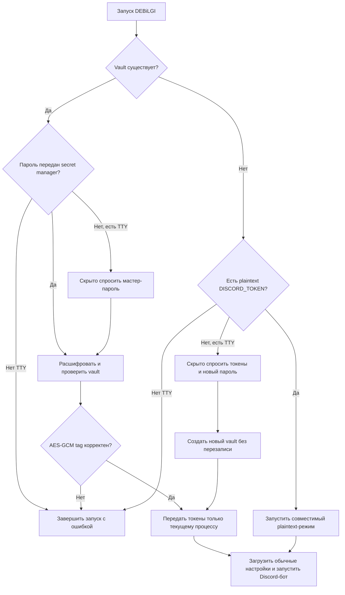

# DEBiLGI

`Cognitive Core v0.2` Discord-бота, который хранит наблюдения в единой модели
событий, прогоняет их через долговечную очередь, отдельно изучает язык выбранного
архива, поддерживает ограниченную кратковременную память и вычисляет нейтральные
наблюдаемые признаки. Поверх них работает теневой движок ожиданий `d≠0`. Основной
языковой конвейер не зависит от LLM или embeddings; при желании можно включить внешний
семантический консультант как последний источник разбора. В проекте нет экономики,
автономных штрафов или административных действий.

На текущем этапе бот:

- подключается через `discord.py`;
- нормализует сообщения, ответы и добавление/удаление реакций;
- сохраняет события в SQLite;
- обрабатывает события через ограниченную асинхронную очередь;
- восстанавливает незавершённую обработку после перезапуска;
- защищает обычную доставку от повторной обработки;
- явно воспроизводит сохранённые события без дублирования исходных записей;
- импортирует выбранный канал, период и ограниченное число архивных сообщений;
- сохраняет прогресс архива порциями и продолжает `pending/running` jobs после рестарта;
- считает обезличенные токены, биграммы, триграммы и формы ответов;
- позволяет паузить, продолжать и отменять задания импорта;
- удаляет сырой текст после агрегации, сохраняя ledger для дедупликации;
- держит изолированный по серверам и каналам живой контекст;
- хранит ограниченные окна последних событий участников;
- собирает активные reply-цепочки с ветками и вложенными ответами;
- вычисляет контекстный заряд активности с экспоненциальным затуханием;
- пересобирает кратковременную память из свежего журнала после рестарта;
- по запросу извлекает измеримые показатели поведения из текущего Event-контекста;
- ищет похожие измеримые ситуации и строит категориальный прогноз;
- сохраняет ожидание, распределение вероятностей и ограниченный дедлайн;
- измеряет фактический исход, вычисляет `d` и обновляет веса закономерностей;
- применяет последовательные SQL-миграции с проверкой checksum;
- предоставляет read-only диагностику администраторам сервера;
- изолирует все запросы диагностики по `guild_id`.

## Архитектура

### Personality Genome и личная перспектива

Врождённый характер DEBiLGI хранится как неизменяемый `PersonalityGenome`: набор
числовых склонностей без готовых реплик. Геном влияет на выбор `ActionIntent`, а
`PersonalityExpression` соединяет его с текущим внутренним состоянием: активацией,
напряжением, интересом, неопределённостью и знакомством. На этом шаге вычисляются не
только длина и вариативность речи, но и текущие общительность, подозрительность,
терпение, напористость, теплота и игривость.

Перед построением ответа создаётся `PersonalityPerspective`. Она переваривает четыре
источника:

1. неизменяемое ядро `PersonalityGenome`;
2. текущий фенотип `PersonalityExpression`;
3. реакцию на это сообщение и медленно обучаемое отношение к конкретному человеку;
4. `ReflectionGuidance`, полученный из фактических результатов прошлых ответов.

Из перспективы формируется отдельное `PersonalOpinion`: субъект, оцениваемое качество,
позиция, сила позиции, уверенность, ценностные измерения и доказательства. Только после
этого планировщик создаёт несколько смысловых ходов, продуктивная грамматика строит
формулировки, а общий арбитр выбирает вариант с учётом фактов, контекста, обязанности
ответа и соответствия личности. Поэтому характер участвует в выборе мысли, а не
добавляется как стилизация к уже готовой фразе.

Факты имеют больший вес, чем личностный prior, и могут изменить позицию. Выраженная
позиция сохраняется отдельно и остаётся пересматриваемой после новой информации или
обратной связи. Отношение к собеседнику влияет на теплоту, сопротивление и выбранный
коммуникативный ход, но само по себе не превращается в доказательство внешнего факта.

В `response pipeline trace` сохраняются снимок `personality_perspective`,
`personality_fit` каждого кандидата, сформированная позиция, её основания и итоговые
оценки арбитража. Команда `/debilgi dna` показывает врождённые коэффициенты и
контрольную подпись генома.

Опыт собственных реплик консолидируется отдельно: прямые ответы, реакции,
продолжение разговора и отсутствие отклика дают наблюдаемую награду. Она медленно
усиливает или ослабляет использованные языковые переходы, не меняя сам геном.
Команда `/debilgi experience` показывает состояние этого приобретённого слоя.

Автономная инициатива включается через `DEBILGI_INITIATIVE=true`. Это не периодический
таймер: после каждого человеческого сообщения политика оценивает неопределённость,
интерес, неожиданность, знакомство, собственную результативность и событийный запас
оснований. Если ожидаемая ценность вопроса достаточно высока, DEBiLGI сам формулирует
его из памяти. В одном канале одновременно может быть только одна открытая цель;
прямой ответ, продолжение автора или 12 последующих событий закрывают её. Команда
`/debilgi autonomy` показывает запас оснований, открытую цель и результаты инициатив.

Внешний слой понятий включается через `DEBILGI_WIKIPEDIA_ENABLED=true`. Явные вопросы
вида «что такое …» запускают немедленный поиск, а самостоятельный поиск происходит при
высоких неопределённости, интересе и неожиданности. Wikipedia работает в отдельном
фоновом worker: статьи не блокируют очередь Discord и не смешиваются целиком с речевой
памятью. В SQLite попадают очищенное определение, псевдонимы, номер ревизии, Wikidata ID,
ссылка на страницу и слабые связи с соседними статьями. Повторные понятия читаются из
локального кэша. Каждое употребление известного понятия связывается с исходным событием,
сервером, каналом и автором; повторения увеличивают измеримые relevance и confidence.
Когда соседняя статья позднее становится самостоятельным понятием, текстовая связь
автоматически превращается в ребро между двумя объектами concept graph. Состояние
показывает `/debilgi knowledge`.

```text
Discord gateway
  -> debilgi.discord.events            адаптация объектов discord.py
  -> debilgi.events.normalizer         воспроизводимые нормализованные Event
  -> debilgi.events.pipeline           durable queue, recovery и replay
       -> ShortTermMemory              ограниченный живой контекст
       -> LearningEngine               ожидание -> исход -> категориальный d
       -> CognitiveCore                эпизод -> модель -> состояние -> намерение
       -> ExperienceConsolidator       последствия реплик -> языковой опыт и self-model
       -> AutonomyRepository           событийный запас -> открытая цель -> исход
       -> KnowledgeAcquisition         пробел понятия -> Wikipedia -> concept graph
  -> SQLite + checksum migrations      долговременная память и журнал причин
```

### Soft Grammar

Языковой слой не использует заготовленные фразы или жёсткие шаблоны. Он извлекает из
памяти вероятности переходов между мягкими ролями слов: местоимением, глаголом,
прилагательным, предлогом, союзом, частицей и содержательным словом. Эти вероятности
не запрещают необычные конструкции, а только меняют вес продолжений и помогают выбрать
более связный вариант среди нескольких кандидатов. По мере накопления нормальных
диалогов статистическая грамматика подстраивается под язык и манеру конкретного сервера.

Обычная целевая длина зависит от характера и внутреннего состояния и составляет 8–48
токенов. Защитный потолок ответа и объём текста одного сообщения в контексте настраиваются
через `.env`; генератор умеет продолжать мысль несколькими предложениями, если памяти
достаточно. `DEBILGI_LANGUAGE_CONTEXT_CHARS` ограничивает одну входную реплику, а не всё
контекстное окно. Рабочая память удерживает до `DEBILGI_MEMORY_MAX_CONTEXT_EVENTS` событий,
гарантированно сохраняет 12 последних ходов и отдельно закрепляет Discord reply-chain.
Случайный выбор кандидата посеян хэшем нормализованной реплики, цепочки и фактов, а не ID
сообщения; повтор одного смыслового входа получает тот же проверенный ответ из ограниченного
кэша. Ограничение длины применяется по границе предложения или слова и не обрывает текст
посреди фразы.

### Semantic Language Memory

Поверх свободной статистической речи работает небольшой смысловой индекс. Утверждения
разбираются в вероятностные рамки `исполнитель -> действие -> объект -> обстоятельства`.
Свойства остаются частью объекта, поэтому `медный ключ` и `железный ключ` не обязаны
смешиваться. Отрицание хранится отдельно, а вопросы не записываются как наблюдаемые факты.
Рамки извлекаются как из архивного импорта, так и из новых сообщений Discord; при ответе
на явный вопрос наиболее подходящий сохранённый факт получает приоритет над случайным
продолжением Маркова.

Локальный фундаментальный урок можно безопасно и повторяемо прогнать командой:

```powershell
.\.venv\Scripts\python.exe .\scripts\train_foundation.py
```

Перед изменением активной базы скрипт создаёт SQLite-backup. Он обучает базовым связям
между исполнителями, действиями, объектами, признаками, местом, отрицанием, порядком и
простыми последствиями. Повторный запуск добавляет только отсутствующую часть урока.
Проверка без записи и без новой резервной копии запускается с `--evaluate-only`.

### Discourse Memory

Разговорная память хранит не только текст, но и положение реплики в диалоге: автора,
адресата, исходное сообщение Discord, тип высказывания, активные темы и состояние вопроса.
Явный reply связывает ответ с вопросом напрямую. Короткий ответ без reply тоже может закрыть
последний вопрос, если он был адресован этому участнику; при следующей генерации исходный
вопрос возвращается в контекст даже для ответа вроде `да` или `нет`.

Релевантность старых реплик считается по reply-цепочке, совпадению редких тем, автору,
адресату и давности. Генератор получает сначала причинную цепочку разговора, затем связанные
эпизоды, открытые вопросы и выученные начала ответов. Вопросительные реплики формируют
отдельную мягкую грамматику, поэтому намерение спросить должно начинаться с выученной
вопросительной конструкции, а не с одинокого знака `?`.

### Unified Working Memory Context Gate

Перед фактической отправкой обычный ответ, словарный retrieval, графовая генерация,
короткая реакция и фоновая инициатива проходят через один контекстный гейт. Он держит
на канал последние `DEBILGI_CONTEXT_GATE_WINDOW_TURNS` реплик вместе с понятиями, автором
и признаком адресации боту. Активное ожидание объяснения и последнее сообщение бота для
короткого речевого акта находятся в том же состоянии.

Кандидат считается связанным при прямом совпадении или связи через граф; минимальное число
совпадений задаёт `DEBILGI_CONTEXT_GATE_MINIMUM_MATCHES`. Нерелевантный реактивный текст
заменяется безопасным fallback. Фоновое сообщение остаётся в очереди, пока разговор активен,
и может пройти после паузы `DEBILGI_CONTEXT_GATE_INITIATIVE_IDLE_SECONDS`. Каждый вердикт
пишется в `data/context-gate.log` вместе с источником, понятиями кандидата и текущего окна.

### Cross-source response arbitration

При `DEBILGI_ARBITRATION_MODE=active` ответ больше не выбирается первой сработавшей
веткой. Identity, retrieval, диалоговый речевой акт, несколько графовых формулировок,
cache и recovery сначала образуют общий пул. Все поверхности проходят одинаковые жёсткие
проверки, получают числовые оценки применимости, связи с рабочей памятью, надёжности,
покрытия фактов, грамматики, длины и повторяемости; наружу уходит максимальный допустимый
балл. Если весь пул ниже `DEBILGI_ARBITRATION_MIN_SCORE`, добавляется нейтральный fallback.

Арбитраж теперь явно двухуровневый. Каждый источник сначала создаёт `ContentProposal` с
`ResponseContentPlan`: речевым актом, целью ответа, темами, ключевыми пунктами и
структурированными обязательными фактами, но без текста. Content arbitration выбирает
допустимые смыслы; только связанные с ними `SurfaceCandidate` участвуют в сравнении
формулировок. Совместимое имя `ResponseCandidate` сохранено для старых интеграций, но в
хранилище proposal и surface записываются раздельно.

Обязательный факт хранит субъект, предикат, объект, логическую полярность, уверенность,
адресата и provenance. Поэтому положительное утверждение не считается покрытым его
отрицанием, а дизъюнкция вроде «согласие или одобрение» допускает любую подтверждённую
ветвь. Неизмеренные признаки не подменяются числами `1.0`, `0.5` или `0.65`: они остаются
`None` и исключаются из нормализации score.

`DEBILGI_ARBITRATION_MODE=shadow` сохраняет тот же расчёт и disagreement со старым путём,
но отправляет legacy-текст. Каждое решение и все кандидаты сохраняются миграцией `027`, а
подробные оценки пишутся в `data/response-arbitration.log`. Обучение весов включается
отдельно через `DEBILGI_ARBITRATION_LEARNING_ENABLED=true`: учитываются только явно
привязанные подтверждения, отрицания и известные реакции на конкретное сообщение бота;
обычное продолжение разговора не считается одобрением. Обновления ограничены по шагу,
версионируются и начинаются после `DEBILGI_ARBITRATION_MIN_FEEDBACK_OBSERVATIONS`.

Миграция `041` добавляет единый `AttributedFeedback` для опыта, reflection, self-dataset,
обучения арбитража и личных позиций. Она же сохраняет `ProcessingOutcome` смыслового
планирования в SQL и ведёт неизменяемые версии профиля весов с отдельным указателем на
активную версию, поэтому rollback больше не зависит от перезаписанной строки.
Уточняющий `ASK_QUESTION` без готового factual answer реально проходит через
`SemanticReplyPlan` и productive realization до общего генератора; технический сбой
остаётся техническим исходом, а не маскируется под намеренное молчание.

### Автономное семантическое планирование через Cloudflare

При включённом `DEBILGI_SEMANTIC_CONSULTANT_ENABLED` Cloudflare Workers AI участвует в
живом ходе, но не пишет ответ. Модель получает запрос, допустимые факты с их ID и числовой
снимок личности. В ответ она обязана вернуть несколько JSON-планов: коммуникативный ход,
позицию, лемму предиката, семантические роли, грамматические признаки и ссылки
`evidence_ids`. Поля с готовым ответом, порядок слов и фрагменты будущей реплики контрактом
запрещены и парсером отбрасываются.

Дальше внешняя модель из цепочки исчезает: локальная `PersonalityPerspective` ранжирует
альтернативы с учётом характера и отношения к собеседнику, локальная проверка отклоняет
выдуманные ссылки на факты, а авторитетные структурированные факты заново компилируются
локально и не могут быть перевёрнуты одной формальной ссылкой на правильный ID. После этого
productive NLG самостоятельно выбирает порядок ролей, склоняет слова, согласует сказуемое
и собирает итоговый русский текст. Поэтому ответ не копируется из ИИ даже частично: у
провайдера нет разрешённого текстового поля, которое можно было бы отправить.

В этом режиме прежние источники с заранее составленной семантикой вообще не добавляются
в пул арбитража. Если планировщик недоступен, вернул пустой план, неизвестный `evidence_id`
или грамматически нереализуемую структуру, система удерживает ход и пишет причину в трассу;
фиксированная аварийная фраза не подставляется.

Сырой структурированный результат хранится в `language_semantic_consultations`, после чего
ассимилятор раскладывает его на долговременные уроки в `language_semantic_lessons`.
Один неподтверждённый вывод остаётся `candidate`; совпадение с локальным анализом или
второе независимое наблюдение переводит урок в `active`. Активные значения и отношения
попадают в граф, морфология и синтаксис — в языковые наблюдения, а речевые акты — в
диалоговые паттерны.

Живой NLG не выбирает готовую реплику или именованный каркас ответа. Продуктивная
грамматика получает абстрактную мысль: предикат, семантические зависимости, полярность,
фокус и признаки времени/лица. Затем она выбирает порядок ролей, назначает управляемые
падежи, согласует словоформы и собирает поверхность.

Постоянный протокол учителя лежит в
`integrations/semantic-consultant-instruction.txt`. Для включения нужны Cloudflare Account
ID и API token:

```dotenv
DEBILGI_SEMANTIC_CONSULTANT_ENABLED=true
DEBILGI_CLOUDFLARE_ACCOUNT_ID=
DEBILGI_CLOUDFLARE_API_TOKEN=
DEBILGI_CLOUDFLARE_MODEL=@cf/meta/llama-3.1-8b-instruct-fast
DEBILGI_SEMANTIC_CONSULTANT_INSTRUCTION_PATH=integrations/semantic-consultant-instruction.txt
DEBILGI_SEMANTIC_CONSULTANT_TIMEOUT_SECONDS=45
```

Секреты лучше вводить через `debilgi-secrets setup`: они попадут в зашифрованный vault,
а не в Git. В живом ходе используется режим `planning`; во время простоя консультант
дополнительно разбирает понятия, для которых словарь и энциклопедия ничего не нашли, а
также переносимые грамматические и социальные конструкции. Консультация кэшируется на
14 дней; извлечённые уроки не истекают.

Локальное контрастивное предобучение социальных политик устанавливается отдельно:

```powershell
.\.venv-admin\Scripts\python.exe scripts\train_social_reasoning.py
```

### Composable Social Reactions

Социальная реакция хранится как вектор семи базовых сил: `agreement`, `resistance`,
`approval`, `curiosity`, `aversion`, `trust` и `arousal`. Текст сообщения даёт только часть
сигнала; к нему добавляются неопределённость, интерес, напряжение, активация, знакомство,
предсказуемость, геном и медленно обучаемая модель отношений с конкретным участником.

Две сильнейшие совместимые компоненты автоматически образуют `blend_id`. Поэтому новые
смеси вроде `curiosity+aversion` или `approval+resistance` не требуют отдельного сценария.
Сопротивление может превратить обычное высказывание в акт границы, любопытство увеличивает
поиск вариантов и склонность к вопросительной форме, доверие усиливает связность с памятью,
а возбуждение немного повышает выразительность и вариативность. Готовых ответных фраз этот
слой не содержит: он меняет речевой акт, профиль генерации и оценку кандидатов.

Команда `/debilgi reactions` показывает количество реакций, динамических смесей, моделей
отношений и последние `blend_id` с уверенностью.

### Dialogue curriculum

The local conversational foundation contains linked multi-turn scenes rather than isolated
response templates. It covers clarification, uncertainty, agreement and disagreement with
reasons, refusal with alternatives, approval, curiosity, mixed reactions, correction,
topic changes, humour and multi-user addressee tracking. Install it into the active local
database with:

```powershell
.\.venv\Scripts\python.exe scripts\train_dialogue_curriculum.py
```

Этот архивный корпус остаётся источником языковых наблюдений. Для выбора социального хода
используется `train_social_reasoning.py`: он обучает структурным политикам и не добавляет
авторские ответы в память.

### Symbolic language-layer curriculum

После фундаментального и диалогового курсов отдельный локальный курс обучает использованию
буквенного Маркова, эталонного и личного словаря, многозначности, явного незнания,
ограниченного любопытства, предречевого плана, причинного summary, консолидации разговоров и
карантина неологизмов. На этом ноутбуке он запускается через второе окружение:

```powershell
.\.venv-admin\Scripts\python.exe scripts\train_language_layer.py
```

Курс идемпотентен, использует отдельный диапазон Discord ID и перед изменением активной БД
создаёт SQLite-backup. `--evaluate-only` проверяет словарь, морфологию, буквенную модель и
контрольные ответы без записи. Для точного ранее изученного вопроса используется полный
проверенный ответ из локальной archive-пары; для перефразированного вопроса остаются
retrieval, семантическая память, предречевой план и генерация.

### Internal reflection

Every sent reply now stores a private expected outcome. When a direct reply, reaction,
continued conversation or timeout resolves that experience, DEBiLGI compares the actual
reward with its prediction and records the prediction error, surprise and a strategy lesson.
The reflection is never emitted as authored chat text.

Reflections slowly calibrate beliefs about responsive versus initiative messages, questions
versus statements, concise/balanced/extended length, expressive tone and search width.
Learned guidance changes future output length, exploration, caution, coherence and candidate
count without rewriting the immutable personality genome. `/debilgi reflection` shows the
private aggregate state to server administrators.

### Symbolic literacy

The deterministic literacy layer distinguishes Unicode letters, digits, punctuation,
operators and other symbols without storing extra raw message text. It knows Russian and
English alphabet order, letter positions and neighbours, counts character classes, compares
numbers, identifies parity and evaluates bounded arithmetic with a dedicated parser.

Exact answers bypass probabilistic wording, so a result such as `12 * 4 = 48` cannot be
mutated by the Markov generator. Expressions are token-limited, exponent-limited and never
executed with `eval`. `/debilgi literacy` shows aggregate symbol exposure and query counts.

### Cognitive Core v0.2

Полный теневой контур выглядит так:

```text
Event
-> наблюдаемые признаки
-> несколько одновременно допустимых ожиданий
-> фактические исходы или timeout/no_response
-> скалярный d + компоненты несовпадения
-> связанные эпизоды
-> семантические закономерности и фоновые веса
-> модели сервера, канала, пользователя и самого DEBiLGI
-> вычисляемое внутреннее состояние
-> вероятностная Assessment
-> shadow-only ActionIntent
```

Четыре слоя памяти разделены физически и по назначению:

- `ShortTermMemory` держит свежие события, участников, reply-цепочки и текущий заряд;
- `cognition_episodes` группирует сцену по каналу и временному разрыву, сохраняя ссылки на
  исходные события, участников, неожиданность, важность и уверенность;
- `cognition_semantic_memories` сжимает повторяющиеся эпизоды в измеримые выводы с
  подтверждениями, противоречиями, затуханием и provenance;
- `cognition_subconscious_weights` хранит слабые фоновые ассоциации, которые могут немного
  влиять на состояние и решение даже после очистки сырого текста.

`ActionIntent` содержит выбранный тип действия, цель, срочность, уверенность, ожидаемый
эффект, доказательства и пошаговый reasoning trace. Схема БД разрешает для него только
`shadow_only=1` и только `executed_at=NULL`. Discord-слой не получает обработчик исполнения
этих намерений: сейчас они существуют исключительно для проверки решений по дальнейшим
событиям.

Языковой слой отделён интерфейсом
`StructuredThought -> UtterancePlan -> PhraseGenerator`. Марковские цепи, n-граммы и архив
языка не участвуют в выборе мнения, важности или действия.

`ShortTermMemory` подключена как idempotent handler очереди. Она не является вторым
источником истины: при запуске бот читает только свежие `Event` из SQLite, сортирует их
по времени и детерминированно восстанавливает оперативный контекст. Повторный replay
того же `event_id` не раздувает память.

Память ограничена одновременно:

- временем хранения;
- общим числом событий;
- числом событий канала;
- числом событий пользователя;
- числом reply-цепочек канала;
- длиной каждой reply-цепочки.

Контекстный заряд — не эмоция и не оценка пользователя. Это затухающая интенсивность
недавнего участия: сообщения дают больший импульс, реакции — меньший, упоминания дают
небольшой импульс упомянутому участнику. Эмоциональная модель появится только на своём
этапе.

## Наблюдаемые признаки

`BehaviorFeatureExtractor` не пытается понимать смысл русского текста и не выдаёт
вердикты. Он вычисляет только числа за текущее окно кратковременной памяти:

- число и скорость сообщений;
- среднюю длину и долю заглавных букв среди букв;
- повторения слов и точные дубли нормализованных сообщений;
- полученные ответы и добавленные реакции;
- продолжительность самой длинной reply-цепочки;
- явные упоминания бота;
- повтор того же текста после наблюдаемого действия бота;
- использование команд;
- явно размеченные попытки запросить награду;
- только подтверждённые удаления модератором;
- среднее время до ответа;
- разницу активности в равных окнах после и до сообщения;
- возвращение в тот же канал после паузы и активности другого участника;
- повторение последовательностей типов событий.

Признаки вычисляются на лету и пока не сохраняются как мнения или профили. `капс` не
означает злость, реакция не означает одобрение, мат не означает конфликт. Следующий
этап сможет строить проверяемые ожидания из нескольких признаков, но один показатель
сам по себе ничего не доказывает.

Discord raw delete не сообщает, кто удалил сообщение. Поэтому live-счётчик
`moderator_deletion_count` остаётся нулевым, пока другой доверенный источник явно не
передаст `deleted_by_moderator=true`. Аналогично `reward_request_attempt_count` требует
явной машинной разметки команды и не угадывается по словам пользователя.

## Ожидания и `d≠0`

После живого сообщения engine описывает ситуацию дискретными нейтральными признаками:
тип события, бот/участник, reply, упоминания, активность канала, контекстный заряд,
длина сообщения, скорость сообщений автора и доля капса. Идентификатор пользователя и
текст сообщения в ключ закономерности не входят.

Для похожих ситуаций строится распределение пяти проверяемых исходов:

```text
no_response
other_message
same_actor_message
reply
reaction
```

До накопления опыта используется равномерный prior `0.2`. Исторические исходы
добавляются с весом похожести, а вероятности сглаживаются, чтобы одно наблюдение не
создавало абсолютную уверенность.

Различие считается так:

```text
d = 1 - P(фактический исход)
```

Если произошёл вероятный исход, `d` маленькое. Если случился исход, которому модель
давала мало вероятности, `d` большое. Разрешение ожидания и увеличение счётчика паттерна
выполняются одной SQLite-транзакцией. Повторный Event и явный replay не обучают модель
второй раз.

Ожидания работают только в тени: они ничего не отправляют в Discord, не меняют баланс,
не назначают роли и не являются мнением о человеке. Это вероятностные закономерности
ситуаций, а не истины.

Сначала событие вставляется в `events`. SQLite-триггер атомарно создаёт для него
`event_processing` со статусом `pending`. Worker захватывает запись условным обновлением,
поэтому два одинаковых задания в памяти не приводят к двум обработкам. Состояния:

```text
pending -> processing -> processed
                      -> failed
```

Прерванный `processing` после запуска снова становится `pending`. Ошибки повторяются
не более трёх запусков, после чего остаются видимыми в диагностике. Явный replay
сбрасывает счётчик выбранных событий по прямой команде администратора.

Модули `memory`, `cognition`, `actions` и `economy` пока являются только границами
будущих этапов. Discord-объекты не проходят ни в событийное ядро, ни в языковой
импорт, а экономика намеренно не реализована.

Языковой архив идёт отдельным путём:

```text
Discord channel.history (oldest first, rate limits handled by discord.py)
  -> DiscordHistorySource
  -> ArchivedMessage
  -> batched ArchiveImporter + saved cursor
  -> tokenizer
  -> token / 2-gram / 3-gram / reply-pattern counters
```

Архив не записывает отношения, репутацию, эмоции или оценки участников. Упоминания
нормализуются до `<user>`, `<role>` и `<channel>`, URL — до `<url>`, ID кастомных эмодзи
не попадают в языковую статистику.

## Требования

- Python 3.11 или новее;
- Discord-приложение с ботом;
- включённый **Message Content Intent** в Discord Developer Portal.

## Локальный запуск

Рекомендуемый режим хранит токены только в зашифрованном vault. После клонирования в
PowerShell выполни:

```powershell
python bootstrap.py setup --dev
python bootstrap.py run
```

Первая команда создаёт `.venv`, устанавливает зависимости и один раз создаёт локальный
`.env.local` из `.env.local.example`. Вторая запускает бота. Если ни открытого
`DISCORD_TOKEN`, ни vault ещё нет, в этой же консоли начинается первоначальная настройка:

1. Discord-токен вводится скрыто и является обязательным.
2. Cloudflare Account ID и API token вводятся скрыто, но могут остаться пустыми.
3. Новый мастер-пароль вводится дважды. Минимальная длина — 12 символов.
4. Создаётся `.debilgi-secrets.vault`; исходные токены в него открытым текстом не записываются.
5. Бот использует уже введённые значения для текущего запуска.

На следующих запусках токены повторно вводить не нужно: консоль спрашивает только
мастер-пароль vault. Если пароль неверный, файл повреждён или его подменили, запуск
прекращается без попытки использовать мусорное значение.

На Linux команды те же, только системный Python обычно называется `python3`:

```bash
python3 bootstrap.py setup
python3 bootstrap.py run
```

При обычной editable-установке без bootstrap локальный конфиг и vault подготавливаются
отдельными командами:

```powershell
python -m pip install -e ".[dev]"
debilgi-init
debilgi-secrets setup
debilgi
```

### Файлы конфигурации и их назначение

| Файл или источник | Что в нём хранится | Попадает в Git | Приоритет |
|---|---|---:|---:|
| Переменные процесса / CI secrets | Токены и любые настройки конкретного запуска | Нет | 1 |
| `.debilgi-secrets.vault` | Зашифрованные токены | Нет | 2 |
| `.env.local` | Локальные несекретные overrides; plaintext-секреты только для совместимости | Нет | 3 |
| `.env` | Старый локальный формат, оставленный для совместимости | Нет | 4 |
| `.env.local.example` | Пустой пример локальных overrides | Да | — |
| `.env.example` | Публичный список доступных настроек без значений секретов | Да | — |

Установщик никогда не перезаписывает существующие `.env.local` и vault. Шаблоны можно
обновлять через Git независимо от локальных данных. Правила `.gitignore` исключают `.env`,
все `.env.*`, кроме двух безопасных примеров, vault, его резервные копии, базы, `data/` и
runtime-логи.

### Зашифрованное хранилище токенов

Vault — это JSON-конверт с версией формата, параметрами KDF, случайной солью, случайным nonce
и ciphertext. В нём нет открытых токенов и нет значения или хеша мастер-пароля. Токены
шифруются AES-256-GCM, поэтому незаметно изменить ciphertext нельзя. 256-битный ключ
получается из мастер-пароля через Scrypt с отдельной случайной солью. Мастер-пароль существует
только во время разблокировки и проектом не сохраняется.

Порядок запуска выглядит так:



Если токен одновременно передан через окружение процесса и присутствует в vault, явная
переменная процесса имеет приоритет. Vault дополняет только отсутствующие секреты.

Vault можно подготовить заранее:

```powershell
debilgi-secrets setup
debilgi-secrets status
```

`setup` работает только при отсутствии `.debilgi-secrets.vault`. Он не умеет дописывать,
исправлять или перезаписывать существующий vault. Поэтому замена любого токена выполняется
через полный сброс:

```powershell
debilgi-secrets reset
debilgi-secrets setup
```

Первая команда показывает предупреждение и удаляет файл только после ручного ввода `RESET`.
Она удаляет локальную зашифрованную копию, но не отзывает Discord/API-токены у провайдера.
Вторая команда снова спрашивает полный набор значений и новый мастер-пароль. Если
мастер-пароль забыт, восстановить содержимое vault нельзя: остаётся reset и повторный ввод
действующих токенов.

Дополнительные секретные переменные перечисляются в локальном конфиге до `setup`:

```env
DEBILGI_VAULT_EXTRA_KEYS=FIRST_TOKEN,SECOND_TOKEN
```

Setup скрыто запросит каждую из них и положит непустые значения в тот же зашифрованный
payload. Имена должны состоять из заглавных латинских букв, цифр и `_`.

### Переход со старого `.env`

Существующая установка с открытым токеном продолжает запускаться без автоматической
миграции: установщик намеренно не перемещает и не удаляет секреты за владельца. Для перехода:

1. Останови бот.
2. Выполни `debilgi-secrets setup` и введи действующие токены.
3. Проверь `debilgi-secrets status`: состояние должно быть `vault=present`.
4. Удали строки с реальными токенами из `.env` и `.env.local`, оставив там только
   несекретные настройки.
5. Запусти `python bootstrap.py run` и введи мастер-пароль.

Если после reset в `.env` или `.env.local` остаётся открытый `DISCORD_TOKEN`, приложение
считает его совместимым источником и не начинает первоначальную настройку автоматически. Чтобы
получить строгое поведение «сбросил vault — заново ввёл все токены», открытых копий быть не
должно.

### Сервер, systemd и Docker

Интерактивный режим требует терминал на каждом старте, потому что мастер-пароль нигде не
хранится. В фоне без TTY приложение закрывается с ошибкой, а не запускается без токена. Для
unattended systemd/Docker-запуска внешний secret manager должен передать пароль процессу:

```text
DEBILGI_VAULT_PASSPHRASE=<значение из secret manager>
```

Не записывай эту переменную в `.env`, `.env.local`, Dockerfile, compose-файл или unit,
который отправляется в Git. Используй секреты панели хостинга, Docker/Kubernetes secrets,
CI/CD secrets или внешний KMS. Платформа либо wrapper должны передать полученное значение
именно как переменную окружения процесса. В таком режиме vault автоматически разблокируется
при рестарте без консольного вопроса.

### Граница защиты

Vault защищает токены от публикации через Git, чтения украденной копии диска, обычного
просмотра файла, утечки backup и незаметной подмены ciphertext. Он не может скрыть секрет от
root/Administrator, который полностью контролирует работающий сервер: после разблокировки
токен необходим процессу в расшифрованном виде, поэтому привилегированный администратор может
подменить программу или исследовать её память. Если сохранить мастер-пароль рядом с vault,
защита остаётся только шифрованием данных на диске.

### Совместимый plaintext-режим

Шифрование необязательно. Если `DISCORD_TOKEN` уже задан через переменную процесса,
`.env.local` или старый `.env`, приложение использует его и не создаёт vault автоматически.
Это удобно для платформ, где секреты уже безопасно инжектируются извне. Для локального
plaintext-файла достаточно:

```env
DISCORD_TOKEN=токен_конкретного_развёртывания
```

Такой файл игнорируется Git, но сам токен на диске не зашифрован.

## Настройка Discord

В Developer Portal:

1. Создай Application и Bot.
2. В разделе Bot включи **Message Content Intent**.
3. В OAuth2 URL Generator выбери scopes `bot` и `applications.commands`.
4. Выдай только `View Channels`, `Read Message History`, `Send Messages` и
   `Add Reactions`. Права администратора боту не нужны.
5. Для первой регистрации команд выставь `DEBILGI_SYNC_COMMANDS=true` и запусти бота.
   После успешной синхронизации верни значение `false`.

Для разработки удобно указать `DEBILGI_DEV_GUILD_ID`: команды синхронизируются только
с тестовым сервером и появляются почти сразу. Без него выполняется глобальная
синхронизация, распространение которой Discord может задержать.

## Диагностические команды

Команды видны как группа `/debilgi` и доступны участникам с правом `Manage Server`:

- `/debilgi health` — gateway, задержка, версия схемы, события и глубина RAM-очереди;
- `/debilgi queue` — durable-состояния `pending/processing/processed/failed`;
- `/debilgi stats` — число событий по типам;
- `/debilgi recent` — последние метаданные событий без текста сообщений.
- `/debilgi trace` — этапы последнего ответа; необязательный `message_id` выбирает конкретное
  сообщение.
- `/debilgi replay` — явное повторное прохождение до 100 последних событий сервера.
- `/debilgi archive-start` — запустить импорт канала за включительный период дат;
- `/debilgi archive-status` — показать прогресс последних jobs или одной job;
- `/debilgi archive-pause` — приостановить импорт с сохранением курсора;
- `/debilgi archive-resume` — продолжить paused/failed job;
- `/debilgi archive-cancel` — окончательно отменить job;
- `/debilgi language-stats` — объём сырья и число языковых признаков.
- `/debilgi memory` — размер кратковременного контекста и, опционально, заряд участника.
- `/debilgi features` — нейтральные наблюдаемые показатели выбранного участника.
- `/debilgi expectations` — последние прогнозы, фактические исходы и величины `d`.
- `/debilgi core` — эпизоды, семантическая память, модель, состояние, последнее теневое
  намерение, среднее время обработки и его причинная цепочка.

Ответы эфемерные. `replay` и архивные команды меняют только внутренние данные DEBiLGI;
они ничего не публикуют и не изменяют ни в Discord, ни в экономике.

### Трассировка ответа

Каждое сообщение, для которого строится ответ, получает одну сквозную трассу:
`received → event_pipeline → intent → context → planning → interpretation → knowledge →
candidate_generation → arbitration → recovery → selection → route → context_gate → send →
completed`. Пропущенные необязательные этапы не создают фиктивных записей.

Корневая запись хранится в `language_response_traces`, упорядоченные шаги — в
`language_response_trace_steps`. Полные структурированные события также пишутся отдельными
JSON-строками в `data/response-trace.log`; секреты и токены в деталях автоматически
редактируются. В трассе видны grounding facts, семантические планы без поверхности,
локально реализованные кандидаты, отключённые старые источники, hard rejection, оценки
арбитража, выбранный текст, маршрут, попытка отправки и фактический Discord message id.

Dialogue act, вопросительность и другие категории здесь являются наблюдаемыми сигналами, а
не жёсткими режимами ответа. Эпистемический fallback допускается только для содержательного
вопроса о внешнем факте; обращённая к собеседнику реплика, самооценка, риторический вопрос и
контекстное «а почему так» продолжают разговор через смысловые кандидаты.

Для временного эксперимента `DEBILGI_PRODUCTIVE_ONLY_REPLIES=true` запрещает отправку
готовых, кэшированных, дословно извлечённых и фиксированных аварийных поверхностей. Факты
остаются входом смыслового планирования, но наружу проходит только текст, собранный
продуктивным NLG из ролей и морфологических признаков. Если такой поверхности нет, ответ
удерживается, а трасса завершается причиной `productive_only_no_surface`. Значение `false`
возвращает обычный безопасный режим.

Пример периода для `/debilgi archive-start`:

```text
channel: #general
from_date: 2026-01-01
through_date: 2026-01-31
limit: 10000
delete_raw_after: true
```

Обе даты включительные. Импорт идёт от старых сообщений к новым, чтобы цепочка ответа
могла найти исходное сообщение. При остановке процесса текущая `running` job остаётся
в базе и автоматически продолжится после следующего подключения бота.

Лимиты памяти задаются через переменные процесса, `.env.local` или совместимый `.env`:

```text
DEBILGI_MEMORY_RETENTION_MINUTES=60
DEBILGI_MEMORY_CHARGE_HALF_LIFE_MINUTES=15
DEBILGI_MEMORY_MAX_TOTAL_EVENTS=5000
DEBILGI_MEMORY_MAX_CHANNEL_EVENTS=100
DEBILGI_MEMORY_MAX_USER_EVENTS=50
DEBILGI_MEMORY_MAX_REPLY_CHAINS=100
DEBILGI_MEMORY_MAX_CHAIN_EVENTS=50
DEBILGI_EXPECTATION_HORIZON_SECONDS=120
DEBILGI_EXPECTATION_POLL_SECONDS=5
DEBILGI_COGNITIVE_EPISODE_GAP_SECONDS=600
DEBILGI_COGNITIVE_MAINTENANCE_SECONDS=60
DEBILGI_COGNITIVE_BATCH_SIZE=100
DEBILGI_RAW_TEXT_RETENTION_DAYS=30
DEBILGI_INITIATIVE=false
DEBILGI_LANGUAGE_MAX_OUTPUT_TOKENS=72
DEBILGI_LANGUAGE_MAX_OUTPUT_CHARS=1200
DEBILGI_LANGUAGE_CONTEXT_CHARS=600
DEBILGI_DISCOURSE_CONTEXT_TURNS=80
DEBILGI_DISCOURSE_MAX_TURNS=20000
DEBILGI_WIKIPEDIA_ENABLED=false

# Optional Russian-language reference. Explicit requests such as «что значит X»
# are resolved synchronously; unknown words are checked in the background and
# cached locally. Russian Wiktionary lookup preserves conversational/slang labels
# and may accept only a tightly matching spelling suggestion. Ordinary morphology
# remains offline through OpenCorpora/pymorphy3; Wikipedia is used for concepts.
DEBILGI_RUSSIAN_REFERENCE_ENABLED=false
DEBILGI_WIKIPEDIA_LANGUAGE=ru
DEBILGI_WIKIPEDIA_TIMEOUT_SECONDS=5
DEBILGI_WIKIPEDIA_REPLY_WAIT_MILLISECONDS=1800
DEBILGI_WIKIPEDIA_USER_AGENT=DEBiLGI/0.4 (mailto:local-operator@example.invalid)
```

Перед публичным или крупным запуском замени адрес в `DEBILGI_WIKIPEDIA_USER_AGENT` на
реальный контакт владельца. Wikimedia использует его для идентификации клиента.

`DEBILGI_RAW_TEXT_RETENTION_DAYS` задаёт срок хранения живого `content` в журнале событий.
После срока фоновая консолидация удаляет только сырой текст, сохраняя структуру события,
эпизоды, признаки, модели и выводы. Архивный импорт дополнительно управляет своим сырьём через
`delete_raw_after`.

## Офлайн-replay

`debilgi-replay` принимает JSONL с нормализованными событиями и после каждого события печатает
кадр с ожиданиями, `d`, эпизодом, семантической памятью, состоянием и теневым решением:

```powershell
debilgi-replay .\scenario.jsonl --database .\data\replay.sqlite3
```

Replay не подключается к Discord и ничего туда не отправляет.

## Миграции

SQL-файлы лежат в `migrations/` и называются по схеме
`NNN_short_description.sql`. При запуске применяются только новые версии. Если уже
применённый файл изменить, запуск остановится с ошибкой checksum — существующую
миграцию надо не переписывать, а дополнять новой.

Текущая версия схемы — `44`. Миграции обновляют старые БД последовательно и без удаления
журнала событий. `016_language_dialogue_layer.sql` добавляет буквенные переходы, раздельные
словари, карантин неологизмов, явные пробелы знания, активные разговоры, эпизоды и технические
предречевые планы. Миграции `042`–`044` добавляют прозрачный журнал полного конвейера ответа,
автономное семантическое планирование и непрерывное локальное познание.

## Языковой и разговорный конвейер

Ответ больше не получает смысл из Марковской цепи. Сначала собираются активный разговор,
серверное значение, личная интерпретация, локальный морфологический словарь и прошлые эпизоды.
Затем создаётся короткий структурированный план. Словесный генератор выражает этот план, а
валидатор проверяет ключевые пункты, тему и недопустимую уверенность. При провале число повторов
ограничено, после чего используется простой ответ или честное признание незнания.

Морфологический слой различает словарный разбор, исправленную форму, числовой литерал и
продуктивную гипотезу для неизвестного слова. Гипотеза сохраняет предполагаемую часть речи,
но её уверенность ограничена и явно передаётся в структурный разбор. Целые, десятичные числа
и проценты получают категорию `number`; десятичная запись остаётся одним токеном. Контекстное
снятие омонимии учитывает согласование подлежащего со сказуемым, конструкции с количественным
числительным и управление инфинитивом (`буду печь`, `могу сказать`). Помимо падежа, числа,
рода, времени и лица наружу передаются вид, наклонение, залог и переходность.

Буквенная модель обучается на каждом слове отдельно с `<WORD_START>`/`<WORD_END>`, порядками
2–8 и backoff. Она оценивает и изредка предлагает только форму отдельного нового слова; смысл
ответа ей не поручается. Кандидат не попадает прямо в обычный словарь: он проходит cooldown,
проверку нормативного эквивалента, карантин и закрепляется только после повторений и понятной
реакции людей.

Локальная диагностика доступна администраторам в группе `/debilgi language`:
`interpret`, `word-check`, `unknowns`, `neologisms`, `conversation-state`. Она показывает
наблюдаемое состояние понимания, но не сырой внутренний журнал.

## Собственный датасет

После каждого реально отправленного ответа бот сохраняет пару `instruction/input/output` как
кандидат для Instruction/Q&A-корпуса и одновременно расширяет граф узлами инструкций, ответов,
участников и понятий. Реакции и явные исправления переводят примеры в `accepted` или `rejected`,
поэтому ошибочный ответ не становится эталоном только из-за факта отправки. Поле `reasoning`
содержит краткое резюме наблюдаемого плана, ключевых пунктов и валидации, а не скрытую цепочку
мыслей.

Собрать прежние сохранённые ответы и экспортировать только подтверждённые примеры:

```powershell
python scripts/export_self_dataset.py
```

Для исследовательского экспорта вместе с ещё не подтверждёнными кандидатами:

```powershell
python scripts/export_self_dataset.py --include-candidates --minimum-quality 0.55
```

В каталоге `data/self-dataset/` создаются `instruction_qa.jsonl`, `graph_nodes.jsonl` и
`graph_edges.jsonl`. Данные каждого сервера изолированы по `guild_id`.

## Автономная фоновая обработка

При `DEBILGI_BACKGROUND_ENABLED=true` бот запускает независимый `asyncio`-цикл: он
обрабатывает ограниченную порцию `language_unknown_concepts`, сначала проверяет локальный
словарь и Викисловарь, затем — только близко совпавшую статью Википедии. Найденное попадает
в словарь и граф, а ненайденное после ограниченного числа попыток ждёт нового упоминания.

В том же цикле запускаются decay связей графа и долгосрочной памяти, поиск конфликтующих
объяснений без автоматического разрешения и периодическая identity-самопроверка без отправки
в Discord. Фоновая инициатива использует общий баланс автономии, вероятность и отдельный
cooldown; за один цикл отправляется не больше одного сообщения. Итоги каждого прохода лежат
в `background_cycle_runs`, а подробности — в `data/background-learning.log`.
Перед отправкой такая инициатива также проходит общий Working Memory Context Gate; при
чужой активной теме она сохраняет статус `pending`, а не появляется посреди разговора.

## Непрерывное познание между сообщениями

`BackgroundLearningService` обслуживает тяжёлые пакетные задачи, но сам по себе не делает
мышление непрерывным. Поэтому отдельно работает `ContinuousCognitionService`. Он запускается
один раз внутри процесса бота и остаётся живым до его остановки; отдельный процесс, второй
Discord-клиент и второй instance-lock для него не создаются.

После каждого человеческого сообщения сервис сохраняет маленькую задачу, а после завершения
ответа получает сигнал от `ResponseTraceRepository`. На следующих коротких импульсах он:

1. читает уже завершённый типизированный семантический разбор;
2. отдельно сохраняет выводы, предположения и незакрытые вопросы;
3. связывает каждое предположение с конкретными событиями-доказательствами;
4. укрепляет его только при независимых повторениях, не превращая предположение в факт;
5. передаёт релевантные удерживаемые выводы следующему планировщику ответа с явной
   эпистемической меткой.

Это не скрытый текстовый монолог и не коллекция готовых фраз. Сохраняются типизированные роли,
отношения, уверенность, источники доказательств и наблюдаемый результат ответа. Внешний
семантический консультант для работы этого цикла не нужен и его формулировки не копируются.
Цикл также ничего сам не отправляет в Discord: постоянной является внутренняя обработка, а не
спам сообщениями.

Настройка:

```dotenv
DEBILGI_CONTINUOUS_COGNITION_ENABLED=true
DEBILGI_CONTINUOUS_COGNITION_ACTIVE_SECONDS=2
DEBILGI_CONTINUOUS_COGNITION_IDLE_SECONDS=15
DEBILGI_CONTINUOUS_COGNITION_WORK_PER_PULSE=8
```

`ACTIVE_SECONDS` задаёт паузу при наличии работы, `IDLE_SECONDS` — дешёвый heartbeat без
активной очереди, а `WORK_PER_PULSE` ограничивает нагрузку на SQLite. Пустые импульсы не
копятся отдельными строками. Текущее состояние и последний heartbeat лежат в
`continuous_cognition_runtime`, задачи — в `continuous_cognition_work_items`, гипотезы и
доказательства — в `continuous_cognition_hypotheses` и `continuous_cognition_evidence`,
незакрытые смысловые места — в `continuous_cognition_gaps`, результаты отправки — в
`continuous_cognition_signals`. Рабочие импульсы записываются в
`continuous_cognition_pulses`, подробный журнал — в `data/continuous-cognition.log`.
Тот же срез без ручного SQL доступен администратору через
`/debilgi cognition-runtime`.

## Тесты и проверки

```powershell
pytest
ruff check .
```

Тесты используют временные SQLite-файлы и не требуют Discord-токена или сети. В них
есть сценарии повторной gateway-доставки, рестарта, replay, падения обработчика,
восстановления памяти, TTL, half-life, reply-веток, жёстких ограничений размера и
отдельный тест для каждого наблюдаемого признака. Prediction-тесты проверяют similarity,
prior, все типы живых исходов, timeout, `d`, обновление следующего прогноза,
идемпотентность и восстановление ожидания после рестарта.

## Ограничения Discord на этом этапе

- Без привилегированного Message Content Intent текст большинства сообщений будет
  пустым, хотя само событие gateway может прийти.
- Raw reaction events позволяют видеть реакции на сообщения вне кэша, но событие
  удаления реакции не содержит полного объекта участника или автора сообщения.
- History API доступен только в каналах с `View Channel` и `Read Message History`;
  `discord.py` сам выдерживает HTTP rate limits, поэтому большой архив может идти долго.
- Reply-паттерн извлекается, когда исходное сообщение входит в выбранный архив и его
  сырой текст ещё доступен. Удалённый ранее текст намеренно не восстанавливается.
- Глобальные slash-команды появляются не мгновенно; для разработки нужен guild sync.
- Бот видит только доступные ему каналы и историю в пределах выданных прав.
- Текст удалённого сообщения нельзя надёжно восстановить из события удаления, поэтому
  удаление сообщений пока не записывается.
- Проверить реальное gateway-подключение без токена и тестового сервера невозможно;
  локальные тесты проверяют сборку бота, команды, миграции и хранилище.

## Данные

По умолчанию база находится в `data/debilgi.sqlite3`. В ней хранится текст живых
событий, идентификаторы Discord и ограниченные метаданные вложений. Архивный импорт по
умолчанию получает `delete_raw_after=true`: после успешной агрегации поле сырого текста
зануливается, но ID и технический ledger остаются, чтобы повторный импорт не накрутил
счётчики. Не публикуй базу и выдавай боту доступ только к нужным каналам.

Живой текст в `events.payload_json` теперь не бессрочный: после настроенного retention он
редактируется через `json_remove`, а `raw_redacted_at` фиксирует очистку. Межсерверные выборки
для обучения не строятся — модели, эпизоды, выводы, язык и диагностика всегда ограничены
`guild_id`.
