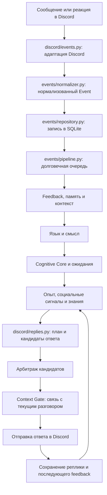

# DEBiLGI

`Cognitive Core v0.2` Discord-бота, который хранит наблюдения в единой модели
событий, прогоняет их через долговечную очередь, отдельно изучает язык выбранного
архива, поддерживает ограниченную кратковременную память и вычисляет нейтральные
наблюдаемые признаки. Поверх них работает теневой движок ожиданий `d≠0`. Основной
языковой конвейер не зависит от LLM или embeddings; при желании можно включить внешний
семантический консультант как последний источник разбора. В проекте нет экономики,
автономных штрафов или административных действий.

На текущем этапе бот:

- подключается через `discord.py`;
- нормализует сообщения, ответы и добавление/удаление реакций;
- сохраняет события в SQLite;
- обрабатывает события через ограниченную асинхронную очередь;
- восстанавливает незавершённую обработку после перезапуска;
- защищает обычную доставку от повторной обработки;
- явно воспроизводит сохранённые события без дублирования исходных записей;
- импортирует выбранный канал, период и ограниченное число архивных сообщений;
- сохраняет прогресс архива порциями и продолжает `pending/running` jobs после рестарта;
- считает обезличенные токены, биграммы, триграммы и формы ответов;
- позволяет паузить, продолжать и отменять задания импорта;
- удаляет сырой текст после агрегации, сохраняя ledger для дедупликации;
- держит изолированный по серверам и каналам живой контекст;
- хранит ограниченные окна последних событий участников;
- собирает активные reply-цепочки с ветками и вложенными ответами;
- вычисляет контекстный заряд активности с экспоненциальным затуханием;
- пересобирает кратковременную память из свежего журнала после рестарта;
- по запросу извлекает измеримые показатели поведения из текущего Event-контекста;
- ищет похожие измеримые ситуации и строит категориальный прогноз;
- сохраняет ожидание, распределение вероятностей и ограниченный дедлайн;
- измеряет фактический исход, вычисляет `d` и обновляет веса закономерностей;
- применяет последовательные SQL-миграции с проверкой checksum;
- предоставляет read-only диагностику администраторам сервера;
- изолирует все запросы диагностики по `guild_id`.

## Быстрая карта проекта

### Суть проекта простыми словами

DEBiLGI — экспериментальный Discord-бот с долговременным состоянием. Это не обычная
обёртка над ChatGPT и не набор заранее написанных ответов. Бот превращает сообщения,
реакции, ответы и удаления в нормализованные события, сохраняет их в SQLite, обновляет
несколько видов памяти и строит ответ из локально накопленных языковых и смысловых
связей.

Главная идея проекта: бот должен не только помнить текст, но и различать наблюдение,
вопрос, ответ, участника, адресата, тему, причинную связь и результат собственной
реплики. После перезапуска состояние восстанавливается из базы, поэтому обучение и
история обработки не начинаются с нуля.

По умолчанию живой ответ создаётся локально, без внешней LLM. Wikipedia, Wiktionary и
семантический консультант включаются отдельно. Семантический консультант используется
как фоновый учитель для неизвестных понятий и конструкций, а не как автор готового
сообщения, которое бот без проверки отправляет в Discord.

Проект сейчас не является системой модерации, экономическим ботом или универсальным
ассистентом. Он не выдаёт наказания, не управляет ролями и не принимает административные
решения. Его основная область — наблюдение, память, обучение языку, построение ответа и
оценка последствий этого ответа.

### Как проходит одно сообщение



Порядок обработки в коде такой:

1. `discord/events.py` получает объект от `discord.py` и не передаёт его глубоко в
   систему.
2. `events/normalizer.py` превращает вход в собственную воспроизводимую модель `Event`.
3. Событие записывается в SQLite до основной обработки.
4. `events/pipeline.py` ставит ID события в очередь. После аварийного завершения
   незаконченные элементы очереди восстанавливаются из базы.
5. Обработчики последовательно обновляют короткую и длинную память, дискурс, смысловые
   связи, лексику, ожидания, Cognitive Core, социальную модель и накопленный опыт.
6. При прямом обращении `discord/replies.py` собирает контекст, строит план ответа и
   запрашивает кандидатов у языковых компонентов.
7. Арбитраж оценивает допустимые варианты, а Context Gate проверяет связь победителя с
   текущим разговором.
8. Отправленная реплика сохраняется. Последующие ответы и реакции пользователей могут
   стать наблюдаемым feedback для обучения.

### Что происходит при запуске

1. `start.cmd` на Windows или `bootstrap.py` на любой платформе проверяет `.venv` и
   устанавливает проект из `pyproject.toml`.
2. `debilgi.main` читает `.env`, настраивает логирование и ставит блокировку от запуска
   двух экземпляров с одной базой.
3. `discord/bot.py` создаёт все сервисы и связывает их между собой. Это главный
   composition root проекта: по нему видно, какие компоненты реально используются.
4. SQLite открывается в WAL-режиме, затем применяются ещё не выполненные SQL-миграции.
5. Из журнала восстанавливается свежая кратковременная память, запускаются обработчики,
   фоновые сервисы и долговечная очередь.
6. Бот подключается к Discord и возобновляет незавершённые задания импорта архива.

### Карта корня репозитория

| Путь | За что отвечает | Насколько важен |
| --- | --- | --- |
| `bootstrap.py` | Создаёт `.venv`, устанавливает проект, запускает бота и тесты | Основной переносимый запуск |
| `start.cmd` | Удобный запуск `bootstrap.py` двойным нажатием в Windows | Можно заменить командой `python bootstrap.py run` |
| `pyproject.toml` | Версия проекта, требуемый Python, зависимости, настройки pytest и Ruff | Источник правды о Python-пакете |
| `.env.example` | Пример всех пользовательских настроек | Можно копировать и публиковать |
| `.env` | Настройки конкретного запуска и секретный Discord-токен | Не публиковать и не перезаписывать без необходимости |
| `src/debilgi/` | Весь основной Python-код бота | Главная часть проекта |
| `migrations/` | Нумерованные изменения структуры SQLite | Не переписывать уже применённые миграции |
| `scripts/` | Явные учебные программы, экспорт датасета и диагностические прогоны | Запускаются вручную |
| `tests/unit/` | Быстрые проверки отдельных правил и компонентов | Запускать при локальных изменениях |
| `tests/integration/` | Проверки взаимодействия базы, очереди и сервисов | Ловят поломки между слоями |
| `data/` | Рабочие SQLite-базы, WAL/SHM, backup-файлы и подробные логи | Содержит накопленное состояние |
| `runtime-logs/` | Исторические stdout/stderr запуски | Нужны только для диагностики |
| `integrations/puter-sidecar/` | Необязательный Node.js-мост к Puter для фонового консультанта | Основной бот может работать без него |
| `.venv/` | Локальный Python и установленные библиотеки | Расходная папка, пересоздаётся автоматически |

`data/` и `.env` не следует публиковать: кроме истории и настроек, там могут находиться
рабочая база и данные авторизации необязательных интеграций.

### Карта `src/debilgi`

| Пакет или файл | Ответственность |
| --- | --- |
| `main.py` | Минимальная точка входа: настройки, блокировка экземпляра, база и запуск Discord-клиента |
| `config.py` | Читает и проверяет переменные `DEBILGI_*` из окружения и `.env` |
| `discord/` | Граница с Discord: intents, события, slash-команды, архив и отправка ответов |
| `events/` | Модель события, нормализация, журнал, статусы обработки, очередь, recovery и replay |
| `storage/` | Асинхронная граница SQLite и применение SQL-миграций с checksum |
| `memory/` | Ограниченная оперативная память и консолидация важных фрагментов в долгую память |
| `cognition/` | Признаки поведения, ожидания, world model, эпизоды, внутреннее состояние и `ActionIntent` |
| `language/` | Понимание реплик, языковая память, рассуждение, планирование, генерация и контроль качества |
| `personality/` | Неизменяемый Personality Genome и его проявление в текущем состоянии |
| `experience/` | Связывает собственную реплику с последующими ответами и реакциями, вычисляет опыт |
| `social/` | Извлекает наблюдаемые социальные сигналы и хранит составные реакции |
| `autonomy/` | Решает, достаточно ли оснований для инициативы, и отслеживает открытые цели |
| `knowledge/` | Кэш понятий, Wikipedia, concept graph и политика внешнего поиска |
| `literacy/` | Символы, числа и формальные отношения, которые нельзя надёжно выучить как обычный текст |
| `reflection/` | Строит внутренние выводы из накопленного опыта и результатов собственных действий |
| `dataset/` | Собирает собственный датасет бота, происхождение примеров и feedback |
| `actions/` | Выбор и модели намерения действия после когнитивной оценки |
| `background.py` | Фоновое изучение неизвестных слов, смысловых целей, конфликтов и ослабление графа |
| `simulation.py` | Офлайн-replay сохранённых событий без подключения к Discord |
| `logging.py` | Настройка обычных и специализированных диагностических логов |
| `runtime_lock.py` | Межпроцессная блокировка, не позволяющая двум ботам одновременно писать в одну базу |
| `economy/` | Зарезервированный пустой пакет; экономики в текущем проекте нет |

### Как устроен большой пакет `language`

`language/` — самая крупная часть проекта. Её удобнее воспринимать не как десятки
разрозненных файлов, а как несколько последовательных слоёв:

| Слой | Основные файлы | Что делает |
| --- | --- | --- |
| Разбор входа | `tokenizer`, `morphology`, `entities`, `structured_utterance`, `sentence_understanding` | Превращает строку в токены, формы, сущности и структурированную реплику |
| Смысл и прагматика | `semantics`, `sense_resolution`, `pragmatics`, `dialogue_acts`, `content` | Определяет смысловые роли, намерение, отрицание, вопросительность и содержание |
| Состояние разговора | `discourse`, `conversation`, `open_questions`, `context_gate` | Помнит ветки, адресатов, темы, открытые вопросы и текущую связность |
| Рассуждение | `question_reasoning`, `relation_reasoning`, `causal_reasoning`, `preference_reasoning`, `position_reasoning`, `social_reasoning` | Строит ответы на разные типы отношений и вопросов |
| Планирование | `semantic_reply_plan`, `meaning_plan`, `planning`, `self_state_reasoning`, `contextual_question_reasoning` | Решает, какую мысль выразить и какие факты обязаны попасть в ответ |
| Генерация | `grounded_generator`, `construction_nlg`, `productive_nlg`, `ngrams`, `grammar`, `valency`, `function_words` | Собирает поверхность ответа из локальных конструкций и языковой статистики |
| Выбор и защита | `arbitration`, `response_alignment`, `surface_coherence`, `surface_policy`, `recovery`, `conversational_repair` | Сравнивает кандидатов, отбрасывает несвязное и создаёт fallback |
| Обучение | `archive_importer`, `usage_learning`, `structural_learning`, `semantic_assimilation`, файлы `*_curriculum` | Пополняет языковые связи из архива, feedback и явных уроков |

`discord/replies.py` находится снаружи этого пакета, потому что он оркестрирует полный
ответ именно для Discord: получает когнитивное намерение, собирает нужные языковые
компоненты, запускает арбитраж и регистрирует отправленный результат.

Первый узкий путь «намерение → смысл → текст» реализован для уточняющего вопроса. Если
`ActionIntent` уже решил попросить пояснение и готового фактического ответа нет,
`language/semantic_reply_plan.py` сначала фиксирует независимый от формулировки смысл:
признать непонимание и запросить предполагаемое значение. Затем существующий
`productive_nlg` строит несколько фраз, а валидатор проверяет оба обязательных элемента,
вопросительную функцию, противоречия, постороннюю тему и неподтверждённые утверждения.
Остальные намерения пока проходят по прежнему общему пути.

Результат обработки также различает осознанное молчание и технический сбой. В первом
случае `ProcessingOutcome.was_intentional=True` и стадии ошибки нет; при сбое построения
плана, генерации или проверки `was_intentional=False` и сохраняются `failure_stage` с
`failure_reason`. Последние результаты доступны у сервиса ответа для диагностики, а
подробный след записывается в `data/semantic-reply-plan.log`.

### Куда идти для типичных изменений

| Задача | Начать с | Затем проверить |
| --- | --- | --- |
| Изменить способ запуска | `bootstrap.py`, `start.cmd` | раздел «Локальный запуск» и `pyproject.toml` |
| Добавить библиотеку | `pyproject.toml` | `python bootstrap.py setup --recreate`, затем тесты |
| Добавить настройку | `config.py` | `.env.example`, README и `tests/unit/test_config.py` |
| Изменить приём Discord-событий | `discord/events.py` | `events/normalizer.py`, модели и pipeline-тесты |
| Добавить slash-команду | `discord/commands.py` | права в `discord/permissions.py` и integration-тесты |
| Изменить обычный ответ | `discord/replies.py` | соответствующий модуль `language/` и его unit-тест |
| Изменить память диалога | `memory/`, `language/discourse.py`, `language/conversation.py` | тесты short-term, discourse и dialogue-state |
| Изменить выбор кандидата | `language/arbitration.py` | `arbitration_repository.py`, Context Gate и тесты arbitration |
| Изменить характер | `personality/genome.py` | `personality/expression.py` и personality-тесты |
| Изменить обучение на feedback | `experience/`, `dataset/`, `social/` | integration-тесты experience и self-dataset |
| Добавить таблицу или поле базы | новая миграция в `migrations/` | repository-класс и `test_migration_checksums.py` |
| Изменить внешний поиск | `knowledge/`, `language/russian_reference.py` | `.env.example`, cache и сетевые mock-тесты |
| Изменить фоновые задачи | `background.py` | `DEBILGI_BACKGROUND_*` и background-тесты |
| Найти причину странного ответа | логи в `data/` | `meaning-plan`, `dialogue-state`, `context-gate`, `response-arbitration` |

### Что можно удалять, а что нельзя

| Путь | Можно удалить? | Последствие |
| --- | --- | --- |
| `.venv/` | Да | Библиотеки исчезнут, но `bootstrap.py` пересоздаст окружение |
| `__pycache__/`, `.pytest_cache/`, `.ruff_cache/` | Да | Пересоздадутся автоматически |
| `runtime-logs/` и старые `*.log` | Да, когда бот остановлен | Потеряется только история диагностики |
| `.env` | Обычно нет | Потеряются токен и настройки конкретного запуска |
| `data/*.sqlite3` | Нет, если нужна память бота | Это основное долговременное состояние |
| `data/*.sqlite3-wal` и `data/*.sqlite3-shm` | Не трогать отдельно | Они являются частью активной SQLite-базы |
| `migrations/` | Нет | Новая или чистая база не сможет построить правильную схему |
| `src/` | Нет | Это сам проект |
| `tests/` | Не для запуска, но нужны разработке | Без них сложнее понять, не сломано ли поведение |

Перед копированием или резервным сохранением рабочей SQLite-базы сначала останови бота.
Файлы базы, `-wal` и `-shm` нельзя выборочно смешивать из разных моментов времени.

### Источники правды

Если документация и код когда-нибудь начнут противоречить друг другу, проверяй в таком
порядке:

1. `pyproject.toml` — версия Python и зависимости.
2. `config.py` — реальные значения по умолчанию и проверка настроек.
3. `.env.example` — пользовательские параметры, которые предполагается настраивать.
4. `migrations/` — фактическая структура долговременной базы.
5. `discord/bot.py` — какие сервисы созданы, как они соединены и в каком порядке
   вызываются обработчики события.
6. `events/pipeline.py` — механика очереди, повторной обработки и восстановления.
7. `tests/` — какое поведение считается ожидаемым и защищено от регрессии.

## Архитектура

### Personality Genome v0.3

Врождённый характер DEBiLGI хранится как неизменяемый `PersonalityGenome`: набор
числовых склонностей без готовых реплик. Геном влияет на выбор `ActionIntent`, а
`PersonalityExpression` соединяет его с текущим внутренним состоянием и опытом
отношений. Языковой слой извлекает релевантную память, строит множество вариантов
через переменные n-граммы второго–четвёртого порядка и выбирает вариант по связности,
теме, новизне, повторам и проявлению характера. Команда `/debilgi dna` показывает
активные врождённые коэффициенты и контрольную подпись генома.

Опыт собственных реплик консолидируется отдельно: прямые ответы, реакции,
продолжение разговора и отсутствие отклика дают наблюдаемую награду. Она медленно
усиливает или ослабляет использованные языковые переходы, не меняя сам геном.
Команда `/debilgi experience` показывает состояние этого приобретённого слоя.

Автономная инициатива включается через `DEBILGI_INITIATIVE=true`. Это не периодический
таймер: после каждого человеческого сообщения политика оценивает неопределённость,
интерес, неожиданность, знакомство, собственную результативность и событийный запас
оснований. Если ожидаемая ценность вопроса достаточно высока, DEBiLGI сам формулирует
его из памяти. В одном канале одновременно может быть только одна открытая цель;
прямой ответ, продолжение автора или 12 последующих событий закрывают её. Команда
`/debilgi autonomy` показывает запас оснований, открытую цель и результаты инициатив.

Внешний слой понятий включается через `DEBILGI_WIKIPEDIA_ENABLED=true`. Явные вопросы
вида «что такое …» запускают немедленный поиск, а самостоятельный поиск происходит при
высоких неопределённости, интересе и неожиданности. Wikipedia работает в отдельном
фоновом worker: статьи не блокируют очередь Discord и не смешиваются целиком с речевой
памятью. В SQLite попадают очищенное определение, псевдонимы, номер ревизии, Wikidata ID,
ссылка на страницу и слабые связи с соседними статьями. Повторные понятия читаются из
локального кэша. Каждое употребление известного понятия связывается с исходным событием,
сервером, каналом и автором; повторения увеличивают измеримые relevance и confidence.
Когда соседняя статья позднее становится самостоятельным понятием, текстовая связь
автоматически превращается в ребро между двумя объектами concept graph. Состояние
показывает `/debilgi knowledge`.

```text
Discord gateway
  -> debilgi.discord.events            адаптация объектов discord.py
  -> debilgi.events.normalizer         воспроизводимые нормализованные Event
  -> debilgi.events.pipeline           durable queue, recovery и replay
       -> ShortTermMemory              ограниченный живой контекст
       -> LearningEngine               ожидание -> исход -> категориальный d
       -> CognitiveCore                эпизод -> модель -> состояние -> намерение
       -> ExperienceConsolidator       последствия реплик -> языковой опыт и self-model
       -> AutonomyRepository           событийный запас -> открытая цель -> исход
       -> KnowledgeAcquisition         пробел понятия -> Wikipedia -> concept graph
  -> SQLite + checksum migrations      долговременная память и журнал причин
```

### Soft Grammar

Языковой слой не использует заготовленные фразы или жёсткие шаблоны. Он извлекает из
памяти вероятности переходов между мягкими ролями слов: местоимением, глаголом,
прилагательным, предлогом, союзом, частицей и содержательным словом. Эти вероятности
не запрещают необычные конструкции, а только меняют вес продолжений и помогают выбрать
более связный вариант среди нескольких кандидатов. По мере накопления нормальных
диалогов статистическая грамматика подстраивается под язык и манеру конкретного сервера.

Обычная целевая длина зависит от характера и внутреннего состояния и составляет 8–48
токенов. Защитный потолок ответа и объём текста одного сообщения в контексте настраиваются
через `.env`; генератор умеет продолжать мысль несколькими предложениями, если памяти
достаточно. `DEBILGI_LANGUAGE_CONTEXT_CHARS` ограничивает одну входную реплику, а не всё
контекстное окно. Рабочая память удерживает до `DEBILGI_MEMORY_MAX_CONTEXT_EVENTS` событий,
гарантированно сохраняет 12 последних ходов и отдельно закрепляет Discord reply-chain.
Перед смысловым разбором из них строится ограниченный `DialogueContextWindow`: обычные
свежие реплики дают фон, прямой reply-chain получает приоритет, а последние человеческие
реплики цепочки сохраняются как смысловые якоря. Поэтому короткое продолжение вроде
`А ты предположи` восстанавливает объект из исходного вопроса, а не принимает последний
ответ самого бота за новую тему. Окно хранит не более 12 ходов, до 8 ходов прямой цепочки
и до 4 человеческих якорей.

Короткие латинские обозначения вроде `IQ` тоже сохраняются как содержательные понятия,
даже когда нормализатор приводит текст к нижнему регистру. Для глаголов с обязательным
объектом, например `предположить`, окно может безопасно восстановить этот объект из
человеческого якоря и передать его в понимание, поиск знаний и генерацию.
Случайный выбор кандидата посеян хэшем нормализованной реплики, цепочки и фактов, а не ID
сообщения; повтор одного смыслового входа получает тот же проверенный ответ из ограниченного
кэша. Ограничение длины применяется по границе предложения или слова и не обрывает текст
посреди фразы.

### Semantic Language Memory

Поверх свободной статистической речи работает небольшой смысловой индекс. Утверждения
разбираются в вероятностные рамки `исполнитель -> действие -> объект -> обстоятельства`.
Свойства остаются частью объекта, поэтому `медный ключ` и `железный ключ` не обязаны
смешиваться. Отрицание хранится отдельно, а вопросы не записываются как наблюдаемые факты.
Рамки извлекаются как из архивного импорта, так и из новых сообщений Discord; при ответе
на явный вопрос наиболее подходящий сохранённый факт получает приоритет над случайным
продолжением Маркова.

Локальный фундаментальный урок можно безопасно и повторяемо прогнать командой:

```powershell
.\.venv\Scripts\python.exe .\scripts\train_foundation.py
```

Перед изменением активной базы скрипт создаёт SQLite-backup. Он обучает базовым связям
между исполнителями, действиями, объектами, признаками, местом, отрицанием, порядком и
простыми последствиями. Повторный запуск добавляет только отсутствующую часть урока.
Проверка без записи и без новой резервной копии запускается с `--evaluate-only`.

### Discourse Memory

Разговорная память хранит не только текст, но и положение реплики в диалоге: автора,
адресата, исходное сообщение Discord, тип высказывания, активные темы и состояние вопроса.
Явный reply связывает ответ с вопросом напрямую. Короткий ответ без reply тоже может закрыть
последний вопрос, если он был адресован этому участнику; при следующей генерации исходный
вопрос возвращается в контекст даже для ответа вроде `да` или `нет`.

Релевантность старых реплик считается по reply-цепочке, совпадению редких тем, автору,
адресату и давности. Генератор получает сначала причинную цепочку разговора, затем связанные
эпизоды, открытые вопросы и выученные начала ответов. Вопросительные реплики формируют
отдельную мягкую грамматику, поэтому намерение спросить должно начинаться с выученной
вопросительной конструкции, а не с одинокого знака `?`.

### Unified Working Memory Context Gate

Перед фактической отправкой обычный ответ, словарный retrieval, графовая генерация,
короткая реакция и фоновая инициатива проходят через один контекстный гейт. Он держит
на канал последние `DEBILGI_CONTEXT_GATE_WINDOW_TURNS` реплик вместе с понятиями, автором
и признаком адресации боту. Активное ожидание объяснения и последнее сообщение бота для
короткого речевого акта находятся в том же состоянии.

Кандидат считается связанным при прямом совпадении или связи через граф; минимальное число
совпадений задаёт `DEBILGI_CONTEXT_GATE_MINIMUM_MATCHES`. Нерелевантный реактивный текст
заменяется безопасным fallback. Фоновое сообщение остаётся в очереди, пока разговор активен,
и может пройти после паузы `DEBILGI_CONTEXT_GATE_INITIATIVE_IDLE_SECONDS`. Каждый вердикт
пишется в `data/context-gate.log` вместе с источником, понятиями кандидата и текущего окна.

### Cross-source response arbitration

При `DEBILGI_ARBITRATION_MODE=active` ответ больше не выбирается первой сработавшей
веткой. Identity, retrieval, диалоговый речевой акт, несколько графовых формулировок,
cache и recovery сначала образуют общий пул. Все поверхности проходят одинаковые жёсткие
проверки, получают числовые оценки применимости, связи с рабочей памятью, надёжности,
покрытия фактов, грамматики, длины и повторяемости; наружу уходит максимальный допустимый
балл. Если весь пул ниже `DEBILGI_ARBITRATION_MIN_SCORE`, добавляется нейтральный fallback.

`DEBILGI_ARBITRATION_MODE=shadow` сохраняет тот же расчёт и disagreement со старым путём,
но отправляет legacy-текст. Каждое решение и все кандидаты сохраняются миграцией `027`, а
подробные оценки пишутся в `data/response-arbitration.log`. Обучение весов включается
отдельно через `DEBILGI_ARBITRATION_LEARNING_ENABLED=true`: учитываются только явно
привязанные подтверждения, отрицания и известные реакции на конкретное сообщение бота;
обычное продолжение разговора не считается одобрением. Обновления ограничены по шагу,
версионируются и начинаются после `DEBILGI_ARBITRATION_MIN_FEEDBACK_OBSERVATIONS`.

### Optional semantic consultant через Puter

Puter используется только фоновым обучающим воркером для структурированного разбора
неизвестных понятий. Живой конвейер ответа к внешней модели не обращается и не ждёт её:
его кандидаты строятся локально. Консультант не заменяет основной конвейер; его результат
становится только источником долговременных смысловых признаков и вообще не содержит
готового ответа. Сырой структурированный результат хранится в
`language_semantic_consultations`, после чего
ассимилятор раскладывает его на долговременные уроки в `language_semantic_lessons`:
значения, сущности, отношения, морфологию, синтаксические POS-каркасы, проявившиеся
грамматические правила, речевые акты и регистр. Один неподтверждённый вывод остаётся
`candidate`; совпадение с локальным морфологическим анализом или второе независимое
наблюдение переводит урок в `active`. Активные значения и отношения попадают в граф,
морфология и синтаксис — в языковые наблюдения, а речевые акты — в отдельные диалоговые
паттерны. Генератор мягко учитывает активные POS-каркасы и ожидаемые типы ответа. Поле с
готовой репликой отсутствует в контракте Puter, поэтому внешний текст не участвует в
арбитраже даже при наличии такого поля в старой кэшированной консультации.

Живой NLG не выбирает готовую реплику или именованный каркас ответа. Модуль продуктивной
грамматики получает абстрактную мысль: предикат, семантические зависимости, полярность,
фокус и признаки времени/лица. Затем он выбирает порядок ролей, назначает управляемые
падежи, согласует словоформы и только после этого собирает поверхность. Так один граф
порождает фразы с любыми подходящими лексемами, а не ответ на один заранее перечисленный
вопрос.

Каждая уверенно разобранная человеческая реплика локально сворачивается в обезличенный
порядок вроде `subject → predicate → direct_object`; слова исходной фразы в грамматический
урок не попадают. Фоновый Puter может предложить такую же разметку во время простоя, но не
решает, что отвечать, и не задаёт текст ответа. Валидатор принимает только роли
`subject`, `predicate`, `direct_object`, `indirect_object`, `predicate_complement`,
`location`, `topic`, `negation`. Усвоенные порядки конкурируют с базовой русской
грамматикой как переносимые наблюдения и никогда не вызывают Puter во время ответа.

Социальное обучение тоже хранится без готовых реплик. Эталон — это абстрактный кадр:
тип входящего хода, обязательство ответа, собственная позиция, допустимые и запрещённые
действия, требование ответить прежде объяснения, теплота и игровая подача. Истинность
оценивается отдельно от желания согласиться или возразить. Арбитраж логирует и обучает
дополнительные признаки `truth_grounding`, `stance_consistency`, `semantic_frame_fit` и
`social_coherence`; буквальное сходство с эталонным ответом не используется, потому что
самого эталонного текста в уроке нет. Локальное контрастивное предобучение устанавливается
командой:

```powershell
.\.venv\Scripts\python.exe scripts\train_social_reasoning.py
```

Фоновый консультант может расширять эти политики, размечая `social_frame`, но ему
запрещено предлагать фразу, начало ответа или слова для копирования.

Puter запускается отдельным локальным Node.js-процессом:

```powershell
cd .\integrations\puter-sidecar
npm install
$env:PUTER_SIDECAR_SECRET='случайная-локальная-строка'
npm start
```

После запуска нужно открыть `http://127.0.0.1:43127/bridge` и нажать «Запустить мост».
Puter.js создаёт или восстанавливает штатную браузерную сессию, а токен остаётся в браузере:
Node-процесс и Python-бот его не получают и не сохраняют. Вкладку нужно держать открытой,
пока разрешено фоновое обучение. При сбросе временной сессии достаточно снова нажать кнопку;
личность и память Puter не используются.

Постоянный протокол учителя хранится локально в
`integrations/puter-sidecar/semantic-instruction.txt` и отправляется целиком с каждым
заданием. Браузер принимает только JSON, повторяет запрос один раз при повреждённом JSON,
а sidecar повторно валидирует объект и удаляет поля готового ответа. Поэтому смена
браузерной сессии не меняет формат обучения и не превращает Puter в собеседника Discord.

В `.env` основного Python-процесса:

```dotenv
DEBILGI_SEMANTIC_CONSULTANT_ENABLED=true
DEBILGI_SEMANTIC_CONSULTANT_ENDPOINT=http://127.0.0.1:43127/v1/consult
DEBILGI_SEMANTIC_CONSULTANT_MODEL=google/gemini-3.5-flash
DEBILGI_SEMANTIC_CONSULTANT_TIMEOUT_SECONDS=45
DEBILGI_SEMANTIC_CONSULTANT_SECRET=случайная-локальная-строка
```

Во время простоя консультант разбирает понятия, для которых словарь и энциклопедия ничего
не нашли, а также переносимые грамматические и социальные конструкции. Сама консультация
кэшируется на 14 дней, но извлечённые
уроки не истекают: кандидаты остаются для будущего подтверждения, а активные правила
продолжают участвовать в понимании и генерации.

Модель консультанта по умолчанию зафиксирована в sidecar как
`google/gemini-3.5-flash`: входящий Python-запрос не может незаметно переключить провайдера
или модель. При осознанной смене она задаётся только переменной `PUTER_SEMANTIC_MODEL` у
sidecar; значение в Python-конфигурации служит ожидаемой моделью протокола и для аудита.

### Composable Social Reactions

Социальная реакция хранится как вектор семи базовых сил: `agreement`, `resistance`,
`approval`, `curiosity`, `aversion`, `trust` и `arousal`. Текст сообщения даёт только часть
сигнала; к нему добавляются неопределённость, интерес, напряжение, активация, знакомство,
предсказуемость, геном и медленно обучаемая модель отношений с конкретным участником.

Две сильнейшие совместимые компоненты автоматически образуют `blend_id`. Поэтому новые
смеси вроде `curiosity+aversion` или `approval+resistance` не требуют отдельного сценария.
Сопротивление может превратить обычное высказывание в акт границы, любопытство увеличивает
поиск вариантов и склонность к вопросительной форме, доверие усиливает связность с памятью,
а возбуждение немного повышает выразительность и вариативность. Готовых ответных фраз этот
слой не содержит: он меняет речевой акт, профиль генерации и оценку кандидатов.

Команда `/debilgi reactions` показывает количество реакций, динамических смесей, моделей
отношений и последние `blend_id` с уверенностью.

### Dialogue curriculum

The local conversational foundation contains linked multi-turn scenes rather than isolated
response templates. It covers clarification, uncertainty, agreement and disagreement with
reasons, refusal with alternatives, approval, curiosity, mixed reactions, correction,
topic changes, humour and multi-user addressee tracking. Install it into the active local
database with:

```powershell
.\.venv\Scripts\python.exe scripts\train_dialogue_curriculum.py
```

Этот архивный корпус остаётся источником языковых наблюдений. Для выбора социального хода
используется `train_social_reasoning.py`: он обучает структурным политикам и не добавляет
авторские ответы в память.

### Symbolic language-layer curriculum

После фундаментального и диалогового курсов отдельный локальный курс обучает использованию
буквенного Маркова, эталонного и личного словаря, многозначности, явного незнания,
ограниченного любопытства, предречевого плана, причинного summary, консолидации разговоров и
карантина неологизмов. На этом ноутбуке он запускается через второе окружение:

```powershell
.\.venv\Scripts\python.exe scripts\train_language_layer.py
```

Курс идемпотентен, использует отдельный диапазон Discord ID и перед изменением активной БД
создаёт SQLite-backup. `--evaluate-only` проверяет словарь, морфологию, буквенную модель и
контрольные ответы без записи. Для точного ранее изученного вопроса используется полный
проверенный ответ из локальной archive-пары; для перефразированного вопроса остаются
retrieval, семантическая память, предречевой план и генерация.

### Internal reflection

Every sent reply now stores a private expected outcome. When a direct reply, reaction,
continued conversation or timeout resolves that experience, DEBiLGI compares the actual
reward with its prediction and records the prediction error, surprise and a strategy lesson.
The reflection is never emitted as authored chat text.

Reflections slowly calibrate beliefs about responsive versus initiative messages, questions
versus statements, concise/balanced/extended length, expressive tone and search width.
Learned guidance changes future output length, exploration, caution, coherence and candidate
count without rewriting the immutable personality genome. `/debilgi reflection` shows the
private aggregate state to server administrators.

### Symbolic literacy

The deterministic literacy layer distinguishes Unicode letters, digits, punctuation,
operators and other symbols without storing extra raw message text. It knows Russian and
English alphabet order, letter positions and neighbours, counts character classes, compares
numbers, identifies parity and evaluates bounded arithmetic with a dedicated parser.

Exact answers bypass probabilistic wording, so a result such as `12 * 4 = 48` cannot be
mutated by the Markov generator. Expressions are token-limited, exponent-limited and never
executed with `eval`. `/debilgi literacy` shows aggregate symbol exposure and query counts.

### Cognitive Core v0.2

Полный теневой контур выглядит так:

```text
Event
-> наблюдаемые признаки
-> несколько одновременно допустимых ожиданий
-> фактические исходы или timeout/no_response
-> скалярный d + компоненты несовпадения
-> связанные эпизоды
-> семантические закономерности и фоновые веса
-> модели сервера, канала, пользователя и самого DEBiLGI
-> вычисляемое внутреннее состояние
-> вероятностная Assessment
-> shadow-only ActionIntent
```

Четыре слоя памяти разделены физически и по назначению:

- `ShortTermMemory` держит свежие события, участников, reply-цепочки и текущий заряд;
- `cognition_episodes` группирует сцену по каналу и временному разрыву, сохраняя ссылки на
  исходные события, участников, неожиданность, важность и уверенность;
- `cognition_semantic_memories` сжимает повторяющиеся эпизоды в измеримые выводы с
  подтверждениями, противоречиями, затуханием и provenance;
- `cognition_subconscious_weights` хранит слабые фоновые ассоциации, которые могут немного
  влиять на состояние и решение даже после очистки сырого текста.

`ActionIntent` содержит выбранный тип действия, цель, срочность, уверенность, ожидаемый
эффект, доказательства и пошаговый reasoning trace. Схема БД разрешает для него только
`shadow_only=1` и только `executed_at=NULL`. Discord-слой не получает обработчик исполнения
этих намерений: сейчас они существуют исключительно для проверки решений по дальнейшим
событиям.

Языковой слой отделён интерфейсом
`StructuredThought -> UtterancePlan -> PhraseGenerator`. Марковские цепи, n-граммы и архив
языка не участвуют в выборе мнения, важности или действия.

`ShortTermMemory` подключена как idempotent handler очереди. Она не является вторым
источником истины: при запуске бот читает только свежие `Event` из SQLite, сортирует их
по времени и детерминированно восстанавливает оперативный контекст. Повторный replay
того же `event_id` не раздувает память.

Память ограничена одновременно:

- временем хранения;
- общим числом событий;
- числом событий канала;
- числом событий пользователя;
- числом reply-цепочек канала;
- длиной каждой reply-цепочки.

Контекстный заряд — не эмоция и не оценка пользователя. Это затухающая интенсивность
недавнего участия: сообщения дают больший импульс, реакции — меньший, упоминания дают
небольшой импульс упомянутому участнику. Эмоциональная модель появится только на своём
этапе.

## Наблюдаемые признаки

`BehaviorFeatureExtractor` не пытается понимать смысл русского текста и не выдаёт
вердикты. Он вычисляет только числа за текущее окно кратковременной памяти:

- число и скорость сообщений;
- среднюю длину и долю заглавных букв среди букв;
- повторения слов и точные дубли нормализованных сообщений;
- полученные ответы и добавленные реакции;
- продолжительность самой длинной reply-цепочки;
- явные упоминания бота;
- повтор того же текста после наблюдаемого действия бота;
- использование команд;
- явно размеченные попытки запросить награду;
- только подтверждённые удаления модератором;
- среднее время до ответа;
- разницу активности в равных окнах после и до сообщения;
- возвращение в тот же канал после паузы и активности другого участника;
- повторение последовательностей типов событий.

Признаки вычисляются на лету и пока не сохраняются как мнения или профили. `капс` не
означает злость, реакция не означает одобрение, мат не означает конфликт. Следующий
этап сможет строить проверяемые ожидания из нескольких признаков, но один показатель
сам по себе ничего не доказывает.

Discord raw delete не сообщает, кто удалил сообщение. Поэтому live-счётчик
`moderator_deletion_count` остаётся нулевым, пока другой доверенный источник явно не
передаст `deleted_by_moderator=true`. Аналогично `reward_request_attempt_count` требует
явной машинной разметки команды и не угадывается по словам пользователя.

## Ожидания и `d≠0`

После живого сообщения engine описывает ситуацию дискретными нейтральными признаками:
тип события, бот/участник, reply, упоминания, активность канала, контекстный заряд,
длина сообщения, скорость сообщений автора и доля капса. Идентификатор пользователя и
текст сообщения в ключ закономерности не входят.

Для похожих ситуаций строится распределение пяти проверяемых исходов:

```text
no_response
other_message
same_actor_message
reply
reaction
```

До накопления опыта используется равномерный prior `0.2`. Исторические исходы
добавляются с весом похожести, а вероятности сглаживаются, чтобы одно наблюдение не
создавало абсолютную уверенность.

Различие считается так:

```text
d = 1 - P(фактический исход)
```

Если произошёл вероятный исход, `d` маленькое. Если случился исход, которому модель
давала мало вероятности, `d` большое. Разрешение ожидания и увеличение счётчика паттерна
выполняются одной SQLite-транзакцией. Повторный Event и явный replay не обучают модель
второй раз.

Ожидания работают только в тени: они ничего не отправляют в Discord, не меняют баланс,
не назначают роли и не являются мнением о человеке. Это вероятностные закономерности
ситуаций, а не истины.

Сначала событие вставляется в `events`. SQLite-триггер атомарно создаёт для него
`event_processing` со статусом `pending`. Worker захватывает запись условным обновлением,
поэтому два одинаковых задания в памяти не приводят к двум обработкам. Состояния:

```text
pending -> processing -> processed
                      -> failed
```

Прерванный `processing` после запуска снова становится `pending`. Ошибки повторяются
не более трёх запусков, после чего остаются видимыми в диагностике. Явный replay
сбрасывает счётчик выбранных событий по прямой команде администратора.

Модули `memory`, `cognition`, `actions` и `economy` пока являются только границами
будущих этапов. Discord-объекты не проходят ни в событийное ядро, ни в языковой
импорт, а экономика намеренно не реализована.

Языковой архив идёт отдельным путём:

```text
Discord channel.history (oldest first, rate limits handled by discord.py)
  -> DiscordHistorySource
  -> ArchivedMessage
  -> batched ArchiveImporter + saved cursor
  -> tokenizer
  -> token / 2-gram / 3-gram / reply-pattern counters
```

Архив не записывает отношения, репутацию, эмоции или оценки участников. Упоминания
нормализуются до `<user>`, `<role>` и `<channel>`, URL — до `<url>`, ID кастомных эмодзи
не попадают в языковую статистику.

## Требования

- Python 3.11 или новее;
- Discord-приложение с ботом;
- включённый **Message Content Intent** в Discord Developer Portal.

## Локальный запуск

Проект запускается через `bootstrap.py`. Он сам:

- создаёт локальную `.venv`, если её ещё нет или она скопирована с другого компьютера;
- устанавливает зависимости из `pyproject.toml`;
- обновляет проект в `.venv`, когда меняется список зависимостей;
- запускает бота без ручной активации виртуального окружения.

Папку `.venv` **не нужно копировать** между компьютерами или добавлять в архив проекта.
На каждом устройстве она создаётся заново. Исходный код находится в `src`, данные — в
`data`, настройки — в `.env`.

### Windows

1. Установи [Python 3.11 или новее](https://www.python.org/downloads/). При установке
   включи пункт **Add Python to PATH**.
2. Скопируй проект на компьютер и открой его папку.
3. Если файла `.env` ещё нет, скопируй `.env.example` под именем `.env` и впиши в него
   `DISCORD_TOKEN`.
4. Дважды нажми `start.cmd`.

Запуск из PowerShell вместо двойного нажатия:

```powershell
py -3 bootstrap.py run
```

При первом запуске установка библиотек может занять несколько минут. Для остановки
бота нажми `Ctrl+C`.

### Linux

Установи Python 3.11+ и модуль `venv` через пакетный менеджер своего дистрибутива.
Например, в Ubuntu/Debian:

```bash
sudo apt update
sudo apt install python3 python3-venv
cd /путь/к/DEBiLGI
cp .env.example .env
nano .env
python3 bootstrap.py run
```

Команду `cp .env.example .env` выполняй только при первом запуске: существующий `.env`
перезаписывать не надо.

### macOS

Установи актуальный Python 3 с [python.org](https://www.python.org/downloads/macos/)
или через Homebrew, затем выполни:

```bash
cd /путь/к/DEBiLGI
cp .env.example .env
nano .env
python3 bootstrap.py run
```

Если `.env` уже существует, не копируй пример поверх него.

### Android через Termux

Используй актуальный Termux из
[F-Droid или GitHub](https://github.com/termux/termux-app#installation). Версия из
Google Play может отличаться по возможностям.

Сначала установи необходимые инструменты:

```bash
pkg update
pkg upgrade
pkg install python clang git
```

Распакуй или скопируй проект именно в домашнюю папку Termux, например
`~/DEBiLGI`. Не запускай его непосредственно из `/sdcard`, `Downloads` или
`~/storage`: внешнее хранилище Android не поддерживает нормальное выполнение файлов
и символические ссылки, необходимые для `.venv`. Подробнее — в
[документации Termux](https://github.com/termux/termux-packages/wiki/Termux-execution-environment).

Запуск:

```bash
cd ~/DEBiLGI
cp .env.example .env
nano .env
python bootstrap.py run
```

Для продолжительной работы отключи экономию батареи для Termux и перед запуском
выполни:

```bash
termux-wake-lock
python bootstrap.py run
```

Android всё равно может завершать фоновые процессы, особенно на Android 12 и новее.
Для круглосуточной работы надёжнее использовать обычный компьютер или VPS.

### Полезные команды для всех платформ

Обычный запуск:

```bash
python bootstrap.py run
```

В Linux, macOS команда обычно называется `python3`:

```bash
python3 bootstrap.py run
```

Полностью пересоздать `.venv`, если окружение сломалось или проект перенесли на другой
компьютер:

```bash
python bootstrap.py setup --recreate
```

Запустить все тесты (инструменты разработки установятся автоматически):

```bash
python bootstrap.py test
```

Если `.env` отсутствует, команда `run` создаст его из `.env.example` и попросит
добавить `DISCORD_TOKEN`. Токен читается только из окружения или локального `.env`;
`.env` исключён из Git.

## Настройка Discord

В Developer Portal:

1. Создай Application и Bot.
2. В разделе Bot включи **Message Content Intent**.
3. В OAuth2 URL Generator выбери scopes `bot` и `applications.commands`.
4. Выдай только `View Channels`, `Read Message History`, `Send Messages` и
   `Add Reactions`. Права администратора боту не нужны.
5. Для первой регистрации команд выставь `DEBILGI_SYNC_COMMANDS=true` и запусти бота.
   После успешной синхронизации верни значение `false`.

Для разработки удобно указать `DEBILGI_DEV_GUILD_ID`: команды синхронизируются только
с тестовым сервером и появляются почти сразу. Без него выполняется глобальная
синхронизация, распространение которой Discord может задержать.

## Диагностические команды

Команды видны как группа `/debilgi` и доступны участникам с правом `Manage Server`:

- `/debilgi health` — gateway, задержка, версия схемы, события и глубина RAM-очереди;
- `/debilgi queue` — durable-состояния `pending/processing/processed/failed`;
- `/debilgi stats` — число событий по типам;
- `/debilgi recent` — последние метаданные событий без текста сообщений.
- `/debilgi replay` — явное повторное прохождение до 100 последних событий сервера.
- `/debilgi archive-start` — запустить импорт канала за включительный период дат;
- `/debilgi archive-status` — показать прогресс последних jobs или одной job;
- `/debilgi archive-pause` — приостановить импорт с сохранением курсора;
- `/debilgi archive-resume` — продолжить paused/failed job;
- `/debilgi archive-cancel` — окончательно отменить job;
- `/debilgi language-stats` — объём сырья и число языковых признаков.
- `/debilgi memory` — размер кратковременного контекста и, опционально, заряд участника.
- `/debilgi features` — нейтральные наблюдаемые показатели выбранного участника.
- `/debilgi expectations` — последние прогнозы, фактические исходы и величины `d`.
- `/debilgi core` — эпизоды, семантическая память, модель, состояние, последнее теневое
  намерение, среднее время обработки и его причинная цепочка.

Ответы эфемерные. `replay` и архивные команды меняют только внутренние данные DEBiLGI;
они ничего не публикуют и не изменяют ни в Discord, ни в экономике.

Пример периода для `/debilgi archive-start`:

```text
channel: #general
from_date: 2026-01-01
through_date: 2026-01-31
limit: 10000
delete_raw_after: true
```

Обе даты включительные. Импорт идёт от старых сообщений к новым, чтобы цепочка ответа
могла найти исходное сообщение. При остановке процесса текущая `running` job остаётся
в базе и автоматически продолжится после следующего подключения бота.

Лимиты памяти задаются в `.env`:

```text
DEBILGI_MEMORY_RETENTION_MINUTES=60
DEBILGI_MEMORY_CHARGE_HALF_LIFE_MINUTES=15
DEBILGI_MEMORY_MAX_TOTAL_EVENTS=5000
DEBILGI_MEMORY_MAX_CHANNEL_EVENTS=100
DEBILGI_MEMORY_MAX_USER_EVENTS=50
DEBILGI_MEMORY_MAX_REPLY_CHAINS=100
DEBILGI_MEMORY_MAX_CHAIN_EVENTS=50
DEBILGI_EXPECTATION_HORIZON_SECONDS=120
DEBILGI_EXPECTATION_POLL_SECONDS=5
DEBILGI_COGNITIVE_EPISODE_GAP_SECONDS=600
DEBILGI_COGNITIVE_MAINTENANCE_SECONDS=60
DEBILGI_COGNITIVE_BATCH_SIZE=100
DEBILGI_RAW_TEXT_RETENTION_DAYS=30
DEBILGI_INITIATIVE=false
DEBILGI_LANGUAGE_MAX_OUTPUT_TOKENS=72
DEBILGI_LANGUAGE_MAX_OUTPUT_CHARS=1200
DEBILGI_LANGUAGE_CONTEXT_CHARS=600
DEBILGI_DISCOURSE_CONTEXT_TURNS=80
DEBILGI_DISCOURSE_MAX_TURNS=20000
DEBILGI_WIKIPEDIA_ENABLED=false

# Optional Russian-language reference. Explicit requests such as «что значит X»
# are resolved synchronously; unknown words are checked in the background and
# cached locally. Russian Wiktionary lookup preserves conversational/slang labels
# and may accept only a tightly matching spelling suggestion. Ordinary morphology
# remains offline through OpenCorpora/pymorphy3; Wikipedia is used for concepts.
DEBILGI_RUSSIAN_REFERENCE_ENABLED=false
DEBILGI_WIKIPEDIA_LANGUAGE=ru
DEBILGI_WIKIPEDIA_TIMEOUT_SECONDS=5
DEBILGI_WIKIPEDIA_REPLY_WAIT_MILLISECONDS=1800
DEBILGI_WIKIPEDIA_USER_AGENT=DEBiLGI/0.4 (mailto:local-operator@example.invalid)
```

Перед публичным или крупным запуском замени адрес в `DEBILGI_WIKIPEDIA_USER_AGENT` на
реальный контакт владельца. Wikimedia использует его для идентификации клиента.

`DEBILGI_RAW_TEXT_RETENTION_DAYS` задаёт срок хранения живого `content` в журнале событий.
После срока фоновая консолидация удаляет только сырой текст, сохраняя структуру события,
эпизоды, признаки, модели и выводы. Архивный импорт дополнительно управляет своим сырьём через
`delete_raw_after`.

## Офлайн-replay

`debilgi-replay` принимает JSONL с нормализованными событиями и после каждого события печатает
кадр с ожиданиями, `d`, эпизодом, семантической памятью, состоянием и теневым решением:

```powershell
debilgi-replay .\scenario.jsonl --database .\data\replay.sqlite3
```

Replay не подключается к Discord и ничего туда не отправляет.

## Миграции

SQL-файлы лежат в `migrations/` и называются по схеме
`NNN_short_description.sql`. При запуске применяются только новые версии. Если уже
применённый файл изменить, запуск остановится с ошибкой checksum — существующую
миграцию надо не переписывать, а дополнять новой.

Текущая версия схемы — `24`. Миграции обновляют старые БД последовательно и без удаления
журнала событий. `016_language_dialogue_layer.sql` добавляет буквенные переходы, раздельные
словари, карантин неологизмов, явные пробелы знания, активные разговоры, эпизоды и технические
предречевые планы.

## Языковой и разговорный конвейер

Ответ больше не получает смысл из Марковской цепи. Сначала собираются активный разговор,
серверное значение, личная интерпретация, локальный морфологический словарь и прошлые эпизоды.
Затем создаётся короткий структурированный план. Словесный генератор выражает этот план, а
валидатор проверяет ключевые пункты, тему и недопустимую уверенность. При провале число повторов
ограничено, после чего используется простой ответ или честное признание незнания.

Буквенная модель обучается на каждом слове отдельно с `<WORD_START>`/`<WORD_END>`, порядками
2–8 и backoff. Она оценивает и изредка предлагает только форму отдельного нового слова; смысл
ответа ей не поручается. Кандидат не попадает прямо в обычный словарь: он проходит cooldown,
проверку нормативного эквивалента, карантин и закрепляется только после повторений и понятной
реакции людей.

Локальная диагностика доступна администраторам в группе `/debilgi language`:
`interpret`, `word-check`, `unknowns`, `neologisms`, `conversation-state`. Она показывает
наблюдаемое состояние понимания, но не сырой внутренний журнал.

## Собственный датасет

После каждого реально отправленного ответа бот сохраняет пару `instruction/input/output` как
кандидат для Instruction/Q&A-корпуса и одновременно расширяет граф узлами инструкций, ответов,
участников и понятий. Реакции и явные исправления переводят примеры в `accepted` или `rejected`,
поэтому ошибочный ответ не становится эталоном только из-за факта отправки. Поле `reasoning`
содержит краткое резюме наблюдаемого плана, ключевых пунктов и валидации, а не скрытую цепочку
мыслей.

Собрать прежние сохранённые ответы и экспортировать только подтверждённые примеры:

```powershell
python scripts/export_self_dataset.py
```

Для исследовательского экспорта вместе с ещё не подтверждёнными кандидатами:

```powershell
python scripts/export_self_dataset.py --include-candidates --minimum-quality 0.55
```

В каталоге `data/self-dataset/` создаются `instruction_qa.jsonl`, `graph_nodes.jsonl` и
`graph_edges.jsonl`. Данные каждого сервера изолированы по `guild_id`.

## Автономная фоновая обработка

При `DEBILGI_BACKGROUND_ENABLED=true` бот запускает независимый `asyncio`-цикл: он
обрабатывает ограниченную порцию `language_unknown_concepts`, сначала проверяет локальный
словарь и Викисловарь, затем — только близко совпавшую статью Википедии. Найденное попадает
в словарь и граф, а ненайденное после ограниченного числа попыток ждёт нового упоминания.

В том же цикле запускаются decay связей графа и долгосрочной памяти, поиск конфликтующих
объяснений без автоматического разрешения и периодическая identity-самопроверка без отправки
в Discord. Фоновая инициатива использует общий баланс автономии, вероятность и отдельный
cooldown; за один цикл отправляется не больше одного сообщения. Итоги каждого прохода лежат
в `background_cycle_runs`, а подробности — в `data/background-learning.log`.
Перед отправкой такая инициатива также проходит общий Working Memory Context Gate; при
чужой активной теме она сохраняет статус `pending`, а не появляется посреди разговора.

## Тесты и проверки

```powershell
pytest
ruff check .
```

Тесты используют временные SQLite-файлы и не требуют Discord-токена или сети. В них
есть сценарии повторной gateway-доставки, рестарта, replay, падения обработчика,
восстановления памяти, TTL, half-life, reply-веток, жёстких ограничений размера и
отдельный тест для каждого наблюдаемого признака. Prediction-тесты проверяют similarity,
prior, все типы живых исходов, timeout, `d`, обновление следующего прогноза,
идемпотентность и восстановление ожидания после рестарта.

## Ограничения Discord на этом этапе

- Без привилегированного Message Content Intent текст большинства сообщений будет
  пустым, хотя само событие gateway может прийти.
- Raw reaction events позволяют видеть реакции на сообщения вне кэша, но событие
  удаления реакции не содержит полного объекта участника или автора сообщения.
- History API доступен только в каналах с `View Channel` и `Read Message History`;
  `discord.py` сам выдерживает HTTP rate limits, поэтому большой архив может идти долго.
- Reply-паттерн извлекается, когда исходное сообщение входит в выбранный архив и его
  сырой текст ещё доступен. Удалённый ранее текст намеренно не восстанавливается.
- Глобальные slash-команды появляются не мгновенно; для разработки нужен guild sync.
- Бот видит только доступные ему каналы и историю в пределах выданных прав.
- Текст удалённого сообщения нельзя надёжно восстановить из события удаления, поэтому
  удаление сообщений пока не записывается.
- Проверить реальное gateway-подключение без токена и тестового сервера невозможно;
  локальные тесты проверяют сборку бота, команды, миграции и хранилище.

## Данные

По умолчанию база находится в `data/debilgi.sqlite3`. В ней хранится текст живых
событий, идентификаторы Discord и ограниченные метаданные вложений. Архивный импорт по
умолчанию получает `delete_raw_after=true`: после успешной агрегации поле сырого текста
зануливается, но ID и технический ledger остаются, чтобы повторный импорт не накрутил
счётчики. Не публикуй базу и выдавай боту доступ только к нужным каналам.

Живой текст в `events.payload_json` теперь не бессрочный: после настроенного retention он
редактируется через `json_remove`, а `raw_redacted_at` фиксирует очистку. Межсерверные выборки
для обучения не строятся — модели, эпизоды, выводы, язык и диагностика всегда ограничены
`guild_id`.
